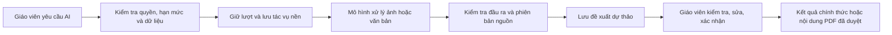
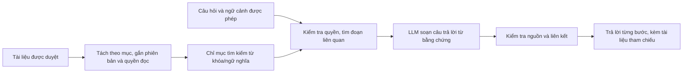
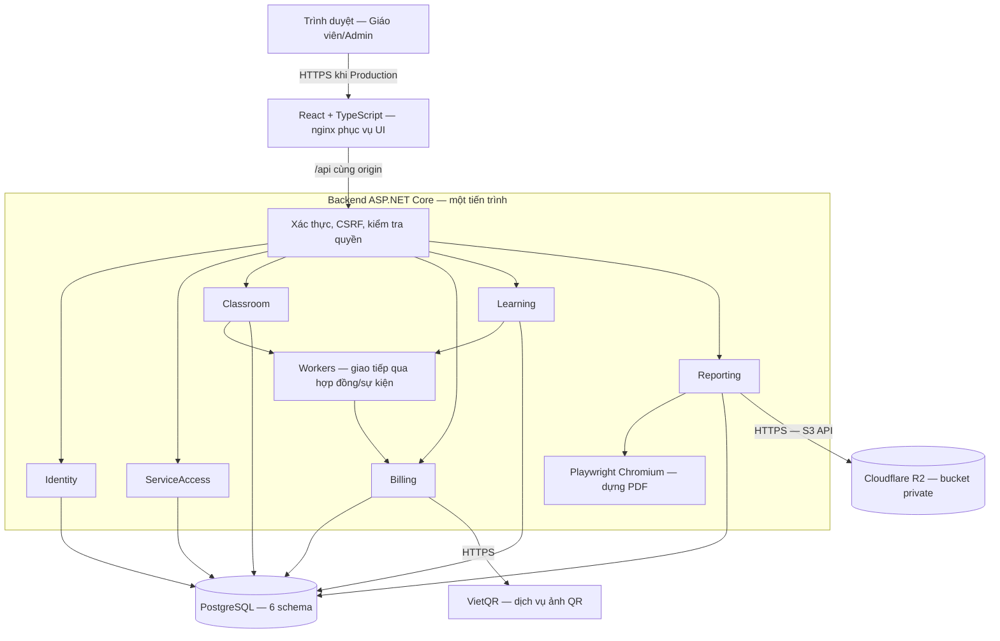
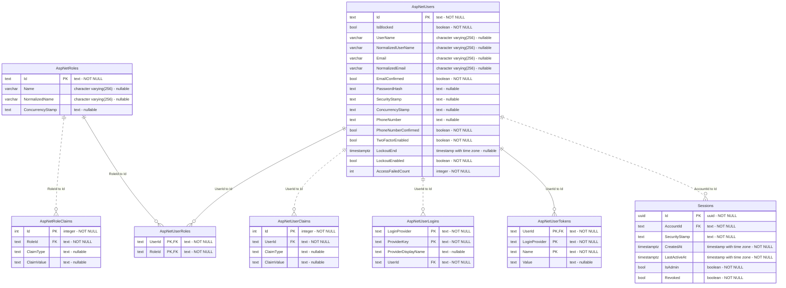
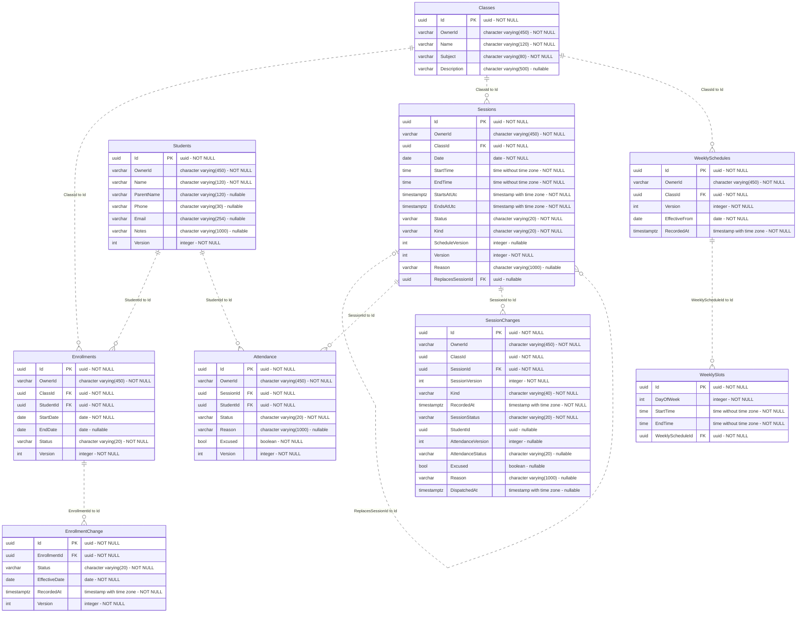
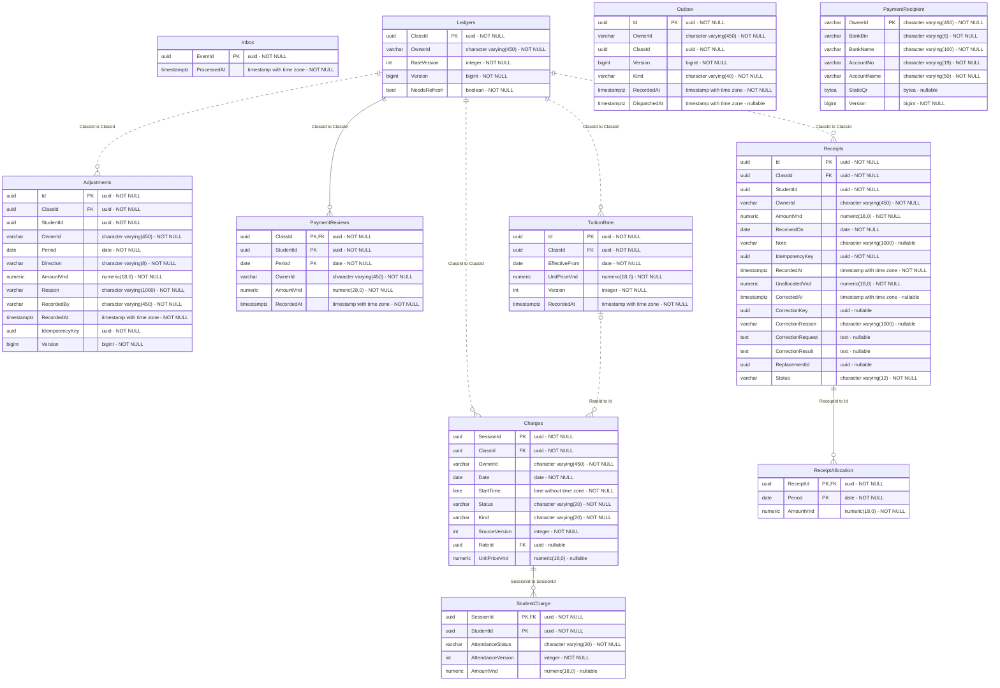
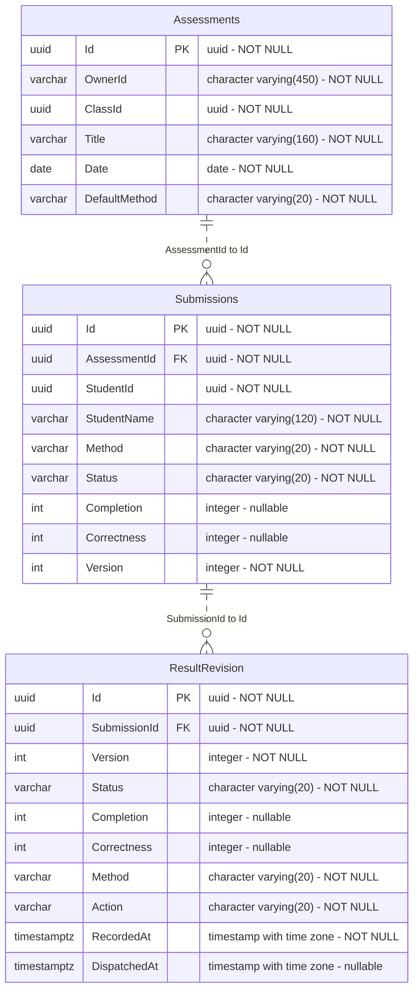
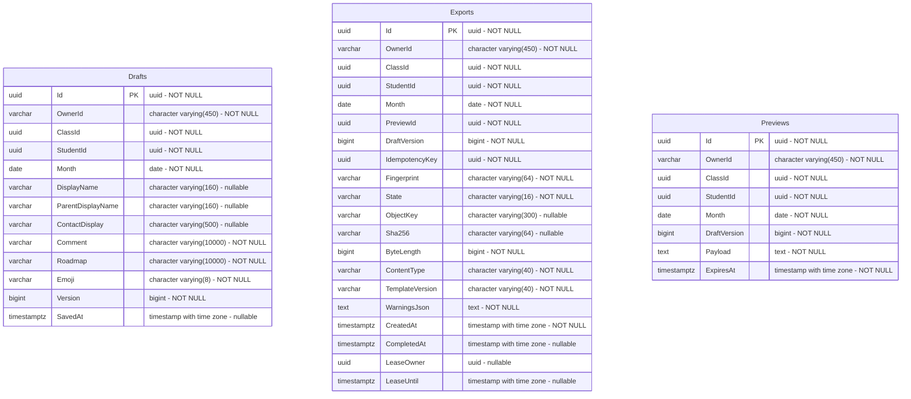
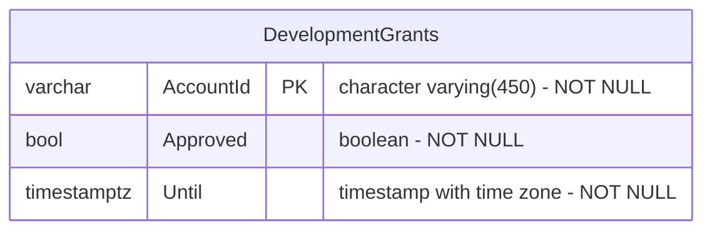

    # BÁO CÁO THÔNG ĐỒ ÁN — BUỔI 1

**Học phần:** Đồ án Phát triển ứng dụng phía máy chủ nâng cao

**Đề tài:** Education Keeptrack — Hệ thống quản lý lớp học, theo dõi học tập và học phí, định hướng tích hợp AI hỗ trợ giáo viên

**Ngày cập nhật báo cáo:** 23/10/2026

**Nội dung:** Phân tích yêu cầu, phân rã chức năng, thiết kế hệ thống và cơ sở dữ liệu; trình bày các chức năng AI, vai trò của học máy và học sâu, dữ liệu đầu vào, quy trình xử lý và phương án đánh giá.

## 1. Giới thiệu đề tài

### 1.1. Bài toán thực tế

Giáo viên dạy thêm và gia sư độc lập thường quản lý lớp, học sinh, điểm danh, kết quả học tập và học phí bằng nhiều công cụ rời rạc. Việc tổng hợp cuối tháng mất thời gian, dễ bỏ sót buổi học, tính nhầm số tiền hoặc nhầm lẫn giữa học phí phát sinh và tiền thực nhận.

Education Keeptrack tập trung các hoạt động này vào một ứng dụng web. Giáo viên theo dõi dữ liệu của mình, ghi nhận học tập và thanh toán, sau đó xuất báo cáo tháng dạng PDF để gửi phụ huynh. Các chức năng AI được thiết kế như công cụ hỗ trợ; giáo viên giữ quyền xác nhận kết quả cuối cùng.

### 1.2. Mục tiêu và phạm vi

- Quản lý lớp, học sinh, lịch dạy và điểm danh trong phạm vi riêng của từng giáo viên.
- Tính học phí theo buổi thực học và đơn giá có hiệu lực; quản lý khoản nhận tiền, phân bổ và công nợ.
- Theo dõi kết quả học tập bằng hai chỉ số hoàn thành và làm đúng độc lập.
- Tổng hợp báo cáo tháng có nội dung học tập và tài chính, lưu PDF riêng tư.
- Thiết kế AI hỗ trợ đọc ảnh bài nộp, đề xuất đánh giá, soạn nhận xét và lộ trình học tập để giáo viên kiểm tra, chỉnh sửa và xác nhận.
- Xác định hướng ứng dụng học máy trong cảnh báo học tập và học sâu trong xử lý ảnh, ngôn ngữ; phân biệt chức năng dự kiến với phần đã triển khai.
- Đáp ứng định hướng học phần: .NET Modular Monolith, DbContext/schema riêng theo module, giao tiếp liên module, object storage tương thích S3, Docker Compose và Jenkins.

### 1.3. Tác nhân và trạng thái phạm vi

| Tác nhân | Vai trò |
| --- | --- |
| Giáo viên | Quản lý lớp, học sinh, học tập, học phí và báo cáo thuộc quyền sở hữu của mình. |
| Admin | Theo thiết kế: duyệt đăng ký, đối chiếu phí dịch vụ, cấp kỳ sử dụng, quản lý khóa tài khoản và quyền AI. Không mặc định được đọc dữ liệu học sinh. |
| Phụ huynh | Nhận báo cáo PDF và hướng dẫn thanh toán từ giáo viên; không có tài khoản đăng nhập trong phạm vi đề tài hiện tại. |

## 2. Yêu cầu chức năng

| Mã | Nhóm chức năng | Hệ thống cần cung cấp | |
| --- | --- | --- | --- |
| FR-01 | Đăng nhập và phiên | Đăng nhập email/mật khẩu, đăng xuất, xác định giáo viên hiện tại, hết hạn và thu hồi phiên. |
| FR-02 | Đăng ký và quản trị dịch vụ | Xác minh email, Admin duyệt, đối chiếu phí dịch vụ, cấp/gia hạn kỳ sử dụng, khóa tài khoản, quản lý quyền AI. | 
| FR-03 | Quản lý lớp | Tạo, xem và cập nhật thông tin lớp; giới hạn truy cập theo giáo viên sở hữu. | 
| FR-04 | Quản lý học sinh | Quản lý hồ sơ, thông tin phụ huynh, đăng ký vào lớp, tình trạng theo học và lịch sử thay đổi; ngăn đăng ký đang hoạt động bị trùng. | 
| FR-05 | Lịch và buổi học | Thiết lập lịch tuần, sinh buổi, tạo học bù, ghi nhận buổi đã diễn ra/hủy; kiểm tra trùng khung giờ. | 
| FR-06 | Điểm danh | Ghi chưa điểm danh/có mặt/vắng, lý do vắng và nghỉ có phép; cho phép sửa có kiểm soát phiên bản. | 
| FR-07 | Học phí theo buổi | Lưu đơn giá hiệu lực theo ngày, tính phí buổi đã diễn ra có mặt; không tự áp giá mới vào lịch sử đã có căn cứ. | 
| FR-08 | Thu tiền và công nợ | Ghi từng khoản nhận tiền, phân bổ kỳ cũ còn nợ trước, theo dõi trả một phần, tiền chưa phân bổ và công nợ theo kỳ. | 
| FR-09 | Điều chỉnh tài chính | Điều chỉnh tăng/giảm phí có lý do; sửa/hủy giao dịch nhận tiền với lịch sử và tính lại phân bổ. | 
| FR-10 | QR và thống kê | Thiết lập người nhận tiền, tạo QR chuyển khoản, giữ hướng dẫn thủ công khi QR lỗi; thống kê tiền thực thu và số dư kỳ. | 
| FR-11 | Đánh giá thủ công | Tạo bài đánh giá, ghi hai chỉ số hoàn thành/làm đúng, phân biệt chưa đánh giá, không làm bài, không có câu đúng và không giao bài; lưu lịch sử. | 
| FR-12 | Ảnh bài và AI chấm | Upload ảnh riêng tư có thứ tự, lưu phiên bản hướng dẫn; AI đề xuất kết quả, giáo viên chỉnh/xác nhận; hỗ trợ lỗi và chấm lại. | Thiết kế mở rộng. |
| FR-13 | Xu hướng và nhận xét AI | Tổng hợp kết quả cuối, nhận biết xu hướng/cảnh báo, đề xuất nhận xét và lộ trình; không ghi đè nội dung giáo viên tự sửa. | Thiết kế mở rộng. |
| FR-14 | Báo cáo tháng PDF | Soạn nhận xét/lộ trình, xem trước, lấy dữ liệu học tập/tài chính, xuất PDF và tải có kiểm tra quyền. |  lưu PDF trên R2. |
| FR-15 | Trả trước và bảo lưu | Theo dõi nguồn tiền trả trước, duyệt bảo lưu và sử dụng đúng một lần cho kỳ sau, thể hiện trên báo cáo. | Thiết kế mở rộng. |
| FR-16 | Cập nhật báo cáo | Nhận biết bản xuất không còn khớp dữ liệu nguồn và chủ động tạo bản cập nhật, giữ lịch sử bản cũ. | Phát hiện xung đột nguồn lúc xuất đã có; luồng cập nhật PDF cũ đầy đủ là phần tiếp theo. |
| FR-17 | Chatbot hướng dẫn giáo viên | Hỏi đáp tiếng Việt, hướng dẫn thao tác theo màn hình, giải thích nghiệp vụ và lỗi thường gặp; trả lời dựa trên tài liệu đã duyệt, có dẫn nguồn. | Đề xuất bổ sung; chưa triển khai. |
| FR-18 | Khóa học và chuẩn đầu ra | Thiết kế khung khóa học, kỹ năng, chuẩn đầu ra khóa/buổi, tiêu chí đánh giá và phiên bản áp dụng cho từng lớp. | Thiết kế bổ sung; chưa triển khai. |
| FR-19 | Hồ sơ kỹ năng và lộ trình cá nhân | Ghi minh chứng theo học sinh, buổi và tiêu chí; giáo viên xác nhận mức đạt; AI đề xuất hoạt động bổ trợ và kế hoạch buổi tiếp theo. | Thiết kế bổ sung; AI phát triển sau khi hoàn tất thiết kế hệ thống. |

### 2.1. Quy tắc nghiệp vụ cốt lõi

1. Phí dịch vụ là tiền giáo viên trả để dùng phần mềm; học phí là tiền phụ huynh/học sinh trả giáo viên. Hai khoản được quản lý ở hai ngữ cảnh khác nhau.
2. Tình trạng theo học thuộc đăng ký lớp; điểm danh thuộc từng buổi. Không suy ra học sinh có mặt từ trạng thái đang học.
3. Phí học chỉ phát sinh cho buổi đã diễn ra có mặt và có đơn giá phù hợp. Dữ liệu thiếu căn cứ phải được chỉ rõ, không tự coi là tổng hoàn chỉnh.
4. Tiền nhận và phí phát sinh là hai loại dữ liệu khác nhau. Tạo hoặc quét QR không tự ghi nhận đã thanh toán.
5. Giao dịch nhận tiền và phân bổ được lưu nguyên tử; gửi lặp cùng lệnh không được tạo thêm khoản thu.
6. Hết hạn sử dụng vẫn được xem/xuất dữ liệu cũ; khóa tài khoản chặn truy cập. Chính sách hoàn chỉnh do ServiceAccess thực thi theo thiết kế.
7. AI chỉ đề xuất; kết quả cuối do giáo viên xác nhận mới dùng làm căn cứ báo cáo và phân tích.

### 2.2. Các chức năng liên quan đến AI, học máy và học sâu

AI là nhóm kỹ thuật hỗ trợ thực hiện các tác vụ như hiểu nội dung bài làm và sinh nhận xét. Học máy (Machine Learning — ML) là một hướng thuộc AI, trong đó mô hình học từ dữ liệu. Học sâu (Deep Learning — DL) là một hướng thuộc học máy, sử dụng mạng nơ-ron nhiều lớp. Việc tích hợp một mô hình đã huấn luyện để suy luận khác với tự xây dựng và huấn luyện mô hình mới.

Trong đề tài, hướng triển khai AI là tích hợp mô hình có sẵn thông qua dịch vụ phía máy chủ. Chưa chốt nhà cung cấp, mô hình cụ thể hoặc phương án tự huấn luyện. Các chức năng AI sẽ được phát triển sau khi hoàn tất thiết kế hệ thống. Hiện báo cáo mô tả yêu cầu và thiết kế dự kiến; chưa có dữ liệu kiểm thử AI, chưa có căn cứ khẳng định hệ thống đã vận hành AI thật hoặc đạt một mức độ chính xác cụ thể.

| Mã | Chức năng | Dữ liệu đầu vào | Xử lý dự kiến | Kết quả và vai trò giáo viên |
| --- | --- | --- | --- | --- |
| AI-01 | Đọc ảnh bài nộp | Ảnh có thứ tự, nội dung bài đánh giá và hướng dẫn chấm tương ứng. | Mô hình đa phương thức đọc ảnh và văn bản; có thể dùng OCR như một bước riêng nếu phương án tích hợp cần đến. | Nội dung/bằng chứng đọc được và trạng thái thiếu trang, ảnh mờ hoặc chưa đủ căn cứ; giáo viên kiểm tra nguồn. |
| AI-02 | Hỗ trợ chấm bài | Ảnh bài nộp, đề bài/đáp án/hướng dẫn chấm đã có phiên bản. | Đối chiếu bài làm với hướng dẫn, đề xuất riêng mức hoàn thành và mức làm đúng, kèm căn cứ. | Bản nháp đánh giá; giáo viên xem ảnh, sửa và xác nhận kết quả cuối. |
| AI-03 | Sinh nhận xét tháng | Điểm danh, kết quả cuối đã xác nhận, khoảng thời gian và độ đầy đủ dữ liệu. | Mô hình ngôn ngữ tổng hợp điểm mạnh, nội dung cần cải thiện và tiến bộ có căn cứ. | Nhận xét tiếng Việt có thể biên tập; chỉ nội dung giáo viên duyệt mới đưa vào PDF. |
| AI-04 | Gợi ý lộ trình học tập | Dữ liệu học tập chính thức và nội dung cần cải thiện được ghi nhận. | Đề xuất nội dung ôn tập và hoạt động hỗ trợ phù hợp với bằng chứng hiện có. | Lộ trình dự thảo để giáo viên điều chỉnh; thiếu thông tin về kỹ năng thì không tự suy ra kỹ năng yếu. |
| AI-05 | Cảnh báo học sinh cần hỗ trợ | Chuỗi kết quả cuối, điểm danh, lịch sử đủ dài và tiêu chí đã được duyệt. | Phát hiện tín hiệu cần quan tâm bằng tiêu chí minh bạch; có thể mở rộng sang mô hình ML khi có dữ liệu gán nhãn phù hợp. | Cảnh báo kèm giai đoạn, dữ liệu và lý do; giáo viên kiểm tra, ghi nhận hành động hỗ trợ. |
| AI-06 | Chatbot hướng dẫn giáo viên | Câu hỏi, ngữ cảnh màn hình được phép sử dụng và các đoạn tài liệu hướng dẫn đã duyệt. | Truy xuất tài liệu liên quan rồi dùng mô hình ngôn ngữ soạn câu trả lời tiếng Việt có dẫn nguồn. | Hướng dẫn từng bước, liên kết chức năng và giải thích nghiệp vụ; giáo viên chủ động thực hiện thao tác. |
| AI-07 | Cá nhân hóa lộ trình theo chuẩn đầu ra | Chuẩn đã duyệt, minh chứng và kết quả kỹ năng đã xác nhận, lịch sử từng buổi, tài liệu và bài tập được duyệt. | Đối chiếu từng kỹ năng với chuẩn, tổng hợp tiến bộ và đề xuất mục tiêu, nội dung ôn tập, hoạt động bổ trợ cùng cách kiểm tra lại. | Lộ trình cá nhân dự thảo cho buổi tiếp theo; giáo viên sửa và duyệt, AI không tự kết luận đạt chuẩn. |

**Phân tích xu hướng:** Biểu đồ mức hoàn thành và làm đúng theo thời gian là chức năng phân tích dữ liệu hỗ trợ AI-03 đến AI-05. Vẽ biểu đồ, tính thống kê hoặc kiểm tra ngưỡng cố định không đồng nghĩa với đã ứng dụng học máy. Hai chỉ số dùng các mức phân nhóm, không được trình bày như tỷ lệ chính xác tuyệt đối.

### 2.3. Phạm vi học máy và học sâu trong đề tài

| Hướng kỹ thuật | Ứng dụng trong hệ thống | Phạm vi đề xuất tại buổi 1 |
| --- | --- | --- |
| Thị giác máy tính và nhận dạng ký tự (OCR) | Đọc ảnh bài nộp, hỗ trợ trích xuất câu trả lời trước khi đánh giá. | Khảo sát mô hình có sẵn; cần kiểm tra khả năng đọc chữ viết tay, ký hiệu và dạng bài thực tế. OCR không tự xác định đáp án đúng. |
| Học sâu với mô hình đa phương thức | Xử lý kết hợp ảnh bài làm và hướng dẫn chấm dạng văn bản. | Tích hợp suy luận từ mô hình đã huấn luyện; không tuyên bố tự huấn luyện mạng nơ-ron. |
| Xử lý ngôn ngữ tự nhiên và mô hình ngôn ngữ lớn (LLM) | Soạn nhận xét, giải thích đề xuất và gợi ý lộ trình. | Sinh bản nháp dựa trên dữ liệu được cung cấp; không tự tạo thành tích hoặc lỗi học sinh. |
| Học máy có giám sát | Hướng mở rộng để phân loại trường hợp cần hỗ trợ từ lịch sử học tập. | Chỉ nghiên cứu triển khai khi có định nghĩa nhãn, đủ dữ liệu và bộ đánh giá được duyệt; chưa chọn thuật toán hoặc công bố độ chính xác. |
| Phân tích thống kê và luật nghiệp vụ | Tổng hợp xu hướng, kiểm tra dữ liệu thiếu và xác định tín hiệu theo tiêu chí. | Là cơ sở đối chiếu cho cảnh báo; không gọi các phép tính này là mô hình học sâu. |

Đóng góp dự kiến của đồ án phía máy chủ là xây dựng luồng tích hợp AI có kiểm soát: chuẩn bị dữ liệu, xử lý nền, kiểm tra đầu ra, quản lý phiên bản, phân quyền, hạn mức và lưu vết quyết định. Tự huấn luyện mô hình ML/DL mới chưa thuộc phạm vi đã cam kết.

### 2.4. Quy trình AI và kiểm soát kết quả

1. **Chuẩn bị dữ liệu:** Xác định chủ sở hữu, bài nộp, thứ tự ảnh, phiên bản hướng dẫn và snapshot nguồn. Sinh nhận xét chỉ dùng kết quả cuối cùng điểm danh, không gọi lại OCR hoặc chấm lại ảnh.
2. **Xử lý nền:** API trả mã tác vụ và trạng thái để giao diện theo dõi. Tác vụ cần lưu bền để theo dõi và phục hồi khi dịch vụ gián đoạn.
3. **Kiểm tra đầu ra:** Phản hồi phải đúng cấu trúc, có dữ liệu hợp lệ và đủ căn cứ. Mức đề xuất được quy đổi theo quy tắc nghiệp vụ đã đặc tả. Ảnh mờ, thiếu trang hoặc phản hồi không chắc chắn phải được báo rõ, không tự ghi thành điểm 0.
4. **Kiểm soát phiên bản:** Lưu nguồn ảnh, hướng dẫn, phiên bản mô hình/cấu hình và kết quả AI gốc riêng với phần giáo viên chỉnh sửa. Kết quả về muộn cho nguồn cũ không được ghi đè bản hiện hành.
5. **Giáo viên phê duyệt:** Kết quả chấm chưa xác nhận không dùng làm dữ liệu chính thức. AI không tự gửi nhận xét hoặc cảnh báo cho phụ huynh. Khi AI lỗi, giáo viên vẫn chấm, viết nhận xét và xuất PDF thủ công.
6. **Quyền và hạn mức:** Quyền AI độc lập quyền dùng phần mềm; chấm bài và sinh nhận xét có hạn mức riêng. Giữ lượt khi nhận tác vụ, trừ khi thành công, hoàn khi lỗi/hủy và không trừ lặp. Tắt AI hoặc hết hạn cho tác vụ đã nhận hoàn tất bản nháp; khóa tài khoản vô hiệu kết quả về muộn. Đơn vị tính lượt cảnh báo AI chưa chốt.

### 2.5. Dữ liệu, đánh giá chất lượng và giới hạn

**Bộ dữ liệu đánh giá dự kiến:** Thu thập bộ bài mẫu được phép sử dụng, có ảnh nguồn, hướng dẫn chấm và kết quả giáo viên xác nhận. Cần có các trường hợp đủ/thiếu trang, ảnh mờ, không làm bài, không có câu đúng và bài hoàn thành một phần. Trước tích hợp thật phải chốt môn học, dạng bài, nhà cung cấp và tiêu chí nghiệm thu.

| Thành phần | Nội dung đánh giá dự kiến |
| --- | --- |
| Đọc ảnh | Đối chiếu nội dung trích xuất với bản kiểm tra thủ công; ghi nhận ảnh hưởng của chất lượng ảnh và chữ viết tay. |
| Đề xuất đánh giá | Đo tỷ lệ trùng mức với giáo viên cho từng chỉ số, các trường hợp đề xuất quá cao/quá thấp và khả năng nhận biết thiếu căn cứ. |
| Nhận xét và lộ trình | Kiểm tra tính đúng dữ liệu, mức phù hợp của đề xuất, ngôn ngữ và mức độ giáo viên cần biên tập. |
| Cảnh báo ML nếu triển khai | Đánh giá precision/recall đối với nhãn cần hỗ trợ đã thống nhất; xem xét cả báo động nhầm và bỏ sót. Tách dữ liệu huấn luyện/đánh giá để hạn chế rò rỉ theo học sinh và thời gian. |
| Luồng phía máy chủ | Kiểm tra lệnh lặp, phục hồi tác vụ, thay đổi nguồn, giới hạn quyền, hoàn/trừ lượt và việc không ghi đè bản giáo viên sửa. |

Chưa đặt ngưỡng nghiệm thu, số lượng mẫu hoặc độ chính xác khi chưa có thống nhất và thực nghiệm. Kiểm thử bằng phản hồi AI mô phỏng chỉ chứng minh luồng phần mềm, không chứng minh chất lượng mô hình thật.

Ảnh bài nộp và dữ liệu học tập phải được lưu riêng tư, kiểm tra quyền trước truy cập. Trước khi gửi dữ liệu đến nhà cung cấp AI cần xác định phạm vi dữ liệu cần thiết, loại bỏ thông tin nhận diện không cần dùng và làm rõ chính sách lưu giữ, sử dụng dữ liệu của nhà cung cấp. Mô hình có thể đọc sai chữ viết tay hoặc sinh nội dung thiếu căn cứ; do đó giáo viên luôn giữ quyền quyết định cuối cùng.

### 2.6. Chatbot AI hướng dẫn giáo viên

**Mục tiêu:** Cung cấp trợ lý hỏi đáp ngay trong ứng dụng để giáo viên nhanh chóng tìm cách sử dụng phần mềm, hiểu quy tắc nghiệp vụ và xử lý tình huống thường gặp. Đây là chức năng đề xuất bổ sung cho báo cáo buổi 1, chưa có trong phần triển khai hiện tại.

#### 2.6.1. Các tính năng cần có

| Mã | Tính năng | Yêu cầu cụ thể |
| --- | --- | --- |
| CB-01 | Hỏi đáp tiếng Việt | Hiểu câu hỏi tự nhiên và lỗi gõ phổ biến; hỏi lại khi chưa rõ chức năng, kỳ hoặc tình huống cần hỗ trợ. |
| CB-02 | Hướng dẫn bắt đầu | Hướng dẫn theo trình tự tạo lớp → thêm học sinh → thiết lập lịch → điểm danh → đánh giá → học phí → báo cáo tháng. |
| CB-03 | Hướng dẫn theo màn hình | Khi giáo viên cho phép dùng ngữ cảnh, tiếp nhận mã màn hình và chức năng đang mở để chỉ đúng nút, trường nhập và bước tiếp theo; không tự đọc toàn bộ dữ liệu hiển thị. |
| CB-04 | Giải thích nghiệp vụ | Giải thích phí phát sinh, tiền thực nhận, công nợ, phân bổ thanh toán, hai chỉ số đánh giá, quyền sử dụng và quyền AI bằng ví dụ đã được duyệt. |
| CB-05 | Hỗ trợ lỗi thường gặp | Tra cứu mã lỗi, nguyên nhân được tài liệu xác nhận và bước khắc phục; nhắc kiểm tra lịch sử trước khi nhập lại khoản thu khi chưa rõ kết quả lưu. |
| CB-06 | Trả lời có dẫn nguồn | Hiện tên tài liệu, mục hướng dẫn, phiên bản và liên kết nguồn; phân biệt chức năng đã có với chức năng dự kiến. |
| CB-07 | Hội thoại nhiều lượt | Giữ ngữ cảnh trong phiên, cho phép bắt đầu cuộc trò chuyện mới; hỏi làm rõ thay vì tự suy đoán dữ liệu thiếu. |
| CB-08 | Phản hồi chất lượng | Cho phép đánh dấu hữu ích/chưa đúng và ghi lý do; ghi nhận câu hỏi chưa được giải đáp để bổ sung tài liệu sau khi người phụ trách duyệt. |
| CB-09 | Xử lý thiếu căn cứ | Thông báo chưa tìm được hướng dẫn phù hợp, đưa liên kết trợ giúp hoặc kênh hỗ trợ được cấu hình; không tự tạo chính sách hay nút chức năng. |

Phạm vi ban đầu là hỏi đáp và điều hướng. Chatbot không tự sửa điểm danh, xác nhận đánh giá, ghi nhận thanh toán, cấp quyền hoặc gửi báo cáo. Nếu mở rộng sang hỏi dữ liệu cá nhân như “học sinh nào còn nợ tháng này”, backend phải gọi API nghiệp vụ chỉ đọc, kiểm tra quyền giáo viên và lấy số liệu chính thức; không để mô hình tự truy vấn SQL hoặc suy ra số tiền từ hội thoại.

#### 2.6.2. Tài liệu cần chuẩn bị để AI đọc và trả lời

Kho tri thức cần chứa tài liệu hướng đến giáo viên, được duyệt theo phiên bản sản phẩm. Các tài liệu kỹ thuật hiện có là nguồn để biên soạn và kiểm chứng hướng dẫn; không mặc định đưa toàn bộ mã nguồn, đặc tả nội bộ hoặc dữ liệu thật vào chatbot.

| Nhóm tài liệu | Nội dung cần có | Nguồn hiện có hoặc việc cần bổ sung |
| --- | --- | --- |
| Hướng dẫn bắt đầu | Đăng nhập, tạo lớp đầu tiên, thêm học sinh, lịch tuần và quy trình làm việc cuối tháng. | Cần biên soạn tài liệu dành cho giáo viên, đối chiếu UI và chức năng đã triển khai. |
| Hướng dẫn từng chức năng | Điều kiện trước thao tác, các bước, trường bắt buộc, kết quả sau lưu và cách kiểm tra lịch sử. | Biên soạn từ hành vi API/UI đã xác nhận và các hướng dẫn chức năng trong `README.md`. |
| Từ điển nghiệp vụ | Định nghĩa buổi học, điểm danh, tình trạng theo học, phí dịch vụ, học phí, công nợ, quyền AI và hạn mức AI. | Dùng `GLOSSARY.md` làm nguồn thuật ngữ; diễn đạt lại cho người sử dụng khi cần. |
| Quy tắc học phí và thanh toán | Điều kiện phát sinh phí, đơn giá hiệu lực, phân bổ tiền, điều chỉnh, tiền giữ đối chiếu và giới hạn của QR. | Đối chiếu đặc tả nghiệp vụ, ADR `0004-billing-effective-rates.md` và chức năng thực tế; bổ sung ví dụ số liệu giả lập. |
| Hướng dẫn đánh giá và AI | Hai chỉ số độc lập, bản nháp/kết quả cuối, ảnh đầu vào, cách giáo viên kiểm tra đề xuất và xử lý AI lỗi. | Biên soạn từ đặc tả học tập; gắn nhãn rõ phần đã có và phần dự kiến. |
| Hướng dẫn báo cáo PDF | Nhập nhận xét/lộ trình, xem trước, xuất, tải và xử lý khi dữ liệu nguồn thay đổi. | Đối chiếu luồng Reporting hiện có, `README.md` và hướng dẫn UI. |
| Chính sách tài khoản và dịch vụ | Quyền đọc/ghi, hết hạn, khóa tài khoản, quyền AI và hạn mức áp dụng. | Đối chiếu ADR `0003-service-access-and-ai.md`; chỉ công bố điều kiện/gói đã được duyệt, không suy diễn chính sách chưa chốt. |
| Danh mục lỗi và FAQ | Thông báo lỗi thực tế, mã lỗi, nguyên nhân, cách thử lại an toàn và khi nào cần hỗ trợ. | Cần biên soạn từ lỗi API/UI và tình huống kiểm thử đã xác nhận. |
| Danh mục màn hình và liên kết | Tên màn hình, nhãn nút, đường dẫn hợp lệ, quyền cần có và phiên bản bắt đầu hỗ trợ. | Cần lập từ UI thực tế để chatbot điều hướng đúng, không tự tạo đường dẫn. |
| Ghi chú phiên bản | Chức năng đã phát hành, thay đổi thao tác, hướng dẫn thay thế và phần chưa hỗ trợ. | Cần duy trì khi phát hành để loại bỏ hướng dẫn lỗi thời. |
| Chính sách dữ liệu và hỗ trợ | Dữ liệu được gửi AI, thời gian lưu hội thoại, cách xóa và kênh liên hệ hỗ trợ. | Cần được người phụ trách phê duyệt trước khi vận hành; chưa coi nội dung này là chính sách đã ban hành. |

Mỗi tài liệu cần có mã, tiêu đề, người duyệt, trạng thái duyệt, phiên bản sản phẩm, ngày hiệu lực, đối tượng được đọc và liên kết nguồn. Tài liệu ví dụ dùng dữ liệu giả lập. Không nạp `.env`, mật khẩu, khóa API, chuỗi kết nối, cookie, thông tin tài khoản ngân hàng thật hoặc hồ sơ học sinh vào kho hướng dẫn chung.

#### 2.6.3. Cách AI đọc tài liệu và hình thành câu trả lời

Đề xuất cơ chế RAG (Retrieval-Augmented Generation): hệ thống tìm các đoạn tài liệu phù hợp với câu hỏi, sau đó cung cấp các đoạn đó cho mô hình để soạn câu trả lời. Tài liệu được tra cứu tại thời điểm trả lời; việc cập nhật tài liệu không đồng nghĩa với huấn luyện lại mô hình.

Backend lọc tài liệu theo quyền, trạng thái đã duyệt và phiên bản sản phẩm trước khi chuyển nội dung sang mô hình. Có thể kết hợp từ khóa với biểu diễn ngữ nghĩa bằng embedding; công nghệ lưu chỉ mục chưa được chốt. Khi tài liệu mâu thuẫn, hết hiệu lực hoặc không đủ bằng chứng, chatbot phải nêu giới hạn và yêu cầu làm rõ hoặc chuyển hỗ trợ.

Nội dung được truy xuất được xử lý như dữ liệu tham khảo, không phải lệnh thay đổi quyền hoặc yêu cầu hệ thống. Hội thoại của giáo viên không tự trở thành tài liệu chuẩn. Việc lưu lịch sử, thời hạn lưu, chính sách quyền AI và cách tính lượt chatbot cần được thống nhất riêng trước triển khai; không tự dùng hạn mức chấm bài hoặc sinh nhận xét cho chatbot. Chính sách này sẽ cần bổ sung vào thiết kế ServiceAccess, hiện chưa được ADR về quyền AI quy định.

**Ví dụ câu trả lời mong đợi:** Với câu hỏi “Tạo QR rồi thì học sinh đã được tính là đóng tiền chưa?”, chatbot giải thích rằng tạo hoặc quét QR chưa ghi nhận thanh toán, hướng dẫn giáo viên kiểm tra tiền thực nhận và dùng chức năng ghi nhận khoản thu, kèm liên kết hướng dẫn thanh toán đúng phiên bản.

#### 2.6.4. Tiêu chí đánh giá chatbot

Cá nhân hoá học tại

Bộ câu hỏi nghiệm thu cần bao phủ hướng dẫn cơ bản, câu hỏi nhiều lượt, lỗi gõ, lỗi lưu chưa rõ kết quả, tài liệu lỗi thời, câu hỏi ngoài phạm vi và yêu cầu truy cập dữ liệu giáo viên khác. Đánh giá độ đúng của câu trả lời, nguồn có thực sự hỗ trợ nội dung hay không, liên kết điều hướng, khả năng nhận biết thiếu căn cứ, thời gian phản hồi và chi phí. Cần kiểm tra việc loại bỏ tài liệu đã thu hồi khỏi chỉ mục và khả năng chống yêu cầu bỏ qua phân quyền hoặc tiết lộ bí mật. Ngưỡng nghiệm thu được thống nhất sau khi có bộ câu hỏi đã duyệt; chưa công bố chất lượng chatbot khi chưa thực nghiệm.

### 2.7. AI cá nhân hóa học tập và đánh giá chuẩn đầu ra

#### 2.7.1. Mục tiêu và nguyên tắc thiết kế

Chức năng giúp giáo viên trả lời bốn câu hỏi cho từng học sinh: đang đạt những kỹ năng nào, nội dung nào cần cải thiện, tiến bộ ra sao qua từng buổi và buổi tiếp theo nên học hoặc luyện gì. Mỗi nhận định phải có minh chứng đối chiếu được; hai chỉ số tổng hợp hoàn thành/làm đúng hiện tại không đủ để tự suy ra điểm yếu theo kỹ năng.

Thiết kế hướng đến nhiều môn học, nhưng môn, trình độ và khóa học dùng nghiệm thu sẽ được xác định khi có dữ liệu phù hợp. Hiện chưa có bộ dữ liệu kiểm thử; việc thu thập, gán nhãn và đánh giá chất lượng AI sẽ bổ sung sau. Các thuật ngữ khóa học, kỹ năng và chuẩn đầu ra dưới đây là khái niệm đề xuất, chưa phải mô hình dữ liệu đã triển khai.

#### 2.7.2. Khung khóa học, kỹ năng và chuẩn đầu ra

| Thành phần | Thiết kế đã thống nhất |
| --- | --- |
| Khung khóa học | Danh sách nội dung, kỹ năng và chuẩn đầu ra; một khung có thể áp dụng cho nhiều lớp. Lớp là nhóm học sinh học theo một phiên bản khung cụ thể. |
| Kỹ năng | Có mã định danh ổn định, mô tả rõ; có thể được dạy, luyện và đánh giá qua nhiều buổi để theo dõi tiến bộ xuyên suốt khóa. |
| Chuẩn đầu ra khóa học | Nêu học sinh làm được gì khi kết thúc khóa, minh chứng cần có và tiêu chí đạt; chỉ rõ các tiêu chí bắt buộc. Giáo viên thiết lập hoặc duyệt trước khi áp dụng. |
| Chuẩn đầu ra buổi học | Chọn các chuẩn/kỹ năng thuộc khung khóa sẽ dạy và đánh giá trong buổi, kèm hoạt động kiểm tra và tiêu chí tương ứng. |
| Thang đánh giá | Mỗi tiêu chí có mô tả cho các mức chưa đạt, đạt, vượt yêu cầu; chưa đủ bằng chứng là trạng thái riêng, không phải mức chưa đạt. |
| Phiên bản áp dụng | Mỗi lớp giữ phiên bản khung và tiêu chí đã áp dụng. Sửa khung sau này không tự thay đổi chuẩn hoặc kết quả lịch sử. |

AI có thể hỗ trợ soạn chuẩn và tiêu chí ở dạng bản nháp. Giáo viên phải kiểm tra tính phù hợp, khả năng đo lường và duyệt trước khi sử dụng. Không mặc định tham gia đủ buổi hoặc có điểm tổng cao là đạt chuẩn.

#### 2.7.3. Dữ liệu và đánh giá sau từng buổi

Giáo viên cung cấp bài làm, kết quả từng câu hỏi hoặc quan sát học tập, gắn với học sinh, buổi học, kỹ năng và tiêu chí cụ thể. Hệ thống cần lưu nguồn minh chứng, thời điểm, phiên bản tiêu chí, người xác nhận và lịch sử thay đổi. Các mức đánh giá kỹ năng bổ sung cho hai chỉ số hiện tại, không tự thay thế hoặc quy đổi hai chỉ số đó thành mức đạt chuẩn.

AI hỗ trợ tổng hợp minh chứng và đề xuất đánh giá. Giáo viên xác nhận trước khi kết quả được dùng chính thức trong hồ sơ kỹ năng, phân tích và báo cáo. Vắng học, chưa được đánh giá hoặc thiếu bài không tự chuyển thành kết luận chưa đạt kỹ năng. Với học sinh mới hoặc kỹ năng thiếu bằng chứng, hệ thống đề xuất đánh giá đầu vào hay hoạt động kiểm tra bổ sung.

Ví dụ minh họa, không phải dữ liệu thực nghiệm: học sinh thực hiện phép tính đúng nhưng lập phương trình chưa phù hợp ở những câu đã được giáo viên kiểm tra. Hệ thống cần thể hiện riêng hai kỹ năng và liên kết đến câu trả lời tương ứng; không kết luận học sinh yếu toàn bộ môn từ một chỉ số tổng hợp.

#### 2.7.4. Quy trình đề xuất lộ trình cá nhân

1. Giáo viên xác nhận kết quả đánh giá buổi học theo từng tiêu chí.
2. Giáo viên chủ động yêu cầu AI tạo hoặc cập nhật lộ trình. Backend lấy chuẩn áp dụng, minh chứng đã xác nhận và lịch sử liên quan trong phạm vi giáo viên có quyền.
3. AI đối chiếu bằng chứng với chuẩn, mô tả tiến bộ và nội dung cần cải thiện; thiếu căn cứ phải nêu rõ và đề xuất kiểm tra bổ sung.
4. AI tạo bản nháp gồm mục tiêu tiếp theo, phần cần ôn, hoạt động/bài tập bổ trợ, nguồn tài liệu, thứ tự thực hiện và cách kiểm tra lại.
5. Giáo viên sửa, duyệt và quyết định giao hoạt động nào. Học sinh trong cùng lớp giữ mục tiêu chung, có phần hỗ trợ riêng; AI cũng có thể đề xuất điều chỉnh bài dạy chung để giáo viên cân nhắc.
6. Buổi sau bổ sung minh chứng mới để kiểm tra hiệu quả và cập nhật hồ sơ tiến bộ. Khi dữ liệu nguồn thay đổi, đánh dấu đề xuất cần cập nhật; không tự ghi đè phần giáo viên đã sửa hoặc áp dụng kết quả về muộn cho nguồn cũ.

Ưu tiên chọn nội dung từ tài liệu và kho bài tập giáo viên cung cấp hoặc duyệt, có gắn kỹ năng và chuẩn liên quan. Nếu sinh bài mới, AI phải đánh dấu bản nháp, kèm đáp án và tiêu chí đánh giá để giáo viên kiểm tra trước khi giao. Gợi ý tài liệu đơn thuần không đủ thay thế một kế hoạch có mục tiêu và cách đo kết quả.

#### 2.7.5. Đánh giá cuối khóa và báo cáo

Kết quả cuối khóa được tổng hợp theo quy tắc giáo viên duyệt, xét riêng từng chuẩn và các tiêu chí bắt buộc; có thể yêu cầu bài đánh giá cuối khóa. Không lấy trung bình kết quả các buổi để che lấp kỹ năng bắt buộc chưa đạt. Quy tắc cần nêu rõ bằng chứng nào được sử dụng và cách xử lý khi bằng chứng giữa các lần đánh giá khác nhau; không để AI tự đặt quy tắc tổng hợp.

Giáo viên xem hồ sơ gồm chuẩn áp dụng, mức hiện tại, minh chứng, lịch sử tiến bộ, điểm cần cải thiện và kế hoạch đã duyệt. PDF gửi phụ huynh chỉ chứa nội dung giáo viên đã duyệt; không đưa nhận định hoặc cảnh báo AI chưa xác nhận. AI không tự thay đổi kết quả chính thức hay quyết định học sinh đạt chuẩn buổi/khóa.

#### 2.7.6. Phụ thuộc thiết kế và lộ trình phát triển

Hiện bài đánh giá mới gắn lớp và ngày, buổi học chưa chứa mục tiêu học tập, chưa có mô hình khóa học hay đánh giá theo kỹ năng. Trước khi phát triển AI cần thiết kế liên kết bài đánh giá–buổi học, khung khóa học có phiên bản, chuẩn/tiêu chí, minh chứng, kết quả xác nhận và lộ trình. Các module trao đổi qua hợp đồng hoặc sự kiện, kiểm tra quyền theo giáo viên và không đọc trực tiếp bảng của module khác.

| Giai đoạn | Nội dung và điều kiện |
| --- | --- |
| 1. Hoàn tất thiết kế hệ thống | Chốt mô hình nghiệp vụ, giao diện, cơ sở dữ liệu, hợp đồng liên module, phiên bản và quy trình giáo viên duyệt. Đây là phạm vi bổ sung vào báo cáo hiện tại. |
| 2. Xây dựng nền tảng dữ liệu | Phát triển quản lý khóa/chuẩn, ghi nhận minh chứng, đánh giá kỹ năng và kế hoạch thủ công để quy trình dùng được độc lập với AI. |
| 3. Phát triển các chức năng AI | Sau khi thiết kế hệ thống hoàn tất, tích hợp AI theo các luồng đã duyệt; chọn nhà cung cấp/mô hình và xác định quyền, hạn mức cho tác vụ cá nhân hóa trước vận hành. Không tự dùng lượt chấm bài hoặc nhận xét tháng cho loại tác vụ mới. |
| 4. Bổ sung dữ liệu và nghiệm thu | Khi có dữ liệu được phép sử dụng, chọn môn/trình độ/khóa mẫu, chuẩn bị minh chứng và đánh giá giáo viên làm đối chiếu, rồi đo chất lượng đề xuất. Không công bố độ chính xác khi chưa có kết quả thực nghiệm. |

Kiểm thử bằng dữ liệu giả lập trước đó chỉ xác nhận luồng xử lý, phân quyền, phiên bản và phê duyệt. Nghiệm thu AI thật cần đánh giá tính đúng căn cứ, mức phù hợp với chuẩn và trình độ, tính khả thi của hoạt động, khả năng nhận biết thiếu dữ liệu và mức giáo viên cần chỉnh sửa. Thiết kế này không cam kết tự huấn luyện mô hình học máy hoặc học sâu mới.

## 3. Yêu cầu phi chức năng

| Mã | Nhóm yêu cầu | Nội dung |
| --- | --- | --- |
| NFR-01 | Bảo mật | Người dùng phải đăng nhập và chỉ được truy cập dữ liệu thuộc quyền của mình. Mật khẩu và thông tin kết nối phải được bảo vệ. |
| NFR-02 | Hiệu năng | Các thao tác xem, thêm và sửa dữ liệu cần phản hồi nhanh. Khi xuất PDF hoặc xử lý AI, giao diện phải thông báo đang xử lý hoặc có lỗi. |
| NFR-03 | Độ chính xác | Học phí, khoản thu và công nợ phải được tính đúng; gửi lại cùng một yêu cầu không được tạo dữ liệu hoặc tính tiền trùng. |
| NFR-04 | Dễ sử dụng | Giao diện tiếng Việt, bố cục rõ ràng, thông báo dễ hiểu và sử dụng được trên máy tính lẫn điện thoại. |
| NFR-05 | Độ tin cậy | Dữ liệu đã lưu phải được giữ sau khi khởi động lại. Khi dịch vụ QR hoặc lưu file gặp lỗi, hệ thống cần thông báo và cho phép thử lại. |
| NFR-06 | Chất lượng báo cáo | PDF phải hiển thị rõ tiếng Việt, đúng học sinh và số liệu, không bị mất nội dung khi có nhiều trang. |
| NFR-07 | Sao lưu và phục hồi | Cần có phương án sao lưu và khôi phục dữ liệu nghiệp vụ cùng các file báo cáo khi xảy ra sự cố. |
| NFR-08 | Bảo trì và mở rộng | Mã nguồn được chia theo module để dễ sửa lỗi, bổ sung chức năng và triển khai hệ thống. |

## 4. Sơ đồ phân rã chức năng

Đây là sơ đồ toàn bộ phạm vi sản phẩm. Các nhánh AI, ảnh bài nộp, bảo lưu và quản trị dịch vụ đầy đủ là chức năng dự kiến, không được hiểu là đều đã hoàn thành.

```mermaid
flowchart TB
    ROOT["Education Keeptrack"]
    ROOT --> ID["1. Tài khoản và dịch vụ"]
    ROOT --> CL["2. Lớp và học sinh"]
    ROOT --> AT["3. Lịch và điểm danh"]
    ROOT --> BI["4. Học phí và thanh toán"]
    ROOT --> LE["5. Học tập và đánh giá"]
    ROOT --> RE["6. Báo cáo và phân tích"]

    ID --> ID1["1.1 Đăng nhập, đăng xuất, phiên"]
    ID --> ID2["1.2 Đăng ký, xác minh, khôi phục"]
    ID --> ID3["1.3 Duyệt, gia hạn, khóa tài khoản"]
    ID --> ID4["1.4 Quyền và hạn mức AI"]
    CL --> CL1["2.1 Quản lý lớp"]
    CL --> CL2["2.2 Hồ sơ học sinh, phụ huynh"]
    CL --> CL3["2.3 Đăng ký và tình trạng theo học"]
    AT --> AT1["3.1 Lịch tuần và sinh buổi"]
    AT --> AT2["3.2 Học bù, hủy, xác nhận đã học"]
    AT --> AT3["3.3 Điểm danh và nhắc còn thiếu"]
    BI --> BI1["4.1 Đơn giá và phí theo buổi"]
    BI --> BI2["4.2 Nhận tiền, phân bổ, công nợ"]
    BI --> BI3["4.3 Điều chỉnh, sửa/hủy khoản thu"]
    BI --> BI4["4.4 QR và thống kê tài chính"]
    BI --> BI5["4.5 Trả trước và bảo lưu"]
    LE --> LE1["5.1 Bài đánh giá và tự chấm"]
    LE --> LE2["5.2 Ảnh bài và hướng dẫn chấm"]
    LE --> LE3["5.3 AI chấm, sửa, xác nhận"]
    LE --> LE4["5.4 Thử lại, chấm lại, lịch sử"]
    LE --> LE5["5.5 Khung khóa học, kỹ năng và chuẩn đầu ra"]
    LE --> LE6["5.6 Minh chứng và đánh giá theo buổi/khóa"]
    LE --> LE7["5.7 Lộ trình cá nhân và giáo viên phê duyệt"]
    RE --> RE1["6.1 Nhận xét và lộ trình"]
    RE --> RE2["6.2 Xem trước, xuất/tải PDF"]
    RE --> RE3["6.3 Xu hướng và cảnh báo"]
    RE --> RE4["6.4 Nhận biết báo cáo cần cập nhật"]
    ROOT --> HELP["7. Chatbot hướng dẫn giáo viên — dự kiến"]
    HELP --> HELP1["7.1 Hỏi đáp và hướng dẫn theo màn hình"]
    HELP --> HELP2["7.2 Tra cứu tài liệu đã duyệt, dẫn nguồn"]
    HELP --> HELP3["7.3 Giải thích lỗi và tiếp nhận phản hồi"]
```

## 5. Thiết kế hệ thống

### 5.1. Kiến trúc tổng thể

Hệ thống chọn Modular Monolith: các module cùng chạy trong một backend, có ranh giới nghiệp vụ và dữ liệu riêng. Kiến trúc này phù hợp quy mô đồ án và khả năng triển khai trên một máy chủ, đồng thời giữ đường mở rộng theo module.

### 5.2. Thành phần và công nghệ

| Thành phần | Công nghệ | Vai trò |
| --- | --- | --- |
| UI | React, TypeScript, Vite | Hiển thị nghiệp vụ, gọi API, giữ bản nhập khi lỗi. Vite phục vụ phát triển; nginx phục vụ bản build. |
| API/backend | .NET 10, ASP.NET Core | Host các module, xác thực, phân quyền và xử lý nghiệp vụ. |
| ORM | Entity Framework Core, Npgsql | Ánh xạ dữ liệu PostgreSQL, giao dịch và migrations theo module. |
| Database | PostgreSQL 18 | Dữ liệu nghiệp vụ, phiên, metadata, inbox/outbox. |
| File storage | Cloudflare R2 qua AWSSDK.S3 | Giữ PDF riêng tư; ảnh bài nộp là phần mở rộng. |
| PDF | Microsoft.Playwright và Chromium | Dựng PDF từ HTML phía server. |
| Xác thực | ASP.NET Core Identity, cookie HttpOnly, CSRF | Tài khoản và phiên, kiểm tra yêu cầu ghi. |
| Triển khai | Docker, Docker Compose, nginx | Đóng gói backend/UI/database, mạng và volume. |
| CI | Jenkins | Build, kiểm thử và lưu kết quả; tích hợp R2 CI còn ở ticket #29 tại mốc này. |
| Quản lý mã nguồn | Git/GitHub và GitHub Issues | Lưu mã, đặc tả, ticket và phụ thuộc công việc. |

Mỗi module tổ chức Domain, Application và Infrastructure; API ánh xạ yêu cầu vào ca sử dụng. Hợp đồng dùng chung nằm trong Contracts. Module không đọc trực tiếp schema của module khác và không tạo FK xuyên schema.

### 5.3. Luồng tương tác điển hình

**Điểm danh → học phí:** Classroom lưu thay đổi điểm danh cùng sự kiện trong outbox. Worker chuyển sự kiện qua hợp đồng đến Billing; Billing kiểm tra phiên bản và inbox, cập nhật phí trong giao dịch. Giao nhận lại không được cộng phí hai lần.

**Thu tiền:** API kiểm tra giáo viên, lớp, học sinh, số tiền, phiên bản và idempotency key. Billing ghi giao dịch, phân bổ và phiên bản sổ cái trong cùng giao dịch; gửi lại cùng lệnh trả kết quả đã lưu.

**Xuất PDF:** Reporting lấy snapshot nguồn qua hợp đồng, dựng HTML/PDF, upload R2 rồi lưu metadata ready. Khi tải, API kiểm tra owner, phiên, quyền và token trước khi đọc R2. PostgreSQL giữ thông tin về file; R2 giữ nội dung file.

### 5.4. Hạ tầng, dữ liệu bền vững và phục hồi

Compose khởi động theo chuỗi: PostgreSQL healthy → tác vụ migrate thành công → backend → nginx/UI. R2 là dịch vụ ngoài, không thuộc depends_on. R2 lỗi chỉ ảnh hưởng thao tác file; PostgreSQL lỗi ảnh hưởng phần lớn nghiệp vụ.

Volume `postgres-data` giữ dữ liệu database; `session-keys` giữ khóa Data Protection bảo vệ cookie/token. Các object R2 độc lập với volume Docker. Khôi phục cần cả metadata và object tương ứng; không coi volume là bản backup.

nginx hiện lắng nghe HTTP trong cấu hình repo; Production phải có điểm kết thúc HTTPS phù hợp. Cấu hình R2 và database lấy từ môi trường, không chứa secrets trong báo cáo. SeaweedFS không còn trong Compose đích, nhưng dữ liệu cũ chỉ được ngừng/xóa sau quy trình chuyển đổi #30.

## 6. Thiết kế cơ sở dữ liệu

### 6.1. Lựa chọn mô hình và nguyên tắc

Chọn cơ sở dữ liệu quan hệ PostgreSQL do nghiệp vụ có nhiều quan hệ lớp–học sinh–buổi học, ràng buộc phiên bản và giao dịch tài chính. Không sử dụng NoSQL document trong phạm vi hiện tại. R2 là object storage, không thay thế database nghiệp vụ.

- Một database, sáu schema độc lập theo trách nhiệm module, mỗi schema có DbContext và migrations riêng.
- `OwnerId` tham chiếu định danh giáo viên về mặt nghiệp vụ; không phải FK xuyên schema đến Identity.
- Các ID liên module như `StudentId`, `ClassId`, `SessionId` được kiểm tra qua hợp đồng; chỉ đánh dấu FK trên ERD khi có ràng buộc vật lý thật.
- UUID dùng cho nhiều định danh nghiệp vụ; Identity dùng chuỗi định danh theo cấu hình ASP.NET Core Identity.
- Ngày buổi học/kỳ học phí dùng kiểu date theo nghiệp vụ Việt Nam; các thời điểm sự kiện dùng kiểu timestamp phù hợp với mapping hiện có.
- Tiền lưu numeric có độ chính xác, không dùng số thực; khóa ghép dùng cho các dòng thuộc buổi, phân bổ hoặc phạm vi tổng hợp.
- Không xóa lịch sử tài chính để sửa sai; dùng thao tác điều chỉnh có căn cứ.

### 6.2. Phạm vi ERD và cách đọc

ERD bên dưới mô tả **schema đã hiện thực**, lấy từ metadata database local đã migrate ngày 22/10/2026 và đối chiếu ranh giới DbContext. Tên bảng là tên vật lý thực tế; ví dụ Billing có `Ledgers`, `Charges`, `TuitionRate`, còn Reporting có `Drafts`, `Previews`, `Exports`. Tên có thể khác tên mô tả nghiệp vụ trong tài liệu cũ.

Các bảng phục vụ AI, ảnh bài nộp, bảo lưu và quản trị dịch vụ đầy đủ chưa được tạo trong ERD hiện thực này. Khi triển khai cần thiết kế chi tiết và thêm migrations riêng; không coi `DevelopmentGrants` là mô hình cấp quyền Production hoàn chỉnh.

Ký hiệu: **PK** là khóa chính, **FK** là khóa ngoại; `PK, FK` nghĩa là thuộc tính đồng thời thuộc cả hai loại khóa. Các cột PK cùng một bảng tạo khóa ghép nếu có nhiều cột. Ghi chú `nullable` chỉ thuộc tính được phép null. Bảng lịch sử migrations của EF được bỏ khỏi báo cáo vì chỉ phục vụ công cụ.

Đường nối ERD thể hiện FK vật lý. Quan hệ nghiệp vụ xuyên schema được giải thích bằng lời; không thêm FK giả để nối tất cả schema thành một sơ đồ.

### 6.3. Các nhóm dữ liệu và ý nghĩa

| Schema | Dữ liệu chính | Ý nghĩa |
| --- | --- | --- |
| identity | AspNetUsers, AspNetRoles và bảng hỗ trợ Identity, Sessions | Tài khoản, vai trò, thông tin xác thực và phiên có thể thu hồi. |
| classroom | Classes, Students, Enrollments, EnrollmentChange, WeeklySchedules, WeeklySlots, Sessions, Attendance, SessionChanges | Hồ sơ lớp/học sinh, lịch/buổi, điểm danh và lịch sử/sự kiện. |
| billing | Ledgers, TuitionRate, Charges, StudentCharge, Receipts, ReceiptAllocation, Adjustments, PaymentRecipient, PaymentReviews, Inbox, Outbox | Giá, phí, tiền nhận, phân bổ, điều chỉnh, người nhận tiền và xử lý sự kiện. |
| learning | Assessments, Submissions, ResultRevision | Bài đánh giá, kết quả từng học sinh và lịch sử kết quả. |
| reporting | Drafts, Previews, Exports | Nội dung thủ công, snapshot xem trước và bản xuất PDF. |
| service_access | DevelopmentGrants | Quyền cấp phục vụ phát triển; sẽ được mở rộng theo thiết kế quản trị dịch vụ. |

### 6.4. Các ràng buộc nghiệp vụ quan trọng

| Phạm vi | Ràng buộc |
| --- | --- |
| Đăng ký lớp | Unique có điều kiện trên lớp–học sinh khi đăng ký chưa dừng; giữ lịch sử đăng ký trước. |
| Lịch/buổi | Unique lớp–ngày–giờ bắt đầu; kiểm tra chồng lấn trong ca sử dụng. |
| Đơn giá | Unique lớp–ngày hiệu lực và lớp–phiên bản. |
| Phí học sinh | PK ghép SessionId–StudentId; một dòng phí cho một học sinh trong một buổi. |
| Khoản nhận tiền | Số tiền dương, tiền chưa phân bổ không âm và không vượt khoản nhận; unique ClassId–IdempotencyKey. |
| Phân bổ | PK ghép ReceiptId–Period; số tiền phân bổ dương. |
| Điều chỉnh phí | Số tiền dương, chiều increase/decrease, lý do bắt buộc; unique theo lớp và idempotency key. |
| Inbox/outbox | Inbox nhận diện event đã xử lý; outbox và dữ liệu nghiệp vụ commit cùng nhau. |
| Xuất báo cáo | Object key riêng mỗi attempt; chỉ công bố ready khi upload và metadata thành công; lưu kích thước và SHA-256 để đối chiếu. |

Các chỉ mục unique ghép không được đánh dấu UK riêng trên từng cột trong ERD, vì từng cột đơn lẻ không nhất thiết duy nhất.

### 6.5. ERD schema `identity`

Schema có 8 bảng dữ liệu trong phạm vi khảo sát. Thuộc tính được liệt kê theo metadata thực tế.

### 6.6. ERD schema `classroom`

Schema có 9 bảng dữ liệu trong phạm vi khảo sát. Thuộc tính được liệt kê theo metadata thực tế.

### 6.7. ERD schema `billing`

Schema có 11 bảng dữ liệu trong phạm vi khảo sát. Thuộc tính được liệt kê theo metadata thực tế.

### 6.8. ERD schema `learning`

Schema có 3 bảng dữ liệu trong phạm vi khảo sát. Thuộc tính được liệt kê theo metadata thực tế.

### 6.9. ERD schema `reporting`

Schema có 3 bảng dữ liệu trong phạm vi khảo sát. Thuộc tính được liệt kê theo metadata thực tế.

### 6.10. ERD schema `service_access`

Schema có 1 bảng dữ liệu trong phạm vi khảo sát. Thuộc tính được liệt kê theo metadata thực tế.

## 7. Nội dung trình bày và minh chứng cho buổi thông

| Nội dung | Điểm cần trình bày | Minh chứng |
| --- | --- | --- |
| Bài toán và yêu cầu | Ai sử dụng, khó khăn thực tế, phạm vi chính và phần mở rộng. | Mục 1–3, BRD và bảng FR/NFR. |
| Phân rã chức năng | Bảy nhóm chức năng, gồm chatbot dự kiến; mối liên hệ với trách nhiệm module. | Sơ đồ mục 4. |
| Kiến trúc | Vì sao dùng Modular Monolith, cách module giao tiếp, vai trò PostgreSQL/R2. | Mục 5, cấu trúc source và Compose. |
| Cơ sở dữ liệu | Tách schema, PK/FK, khóa ghép, liên kết logic xuyên module, tính đúng tiền. | Mục 6, ERD và database trong DBeaver. |
| Demo ngắn | Đăng nhập → tạo lớp/học sinh → buổi/điểm danh → học phí/thu tiền → xem trước/xuất/tải PDF. | API/UI, PostgreSQL và object PDF trong bucket test. |
| Tiến độ | Luồng PDF R2 đã nghiệm thu ở mốc #28; CI R2, chuyển dữ liệu và chức năng mở rộng còn có công việc riêng. | Ticket #28/#29/#30 và backlog T12 trở đi. |
| AI, học máy và học sâu | Trình bày bảy chức năng AI, chatbot tra cứu tài liệu, cá nhân hóa theo kỹ năng và chuẩn đầu ra, cùng bước giáo viên xác nhận. | Mục 2.2–2.7; AI phát triển sau khi hoàn tất thiết kế hệ thống, dữ liệu kiểm thử bổ sung sau. |

Kết quả kiểm thử ghi nhận tại mốc triển khai #28: 141/141 API tests và 6/6 browser tests desktop/mobile đã qua trong môi trường kiểm thử. Đây là kết quả của lần chạy đã ghi nhận, không phải khẳng định trạng thái kiểm thử mới tại mọi lần đọc báo cáo.

## 8. Tài liệu tham chiếu

- [Đề cương học phần](../Đồ%20án%20phát%20triển%20ứng%20dụng%20phía%20máy%20chủ%20nâng%20cao.md).
- [Yêu cầu nghiệp vụ](../docs/BA_Requirements_Keeptrack.md).
- [Đặc tả sản phẩm và kỹ thuật](../docs/Technical_Spec_EducationKeeptrack.md).
- [Thiết kế hệ thống tổng thể](thiet-ke-he-thong.md).
- [Thiết kế Cloudflare R2](cloudflare-r2.md).
- [Cơ chế hạ tầng và vai trò](../docs/co-che-ha-tang-va-vai-tro.md).
- [Thuật ngữ nghiệp vụ](../GLOSSARY.md) và [các ADR](../docs/adr/).
