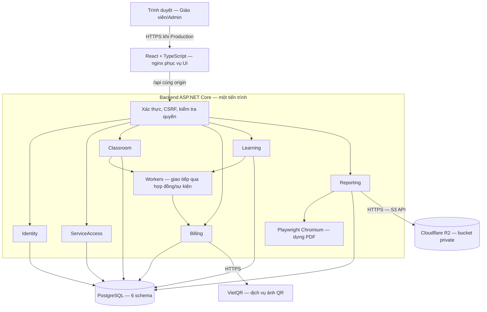
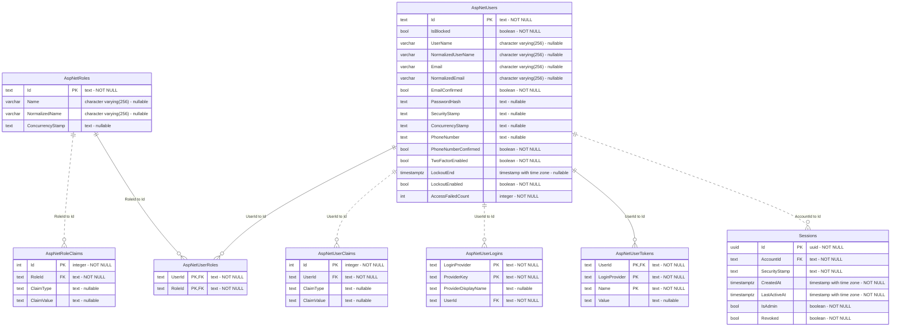
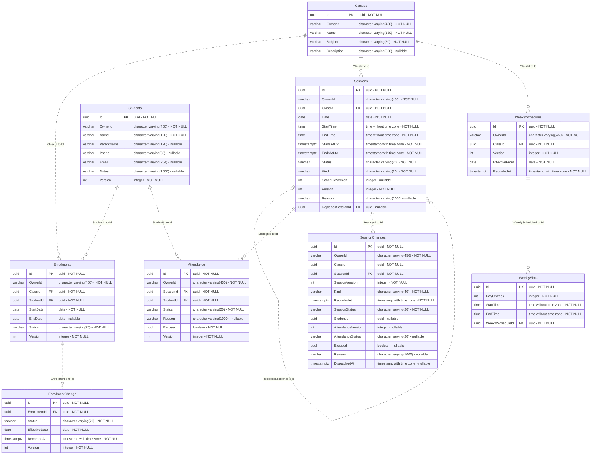
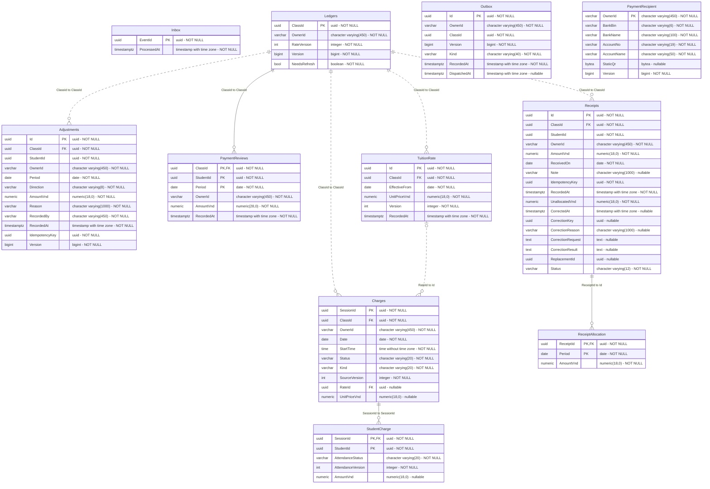
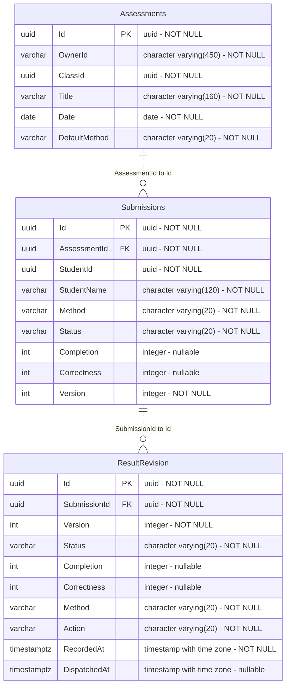
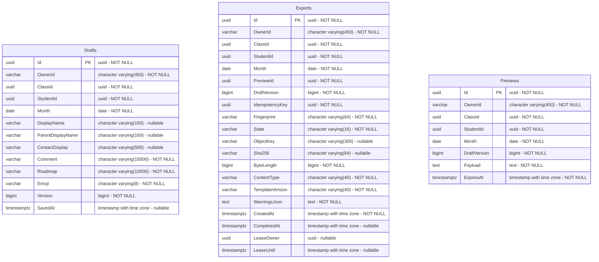
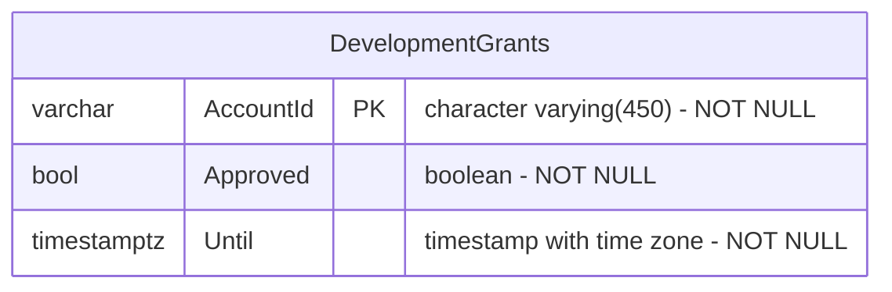

# BÁO CÁO THÔNG ĐỒ ÁN — BUỔI 1

**Học phần:** Đồ án Phát triển ứng dụng phía máy chủ nâng cao

**Đề tài:** Education Keeptrack — Hệ thống quản lý lớp học, theo dõi học tập và học phí

**Ngày lập:** 22/10/2026

**Nội dung:** Phân tích yêu cầu, phân rã chức năng, thiết kế hệ thống và thiết kế cơ sở dữ liệu.

## 1. Giới thiệu đề tài

### 1.1. Bài toán thực tế

Giáo viên dạy thêm và gia sư độc lập thường quản lý lớp, học sinh, điểm danh, kết quả học tập và học phí bằng nhiều công cụ rời rạc. Việc tổng hợp cuối tháng mất thời gian, dễ bỏ sót buổi học, tính nhầm số tiền hoặc nhầm lẫn giữa học phí phát sinh và tiền thực nhận.

Education Keeptrack tập trung các hoạt động này vào một ứng dụng web. Giáo viên theo dõi dữ liệu của mình, ghi nhận học tập và thanh toán, sau đó xuất báo cáo tháng dạng PDF để gửi phụ huynh. Các chức năng AI được thiết kế như công cụ hỗ trợ; giáo viên giữ quyền xác nhận kết quả cuối cùng.

### 1.2. Mục tiêu và phạm vi

- Quản lý lớp, học sinh, lịch dạy và điểm danh trong phạm vi riêng của từng giáo viên.
- Tính học phí theo buổi thực học và đơn giá có hiệu lực; quản lý khoản nhận tiền, phân bổ và công nợ.
- Theo dõi kết quả học tập bằng hai chỉ số hoàn thành và làm đúng độc lập.
- Tổng hợp báo cáo tháng có nội dung học tập và tài chính, lưu PDF riêng tư.
- Đáp ứng định hướng học phần: .NET Modular Monolith, DbContext/schema riêng theo module, giao tiếp liên module, object storage tương thích S3, Docker Compose và Jenkins.

### 1.3. Tác nhân và trạng thái phạm vi

| Tác nhân | Vai trò |
| --- | --- |
| Giáo viên | Quản lý lớp, học sinh, học tập, học phí và báo cáo thuộc quyền sở hữu của mình. |
| Admin | Theo thiết kế: duyệt đăng ký, đối chiếu phí dịch vụ, cấp kỳ sử dụng, quản lý khóa tài khoản và quyền AI. Không mặc định được đọc dữ liệu học sinh. |
| Phụ huynh | Nhận báo cáo PDF và hướng dẫn thanh toán từ giáo viên; không có tài khoản đăng nhập trong phạm vi đề tài hiện tại. |

## 2. Yêu cầu chức năng

| Mã | Nhóm chức năng | Hệ thống cần cung cấp | |
| --- | --- | --- | --- |
| FR-01 | Đăng nhập và phiên | Đăng nhập email/mật khẩu, đăng xuất, xác định giáo viên hiện tại, hết hạn và thu hồi phiên. |
| FR-02 | Đăng ký và quản trị dịch vụ | Xác minh email, Admin duyệt, đối chiếu phí dịch vụ, cấp/gia hạn kỳ sử dụng, khóa tài khoản, quản lý quyền AI. | 
| FR-03 | Quản lý lớp | Tạo, xem và cập nhật thông tin lớp; giới hạn truy cập theo giáo viên sở hữu. | 
| FR-04 | Quản lý học sinh | Quản lý hồ sơ, thông tin phụ huynh, đăng ký vào lớp, tình trạng theo học và lịch sử thay đổi; ngăn đăng ký đang hoạt động bị trùng. | 
| FR-05 | Lịch và buổi học | Thiết lập lịch tuần, sinh buổi, tạo học bù, ghi nhận buổi đã diễn ra/hủy; kiểm tra trùng khung giờ. | 
| FR-06 | Điểm danh | Ghi chưa điểm danh/có mặt/vắng, lý do vắng và nghỉ có phép; cho phép sửa có kiểm soát phiên bản. | 
| FR-07 | Học phí theo buổi | Lưu đơn giá hiệu lực theo ngày, tính phí buổi đã diễn ra có mặt; không tự áp giá mới vào lịch sử đã có căn cứ. | 
| FR-08 | Thu tiền và công nợ | Ghi từng khoản nhận tiền, phân bổ kỳ cũ còn nợ trước, theo dõi trả một phần, tiền chưa phân bổ và công nợ theo kỳ. | 
| FR-09 | Điều chỉnh tài chính | Điều chỉnh tăng/giảm phí có lý do; sửa/hủy giao dịch nhận tiền với lịch sử và tính lại phân bổ. | 
| FR-10 | QR và thống kê | Thiết lập người nhận tiền, tạo QR chuyển khoản, giữ hướng dẫn thủ công khi QR lỗi; thống kê tiền thực thu và số dư kỳ. | 
| FR-11 | Đánh giá thủ công | Tạo bài đánh giá, ghi hai chỉ số hoàn thành/làm đúng, phân biệt chưa đánh giá, không làm bài, không có câu đúng và không giao bài; lưu lịch sử. | 
| FR-12 | Ảnh bài và AI chấm | Upload ảnh riêng tư có thứ tự, lưu phiên bản hướng dẫn; AI đề xuất kết quả, giáo viên chỉnh/xác nhận; hỗ trợ lỗi và chấm lại. | Thiết kế mở rộng. |
| FR-13 | Xu hướng và nhận xét AI | Tổng hợp kết quả cuối, nhận biết xu hướng/cảnh báo, đề xuất nhận xét và lộ trình; không ghi đè nội dung giáo viên tự sửa. | Thiết kế mở rộng. |
| FR-14 | Báo cáo tháng PDF | Soạn nhận xét/lộ trình, xem trước, lấy dữ liệu học tập/tài chính, xuất PDF và tải có kiểm tra quyền. |  lưu PDF trên R2. |
| FR-15 | Trả trước và bảo lưu | Theo dõi nguồn tiền trả trước, duyệt bảo lưu và sử dụng đúng một lần cho kỳ sau, thể hiện trên báo cáo. | Thiết kế mở rộng. |
| FR-16 | Cập nhật báo cáo | Nhận biết bản xuất không còn khớp dữ liệu nguồn và chủ động tạo bản cập nhật, giữ lịch sử bản cũ. |  

### 2.1. Quy tắc nghiệp vụ cốt lõi

1. Phí dịch vụ là tiền giáo viên trả để dùng phần mềm; học phí là tiền phụ huynh/học sinh trả giáo viên. Hai khoản được quản lý ở hai ngữ cảnh khác nhau.
2. Tình trạng theo học thuộc đăng ký lớp; điểm danh thuộc từng buổi. Không suy ra học sinh có mặt từ trạng thái đang học.
3. Phí học chỉ phát sinh cho buổi đã diễn ra có mặt và có đơn giá phù hợp. Dữ liệu thiếu căn cứ phải được chỉ rõ, không tự coi là tổng hoàn chỉnh.
4. Tiền nhận và phí phát sinh là hai loại dữ liệu khác nhau. Tạo hoặc quét QR không tự ghi nhận đã thanh toán.
5. Giao dịch nhận tiền và phân bổ được lưu nguyên tử; gửi lặp cùng lệnh không được tạo thêm khoản thu.
6. Hết hạn sử dụng vẫn được xem/xuất dữ liệu cũ; khóa tài khoản chặn truy cập. Chính sách hoàn chỉnh do ServiceAccess thực thi theo thiết kế.
7. AI chỉ đề xuất; kết quả cuối do giáo viên xác nhận mới dùng làm căn cứ báo cáo và phân tích.

## 3. Yêu cầu phi chức năng

| Mã | Nhóm yêu cầu | Nội dung |
| --- | --- | --- |
| NFR-01 | Bảo mật | Người dùng phải đăng nhập và chỉ được truy cập dữ liệu thuộc quyền của mình. Mật khẩu và thông tin kết nối phải được bảo vệ. |
| NFR-02 | Hiệu năng | Các thao tác xem, thêm và sửa dữ liệu cần phản hồi nhanh. Khi xuất PDF hoặc xử lý AI, giao diện phải thông báo đang xử lý hoặc có lỗi. |
| NFR-03 | Độ chính xác | Học phí, khoản thu và công nợ phải được tính đúng; gửi lại cùng một yêu cầu không được tạo dữ liệu hoặc tính tiền trùng. |
| NFR-04 | Dễ sử dụng | Giao diện tiếng Việt, bố cục rõ ràng, thông báo dễ hiểu và sử dụng được trên máy tính lẫn điện thoại. |
| NFR-05 | Độ tin cậy | Dữ liệu đã lưu phải được giữ sau khi khởi động lại. Khi dịch vụ QR hoặc lưu file gặp lỗi, hệ thống cần thông báo và cho phép thử lại. |
| NFR-06 | Chất lượng báo cáo | PDF phải hiển thị rõ tiếng Việt, đúng học sinh và số liệu, không bị mất nội dung khi có nhiều trang. |
| NFR-07 | Sao lưu và phục hồi | Cần có phương án sao lưu và khôi phục dữ liệu nghiệp vụ cùng các file báo cáo khi xảy ra sự cố. |
| NFR-08 | Bảo trì và mở rộng | Mã nguồn được chia theo module để dễ sửa lỗi, bổ sung chức năng và triển khai hệ thống. |

## 4. Sơ đồ phân rã chức năng

Đây là sơ đồ toàn bộ phạm vi sản phẩm. Các nhánh AI, ảnh bài nộp, bảo lưu và quản trị dịch vụ đầy đủ là chức năng dự kiến, không được hiểu là đều đã hoàn thành.

```mermaid
flowchart TB
    ROOT["Education Keeptrack"]
    ROOT --> ID["1. Tài khoản và dịch vụ"]
    ROOT --> CL["2. Lớp và học sinh"]
    ROOT --> AT["3. Lịch và điểm danh"]
    ROOT --> BI["4. Học phí và thanh toán"]
    ROOT --> LE["5. Học tập và đánh giá"]
    ROOT --> RE["6. Báo cáo và phân tích"]

    ID --> ID1["1.1 Đăng nhập, đăng xuất, phiên"]
    ID --> ID2["1.2 Đăng ký, xác minh, khôi phục"]
    ID --> ID3["1.3 Duyệt, gia hạn, khóa tài khoản"]
    ID --> ID4["1.4 Quyền và hạn mức AI"]
    CL --> CL1["2.1 Quản lý lớp"]
    CL --> CL2["2.2 Hồ sơ học sinh, phụ huynh"]
    CL --> CL3["2.3 Đăng ký và tình trạng theo học"]
    AT --> AT1["3.1 Lịch tuần và sinh buổi"]
    AT --> AT2["3.2 Học bù, hủy, xác nhận đã học"]
    AT --> AT3["3.3 Điểm danh và nhắc còn thiếu"]
    BI --> BI1["4.1 Đơn giá và phí theo buổi"]
    BI --> BI2["4.2 Nhận tiền, phân bổ, công nợ"]
    BI --> BI3["4.3 Điều chỉnh, sửa/hủy khoản thu"]
    BI --> BI4["4.4 QR và thống kê tài chính"]
    BI --> BI5["4.5 Trả trước và bảo lưu"]
    LE --> LE1["5.1 Bài đánh giá và tự chấm"]
    LE --> LE2["5.2 Ảnh bài và hướng dẫn chấm"]
    LE --> LE3["5.3 AI chấm, sửa, xác nhận"]
    LE --> LE4["5.4 Thử lại, chấm lại, lịch sử"]
    RE --> RE1["6.1 Nhận xét và lộ trình"]
    RE --> RE2["6.2 Xem trước, xuất/tải PDF"]
    RE --> RE3["6.3 Xu hướng và cảnh báo"]
    RE --> RE4["6.4 Nhận biết báo cáo cần cập nhật"]
```

## 5. Thiết kế hệ thống

### 5.1. Kiến trúc tổng thể

Hệ thống chọn Modular Monolith: các module cùng chạy trong một backend, có ranh giới nghiệp vụ và dữ liệu riêng. Kiến trúc này phù hợp quy mô đồ án và khả năng triển khai trên một máy chủ, đồng thời giữ đường mở rộng theo module.

### 5.2. Thành phần và công nghệ

| Thành phần | Công nghệ | Vai trò |
| --- | --- | --- |
| UI | React, TypeScript, Vite | Hiển thị nghiệp vụ, gọi API, giữ bản nhập khi lỗi. Vite phục vụ phát triển; nginx phục vụ bản build. |
| API/backend | .NET 10, ASP.NET Core | Host các module, xác thực, phân quyền và xử lý nghiệp vụ. |
| ORM | Entity Framework Core, Npgsql | Ánh xạ dữ liệu PostgreSQL, giao dịch và migrations theo module. |
| Database | PostgreSQL 18 | Dữ liệu nghiệp vụ, phiên, metadata, inbox/outbox. |
| File storage | Cloudflare R2 qua AWSSDK.S3 | Giữ PDF riêng tư; ảnh bài nộp là phần mở rộng. |
| PDF | Microsoft.Playwright và Chromium | Dựng PDF từ HTML phía server. |
| Xác thực | ASP.NET Core Identity, cookie HttpOnly, CSRF | Tài khoản và phiên, kiểm tra yêu cầu ghi. |
| Triển khai | Docker, Docker Compose, nginx | Đóng gói backend/UI/database, mạng và volume. |
| CI | Jenkins | Build, kiểm thử và lưu kết quả; tích hợp R2 CI còn ở ticket #29 tại mốc này. |
| Quản lý mã nguồn | Git/GitHub và GitHub Issues | Lưu mã, đặc tả, ticket và phụ thuộc công việc. |

Mỗi module tổ chức Domain, Application và Infrastructure; API ánh xạ yêu cầu vào ca sử dụng. Hợp đồng dùng chung nằm trong Contracts. Module không đọc trực tiếp schema của module khác và không tạo FK xuyên schema.

### 5.3. Luồng tương tác điển hình

**Điểm danh → học phí:** Classroom lưu thay đổi điểm danh cùng sự kiện trong outbox. Worker chuyển sự kiện qua hợp đồng đến Billing; Billing kiểm tra phiên bản và inbox, cập nhật phí trong giao dịch. Giao nhận lại không được cộng phí hai lần.

**Thu tiền:** API kiểm tra giáo viên, lớp, học sinh, số tiền, phiên bản và idempotency key. Billing ghi giao dịch, phân bổ và phiên bản sổ cái trong cùng giao dịch; gửi lại cùng lệnh trả kết quả đã lưu.

**Xuất PDF:** Reporting lấy snapshot nguồn qua hợp đồng, dựng HTML/PDF, upload R2 rồi lưu metadata ready. Khi tải, API kiểm tra owner, phiên, quyền và token trước khi đọc R2. PostgreSQL giữ thông tin về file; R2 giữ nội dung file.

### 5.4. Hạ tầng, dữ liệu bền vững và phục hồi

Compose khởi động theo chuỗi: PostgreSQL healthy → tác vụ migrate thành công → backend → nginx/UI. R2 là dịch vụ ngoài, không thuộc depends_on. R2 lỗi chỉ ảnh hưởng thao tác file; PostgreSQL lỗi ảnh hưởng phần lớn nghiệp vụ.

Volume `postgres-data` giữ dữ liệu database; `session-keys` giữ khóa Data Protection bảo vệ cookie/token. Các object R2 độc lập với volume Docker. Khôi phục cần cả metadata và object tương ứng; không coi volume là bản backup.

nginx hiện lắng nghe HTTP trong cấu hình repo; Production phải có điểm kết thúc HTTPS phù hợp. Cấu hình R2 và database lấy từ môi trường, không chứa secrets trong báo cáo. SeaweedFS không còn trong Compose đích, nhưng dữ liệu cũ chỉ được ngừng/xóa sau quy trình chuyển đổi #30.

## 6. Thiết kế cơ sở dữ liệu

### 6.1. Lựa chọn mô hình và nguyên tắc

Chọn cơ sở dữ liệu quan hệ PostgreSQL do nghiệp vụ có nhiều quan hệ lớp–học sinh–buổi học, ràng buộc phiên bản và giao dịch tài chính. Không sử dụng NoSQL document trong phạm vi hiện tại. R2 là object storage, không thay thế database nghiệp vụ.

- Một database, sáu schema độc lập theo trách nhiệm module, mỗi schema có DbContext và migrations riêng.
- `OwnerId` tham chiếu định danh giáo viên về mặt nghiệp vụ; không phải FK xuyên schema đến Identity.
- Các ID liên module như `StudentId`, `ClassId`, `SessionId` được kiểm tra qua hợp đồng; chỉ đánh dấu FK trên ERD khi có ràng buộc vật lý thật.
- UUID dùng cho nhiều định danh nghiệp vụ; Identity dùng chuỗi định danh theo cấu hình ASP.NET Core Identity.
- Ngày buổi học/kỳ học phí dùng kiểu date theo nghiệp vụ Việt Nam; các thời điểm sự kiện dùng kiểu timestamp phù hợp với mapping hiện có.
- Tiền lưu numeric có độ chính xác, không dùng số thực; khóa ghép dùng cho các dòng thuộc buổi, phân bổ hoặc phạm vi tổng hợp.
- Không xóa lịch sử tài chính để sửa sai; dùng thao tác điều chỉnh có căn cứ.

### 6.2. Phạm vi ERD và cách đọc

ERD bên dưới mô tả **schema đã hiện thực**, lấy từ metadata database local đã migrate ngày 22/10/2026 và đối chiếu ranh giới DbContext. Tên bảng là tên vật lý thực tế; ví dụ Billing có `Ledgers`, `Charges`, `TuitionRate`, còn Reporting có `Drafts`, `Previews`, `Exports`. Tên có thể khác tên mô tả nghiệp vụ trong tài liệu cũ.

Các bảng phục vụ AI, ảnh bài nộp, bảo lưu và quản trị dịch vụ đầy đủ chưa được tạo trong ERD hiện thực này. Khi triển khai cần thiết kế chi tiết và thêm migrations riêng; không coi `DevelopmentGrants` là mô hình cấp quyền Production hoàn chỉnh.

Ký hiệu: **PK** là khóa chính, **FK** là khóa ngoại; `PK, FK` nghĩa là thuộc tính đồng thời thuộc cả hai loại khóa. Các cột PK cùng một bảng tạo khóa ghép nếu có nhiều cột. Ghi chú `nullable` chỉ thuộc tính được phép null. Bảng lịch sử migrations của EF được bỏ khỏi báo cáo vì chỉ phục vụ công cụ.

Đường nối ERD thể hiện FK vật lý. Quan hệ nghiệp vụ xuyên schema được giải thích bằng lời; không thêm FK giả để nối tất cả schema thành một sơ đồ.

### 6.3. Các nhóm dữ liệu và ý nghĩa

| Schema | Dữ liệu chính | Ý nghĩa |
| --- | --- | --- |
| identity | AspNetUsers, AspNetRoles và bảng hỗ trợ Identity, Sessions | Tài khoản, vai trò, thông tin xác thực và phiên có thể thu hồi. |
| classroom | Classes, Students, Enrollments, EnrollmentChange, WeeklySchedules, WeeklySlots, Sessions, Attendance, SessionChanges | Hồ sơ lớp/học sinh, lịch/buổi, điểm danh và lịch sử/sự kiện. |
| billing | Ledgers, TuitionRate, Charges, StudentCharge, Receipts, ReceiptAllocation, Adjustments, PaymentRecipient, PaymentReviews, Inbox, Outbox | Giá, phí, tiền nhận, phân bổ, điều chỉnh, người nhận tiền và xử lý sự kiện. |
| learning | Assessments, Submissions, ResultRevision | Bài đánh giá, kết quả từng học sinh và lịch sử kết quả. |
| reporting | Drafts, Previews, Exports | Nội dung thủ công, snapshot xem trước và bản xuất PDF. |
| service_access | DevelopmentGrants | Quyền cấp phục vụ phát triển; sẽ được mở rộng theo thiết kế quản trị dịch vụ. |

### 6.4. Các ràng buộc nghiệp vụ quan trọng

| Phạm vi | Ràng buộc |
| --- | --- |
| Đăng ký lớp | Unique có điều kiện trên lớp–học sinh khi đăng ký chưa dừng; giữ lịch sử đăng ký trước. |
| Lịch/buổi | Unique lớp–ngày–giờ bắt đầu; kiểm tra chồng lấn trong ca sử dụng. |
| Đơn giá | Unique lớp–ngày hiệu lực và lớp–phiên bản. |
| Phí học sinh | PK ghép SessionId–StudentId; một dòng phí cho một học sinh trong một buổi. |
| Khoản nhận tiền | Số tiền dương, tiền chưa phân bổ không âm và không vượt khoản nhận; unique ClassId–IdempotencyKey. |
| Phân bổ | PK ghép ReceiptId–Period; số tiền phân bổ dương. |
| Điều chỉnh phí | Số tiền dương, chiều increase/decrease, lý do bắt buộc; unique theo lớp và idempotency key. |
| Inbox/outbox | Inbox nhận diện event đã xử lý; outbox và dữ liệu nghiệp vụ commit cùng nhau. |
| Xuất báo cáo | Object key riêng mỗi attempt; chỉ công bố ready khi upload và metadata thành công; lưu kích thước và SHA-256 để đối chiếu. |

Các chỉ mục unique ghép không được đánh dấu UK riêng trên từng cột trong ERD, vì từng cột đơn lẻ không nhất thiết duy nhất.

### 6.5. ERD schema `identity`

Schema có 8 bảng dữ liệu trong phạm vi khảo sát. Thuộc tính được liệt kê theo metadata thực tế.

### 6.6. ERD schema `classroom`

Schema có 9 bảng dữ liệu trong phạm vi khảo sát. Thuộc tính được liệt kê theo metadata thực tế.

### 6.7. ERD schema `billing`

Schema có 11 bảng dữ liệu trong phạm vi khảo sát. Thuộc tính được liệt kê theo metadata thực tế.

### 6.8. ERD schema `learning`

Schema có 3 bảng dữ liệu trong phạm vi khảo sát. Thuộc tính được liệt kê theo metadata thực tế.

### 6.9. ERD schema `reporting`

Schema có 3 bảng dữ liệu trong phạm vi khảo sát. Thuộc tính được liệt kê theo metadata thực tế.

### 6.10. ERD schema `service_access`

Schema có 1 bảng dữ liệu trong phạm vi khảo sát. Thuộc tính được liệt kê theo metadata thực tế.

## 7. Nội dung trình bày và minh chứng cho buổi thông

| Nội dung | Điểm cần trình bày | Minh chứng |
| --- | --- | --- |
| Bài toán và yêu cầu | Ai sử dụng, khó khăn thực tế, phạm vi chính và phần mở rộng. | Mục 1–3, BRD và bảng FR/NFR. |
| Phân rã chức năng | Sáu nhóm chức năng, mối liên hệ với trách nhiệm module. | Sơ đồ mục 4. |
| Kiến trúc | Vì sao dùng Modular Monolith, cách module giao tiếp, vai trò PostgreSQL/R2. | Mục 5, cấu trúc source và Compose. |
| Cơ sở dữ liệu | Tách schema, PK/FK, khóa ghép, liên kết logic xuyên module, tính đúng tiền. | Mục 6, ERD và database trong DBeaver. |
| Demo ngắn | Đăng nhập → tạo lớp/học sinh → buổi/điểm danh → học phí/thu tiền → xem trước/xuất/tải PDF. | API/UI, PostgreSQL và object PDF trong bucket test. |
| Tiến độ | Luồng PDF R2 đã nghiệm thu ở mốc #28; CI R2, chuyển dữ liệu và chức năng mở rộng còn có công việc riêng. | Ticket #28/#29/#30 và backlog T12 trở đi. |

Kết quả kiểm thử ghi nhận tại mốc triển khai #28: 141/141 API tests và 6/6 browser tests desktop/mobile đã qua trong môi trường kiểm thử. Đây là kết quả của lần chạy đã ghi nhận, không phải khẳng định trạng thái kiểm thử mới tại mọi lần đọc báo cáo.

## 8. Tài liệu tham chiếu

- [Đề cương học phần](../Đồ%20án%20phát%20triển%20ứng%20dụng%20phía%20máy%20chủ%20nâng%20cao.md).
- [Yêu cầu nghiệp vụ](../docs/BA_Requirements_Keeptrack.md).
- [Đặc tả sản phẩm và kỹ thuật](../docs/Technical_Spec_EducationKeeptrack.md).
- [Thiết kế hệ thống tổng thể](thiet-ke-he-thong.md).
- [Thiết kế Cloudflare R2](cloudflare-r2.md).
- [Cơ chế hạ tầng và vai trò](../docs/co-che-ha-tang-va-vai-tro.md).
- [Thuật ngữ nghiệp vụ](../GLOSSARY.md) và [các ADR](../docs/adr/).
