# THIẾT KẾ HỆ THỐNG EDUCATION KEEPTRACK

> Cập nhật 21/10/2026: dùng Cloudflare R2 private thay SeaweedFS/MinIO. [Thiết kế R2](cloudflare-r2.md) quy định cấu hình, quyền tải qua backend, kiểm thử và chuyển dữ liệu; thay thế hướng dẫn kho cũ. Ticket #28 chuyển cấu hình và adapter sang R2; nghiệm thu thực tế cần bucket test và credentials. CI và chuyển dữ liệu cũ lần lượt thuộc #29/#30.

**Đồ án Phát triển Ứng dụng Phía Máy chủ Nâng cao**
**Trường Đại học Xây dựng Hà Nội — Khoa Công nghệ Thông tin**

---

## Mục lục

1. [Tổng quan hệ thống](#1-tổng-quan-hệ-thống)
2. [Kiến trúc hệ thống](#2-kiến-trúc-hệ-thống)
3. [Biểu đồ phân rã chức năng](#3-biểu-đồ-phân-rã-chức-năng)
4. [Thiết kế cơ sở dữ liệu](#4-thiết-kế-cơ-sở-dữ-liệu)
5. [Giao tiếp liên module](#5-giao-tiếp-liên-module)
6. [Luồng dữ liệu chính](#6-luồng-dữ-liệu-chính)
7. [Triển khai và hạ tầng](#7-triển-khai-và-hạ-tầng)
8. [Bảo mật](#8-bảo-mật)

---

## 1. Tổng quan hệ thống

### 1.1. Giới thiệu

**Education Keeptrack** là hệ thống quản lý lớp học dành cho giáo viên dạy thêm/dạy tư, hỗ trợ toàn bộ nghiệp vụ từ quản lý lớp, học sinh, lịch dạy, điểm danh, tính học phí, thu tiền, đánh giá học tập đến xuất báo cáo tháng dạng PDF.

### 1.2. Công nghệ sử dụng

| Thành phần | Công nghệ |
|---|---|
| **Backend** | .NET 10, ASP.NET Core |
| **Kiến trúc** | Modular Monolith |
| **ORM** | Entity Framework Core + Npgsql |
| **Database** | PostgreSQL 18 |
| **Frontend** | React + TypeScript + Vite |
| **Xác thực** | ASP.NET Core Identity (Cookie-based Sessions) |
| **Containerization** | Docker, Docker Compose |
| **Object Storage** | Cloudflare R2 (S3-compatible, private) |
| **CI/CD** | Jenkins Pipeline |
| **PDF Rendering** | Playwright Chromium (headless) |
| **Thanh toán QR** | VietQR Quick Link API |

### 1.3. Danh sách vai trò người dùng

| Vai trò | Mô tả |
|---|---|
| **Giáo viên (Teacher)** | Sử dụng phần mềm quản lý lớp, học sinh, học phí trong phạm vi dữ liệu riêng |
| **Admin** | Quản lý đăng ký, đối chiếu thanh toán dịch vụ; không mặc định được đọc dữ liệu học sinh |

---

## 2. Kiến trúc hệ thống

### 2.1. Kiến trúc tổng thể — Modular Monolith

Hệ thống áp dụng kiến trúc **Modular Monolith**, trong đó mỗi module là một bounded context độc lập với schema, DbContext và migration history riêng. Các module giao tiếp qua **interface contracts** và **in-memory events**, không có foreign key hay cross-schema reads.

```mermaid
graph TB
    subgraph Client["Client Layer"]
        UI["React + TypeScript + Vite<br/>SPA - Port 5173 / 8088"]
    end

    subgraph Proxy["Reverse Proxy"]
        NGINX["nginx<br/>TLS Termination / Static Files"]
    end

    subgraph Host["ASP.NET Core Host Process"]
        MW["Middleware Pipeline<br/>ForwardedHeaders - Auth - CSRF - Routing"]

        subgraph Modules["Business Modules"]
            IDM["Identity Module<br/>schema: identity"]
            CLR["Classroom Module<br/>schema: classroom"]
            BIL["Billing Module<br/>schema: billing"]
            LRN["Learning Module<br/>schema: learning"]
            SAC["ServiceAccess Module<br/>schema: service_access"]
            RPT["Reporting Module<br/>schema: reporting"]
        end

        subgraph Contracts["Contracts Layer"]
            IAA["IAccountAccess"]
            IAS["IAccountState"]
            ICBS["IClassroomBillingSource"]
            ICLS["IClassroomLearningSource"]
            ICCH["IClassroomChangeHandler"]
            ITCH["ITuitionChangeHandler"]
            ILRH["ILearningResultChangeHandler"]
            ICRS["IClassroomReportSource"]
            IBRS["IBillingReportSource"]
            ILRS["ILearningReportSource"]
        end

        subgraph Workers["Background Workers"]
            CRD["ClassroomChangeDispatcher"]
            BLW["BillingWorker"]
            LRD["LearningResultDispatcher"]
        end
    end

    subgraph Storage["Persistence"]
        PG[("PostgreSQL 18<br/>6 schemas")]
    end

    subgraph External["External"]
        S3[("Cloudflare R2 - S3 API<br/>Private PDFs and submission photos")]
        VQR["VietQR API<br/>Payment QR"]
    end

    UI -->|HTTP/HTTPS| NGINX
    NGINX -->|X-Forwarded-Proto| MW
    MW --> Modules

    IDM -.->|implements| IAS
    SAC -.->|implements| IAA
    SAC -.->|consumes| IAS
    CLR -.->|implements| ICBS
    CLR -.->|implements| ICLS
    CLR -.->|implements| ICRS
    CLR -.->|publishes| ICCH
    BIL -.->|consumes| ICBS
    BIL -.->|consumes| ICCH
    BIL -.->|implements| IBRS
    BIL -.->|publishes| ITCH
    LRN -.->|consumes| ICLS
    LRN -.->|implements| ILRS
    LRN -.->|publishes| ILRH
    RPT -.->|consumes| ICRS
    RPT -.->|consumes| IBRS
    RPT -.->|consumes| ILRS

    CRD --> ICCH
    BLW --> BIL
    LRD --> ILRH

    Modules --> PG
    RPT -->|HTTPS| S3
    LRN -->|HTTPS - submission photos| S3
    BIL -->|VietQR Quick Link| VQR
```

### 2.2. Kiến trúc phân tầng bên trong mỗi Module

Mỗi module tuân thủ kiến trúc **Clean Architecture** gồm 3 tầng:

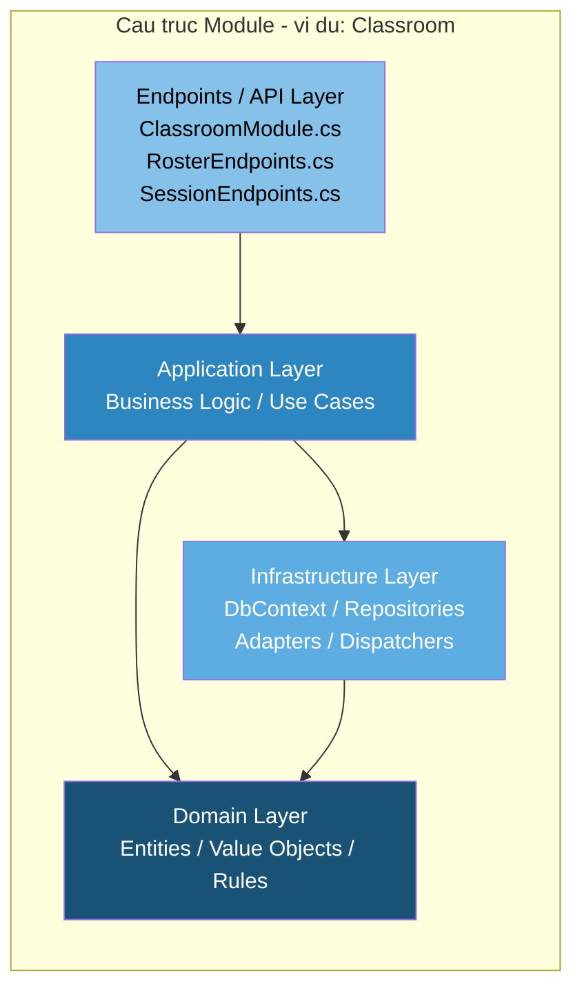

| Tầng | Trách nhiệm | Ví dụ trong Classroom |
|---|---|---|
| **Domain** | Entity, Value Object, business rules | `TeacherClass`, `Student`, `Enrollment`, `ClassSession`, `Attendance` |
| **Application** | Use case, validation, orchestration | Xử lý tạo lớp, đăng ký học sinh, sinh buổi học |
| **Infrastructure** | DbContext, Repository, Adapter | `ClassroomDatabase`, `RosterRepository`, `SessionRepository` |
| **Endpoints** | Minimal API routes, request/response mapping | `ClassroomModule.cs`, `RosterEndpoints.cs` |

### 2.3. Cấu trúc Solution

```
EducationKeeptrack.slnx
├── src/
│   ├── Contracts/                    # Interface contracts giữa các module
│   │   ├── AccountAccess.cs          # IAccountAccess, IAccountState
│   │   ├── ClassroomBillingSource.cs # IClassroomBillingSource
│   │   ├── ClassroomChange.cs        # IClassroomChangeHandler
│   │   ├── ClassroomLearningSource.cs# IClassroomLearningSource
│   │   ├── TuitionChange.cs          # ITuitionChangeHandler
│   │   ├── LearningResultChange.cs   # ILearningResultChangeHandler
│   │   └── ReportSources.cs          # IClassroomReportSource, IBillingReportSource, ILearningReportSource
│   │
│   ├── Host/                         # Entry point — đăng ký module, middleware, migration
│   │   └── Program.cs
│   │
│   └── Modules/
│       ├── Identity/                 # Xác thực, phiên đăng nhập
│       │   ├── Domain/               # Account, LoginSession
│       │   ├── Application/          # ProvisionTeacher, LoginSessions
│       │   ├── Endpoints/            # Auth routes
│       │   └── Infrastructure/       # IdentityDatabase, SessionService
│       │
│       ├── Classroom/                # Lớp, học sinh, lịch, điểm danh
│       │   ├── Domain/               # TeacherClass, Student, Enrollment, ClassSession, ...
│       │   ├── Application/          # Roster logic, Session logic
│       │   ├── Infrastructure/       # ClassroomDatabase, Repositories, Adapters
│       │   ├── ClassroomModule.cs    # Class endpoints
│       │   ├── RosterEndpoints.cs    # Student/Enrollment endpoints
│       │   └── SessionEndpoints.cs   # Schedule/Session/Attendance endpoints
│       │
│       ├── Billing/                  # Học phí, thanh toán, công nợ
│       │   ├── Domain/               # TuitionLedger, SessionCharge, Receipt, ...
│       │   ├── Application/          # Fee projection, Payment logic
│       │   ├── Infrastructure/       # BillingDatabase, BillingWorker, VietQrGenerator
│       │   └── BillingModule.cs      # Rate, Tuition, Payment, QR endpoints
│       │
│       ├── Learning/                 # Đánh giá học tập
│       │   ├── Domain/               # Assessment, Submission, ResultRevision
│       │   ├── Application/
│       │   ├── Infrastructure/       # LearningDatabase, LearningResultDispatcher
│       │   └── LearningModule.cs     # Assessment endpoints
│       │
│       ├── ServiceAccess/            # Quyền sử dụng dịch vụ
│       │   ├── Domain/               # DevelopmentGrant
│       │   ├── Infrastructure/       # ServiceAccessDatabase
│       │   └── ServiceAccessModule.cs
│       │
│       └── Reporting/                # Báo cáo tháng PDF
│           ├── Domain/               # MonthlyReportDraft, ReportExport, ReportPreview
│           ├── Application/
│           ├── Assets/               # HTML/CSS template
│           ├── Infrastructure/       # ReportingDatabase, ChromiumPdfRenderer, S3ReportStore
│           └── ReportingModule.cs    # Report endpoints
│
├── tests/
│   └── ApiTests/                     # Integration tests với PostgreSQL thực
│
├── ui/                               # React frontend
│   ├── src/                          # TypeScript source
│   ├── e2e/                          # Playwright E2E tests
│   └── nginx.conf                    # Production proxy config
│
├── Dockerfile                        # Multi-stage build
├── compose.yaml                      # Docker Compose orchestration
├── compose.https.yaml                # HTTPS overlay
├── Jenkinsfile                       # CI/CD pipeline
└── global.json                       # .NET SDK version
```

---

## 3. Biểu đồ phân rã chức năng

### 3.1. Phân rã chức năng tổng thể

```mermaid
graph TD
    ROOT["Education Keeptrack<br/>He thong quan ly lop hoc"]

    ROOT --> F1["Quan ly Tai khoan<br/>Identity Module"]
    ROOT --> F2["Quan ly Lop hoc<br/>Classroom Module"]
    ROOT --> F3["Quan ly Hoc phi<br/>Billing Module"]
    ROOT --> F4["Danh gia Hoc tap<br/>Learning Module"]
    ROOT --> F5["Quan ly Quyen<br/>ServiceAccess Module"]
    ROOT --> F6["Bao cao<br/>Reporting Module"]

    F1 --> F1_1["Dang nhap / Dang xuat"]
    F1 --> F1_2["Quan ly phien dang nhap"]
    F1 --> F1_3["Provisioning tai khoan"]
    F1 --> F1_4["Khoa / Mo khoa tai khoan"]

    F2 --> F2_1["Quan ly Lop"]
    F2 --> F2_2["Quan ly Hoc sinh"]
    F2 --> F2_3["Quan ly Dang ky lop"]
    F2 --> F2_4["Quan ly Lich tuan"]
    F2 --> F2_5["Quan ly Buoi hoc"]
    F2 --> F2_6["Diem danh"]

    F3 --> F3_1["Quan ly Don gia"]
    F3 --> F3_2["Tinh hoc phi theo buoi"]
    F3 --> F3_3["Thu tien va Cong no"]
    F3 --> F3_4["Thanh toan QR"]
    F3 --> F3_5["Dieu chinh hoc phi"]
    F3 --> F3_6["Thong ke thu chi"]

    F4 --> F4_1["Tao bai danh gia"]
    F4 --> F4_2["Cham diem thu cong"]
    F4 --> F4_3["Quan ly ket qua"]

    F5 --> F5_1["Cap quyen phat trien"]
    F5 --> F5_2["Kiem tra quyen Read/Write/AI"]

    F6 --> F6_1["Soan bao cao thang"]
    F6 --> F6_2["Xem truoc bao cao"]
    F6 --> F6_3["Xuat PDF"]
    F6 --> F6_4["Tai va chia se"]
```

### 3.2. Phân rã chi tiết từng nhóm chức năng

#### 3.2.1. Quản lý Tài khoản (Identity — T01)

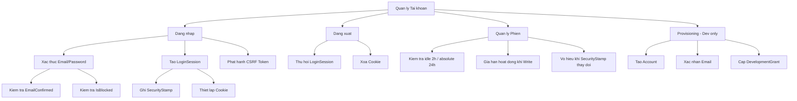

#### 3.2.2. Quản lý Lớp học (Classroom — T01/T02/T03)

```mermaid
graph TD
    F2["Quan ly Lop hoc"]

    F2 --> F2_1["Quan ly Lop"]
    F2_1 --> F2_1a["Tao lop moi"]
    F2_1 --> F2_1b["Sua thong tin lop"]
    F2_1 --> F2_1c["Danh sach lop so huu"]

    F2 --> F2_2["Quan ly Hoc sinh"]
    F2_2 --> F2_2a["Tao ho so hoc sinh"]
    F2_2 --> F2_2b["Sua ho so<br/>ten, phu huynh, SDT, email, ghi chu"]
    F2_2 --> F2_2c["Danh sach hoc sinh cua giao vien"]

    F2 --> F2_3["Quan ly Dang ky lop"]
    F2_3 --> F2_3a["Dang ky hoc sinh vao lop"]
    F2_3 --> F2_3b["Thay doi tinh trang<br/>Dang hoc / Nghi co phep / Dung hoc"]
    F2_3 --> F2_3c["Kiem tra trung lap dang ky"]
    F2_3 --> F2_3d["Luu lich su thay doi"]

    F2 --> F2_4["Quan ly Lich tuan"]
    F2_4 --> F2_4a["Luu lich tuan<br/>ngay, gio bat dau, gio ket thuc"]
    F2_4 --> F2_4b["Dat ngay hieu luc"]
    F2_4 --> F2_4c["Xoa lich tuan - luu lich trong"]

    F2 --> F2_5["Quan ly Buoi hoc"]
    F2_5 --> F2_5a["Sinh buoi theo lich tuan"]
    F2_5 --> F2_5b["Tao buoi rieng / hoc bu"]
    F2_5 --> F2_5c["Thay doi trang thai<br/>Du kien - Da dien ra - Da huy"]
    F2_5 --> F2_5d["Kiem tra trung gio"]

    F2 --> F2_6["Diem danh"]
    F2_6 --> F2_6a["Danh dau Co mat / Vang"]
    F2_6 --> F2_6b["Ghi ly do vang, nghi co phep"]
    F2_6 --> F2_6c["Nhac nho diem danh thieu"]
```

#### 3.2.3. Quản lý Học phí (Billing — T04/T06/T07/T10)

```mermaid
graph TD
    F3["Quan ly Hoc phi"]

    F3 --> F3_1["Quan ly Don gia"]
    F3_1 --> F3_1a["Thiet lap don gia hieu luc"]
    F3_1 --> F3_1b["Lich su don gia - bat bien"]

    F3 --> F3_2["Tinh phi theo buoi"]
    F3_2 --> F3_2a["Chieu buoi Da dien ra + Co mat"]
    F3_2 --> F3_2b["Ap don gia theo ngay buoi hoc"]
    F3_2 --> F3_2c["Bang phi thang<br/>ready/pending/missing-rate"]

    F3 --> F3_3["Thu tien va Cong no"]
    F3_3 --> F3_3a["Ghi nhan giao dich nhan tien"]
    F3_3 --> F3_3b["Phan bo ky cu nhat truoc"]
    F3_3 --> F3_3c["Theo doi du no ky"]
    F3_3 --> F3_3d["Sua / Huy giao dich"]
    F3_3 --> F3_3e["Tien giu de doi chieu"]

    F3 --> F3_4["Thanh toan QR"]
    F3_4 --> F3_4a["Cau hinh tai khoan nhan"]
    F3_4 --> F3_4b["Sinh ma QR qua VietQR"]
    F3_4 --> F3_4c["Fallback QR tinh / thu cong"]

    F3 --> F3_5["Dieu chinh hoc phi"]
    F3_5 --> F3_5a["Tang / Giam phi ky"]
    F3_5 --> F3_5b["Ghi ly do dieu chinh"]

    F3 --> F3_6["Thong ke"]
    F3_6 --> F3_6a["Thuc thu theo ngay nhan"]
    F3_6 --> F3_6b["Cong no theo ky hoc phi"]
```

#### 3.2.4. Đánh giá Học tập (Learning — T05)

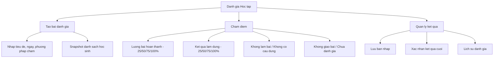

#### 3.2.5. Báo cáo (Reporting)

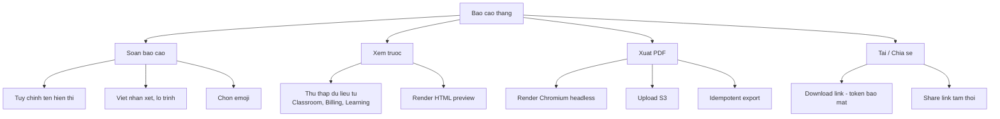

---

## 4. Thiết kế cơ sở dữ liệu

### 4.1. Nguyên tắc thiết kế

- **Schema tách biệt**: Mỗi module sở hữu PostgreSQL schema riêng, không có foreign key cross-schema
- **DbContext độc lập**: Mỗi module có EF Core DbContext riêng với migration history riêng
- **Optimistic Concurrency**: Sử dụng version column cho conflict detection
- **Outbox Pattern**: Mỗi module ghi event vào outbox table trong cùng transaction với dữ liệu nghiệp vụ
- **Idempotency**: Dùng idempotency key cho các write operation quan trọng (receipt, adjustment, export)
- **Money**: Lưu trữ dạng `numeric(18,0)` (nguyên đồng), truyền dạng decimal integer string

### 4.2. Tổng quan 6 Schema

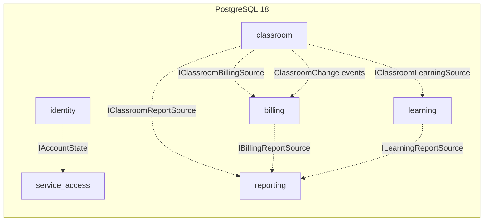

### 4.3. Schema: `identity`

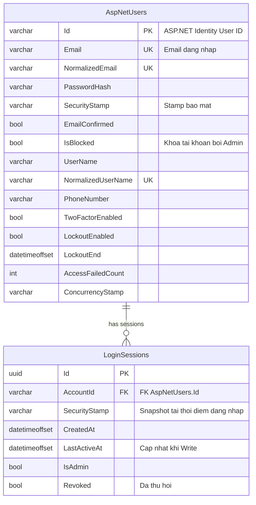

**Bảng ASP.NET Identity chuẩn (tự động tạo bởi framework):**
- `AspNetRoles`, `AspNetUserRoles`, `AspNetUserClaims`, `AspNetRoleClaims`, `AspNetUserTokens`, `AspNetUserLogins`

### 4.4. Schema: `classroom`

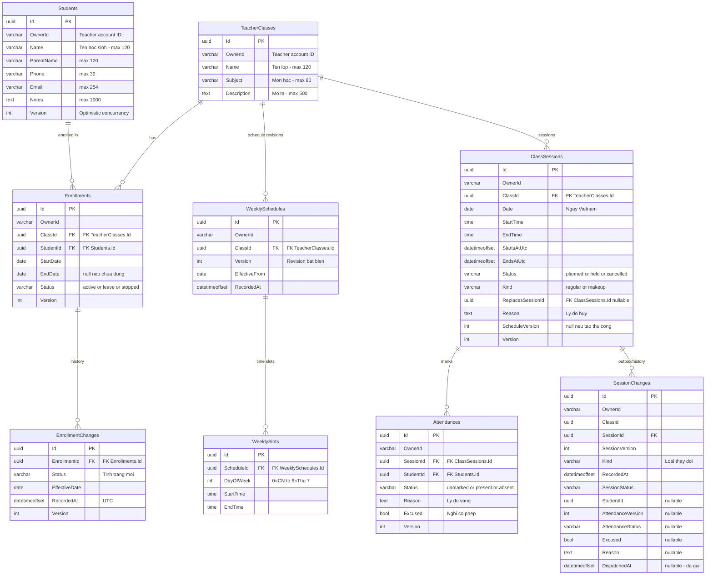

### 4.5. Schema: `billing`

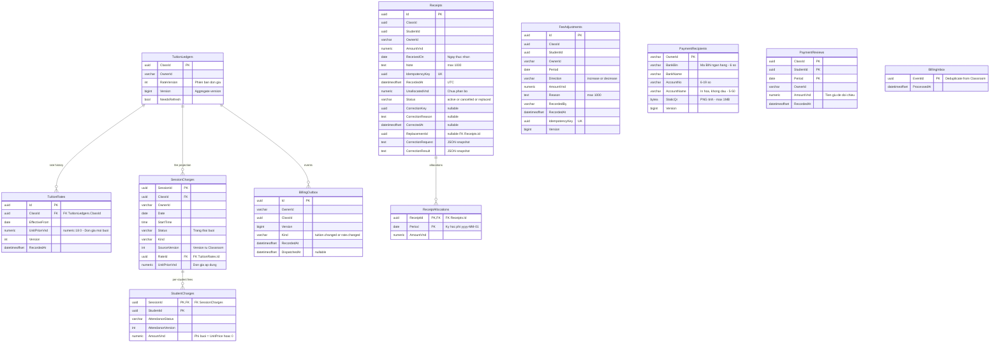

### 4.6. Schema: `learning`

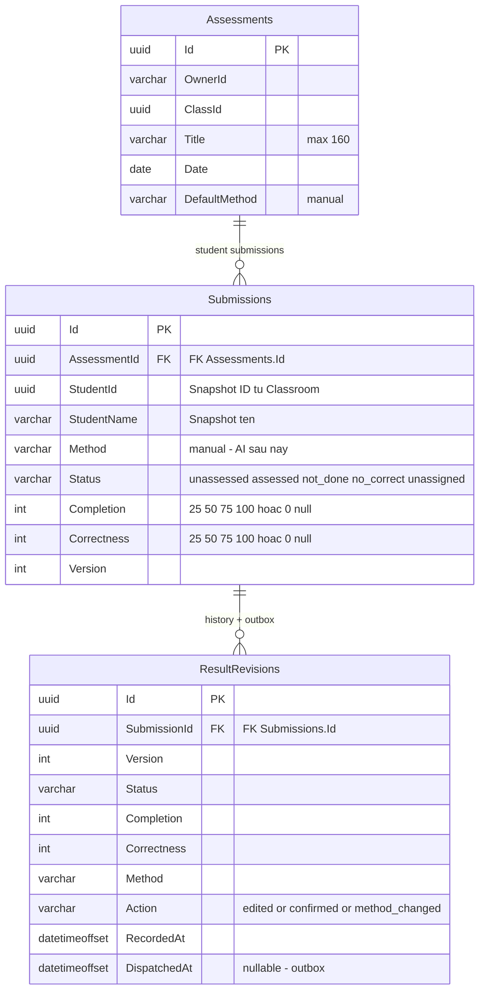

### 4.7. Schema: `service_access`

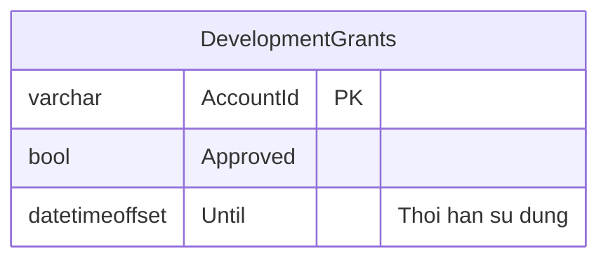

> **Ghi chú**: Đây là bản triển khai tối thiểu cho giai đoạn phát triển. Production sẽ bổ sung bảng `ServicePeriod`, `ApprovalRequest`, `AiQuota` v.v.

### 4.8. Schema: `reporting`

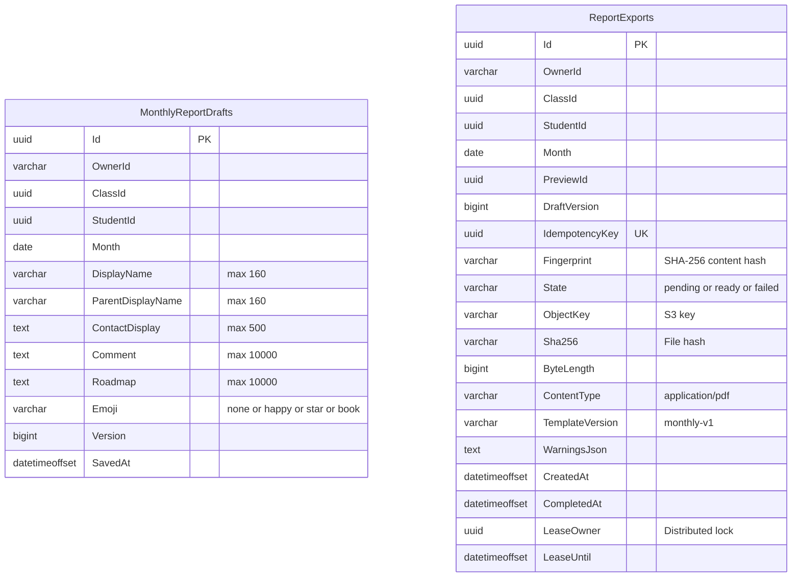

### 4.9. Tổng hợp bảng dữ liệu

| Schema | Bảng | Mô tả |
|---|---|---|
| **identity** | `AspNetUsers` | Tài khoản người dùng (ASP.NET Identity) |
| | `AspNetRoles` | Vai trò (Teacher, Admin) |
| | `AspNetUserRoles` | Gán vai trò cho người dùng |
| | `LoginSessions` | Phiên đăng nhập (idle/absolute timeout) |
| | *+ 4 bảng Identity chuẩn* | Claims, Tokens, Logins, RoleClaims |
| **classroom** | `TeacherClasses` | Lớp học |
| | `Students` | Hồ sơ học sinh |
| | `Enrollments` | Đăng ký lớp |
| | `EnrollmentChanges` | Lịch sử tình trạng đăng ký |
| | `WeeklySchedules` | Phiên bản lịch tuần |
| | `WeeklySlots` | Khung giờ trong lịch tuần |
| | `ClassSessions` | Buổi học |
| | `Attendances` | Điểm danh |
| | `SessionChanges` | Outbox + lịch sử thay đổi buổi/điểm danh |
| **billing** | `TuitionLedgers` | Sổ cái học phí mỗi lớp |
| | `TuitionRates` | Lịch sử đơn giá |
| | `SessionCharges` | Chiếu phí theo buổi |
| | `StudentCharges` | Phí chi tiết mỗi học sinh mỗi buổi |
| | `Receipts` | Giao dịch nhận tiền |
| | `ReceiptAllocations` | Phân bổ thanh toán theo kỳ |
| | `FeeAdjustments` | Điều chỉnh tăng/giảm phí |
| | `PaymentRecipients` | Tài khoản nhận tiền (cho QR) |
| | `PaymentReviews` | Tiền giữ để đối chiếu |
| | `BillingInbox` | Event đã nhận từ Classroom |
| | `BillingOutbox` | Event đã phát đi cho downstream |
| **learning** | `Assessments` | Bài đánh giá |
| | `Submissions` | Bài nộp mỗi học sinh |
| | `ResultRevisions` | Lịch sử + outbox kết quả đánh giá |
| **service_access** | `DevelopmentGrants` | Quyền sử dụng giai đoạn phát triển |
| **reporting** | `MonthlyReportDrafts` | Bản nháp báo cáo tháng |
| | `ReportExports` | Bản xuất PDF |

---

## 5. Giao tiếp liên module

### 5.1. Nguyên tắc

1. **Không cross-schema reads**: Module A không bao giờ query trực tiếp bảng của module B
2. **Không foreign key cross-schema**: Dữ liệu liên kết qua ID logic, không phải FK vật lý
3. **Interface contracts**: Tất cả giao tiếp đi qua interface trong project `Contracts`
4. **Durable outbox**: Event được ghi atomically cùng transaction nghiệp vụ
5. **At-least-once delivery**: Consumer phải deduplicate qua `EventId`

### 5.2. Bảng tổng hợp Contracts

| Contract | Provider | Consumer | Mục đích |
|---|---|---|---|
| `IAccountState` | Identity | ServiceAccess | Kiểm tra tài khoản tồn tại, đã xác nhận, bị khóa |
| `IAccountAccess` | ServiceAccess | Classroom, Billing, Learning | Kiểm tra quyền Read/Write/AI |
| `IClassroomBillingSource` | Classroom | Billing | Snapshot lớp, buổi học, điểm danh cho tính phí |
| `IClassroomLearningSource` | Classroom | Learning | Snapshot danh sách học sinh để tạo bài đánh giá |
| `IClassroomChangeHandler` | Classroom | Billing | Sự kiện thay đổi buổi học/điểm danh |
| `ITuitionChangeHandler` | Billing | (Reporting) | Sự kiện thay đổi học phí |
| `ILearningResultChangeHandler` | Learning | (Reporting) | Sự kiện kết quả đánh giá đã xác nhận |
| `IClassroomReportSource` | Classroom | Reporting | Snapshot attendance/class cho báo cáo |
| `IBillingReportSource` | Billing | Reporting | Snapshot tài chính cho báo cáo |
| `ILearningReportSource` | Learning | Reporting | Snapshot đánh giá cho báo cáo |

### 5.3. Luồng Event (Outbox Pattern)

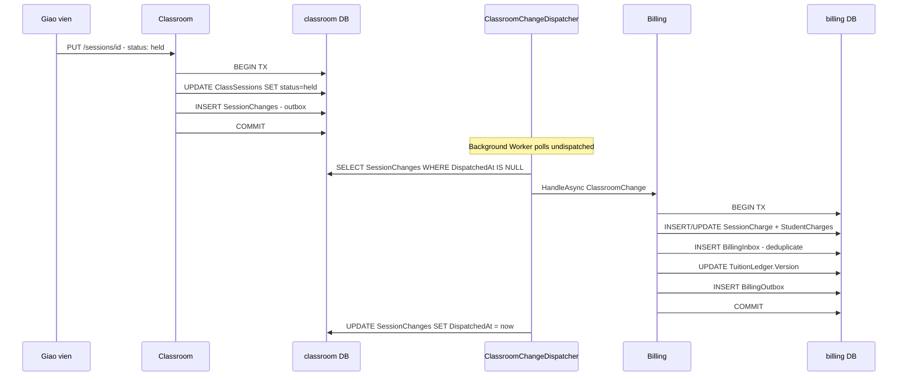

---

## 6. Luồng dữ liệu chính

### 6.1. Luồng Đăng nhập - Tạo lớp - Thêm học sinh

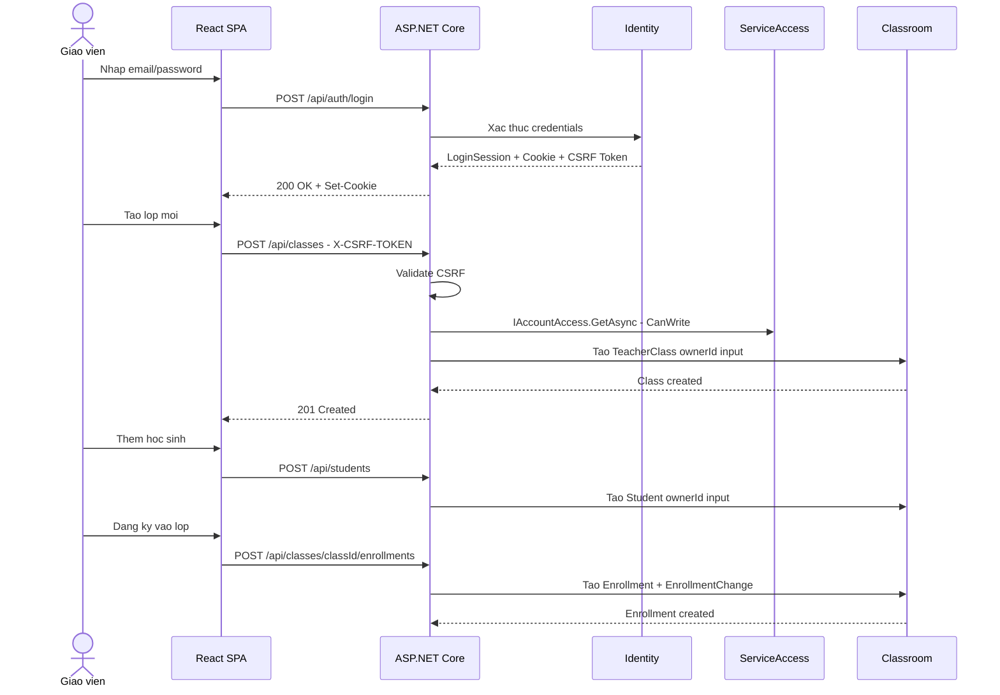

### 6.2. Luồng Tính học phí từ Điểm danh

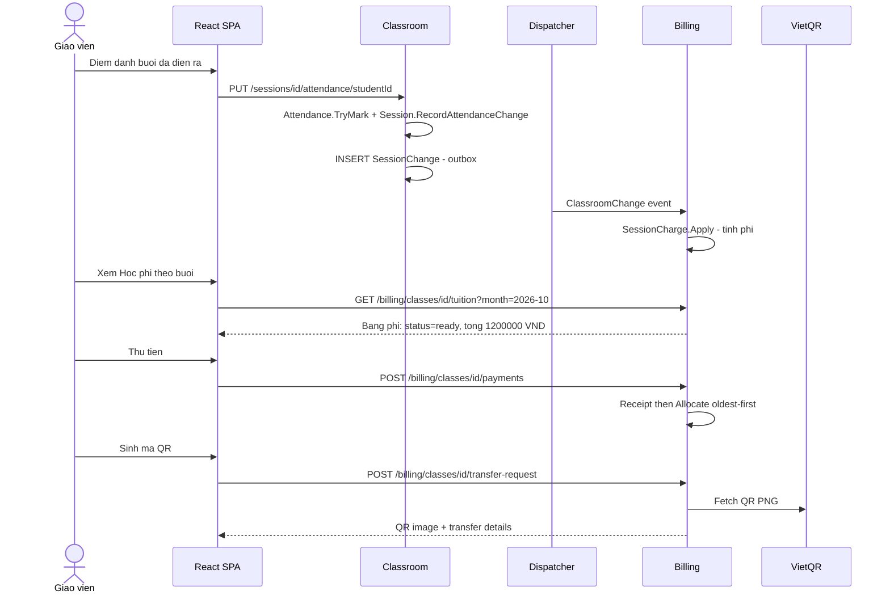

---

## 7. Triển khai và hạ tầng

### 7.1. Docker Compose Architecture

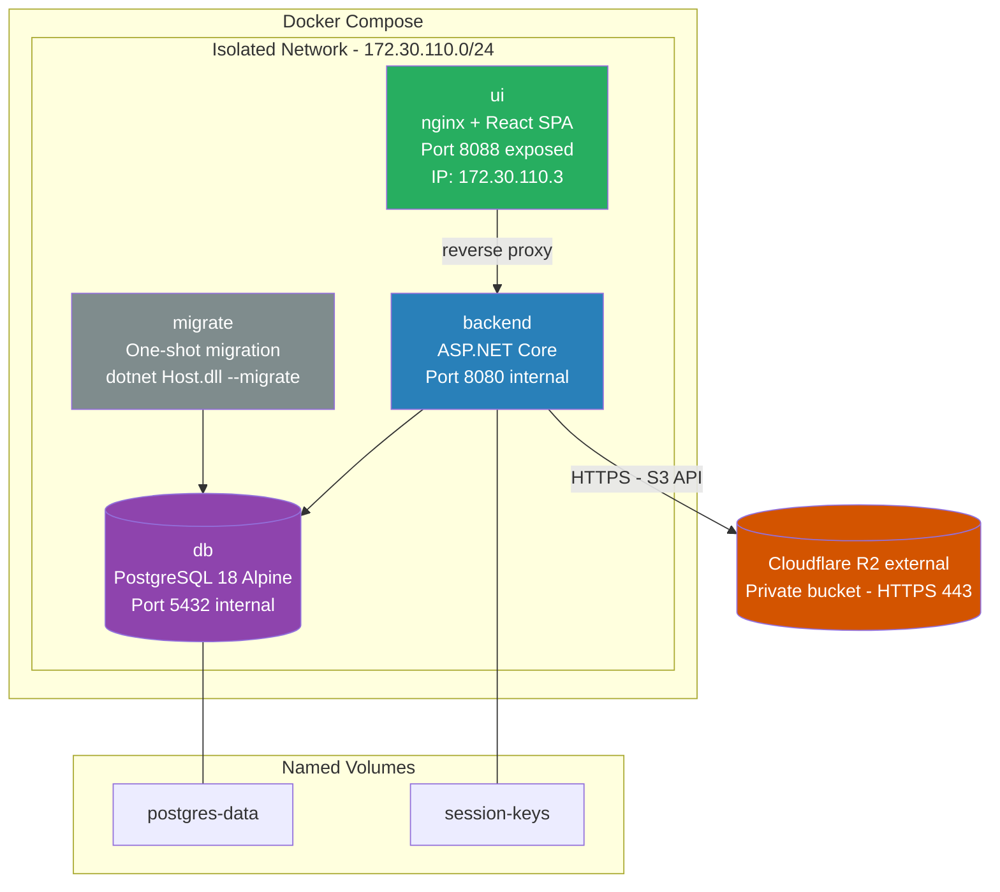

### 7.2. Thứ tự khởi động

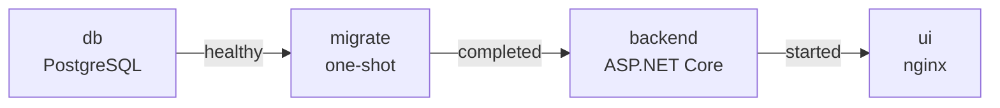

R2 không tham gia depends_on; lỗi R2 được xử lý ở thao tác ảnh/PDF, các module khác vẫn hoạt động.

### 7.3. CI/CD Pipeline (Jenkinsfile)

```mermaid
graph TD
    A["Push/Merge to GitHub"] --> B["Jenkins Webhook"]
    B --> C["Checkout Source"]
    C --> D["dotnet restore + build"]
    D --> E["Start PostgreSQL Container"]
    E --> F["dotnet test - API Tests<br/>Real DB, random ekt_test database"]
    F --> G["npm ci + npm run build - UI"]
    G --> H["Start Vite + API servers"]
    H --> I["npx playwright test - E2E<br/>Desktop + Mobile 390px"]
    I --> J["Docker Build - Multi-stage"]
    J --> K["Report Results"]
```

### 7.4. Dockerfile — Multi-stage Build

```
Stage 1: BUILD (SDK 10.0)
  - Copy source
  - dotnet publish -c Release

Stage 2: RUNTIME (aspnet 10.0)
  - Copy published output
  - Install Playwright Chromium
  - Create /keys directory
  - Run as non-root ($APP_UID)
  - EXPOSE 8080
  - ENTRYPOINT: dotnet Host.dll
```

---

## 8. Bảo mật

### 8.1. Xác thực và Phiên

| Chính sách | Giáo viên | Admin |
|---|---|---|
| **Idle timeout** | 2 giờ | 30 phút |
| **Absolute timeout** | 24 giờ | 8 giờ |
| **Gia hạn** | Chỉ khi CSRF-validated Write | Chỉ khi Write |
| **Cookie** | Secure, HttpOnly, SameSite=Strict | Secure, HttpOnly, SameSite=Strict |
| **GET/Polling** | Không gia hạn idle | Không gia hạn idle |

### 8.2. CSRF Protection

- Mọi request non-GET đến `/api/*` phải kèm header `X-CSRF-TOKEN`
- Token được phát hành qua cookie `ekt.csrf` (Double-Submit pattern)
- Vi phạm trả về **400** với thông báo tiếng Việt

### 8.3. Authorization Model

```mermaid
graph TD
    REQ["HTTP Request"] --> AUTH["IsAuthenticated?"]
    AUTH -->|No| R401["401 Unauthorized"]
    AUTH -->|Yes| SA["IAccountAccess.GetAsync"]

    SA --> CHK_BLK["IsBlocked?"]
    CHK_BLK -->|Yes| R403_B["403 Blocked"]
    CHK_BLK -->|No| CHK_EXP["Expired?"]

    CHK_EXP -->|"Yes + Write"| R403_E["403 Read-only"]
    CHK_EXP -->|"Yes + Read"| OK_READ["Allow Read"]
    CHK_EXP -->|No| CHK_ACT["CanWrite / CanRead?"]

    CHK_ACT -->|"CanWrite + Write req"| OK_WRITE["Allow Write"]
    CHK_ACT -->|"CanRead + Read req"| OK_READ
    CHK_ACT -->|Denied| R403["403 Forbidden"]
```

### 8.4. Ownership Isolation

- Mỗi giáo viên chỉ truy cập dữ liệu thuộc `OwnerId` = account ID của mình
- Truy cập ID của giáo viên khác luôn trả về **404** (không phải 403)
- `OwnerId` được lấy từ session server-side, không tin tưởng input client

### 8.5. Data Validation

| Quy tắc | Cách thực hiện |
|---|---|
| **Input limits** | Domain entity validation (ví dụ: tên lớp max 120, email max 254) |
| **Optimistic concurrency** | Version mismatch trả về **409 Conflict** |
| **Idempotency** | UUID key cho Receipt, Adjustment, Export — retry an toàn |
| **Money precision** | `numeric(18,0)`, `BigInt` formatting trên UI |
| **Request body size** | Kestrel limit 128KB (`MaxRequestBodySize = 131072`) |
| **Image upload** | PNG only, max 1MB, max 2048x2048px (static QR) |

---

> **Tài liệu này phản ánh trạng thái mã nguồn hiện tại của project Education Keeptrack.**
