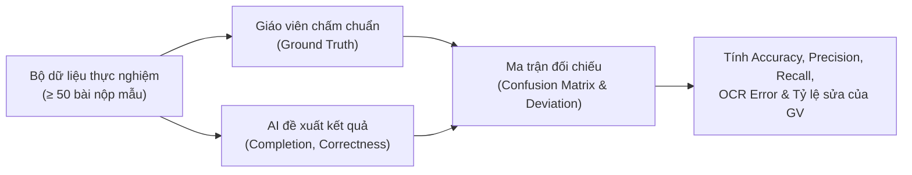
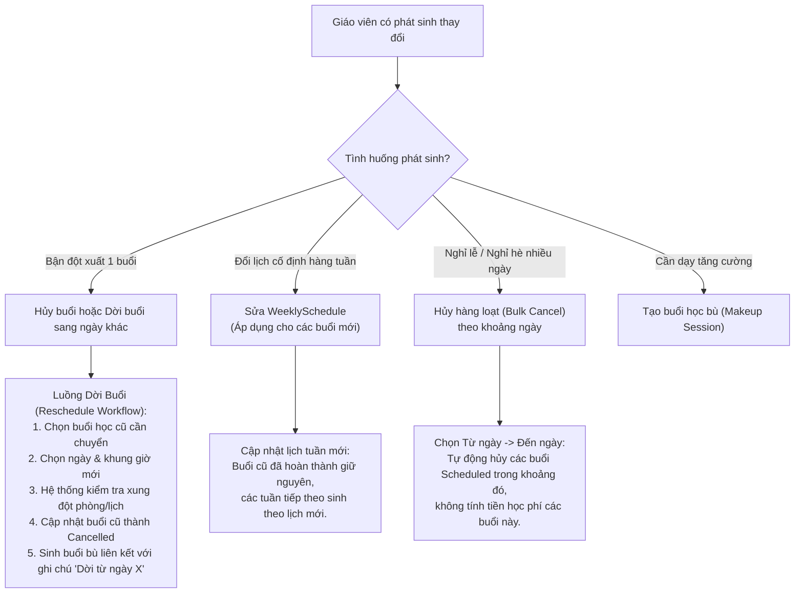
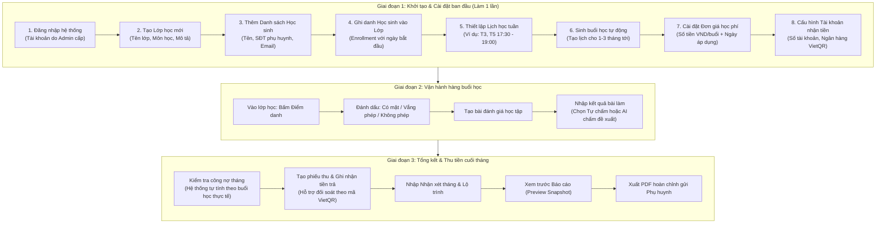
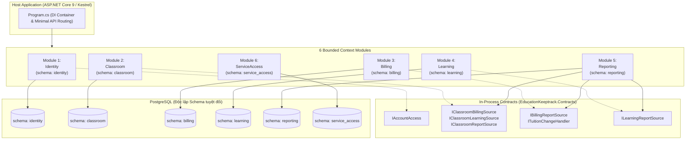

# Báo Cáo Buổi 2 — Education Keeptrack
**Hệ Thống Quản Lý Lớp Học, Điểm Danh, Học Phí & Đánh Giá Học Tập (Mini-CRM Cho Giáo Viên)**

* **Ngày báo cáo:** 29/10/2026
* **Cơ sở tài liệu:** Phản hồi từ Giảng viên hướng dẫn tại Buổi 2 và Hiện trạng Kiến trúc mã nguồn dự án.
* **Mã nguồn hệ thống:** [src/](file:///d:/TruongQuocToan_0214168/Hoc_ky_7/DAPhattrienphiaServer/src)

---

## Mục Lục

1. [PHẦN I: TIẾP THU VÀ XỬ LÝ 5 GÓP Ý TỪ GIẢNG VIÊN](#phần-i-tiếp-thu-và-xử-lý-5-góp-ý-từ-giảng-viên)
   * [1. AI Chấm Bài: Giới hạn phạm vi môn học & Đo lường độ tin cậy](#1-ai-chấm-bài-giới-hạn-phạm-vi-môn-học--đo-lường-độ-tin-cậy)
   * [2. Chuẩn hóa & Chi tiết hóa Yêu cầu Phi Chức Năng (NFR-01 đến NFR-16)](#2-chuẩn-hóa--chi-tiết-hóa-yêu-cầu-phi-chức-năng-nfr-01-đến-nfr-16)
   * [3. Nghiệp vụ Giảng viên thay đổi buổi học & Giải pháp UI/UX trực quan](#3-nghiệp-vụ-giảng-viên-thay-đổi-buổi-học--giải-pháp-uiux-trực-quan)
   * [4. Hướng dẫn Quy trình nhập liệu cho Giáo viên từ A-Z](#4-hướng-dẫn-quy-trình-nhập-liệu-cho-giáo-viên-từ-a-z)
   * [5. Đánh giá Tính khả thi của các tính năng AI & Lộ trình thực tế](#5-đánh-giá-tính-khả-thi-của-các-tính-năng-ai--lộ-trình-thực-tế)
2. [PHẦN II: GIẢI THÍCH CHI TIẾT TỪNG MODULE TRONG HỆ THỐNG](#phần-ii-giải-thích-chi-tiết-từng-module-trong-hệ-thống)
   * [Tổng quan Kiến trúc Modular Monolith](#tổng-quan-kiến-trúc-modular-monolith)
   * [Module 1: Identity (Định danh & Quản lý Phiên làm việc)](#module-1-identity-định-danh--quản-lý-phiên-làm-việc)
   * [Module 2: Classroom (Lớp học, Học sinh, Điểm danh & Lịch học)](#module-2-classroom-lớp-học-học-sinh-điểm-danh--lịch-học)
   * [Module 3: Billing (Học phí, Đơn giá hiệu lực, Thu tiền & VietQR)](#module-3-billing-học-phí-đơn-giá-hiệu-lực-thu-tiền--vietqr)
   * [Module 4: Learning (Đánh giá học tập & Kết quả bài tập)](#module-4-learning-đánh-giá-học-tập--kết-quả-bài-tập)
   * [Module 5: Reporting (Báo cáo tháng, Xem trước Snapshot & Xuất PDF)](#module-5-reporting-báo-cáo-tháng-xem-trước-snapshot--xuất-pdf)
   * [Module 6: ServiceAccess (Kiểm soát Quyền truy cập & Kỳ sử dụng)](#module-6-serviceaccess-kiểm-soát-quyền-truy-cập--kỳ-sử-dụng)
3. [BẢNG SO SÁNH TỔNG HỢP 6 MODULES](#bảng-so-sánh-tổng-hợp-6-modules)
4. [KẾT LUẬN VÀ KẾ HOẠCH BÁO CÁO BUỔI TIẾP THEO](#kết-luận-và-kế-hoạch-báo-cáo-buổi-tiếp-theo)

---

# PHẦN I: TIẾP THU VÀ XỬ LÝ 5 GÓP Ý TỪ GIẢNG VIÊN

---

### 1. AI Chấm Bài: Giới hạn phạm vi môn học & Đo lường độ tin cậy

#### 1.1. Hiện trạng & Góp ý của Giảng viên
* **Góp ý:** "Tính năng AI chấm bài phải giới hạn phạm vi môn học rõ ràng. Phải có cách đo đạc được độ tin cậy của AI."
* **Nhận định khuyết điểm:** Báo cáo trước mô tả AI chung chung ("mô hình đa phương thức đọc ảnh bài nộp"), chưa xác định rõ môn học nào, dạng bài nào có thể chấm được và dạng nào vượt quá năng lực. Đồng thời chưa thiết lập bộ chỉ số đánh giá kỹ thuật (Metrics) và quy trình thực nghiệm rõ ràng.

#### 1.2. Giới hạn phạm vi môn học & Dạng bài thực tế
Để đảm bảo tính khả thi trong phạm vi đồ án tốt nghiệp, hệ thống thu hẹp mục tiêu nghiệm thu tính năng AI chấm bài vào **2 môn học trọng tâm của khối THCS (Lớp 6 đến Lớp 9)**:

| Hạng mục | Quy định cụ thể | Lý do lựa chọn |
| :--- | :--- | :--- |
| **Môn học mục tiêu** | **Toán học** (Lớp 6–9) và **Tiếng Anh** (Ngữ pháp/Từ vựng trắc nghiệm). | Đây là 2 môn học phổ biến nhất tại các lớp học thêm/gia sư, có cấu trúc đề bài chuẩn hóa và đáp án rõ ràng. |
| **Dạng bài hỗ trợ** | 1. Trắc nghiệm nhiều lựa chọn (A, B, C, D) khoanh trực tiếp trên giấy. 2. Bài tập toán tính toán đại số ngắn (phép tính số học, giải phương trình bậc nhất/bậc hai cơ bản có các bước trung gian rõ ràng). 3. Bài điền từ vào chỗ trống (Fill in the blanks). | Có căn cứ rubric chấm điểm tường minh (Ground Truth), AI dễ dàng đối chiếu bước làm và kết quả. |
| **Dạng bài từ chối / Chưa hỗ trợ** | 1. Bài hình học không gian hoặc hình học phẳng cần vẽ thêm đường phụ. 2. Bài chứng minh toán học phức tạp nhiều bước biến đổi phi quy ước. 3. Bài văn luận mở (Essay writing) trong Tiếng Anh. | Mô hình thị giác máy tính và LLM dễ sinh ảo giác (hallucination) khi chấm các bài mở, tính chủ quan cao. |
| **Tiêu chuẩn ảnh đầu vào** | 1. Chụp thẳng góc (độ nghiêng không quá 15 độ), đủ ánh sáng. 2. Định dạng ảnh JPEG/PNG, độ phân giải tối thiểu 1080p. 3. Nét chữ viết tay liền mạch, không bị đứt nét hoặc mất trang. | Nếu ảnh không đạt tiêu chuẩn, hệ thống từ chối chấm ngay từ đầu (`Reject`) thay vì đoán sai lệch. |

#### 1.3. Bộ chỉ số đo lường độ tin cậy (AI Reliability Metrics)
Hệ thống sử dụng hai chỉ số đầu ra chuẩn hóa: **Completion (0–100%)** (Mức độ hoàn thành bài) và **Correctness (0–100%)** (Mức độ chính xác của bài làm). Độ tin cậy của AI được đo qua các chỉ số sau:

| Tên chỉ số | Công thức / Định nghĩa | Cách thức đo kiểm | Ngưỡng mục tiêu nghiệm thu |
| :--- | :--- | :--- | :--- |
| **Accuracy (Độ chính xác tương quan)** | Tỷ lệ số bài mà AI đề xuất sai lệch không quá 1 mức đánh giá (±25%) so với giáo viên: $\frac{N_{\text{khớp}}}{N_{\text{tổng}}}$ | Lấy tối thiểu 50 bài mẫu thực tế, so sánh kết quả AI đề xuất với kết quả giáo viên xác nhận. | **≥ 70%** ở phiên bản đầu tiên. |
| **OCR Character Accuracy** | Tỷ lệ ký tự số và chữ cái AI trích xuất chính xác từ ảnh viết tay: $1 - \frac{\text{Levenshtein Distance}}{\text{Tổng ký tự}}$ | Đối chiếu văn bản số hóa từ OCR với bài gõ lại chuẩn của người dùng. | **≥ 85%** đối với chữ viết tay rõ nét. |
| **Confidence Score** | Mức độ tự tin trung bình của mô hình trên từng câu/bài (thang điểm 0.0 – 1.0). | Mô hình trả về `confidence` trong payload. | Điểm `< 0.6` đánh dấu cờ `[Cần GV kiểm tra kỹ]`. |
| **Rejection Rate (Tỷ lệ từ chối an toàn)** | Tỷ lệ bài nộp ảnh mờ/thiếu trang mà AI từ chối không đoán bừa. | Đưa 20 mẫu ảnh lỗi (mờ nhòe, tối, mất góc). | **100%** ảnh lỗi phải bị từ chối với lý do rõ ràng. |
| **Teacher Override Rate (Tỷ lệ GV phải sửa)** | Tỷ lệ đề xuất bị giáo viên can thiệp sửa đổi trước khi bấm xác nhận (`confirmed`). | Tính trực tiếp từ log bảng `SubmissionHistories`. | **< 30%** (GV đồng ý hoặc chỉ tinh chỉnh nhẹ ≥ 70%). |

---

### 2. Chuẩn hóa & Chi tiết hóa Yêu cầu Phi Chức Năng (NFR-01 đến NFR-16)

#### 2.1. Hiện trạng & Góp ý của Giảng viên
* **Góp ý:** "Sửa lại yêu cầu phi chức năng cụ thể từng yêu cầu, không viết 1 dòng như hiện tại."
* **Nhận định khuyết điểm:** Báo cáo 1 chỉ liệt kê các câu mô tả ngắn như "hệ thống bảo mật", "phản hồi nhanh", không có chỉ số định lượng (SLA/KPI), không có phương pháp kiểm thử cụ thể (Test procedure).

#### 2.2. Bảng đặc tả chi tiết 16 Yêu cầu Phi Chức Năng

| Mã NFR | Nhóm yêu cầu | Nội dung yêu cầu chi tiết | Chỉ tiêu định lượng (Target SLA) | Phương pháp kiểm tra / Đo lường |
| :--- | :--- | :--- | :--- | :--- |
| **NFR-01** | **Bảo mật — Xác thực** | Người dùng đăng nhập bằng Email và Password. Cookie phiên làm việc (`ekt.session`) phải có cờ `HttpOnly`, `SameSite=Strict`, và `Secure` khi chạy trên giao thức HTTPS. | 100% Request phiên có đầy đủ 3 thuộc tính bảo mật cookie. | Dùng DevTools / curl kiểm tra header `Set-Cookie` trả về từ endpoint `/api/auth/login`. |
| **NFR-02** | **Bảo mật — Phân quyền dữ liệu** | Mỗi giáo viên là một tenant độc lập, chỉ xem và thao tác dữ liệu gắn liền với `OwnerId` của mình. Nghiêm cấm rò rỉ dữ liệu giữa các giáo viên. | 0% trường hợp truy cập chéo dữ liệu trái phép. | Viết integration test: Dùng Token của Giáo viên A truy vấn Lớp học/Học sinh của Giáo viên B $\rightarrow$ Hệ thống bắt buộc trả về HTTP `404 Not Found` hoặc `403 Forbidden`. |
| **NFR-03** | **Bảo mật — Chống CSRF** | Tất cả các yêu cầu ghi trạng thái (`POST`, `PUT`, `DELETE`) trên API phải mang header `X-CSRF-TOKEN` hợp lệ do ASP.NET Antiforgery phát hành. | 100% mutation API được bảo vệ bởi middleware CSRF. | Gửi request `POST /api/classes` không có header `X-CSRF-TOKEN` $\rightarrow$ Hệ thống lập tức trả lời mã lỗi `400 Bad Request`. |
| **NFR-04** | **Bảo mật — An toàn Mật khẩu** | Mật khẩu tài khoản phải được băm an toàn thông qua ASP.NET Core Identity (sử dụng chuẩn PBKDF2 với HMAC-SHA256, work factor chuẩn). Toàn bộ Secret Key, Chuỗi kết nối DB không được lưu cứng trong mã nguồn Git. | 0 khóa bí mật lộ trên repo; mật khẩu trong DB là hash 1 chiều. | Quét mã nguồn bằng công cụ Git Secret Scan; kiểm tra trực tiếp cột `PasswordHash` trong bảng `identity.Accounts`. |
| **NFR-05** | **Hiệu năng — Thao tác CRUD** | Các API truy vấn danh sách lớp, danh sách học sinh, điểm danh, bảng học phí phải phản hồi nhanh trên môi trường tiêu chuẩn với cơ sở dữ liệu có ít nhất 10.000 bản ghi. | Thời gian phản hồi $P95 \le 200\text{ ms}$; tối đa không quá $500\text{ ms}$. | Kiểm thử tải bằng k6 hoặc Apache Benchmark với kịch bản 50 người dùng đồng thời. |
| **NFR-06** | **Hiệu năng — Xuất PDF Báo cáo** | Quá trình tổng hợp dữ liệu, tạo HTML snapshot và render PDF bằng Headless Chromium (Playwright) cho 1 học sinh không được nghẽn ứng dụng chính. | Thời gian hoàn tất xuất PDF $\le 15\text{ giây}$ (file từ 2–5 trang). | Gọi API `POST /api/reporting/.../exports`, đo thời gian từ lúc nhận request đến khi trạng thái chuyển sang `Ready`. |
| **NFR-07** | **Hiệu năng — Thời gian chờ AI** | Khi gọi xử lý AI nhận dạng bài hoặc sinh nhận xét, giao diện phải phản hồi trạng thái chờ (`Pending`) và không làm khóa luồng HTTP chính của máy chủ. | Timeout xử lý tối đa là $60\text{ giây}$. Nếu quá giờ, phải chuyển trạng thái `Failed` và cho phép thử lại. | Mô phỏng trễ mạng khi gọi OpenAI/Gemini API, kiểm tra cơ chế ngắt kết nối an toàn (`CancellationToken`). |
| **NFR-08** | **Độ chính xác — Học phí** | Học phí phải được tính toán chính xác tuyệt đối dựa trên: Buổi học thực tế (`Completed`) + Học sinh có mặt (`Present`) + Đơn giá hiệu lực tại ngày học (`TuitionLedger`). | Tỷ lệ sai lệch tài chính $= 0\text{ VNĐ}$ trong mọi trường hợp kiểm thử. | Lập ma trận kiểm thử: 10 buổi học trải dài qua 2 lần đổi giá học phí và có học sinh vắng có phép $\rightarrow$ Đối chiếu kết quả API với tính toán tay. |
| **NFR-09** | **Toàn vẹn — Idempotency Thu tiền** | Khi giáo viên ghi nhận phiếu thu tiền, nếu mạng chập chờn gửi lại cùng một yêu cầu (trùng `IdempotencyKey`), hệ thống không được tạo thêm phiếu thu thứ hai. | 100% request trùng khóa không gây ghi đúp giao dịch. | Gửi đồng thời 2 request `POST /api/billing/.../payments` với cùng `IdempotencyKey` $\rightarrow$ DB chỉ xuất hiện duy nhất 1 bản ghi `Receipt`. |
| **NFR-10** | **Khả năng sử dụng — Ngôn ngữ** | Toàn bộ giao diện người dùng, nhãn bảng biểu và các câu thông báo lỗi nghiệp vụ phải hiển thị bằng tiếng Việt chuẩn mực, rõ ràng, không lộ mã lỗi kỹ thuật như NullReference. | 100% thông điệp phản hồi cho người dùng là tiếng Việt tự nhiên. | Rà soát toàn bộ tệp tài nguyên frontend và middleware xử lý ngoại lệ tập trung `app.UseExceptionHandler`. |
| **NFR-11** | **Khả năng sử dụng — Responsive** | Giao diện phải thích ứng tốt trên các thiết bị di động (Smartphones với màn hình chiều rộng từ $375\text{ px}$) và Máy tính cá nhân ($1280\text{ px}$ trở lên). | Không xuất hiện thanh cuộn ngang vỡ khung hình (Zero horizontal scrollbar). | Kiểm tra trực quan bằng Chrome DevTools Responsive Emulator trên kích thước iPhone SE ($375\text{ px}$) và Desktop ($1920\times 1080\text{ px}$). |
| **NFR-12** | **Độ tin cậy — Tính Bền vững Dữ liệu** | Dữ liệu sau khi ghi nhận thành công phải không bị mất mát khi tắt mở lại hệ điều hành hoặc khởi động lại Docker container. | Zero data loss sau chu kỳ restart dịch vụ. | Thực hiện `docker compose down && docker compose up -d`, kiểm tra toàn bộ dữ liệu bảng `classroom`, `billing` vẫn nguyên vẹn nhờ Docker named volume. |
| **NFR-13** | **Khả năng Chịu lỗi — Graceful Degradation** | Khi các dịch vụ ngoại vi (như kho lưu trữ Cloudflare R2, Cổng VietQR hoặc API AI) gặp sự cố mạng, hệ thống core vẫn phải hoạt động bình thường các tính năng nội bộ. | Ứng dụng không sập (crash); trả về mã lỗi 502/503 kèm thông báo gợi ý. | Ngắt kết nối internet của máy chủ $\rightarrow$ Thực hiện điểm danh và xem công nợ $\rightarrow$ Các chức năng nội bộ vẫn chạy thông suốt. |
| **NFR-14** | **Chất lượng Báo cáo PDF** | Tệp PDF xuất ra phải nhúng font Unicode tiếng Việt (Roboto/Inter) đầy đủ dấu, bố cục rõ ràng, bảng biểu không bị tràn lề, hỗ trợ in ấn tiêu chuẩn A4. | Hiển thị chính xác 100% ký tự tiếng Việt có dấu; mã QR ngân hàng quét được ngay bằng ứng dụng Mobile Banking. | Xuất file PDF thực tế $\rightarrow$ Dùng app ngân hàng Vietcombank/MBBank quét mã QR in trên giấy $\rightarrow$ Đúng số tiền và số tài khoản. |
| **NFR-15** | **Sao lưu & Phục hồi** | Cơ sở dữ liệu PostgreSQL phải có quy trình sao lưu định kỳ bằng lệnh `pg_dump` tiêu chuẩn và có tài liệu kiểm chứng phục hồi thảm họa (`Disaster Recovery`). | Thời gian phục hồi toàn bộ dữ liệu (RTO) $< 10\text{ phút}$; Điểm phục hồi (RPO) $\le 24\text{ giờ}$. | Chạy lệnh backup ra file `.sql`, xóa database thử nghiệm và phục hồi lại thành công 100% trạng thái trước đó. |
| **NFR-16** | **Kiến trúc — Modular Monolith** | Hệ thống phải phân tách thành 6 module tách biệt: `Identity`, `Classroom`, `Billing`, `Learning`, `Reporting`, `ServiceAccess`. Mỗi module quản lý 1 schema PostgreSQL riêng biệt. | Zero direct cross-DbContext joins trong mã nguồn. | Rà soát cấu trúc source code; biên dịch dự án kiểm tra module không reference trực tiếp DbContext của module khác. |

---

### 3. Nghiệp vụ Giảng viên thay đổi buổi học & Giải pháp UI/UX trực quan

#### 3.1. Hiện trạng & Góp ý của Giảng viên
* **Góp ý:** "Gợi ý nghiệp vụ: Giáo viên bận thay đổi buổi học thì làm như thế nào? UI/UX như thế nào để giáo viên cài đặt buổi học dễ dàng?"
* **Nhận định khuyết điểm:** Hệ thống hiện tại có các lệnh cơ bản như tạo buổi, hủy buổi, nhưng chưa có luồng nghiệp vụ liên kết "Dời lịch" (Reschedule) khép kín và giao diện dạng bảng danh sách chưa trực quan cho thao tác xếp lịch hàng tuần.

#### 3.2. Phân tích 5 tình huống thực tế và Giải pháp nghiệp vụ

1. **Tình huống 1: Giáo viên bận đột xuất một buổi trong tuần (Dời buổi)**
   * **Nghiệp vụ:** Giáo viên chọn buổi học cần chuyển $\rightarrow$ Chọn tính năng **"Dời lịch"**.
   * **Quy trình xử lý:** 
     - Nhập ngày học mới và giờ học mới.
     - Hệ thống kiểm tra xung đột lịch: Nếu giáo viên đã có lớp khác trùng khung giờ $\rightarrow$ Cảnh báo đỏ ngay lập tức.
     - Nếu không trùng: Hệ thống đánh dấu buổi học cũ là `Cancelled` (với lý do: "Dời sang ngày dd/MM/yyyy"), đồng thời tự động tạo một buổi học mới ở trạng thái `Scheduled` gắn nhãn `Makeup` (Học bù).
     - Ghi nhận vào bảng nhật ký sự kiện [`SessionChange`](file:///d:/TruongQuocToan_0214168/Hoc_ky_7/DAPhattrienphiaServer/src/Modules/Classroom/Domain/SessionChange.cs) để phục vụ tra cứu lịch sử.

2. **Tình huống 2: Hủy hẳn một buổi học (không học bù)**
   * **Nghiệp vụ:** Giáo viên chuyển trạng thái buổi học thành `Cancelled`.
   * **Quy tắc tài chính:** Buổi học bị hủy tự động không hiển thị trong danh sách điểm danh, và Module [`Billing`](file:///d:/TruongQuocToan_0214168/Hoc_ky_7/DAPhattrienphiaServer/src/Modules/Billing/BillingModule.cs) tuyệt đối không tính phí buổi học này vào công nợ tháng của học sinh.

3. **Tình huống 3: Thay đổi thời khóa biểu cố định hàng tuần**
   * **Nghiệp vụ:** Giáo viên cập nhật cấu hình [`WeeklySchedule`](file:///d:/TruongQuocToan_0214168/Hoc_ky_7/DAPhattrienphiaServer/src/Modules/Classroom/Domain/WeeklySchedule.cs) (ví dụ: chuyển từ Thứ 3, Thứ 5 sang Thứ 4, Thứ 7).
   * **Quy tắc dữ liệu:** Các buổi học trong quá khứ đã diễn ra giữ nguyên lịch sử; tính năng sinh buổi học tự động (`GenerateAsync`) từ thời điểm sửa đổi trở đi sẽ bám theo lịch tuần mới.

4. **Tình huống 4: Giáo viên nghỉ phép hàng loạt (Nghỉ Tết, Nghỉ cá nhân 1–2 tuần)**
   * **Nghiệp vụ:** Bổ sung tính năng **"Nghỉ phép theo khoảng thời gian"** trên giao diện: Giáo viên chỉ cần chọn ngày bắt đầu và ngày kết thúc $\rightarrow$ Hệ thống tự động chuyển tất cả các buổi `Scheduled` trong khoảng thời gian đó sang trạng thái `Cancelled` hàng loạt.

5. **Tình huống 5: Dạy tăng cường / Buổi phụ đạo chuyên đề**
   * **Nghiệp vụ:** Giáo viên bấm nút "Tạo buổi đột xuất", chọn ngày giờ bất kỳ ngoài lịch cố định $\rightarrow$ Buổi học được tạo và học sinh trong lớp được tính điểm danh và học phí bình thường.

#### 3.3. Giải pháp Thiết kế UI/UX cài đặt buổi học dễ dàng
Để giáo viên thao tác nhẹ nhàng, không bị nhầm lẫn, giao diện được định hướng thiết kế với các tiêu chí hiện đại:
* **Giao diện Lịch trực quan (Interactive Calendar View):** Thay vì bảng danh sách đơn điệu, chuyển sang dạng Lịch Tuần / Lịch Tháng tương tự Google Calendar. Mỗi buổi học là một block màu (Xanh lá: Đã học & điểm danh xong; Xanh dương: Sắp diễn ra; Xám gạch ngang: Buổi đã hủy; Cam: Buổi học bù).
* **Kéo & Thả để dời lịch (Drag and Drop):** Khi cần dời lịch, giáo viên chỉ cần kéo block buổi học từ ô Thứ 3 thả sang ô Thứ 6. Một popup xác nhận bật lên hỏi: *"Bạn có muốn dời buổi từ ngày 10/11 sang ngày 13/11 không?"* $\rightarrow$ Tiết kiệm 4 bước thao tác tay.
* **Hành động nhanh (Quick Action Context Menu):** Bấm chuột phải hoặc nhấn giữ vào buổi học để mở menu nhanh: *[Điểm danh]* / *[Dời lịch]* / *[Hủy buổi]* / *[Xem học phí buổi này]*.
* **Trình tạo lịch tuần 3 bước (3-Step Schedule Wizard):**
  - *Bước 1:* Tích chọn các ngày trong tuần (Thứ 2 đến Chủ Nhật).
  - *Bước 2:* Nhập khung giờ (Ví dụ: 18:00 – 19:30).
  - *Bước 3:* Chọn khoảng ngày áp dụng và bấm *"Tự động tạo tất cả buổi học"*.
* **Huy hiệu nhắc việc (Notification Badges):** Những buổi học trong quá khứ chưa được điểm danh sẽ có chấm đỏ nhấp nháy nhắc nhở giáo viên hoàn thiện trước khi chốt sổ cuối tháng.

---

### 4. Hướng dẫn Quy trình nhập liệu cho Giáo viên từ A-Z

#### 4.1. Hiện trạng & Góp ý của Giảng viên
* **Góp ý:** "Về cách sử dụng, giáo viên vào nhập liệu như thế nào?"
* **Nhận định khuyết điểm:** Cần có tài liệu hướng dẫn nghiệp vụ rõ ràng, mô tả từng bước thao tác từ ngày đầu tiên thiết lập đến chu kỳ vận hành hàng ngày và chốt sổ cuối tháng.

#### 4.2. Sơ đồ Quy trình Vận hành Toàn diện

#### 4.3. Mô tả chi tiết từng bước thao tác

* **Bước 1: Đăng nhập & Xác thực an toàn**
  - Giáo viên truy cập giao diện web, nhập Email và Mật khẩu. Hệ thống thiết lập phiên Cookie bảo mật thông qua [`AuthEndpoints`](file:///d:/TruongQuocToan_0214168/Hoc_ky_7/DAPhattrienphiaServer/src/Modules/Identity/Endpoints/AuthEndpoints.cs).
* **Bước 2: Thiết lập cấu trúc lớp học & Học viên**
  - Vào mục *Quản lý lớp* $\rightarrow$ Nhập Tên lớp (Ví dụ: "Toán 9 Nâng Cao A1"), Môn học ("Toán học").
  - Vào mục *Học sinh* $\rightarrow$ Thêm thông tin học sinh (Họ tên, Số điện thoại phụ huynh để gửi báo cáo Zalo/SMS).
  - Ghi danh học sinh vào lớp học vừa tạo: Chọn học sinh và chọn ngày bắt đầu học.
* **Bước 3: Lập lịch học & Cài đặt bảng giá**
  - Thiết lập lịch cố định trong tuần (Thứ mấy, Từ mấy giờ đến mấy giờ).
  - Nhấn *"Sinh buổi học"* theo khoảng thời gian (Ví dụ: từ 01/10 đến 31/12).
  - Thiết lập Đơn giá học phí: Nhập mức học phí (Ví dụ: $150.000\text{ VNĐ/buổi}$) kèm ngày bắt đầu áp dụng.
  - Cập nhật thông tin ngân hàng nhận học phí (Tên chủ tài khoản, Số tài khoản, Ngân hàng Vietcombank/MBBank/...) để tự động vẽ mã QR lên báo cáo.
* **Bước 4: Thao tác trong từng buổi học**
  - Khi bắt đầu hoặc kết thúc buổi học: Giáo viên mở buổi học trên điện thoại hoặc máy tính $\rightarrow$ Bấm nút *Điểm danh*. Giao diện tối ưu hóa cho phép bấm 1 chạm: Học sinh có mặt (màu xanh lá), vắng có phép hoặc vắng không phép.
  - Khi có bài kiểm tra/bài tập: Giáo viên tạo bài đánh giá $\rightarrow$ Chọn phương thức tự chấm (chọn nhanh 4 mức 25%, 50%, 75%, 100% cho Hoàn thành & Đúng) hoặc bấm chọn AI chấm đối với bài viết tay.
* **Bước 5: Chốt học phí & Xuất báo cáo gửi phụ huynh**
  - Cuối tháng, hệ thống tự động tổng hợp số buổi thực học của từng học sinh nhân với đơn giá hiệu lực để ra số tiền học phí.
  - Nếu phụ huynh đã chuyển khoản: Giáo viên bấm *Ghi nhận phiếu thu* (có thể phân bổ cho tháng hiện tại hoặc trừ nợ cũ).
  - Giáo viên nhập lời nhận xét tháng (có thể nhấn gợi ý AI để sinh nhận xét mẫu) và định hướng lộ trình tháng sau.
  - Nhấn nút **Xem trước (Preview)** để kiểm tra lại toàn bộ thông tin điểm danh, học phí, mã QR VietQR.
  - Nhấn **Xuất PDF** $\rightarrow$ Hệ thống tạo tệp PDF hoàn chỉnh chuẩn in ấn lưu trên Cloudflare R2, giáo viên tải về và gửi trực tiếp cho phụ huynh.

---

### 5. Đánh giá Tính khả thi của các tính năng AI & Lộ trình thực tế

#### 5.1. Hiện trạng & Góp ý của Giảng viên
* **Góp ý:** "Chú ý về phần AI có khả thi hay không."
* **Nhận định khuyết điểm:** Báo cáo 1 đưa ra danh sách 7 tính năng AI (AI-01 đến AI-07) nhưng dàn trải, không phân biệt được tính năng nào làm được ngay với độ tin cậy cao, tính năng nào là thách thức lớn về dữ liệu và chi phí API, dễ dẫn đến nguy cơ vỡ kế hoạch khi nghiệm thu đồ án.

#### 5.2. Ma trận Phân tích Tính khả thi Kỹ thuật & Rủi ro

| Mã tính năng | Tên tính năng AI | Mức độ khả thi | Phân tích kỹ thuật & Công nghệ áp dụng | Rủi ro chính & Giải pháp khắc phục |
| :--- | :--- | :--- | :--- | :--- |
| **AI-01** | **OCR Nhận dạng chữ viết tay từ ảnh bài làm** | **Khả thi cao** (Có điều kiện) | Sử dụng Vision LLM (Google Gemini 2.0 Flash hoặc OpenAI GPT-4o-mini đa phương thức). | **Rủi ro:** Chữ viết tay tiếng Việt quá xấu, ảnh nghiêng, thiếu sáng. **Giải pháp:** Giới hạn ảnh chuẩn; nếu độ tin cậy OCR $< 0.6$ thì từ chối xử lý và yêu cầu GV nhập tay. |
| **AI-02** | **Chấm bài tự động & Đề xuất điểm số** | **Khả thi có kiểm soát** | Thu hẹp trong phạm vi: Toán đại số cấp 2 (phép tính, giải phương trình) và Trắc nghiệm Tiếng Anh. Có cung cấp Đề bài và Đáp án chuẩn (Ground Truth). | **Rủi ro:** AI giải thích sai bước làm, sinh ảo giác. **Giải pháp:** AI **chỉ đề xuất** (Suggestion), giáo viên giữ quyền bấm nút duyệt (`Confirmed`) hoặc sửa lại. |
| **AI-03** | **Tự động sinh nhận xét học tập tháng** | **Rất khả thi** (Khả thi cao nhất) | Prompt Engineering trên LLM: Đưa vào dữ liệu có cấu trúc (tỷ lệ có mặt, số buổi vắng, điểm trung bình các bài kiểm tra, mức độ hoàn thành bài). LLM sinh đoạn văn nhận xét mang tính sư phạm. | **Rủi ro:** Văn phong quá chung chung hoặc sáo rỗng. **Giải pháp:** Xây dựng System Prompt chuẩn hóa với ngữ cảnh lớp học; giáo viên được chỉnh sửa văn bản trực tiếp trước khi in ra PDF. |
| **AI-04** | **Gợi ý lộ trình học tập cá nhân hóa** | **Khả thi mức Trung bình** | LLM phân tích các dạng bài học sinh hay làm sai để gợi ý 2–3 chủ đề cần ôn tập trong tháng tới. | **Rủi ro:** Thiếu cây kỹ năng chuẩn (Skill Tree) trong DB dẫn đến gợi ý mơ hồ. **Giải pháp:** Cung cấp danh mục chủ đề môn Toán/Anh có sẵn để AI map vào. |
| **AI-05** | **Cảnh báo học sinh có nguy cơ sa sút** | **Rất khả thi** (Bằng Rule-based) | Giai đoạn 1 dùng giải thuật quy tắc (Rule-based): Vắng $\ge 3$ buổi liên tiếp hoặc kết quả đúng $< 50\%$ trong 2 bài gần nhất $\rightarrow$ Bật cờ cảnh báo. Không cần Machine Learning phức tạp lúc ban đầu. | **Rủi ro:** Dữ liệu nhỏ ban đầu không đủ huấn luyện ML. **Giải pháp:** Tiếp cận Rule-based đem lại độ chính xác 100%, dễ giải thích cho giáo viên. |
| **AI-06** | **Chatbot trợ lý ảo cho Giáo viên** | **Khả thi mức Trung bình** | Kiến trúc RAG (Retrieval-Augmented Generation) tìm kiếm trên tài liệu nghiệp vụ giảng dạy. | **Rủi ro:** Tốn tài nguyên vector database và chi phí token, không phải tính năng cốt lõi của đồ án. **Giải pháp:** Xếp vào danh mục mở rộng sau đồ án. |
| **AI-07** | **Cá nhân hóa theo chuẩn đầu ra năng lực** | **Rủi ro cao / Chưa khả thi** | Đòi hỏi mô hình hóa kiến thức chuẩn Bộ GD&ĐT phức tạp và kho dữ liệu bài kiểm tra khổng lồ. | **Giải pháp:** **Loại bỏ khỏi phạm vi cam kết** của đồ án, chỉ trình bày như định hướng nghiên cứu trong tương lai. |

#### 5.3. Định hướng Triển khai Cam kết trong Đồ án
Nhóm cam kết tập trung hoàn thiện xuất sắc **3 tính năng AI thiết thực nhất**:
1. **AI-03 (Sinh nhận xét sư phạm tháng):** Cam kết hoàn thành 100% tích hợp trực tiếp vào màn hình lập báo cáo PDF.
2. **AI-02 & AI-01 (Đọc ảnh & Gợi ý chấm bài môn Toán/Anh):** Triển khai với bộ dữ liệu mẫu nghiệm thu $\ge 50$ bài, đo lường bằng bộ chỉ số minh bạch.
3. **AI-05 (Cảnh báo học sinh học sa sút):** Vận hành ổn định bằng bộ quy tắc nghiệp vụ thời gian thực.

#### 5.4. Ước tính Chi phí API Vận hành
* **Môi trường phát triển & Đồ án tốt nghiệp:** Sử dụng **Google Gemini 2.0 Flash** (miễn phí ở hạn mức thấp) hoặc **OpenAI GPT-4o-mini** với chi phí cực thấp (~$0.15 cho 1 triệu token đầu vào). Chi phí chạy thử nghiệm cho 100 bài nộp mẫu không vượt quá $1.00 USD (khoảng 25.000 VNĐ).
* **Môi trường thực tế:** Tích hợp bộ đệm (Caching) kết quả và giới hạn số lần gọi API trên mỗi lớp để đảm bảo chi phí vận hành cho giáo viên dưới 10.000 VNĐ/tháng.

---

# PHẦN II: GIẢI THÍCH CHI TIẾT TỪNG MODULE TRONG HỆ THỐNG

---

### Tổng quan Kiến trúc Modular Monolith

Dự án được xây dựng theo kiến trúc **Modular Monolith** hiện đại trên nền tảng .NET 9 và PostgreSQL 16. Kiến trúc này mang lại những ưu thế vượt trội:

1. **Phân tách ranh giới rõ ràng (Bounded Contexts):** Toàn bộ mã nguồn chia thành 6 module độc lập nằm trong thư mục [`src/Modules/`](file:///d:/TruongQuocToan_0214168/Hoc_ky_7/DAPhattrienphiaServer/src/Modules). Mỗi module có tầng `Domain`, `Application`, `Infrastructure`, và bộ API Endpoints riêng.
2. **Cô lập dữ liệu tuyệt đối (Schema Isolation):** Trong cùng một cơ sở dữ liệu PostgreSQL, mỗi module sở hữu một schema riêng biệt (`identity`, `classroom`, `billing`, `learning`, `reporting`, `service_access`) kèm bảng lịch sử migration riêng (`__EFMigrationsHistory`). **Tuyệt đối không có khóa ngoại (Foreign Key) hoặc truy vấn JOIN trực tiếp qua DbContext của module khác.**
3. **Giao tiếp phi kết nối lỏng (Loose Coupling) & Outbox Pattern:**
   - Các module tương tác thông qua các giao diện hợp đồng C# trong dự án [`EducationKeeptrack.Contracts`](file:///d:/TruongQuocToan_0214168/Hoc_ky_7/DAPhattrienphiaServer/src/Contracts).
   - Sự kiện thay đổi dữ liệu (như sửa điểm danh, đổi lịch học) được lưu vào bảng Outbox trong cùng transaction của nghiệp vụ và được bộ điều phối nền ([`ClassroomChangeDispatcher`](file:///d:/TruongQuocToan_0214168/Hoc_ky_7/DAPhattrienphiaServer/src/Modules/Classroom/Infrastructure/ClassroomChangeDispatcher.cs), [`BillingWorker`](file:///d:/TruongQuocToan_0214168/Hoc_ky_7/DAPhattrienphiaServer/src/Modules/Billing/Infrastructure/BillingWorker.cs)) quét định kỳ, sử dụng **PostgreSQL Advisory Lock** để đảm bảo tuần tự hóa tuyệt đối mà không sợ xung đột race-condition.
4. **Cô lập Đa người thuê (Multi-Tenancy Isolation):** Mọi bản ghi nghiệp vụ đều được gắn chặt với khóa `OwnerId` (mã định danh tài khoản giáo viên). Khi truy vấn hoặc ghi, hệ thống luôn lọc theo `OwnerId` lấy từ Claims trong phiên đăng nhập, triệt tiêu nguy cơ xem nhầm dữ liệu giữa các giáo viên.

---

### Module 1: Identity (Định danh & Quản lý Phiên làm việc)

* **Vị trí mã nguồn:** [`src/Modules/Identity/`](file:///d:/TruongQuocToan_0214168/Hoc_ky_7/DAPhattrienphiaServer/src/Modules/Identity)
* **Schema Cơ sở dữ liệu:** `identity`
* **Lớp khởi tạo:** [`IdentityModule.cs`](file:///d:/TruongQuocToan_0214168/Hoc_ky_7/DAPhattrienphiaServer/src/Modules/Identity/IdentityModule.cs)

#### 1. Trách nhiệm & Bounded Context
Chịu trách nhiệm về đăng ký, đăng nhập, bảo vệ tài khoản, băm mật khẩu, xử lý khóa tài khoản (lockout), quản lý phiên làm việc tập trung (Stateful Sessions), thu hồi quyền đăng nhập (Session Revocation) và cung cấp token bảo vệ chống tấn công CSRF.

#### 2. Cấu trúc Lớp & Thành phần Bên trong
* **Domain Model:**
  - [`Account`](file:///d:/TruongQuocToan_0214168/Hoc_ky_7/DAPhattrienphiaServer/src/Modules/Identity/Domain/Account.cs): Kế thừa từ `IdentityUser`, bổ sung các cờ nghiệp vụ như `IsBlocked` (khóa tài khoản bởi quản trị viên) và liên kết vai trò (`Teacher`, `Admin`).
* **Application Services & Contracts:**
  - `ILoginSessions`: Giao diện quản lý vòng đời phiên làm việc (tạo session, kiểm tra tính hợp lệ của token phiên, và thu hồi phiên khi đăng xuất).
* **Infrastructure:**
  - [`IdentityDatabase`](file:///d:/TruongQuocToan_0214168/Hoc_ky_7/DAPhattrienphiaServer/src/Modules/Identity/Infrastructure/IdentityDatabase.cs): DbContext ánh xạ vào schema `identity`. Cấu hình mật khẩu, lockout tối đa 5 lần sai liên tiếp, mã hóa mật khẩu PBKDF2.
  - `SessionService`: Triển khai `ILoginSessions`, kiểm tra trạng thái tài khoản thời gian thực trên mỗi request API nhạy cảm.
  - `ProvisionTeacher`: Tiện ích dòng lệnh hỗ trợ cấp nhanh tài khoản giáo viên thử nghiệm trên môi trường Development.
* **API Endpoints ([`AuthEndpoints.cs`](file:///d:/TruongQuocToan_0214168/Hoc_ky_7/DAPhattrienphiaServer/src/Modules/Identity/Endpoints/AuthEndpoints.cs)):**
  - `GET /api/auth/csrf`: Cấp mã CSRF token mới cho giao diện frontend.
  - `POST /api/auth/login`: Nhận email/password, kiểm tra khóa tài khoản, tạo cookie phiên xác thực `ekt.session`. Bắt buộc tài khoản Admin phải có cơ chế xác thực riêng.
  - `GET /api/auth/me`: Trả về thông tin email giáo viên hiện tại và quyền sử dụng lấy từ Module ServiceAccess (`IAccountAccess`).
  - `POST /api/auth/activity`: Endpoint giữ ấm phiên (keep-alive) khi người dùng đang thao tác.
  - `POST /api/auth/logout`: Thu hồi phiên đăng nhập ngay lập tức trên máy chủ và xóa sạch cookie ở trình duyệt.

---

### Module 2: Classroom (Lớp học, Học sinh, Điểm danh & Lịch học)

* **Vị trí mã nguồn:** [`src/Modules/Classroom/`](file:///d:/TruongQuocToan_0214168/Hoc_ky_7/DAPhattrienphiaServer/src/Modules/Classroom)
* **Schema Cơ sở dữ liệu:** `classroom`
* **Lớp khởi tạo:** [`ClassroomModule.cs`](file:///d:/TruongQuocToan_0214168/Hoc_ky_7/DAPhattrienphiaServer/src/Modules/Classroom/ClassroomModule.cs)

#### 1. Trách nhiệm & Bounded Context
Là trung tâm vận hành lớp học của giáo viên: Quản lý danh mục lớp, thông tin liên lạc của học sinh và phụ huynh, hồ sơ ghi danh (Enrollment), thiết lập lịch cố định trong tuần, sinh các buổi học tương lai, ghi nhận điểm danh chi tiết từng buổi và theo dõi lịch sử chỉnh sửa điểm danh.

#### 2. Cấu trúc Thực thể & Mô hình Dữ liệu (Domain Model)
* [`TeacherClass`](file:///d:/TruongQuocToan_0214168/Hoc_ky_7/DAPhattrienphiaServer/src/Modules/Classroom/Domain/TeacherClass.cs): Lớp học của giáo viên (`Id`, `OwnerId`, `Name`, `Subject`, `Description`).
* [`Student`](file:///d:/TruongQuocToan_0214168/Hoc_ky_7/DAPhattrienphiaServer/src/Modules/Classroom/Domain/Student.cs): Học sinh (`Id`, `OwnerId`, `Name`, `ParentName`, `Phone`, `Email`).
* [`Enrollment`](file:///d:/TruongQuocToan_0214168/Hoc_ky_7/DAPhattrienphiaServer/src/Modules/Classroom/Domain/Enrollment.cs): Ghi nhận học sinh tham gia vào lớp (`ClassId`, `StudentId`, `Status`: Active/Suspended/Ended, `StartDate`, `EndDate`). Ngăn chặn ghi danh trùng học sinh vào cùng một lớp.
* [`WeeklySchedule`](file:///d:/TruongQuocToan_0214168/Hoc_ky_7/DAPhattrienphiaServer/src/Modules/Classroom/Domain/WeeklySchedule.cs): Thời khóa biểu cố định của lớp (chứa danh sách các slot: Ngày trong tuần `DayOfWeek`, Giờ bắt đầu `StartTime`, Giờ kết thúc `EndTime`).
* [`ClassSession`](file:///d:/TruongQuocToan_0214168/Hoc_ky_7/DAPhattrienphiaServer/src/Modules/Classroom/Domain/ClassSession.cs): Một buổi học cụ thể (`Id`, `ClassId`, `OwnerId`, `Date`, `StartTime`, `EndTime`, `Status`: Scheduled/Completed/Cancelled, `Version`).
* [`Attendance`](file:///d:/TruongQuocToan_0214168/Hoc_ky_7/DAPhattrienphiaServer/src/Modules/Classroom/Domain/Attendance.cs): Dữ liệu điểm danh của một học sinh trong buổi học (`SessionId`, `StudentId`, `Status`: Present/Absent, `Excused`: Vắng có phép/không phép, `Note`: Lý do).
* [`SessionChange`](file:///d:/TruongQuocToan_0214168/Hoc_ky_7/DAPhattrienphiaServer/src/Modules/Classroom/Domain/SessionChange.cs): Bảng Outbox lưu mọi biến động về buổi học và điểm danh để chuyển phát sang các module khác.

#### 3. Các Dịch vụ Xử lý Nghiệp vụ chính
* [`ClassroomService`](file:///d:/TruongQuocToan_0214168/Hoc_ky_7/DAPhattrienphiaServer/src/Modules/Classroom/Application/ClassroomService.cs): Quản lý vòng đời lớp học (Tạo mới, sửa thông tin, lấy danh sách theo giáo viên).
* [`RosterService`](file:///d:/TruongQuocToan_0214168/Hoc_ky_7/DAPhattrienphiaServer/src/Modules/Classroom/Application/RosterService.cs): Quản lý học bạ học sinh, phân lớp, đình chỉ hoặc kết thúc học.
* [`SessionService`](file:///d:/TruongQuocToan_0214168/Hoc_ky_7/DAPhattrienphiaServer/src/Modules/Classroom/Application/SessionService.cs): Xử lý lịch tuần, thuật toán sinh buổi học hàng loạt không trùng lặp, cập nhật trạng thái buổi học, ghi nhận điểm danh và kiểm tra các buổi bị sót điểm danh (`MissingAsync`).
* [`ClassroomChangeDispatcher`](file:///d:/TruongQuocToan_0214168/Hoc_ky_7/DAPhattrienphiaServer/src/Modules/Classroom/Infrastructure/ClassroomChangeDispatcher.cs): Background Service chạy định kỳ 2 giây/lần. Quét các sự kiện trong bảng `SessionChanges`, dùng câu lệnh `SELECT pg_try_advisory_xact_lock(hashtextextended(sessionId, 2))` để khóa logic theo phiên học, gọi handler đồng bộ sang Module Billing một cách an toàn.

#### 4. API Endpoints
* Quản lý lớp: `GET/POST /api/classes`, `GET/PUT /api/classes/{id}`.
* Quản lý học sinh & Ghi danh: `GET/POST/PUT /api/students`, `GET/POST /api/classes/{id}/enrollments`, `PUT /api/classes/{id}/enrollments/{enrollmentId}`.
* Lịch học & Điểm danh: `GET/PUT /api/classes/{id}/schedule`, `POST /api/classes/{id}/sessions/generate`, `GET/POST /api/classes/{id}/sessions`, `PUT /api/classes/{id}/sessions/{sid}`, `GET/PUT /api/classes/{id}/sessions/{sid}/attendance`, `GET /api/classes/{id}/attendance-missing`.

---

### Module 3: Billing (Học phí, Đơn giá hiệu lực, Thu tiền & VietQR)

* **Vị trí mã nguồn:** [`src/Modules/Billing/`](file:///d:/TruongQuocToan_0214168/Hoc_ky_7/DAPhattrienphiaServer/src/Modules/Billing)
* **Schema Cơ sở dữ liệu:** `billing`
* **Lớp khởi tạo:** [`BillingModule.cs`](file:///d:/TruongQuocToan_0214168/Hoc_ky_7/DAPhattrienphiaServer/src/Modules/Billing/BillingModule.cs)

#### 1. Trách nhiệm & Bounded Context
Đảm nhận toàn bộ nghiệp vụ tài chính của lớp học: Thiết lập đơn giá học phí theo thời gian (Effective Rate Intervals), tự động tính tiền từng buổi học dựa trên dữ liệu điểm danh, quản lý các khoản điều chỉnh (miễn giảm/phụ thu), ghi nhận phiếu thu tiền (Receipts) kèm phân bổ công nợ, tính toán dòng tiền/công nợ lũy kế, và sinh mã thanh toán ngân hàng VietQR tự động.

#### 2. Cấu trúc Thực thể & Mô hình Dữ liệu (Domain Model)
* [`TuitionLedger`](file:///d:/TruongQuocToan_0214168/Hoc_ky_7/DAPhattrienphiaServer/src/Modules/Billing/Domain/TuitionLedger.cs): Sổ cái học phí của một lớp (`ClassId`, `OwnerId`, `Rates`: Danh sách đơn giá theo ngày hiệu lực, `NeedsRefresh`: Cờ đánh dấu cần tính toán lại sổ cái).
* [`SessionCharge`](file:///d:/TruongQuocToan_0214168/Hoc_ky_7/DAPhattrienphiaServer/src/Modules/Billing/Domain/SessionCharge.cs): Khoản học phí của 1 học sinh trong 1 buổi học cụ thể (`SessionId`, `ClassId`, `StudentId`, `Date`, `UnitPriceVnd`, `AmountVnd`).
* [`FeeAdjustment`](file:///d:/TruongQuocToan_0214168/Hoc_ky_7/DAPhattrienphiaServer/src/Modules/Billing/Domain/FeeAdjustment.cs): Khoản điều chỉnh học phí (`Id`, `ClassId`, `StudentId`, `Month`, `Direction`: Discount - Giảm trừ / Surcharge - Phụ thu, `AmountVnd`, `Reason`).
* [`Receipt`](file:///d:/TruongQuocToan_0214168/Hoc_ky_7/DAPhattrienphiaServer/src/Modules/Billing/Domain/Receipt.cs): Phiếu thu tiền (`Id`, `ClassId`, `StudentId`, `ReceivedOn`, `AmountVnd`, `Allocations`: Danh sách phân bổ tiền cho từng tháng nợ, `IdempotencyKey`: Khóa chống thu trùng lặp).
* [`PaymentRecipient`](file:///d:/TruongQuocToan_0214168/Hoc_ky_7/DAPhattrienphiaServer/src/Modules/Billing/Domain/PaymentRecipient.cs): Thông tin tài khoản ngân hàng của giáo viên (`BankBin`, `BankName`, `AccountNo`, `AccountName`).

#### 3. Các Dịch vụ Xử lý Nghiệp vụ chính
* [`BillingService`](file:///d:/TruongQuocToan_0214168/Hoc_ky_7/DAPhattrienphiaServer/src/Modules/Billing/Application/BillingService.cs): Cốt lõi của việc tính học phí. Khi nhận sự kiện từ Classroom (buổi học hoàn thành, học sinh có mặt), dịch vụ tra cứu đơn giá có hiệu lực tại ngày diễn ra buổi học để tính chính xác số tiền `SessionCharge`.
* [`PaymentService`](file:///d:/TruongQuocToan_0214168/Hoc_ky_7/DAPhattrienphiaServer/src/Modules/Billing/Application/PaymentService.cs): Ghi nhận thu tiền, tự động khấu trừ nợ cũ tháng trước trước khi bù vào tháng hiện tại. Hỗ trợ quy trình điều chỉnh/hủy phiếu thu nhầm ([`ReceiptCorrections.cs`](file:///d:/TruongQuocToan_0214168/Hoc_ky_7/DAPhattrienphiaServer/src/Modules/Billing/Application/ReceiptCorrections.cs)).
* [`StatisticsService`](file:///d:/TruongQuocToan_0214168/Hoc_ky_7/DAPhattrienphiaServer/src/Modules/Billing/Application/StatisticsService.cs): Tính toán bức tranh tài chính: Dòng tiền thực thu (Cashflow) theo kỳ và số dư nợ lũy kế (Period Balances).
* [`PaymentQrService`](file:///d:/TruongQuocToan_0214168/Hoc_ky_7/DAPhattrienphiaServer/src/Modules/Billing/Application/PaymentQrService.cs) & [`VietQrGenerator`](file:///d:/TruongQuocToan_0214168/Hoc_ky_7/DAPhattrienphiaServer/src/Modules/Billing/Infrastructure/VietQrGenerator.cs): Tạo chuỗi mã hóa và hình ảnh QR động chuẩn Napas 247 dựa trên thông tin ngân hàng của giáo viên, số tiền học phí cần đóng và cú pháp nội dung chuyển khoản định danh duy nhất của học sinh.
* [`BillingWorker`](file:///d:/TruongQuocToan_0214168/Hoc_ky_7/DAPhattrienphiaServer/src/Modules/Billing/Infrastructure/BillingWorker.cs): Worker chạy nền, xử lý cờ `NeedsRefresh` để đồng bộ lại học phí khi có sự kiện đổi đơn giá lùi ngày hoặc sửa lịch sử điểm danh.

#### 4. API Endpoints
* Bảng giá & Điều chỉnh: `GET/POST /api/billing/classes/{id}/rates`, `POST /api/billing/classes/{id}/adjustments`.
* Báo cáo học phí & Thu tiền: `GET /api/billing/classes/{id}/tuition?month=yyyy-MM`, `GET/POST /api/billing/classes/{id}/payments`, `POST /api/billing/classes/{id}/payments/{receiptId}/corrections`.
* Dòng tiền & Công nợ: `GET /api/billing/classes/{id}/cashflow`, `GET /api/billing/classes/{id}/period-balances`.
* Cấu hình Ngân hàng & QR: `GET/POST /api/billing/recipient`, `POST /api/billing/classes/{id}/transfer-request`.

---

### Module 4: Learning (Đánh giá học tập & Kết quả bài tập)

* **Vị trí mã nguồn:** [`src/Modules/Learning/`](file:///d:/TruongQuocToan_0214168/Hoc_ky_7/DAPhattrienphiaServer/src/Modules/Learning)
* **Schema Cơ sở dữ liệu:** `learning`
* **Lớp khởi tạo:** [`LearningModule.cs`](file:///d:/TruongQuocToan_0214168/Hoc_ky_7/DAPhattrienphiaServer/src/Modules/Learning/LearningModule.cs)

#### 1. Trách nhiệm & Bounded Context
Quản lý các đợt kiểm tra/bài tập về nhà của lớp học. Cung cấp cơ chế chấm điểm linh hoạt: Tự chấm (Manual) hoặc AI hỗ trợ (AI-Assisted). Quản lý bài nộp (Submissions), tính toán 2 chỉ số độc lập là Mức độ hoàn thành bài (`Completion`: 0–100%) và Mức độ chính xác (`Correctness`: 0–100%), lưu vết toàn bộ lịch sử can thiệp chấm bài (Audit Trail).

#### 2. Cấu trúc Thực thể & Mô hình Dữ liệu (Domain Model)
* [`Assessment`](file:///d:/TruongQuocToan_0214168/Hoc_ky_7/DAPhattrienphiaServer/src/Modules/Learning/Domain/Assessment.cs): Một đợt đánh giá bài tập (`Id`, `ClassId`, `OwnerId`, `Title`, `Date`, `DefaultMethod`: AI / Manual).
* `Submission`: Bài nộp của một học sinh trong đợt đánh giá (`AssessmentId`, `StudentId`, `StudentName`, `Method`, `Status`: Pending/Completed, `Completion`, `Correctness`, `Version`).
* `SubmissionHistory`: Lưu vết chi tiết từng phiên bản đánh giá: Hành động (`ai_proposed` - AI gợi ý, `confirmed` - Giáo viên xác nhận, `edited` - Giáo viên sửa lại), giá trị điểm, ghi chú và thời gian thực hiện.
* `LearningResultDispatcher`: Xử lý outbox phát sự kiện [`LearningResultChange`](file:///d:/TruongQuocToan_0214168/Hoc_ky_7/DAPhattrienphiaServer/src/Contracts/LearningResultChange.cs).

#### 3. Điểm đặc sắc trong Thiết kế Nghiệp vụ
* **Tách bạch Hoàn thành vs. Làm đúng:** Giúp phân loại rõ ràng: Học sinh làm hết bài tập nhưng sai nhiều kiến thức (`Completion = 100%`, `Correctness = 25%`) khác hoàn toàn với học sinh lười làm bài nhưng làm câu nào đúng câu đó (`Completion = 25%`, `Correctness = 100%`).
* **Con người là trung tâm (Human-in-the-loop):** Đề xuất của AI chỉ là trạng thái tạm thời. Báo cáo gửi phụ huynh chỉ được phép lấy kết quả cuối cùng đã được giáo viên duyệt (`confirmed`).

#### 4. API Endpoints
* Tạo & Xem bài kiểm tra: `POST /api/learning/classes/{id}/assessments`, `GET /api/learning/classes/{id}/assessments`, `GET /api/learning/classes/{id}/assessments/{assessmentId}`.
* Ghi điểm & Chuyển đổi phương thức: `PUT /api/learning/classes/{id}/assessments/{aid}/submissions/{studentId}` (chấm điểm), `PUT /api/learning/classes/{id}/assessments/{aid}/submissions/{studentId}/method` (đổi phương thức chấm cho riêng học sinh).

---

### Module 5: Reporting (Báo cáo tháng, Xem trước Snapshot & Xuất PDF)

* **Vị trí mã nguồn:** [`src/Modules/Reporting/`](file:///d:/TruongQuocToan_0214168/Hoc_ky_7/DAPhattrienphiaServer/src/Modules/Reporting)
* **Schema Cơ sở dữ liệu:** `reporting`
* **Lớp khởi tạo:** [`ReportingModule.cs`](file:///d:/TruongQuocToan_0214168/Hoc_ky_7/DAPhattrienphiaServer/src/Modules/Reporting/ReportingModule.cs)

#### 1. Trách nhiệm & Bounded Context
Chịu trách nhiệm tổng hợp toàn bộ bức tranh học tập và tài chính của học sinh trong tháng để xuất bản tài liệu chính thức gửi cho phụ huynh: Quản lý bản nháp nhận xét của giáo viên (Draft), tạo bản chụp trạng thái bất biến (Preview Snapshot), kết xuất HTML và chuyển đổi thành PDF chuyên nghiệp qua Headless Chromium, lưu trữ file trên Cloudflare R2 và cấp link tải an toàn có thời hạn.

#### 2. Cấu trúc Thực thể & Mô hình Dữ liệu (Domain Model)
* [`MonthlyReportDraft`](file:///d:/TruongQuocToan_0214168/Hoc_ky_7/DAPhattrienphiaServer/src/Modules/Reporting/Domain/MonthlyReportDraft.cs): Bản nháp lời nhận xét của giáo viên (`TeacherNotes`) và lộ trình rèn luyện tháng sau (`LearningRoadmap`).
* [`ReportPreview`](file:///d:/TruongQuocToan_0214168/Hoc_ky_7/DAPhattrienphiaServer/src/Modules/Reporting/Domain/ReportPreview.cs): Bản chụp tức thời (Snapshot) tổng hợp từ 3 module:
  - Thông tin lớp, học sinh & danh sách buổi học từ `Classroom`.
  - Bảng kê số buổi tính tiền, đơn giá, miễn giảm, phiếu thu & mã VietQR từ `Billing`.
  - Kết quả các bài đánh giá học tập từ `Learning`.
  - Nhận xét từ `MonthlyReportDraft`.
  - Đi kèm mã băm SHA-256 (`ReportStamp`) để chống xung đột dữ liệu.
* [`ReportExport`](file:///d:/TruongQuocToan_0214168/Hoc_ky_7/DAPhattrienphiaServer/src/Modules/Reporting/Domain/ReportExport.cs): Quản lý file PDF đã xuất (`ExportId`, `PreviewId`, `StorageKey`, `FileSizeBytes`, `Status`: Ready/Failed).

#### 3. Các Dịch vụ Xử lý & Hạ tầng Chuyên sâu
* [`ReportSourceCoordinator`](file:///d:/TruongQuocToan_0214168/Hoc_ky_7/DAPhattrienphiaServer/src/Modules/Reporting/Application/ReportSourceCoordinator.cs): Đóng vai trò nhạc trưởng, gọi qua các interface contracts ([`IClassroomReportSource`](file:///d:/TruongQuocToan_0214168/Hoc_ky_7/DAPhattrienphiaServer/src/Contracts/ReportSources.cs), [`IBillingReportSource`](file:///d:/TruongQuocToan_0214168/Hoc_ky_7/DAPhattrienphiaServer/src/Contracts/ReportSources.cs), [`ILearningReportSource`](file:///d:/TruongQuocToan_0214168/Hoc_ky_7/DAPhattrienphiaServer/src/Contracts/ReportSources.cs)) để thu thập snapshot dữ liệu đồng bộ.
* [`ReportHtmlTemplate`](file:///d:/TruongQuocToan_0214168/Hoc_ky_7/DAPhattrienphiaServer/src/Modules/Reporting/Infrastructure/ReportHtmlTemplate.cs): Kết xuất mã HTML tiêu chuẩn, nhúng mã CSS hiện đại, bố cục sẵn bảng biểu, biểu tượng và vị trí mã QR.
* [`ChromiumPdfRenderer`](file:///d:/TruongQuocToan_0214168/Hoc_ky_7/DAPhattrienphiaServer/src/Modules/Reporting/Infrastructure/ChromiumPdfRenderer.cs): Khởi chạy trình duyệt Chromium không đầu (Microsoft Playwright) để in trang HTML thành PDF. Đảm bảo 100% hiển thị font chữ tiếng Việt, không bị tràn trang và ngắt trang thông minh.
* [`S3ReportStore`](file:///d:/TruongQuocToan_0214168/Hoc_ky_7/DAPhattrienphiaServer/src/Modules/Reporting/Infrastructure/S3ReportStore.cs): Lưu trữ tệp PDF lên dịch vụ lưu trữ đám mây tương thích S3 (Cloudflare R2 Private Bucket).
* [`DownloadTokens`](file:///d:/TruongQuocToan_0214168/Hoc_ky_7/DAPhattrienphiaServer/src/Modules/Reporting/Infrastructure/DownloadTokens.cs) & [`DownloadService`](file:///d:/TruongQuocToan_0214168/Hoc_ky_7/DAPhattrienphiaServer/src/Modules/Reporting/Application/DownloadService.cs): Cấp token truy cập dùng một lần hoặc có giới hạn thời gian (Ephemeral Access Token) để phụ huynh tải file an toàn mà không cần cấp quyền truy cập hệ thống.
* **Cơ chế Kiểm soát Bất biến qua SHA-256 (Optimistic Cryptographic Concurrency):** Trong [`ReportStamp.cs`](file:///d:/TruongQuocToan_0214168/Hoc_ky_7/DAPhattrienphiaServer/src/Contracts/ReportSources.cs), hệ thống băm SHA-256 toàn bộ dữ liệu nguồn. Nếu giáo viên xem preview lúc 10h, nhưng 10h05 giáo viên sửa lại điểm danh hoặc học phí, thì khi bấm Xuất PDF, hệ thống sẽ phát hiện mã băm bị lệch và tung ra ngoại lệ `ReportSourceChangedException` $\rightarrow$ Yêu cầu giáo viên bấm Làm mới để tránh xuất bản sai số liệu tài chính.

#### 4. API Endpoints
* Quản lý bản nháp: `GET/PUT /api/reporting/classes/{cid}/students/{sid}/months/{month}/draft`.
* Tạo & Xem trước Preview: `POST /api/reporting/.../previews`, `GET /api/reporting/.../previews/{pid}/html`.
* Xuất file & Tải PDF: `POST /api/reporting/.../exports`, `GET /api/reporting/.../exports`, `POST /api/reporting/.../exports/{eid}/download-link`, `GET /api/reporting/.../exports/{eid}/file?token=...`.

---

### Module 6: ServiceAccess (Kiểm soát Quyền truy cập & Kỳ sử dụng)

* **Vị trí mã nguồn:** [`src/Modules/ServiceAccess/`](file:///d:/TruongQuocToan_0214168/Hoc_ky_7/DAPhattrienphiaServer/src/Modules/ServiceAccess)
* **Schema Cơ sở dữ liệu:** `service_access`
* **Lớp khởi tạo:** [`ServiceAccessModule.cs`](file:///d:/TruongQuocToan_0214168/Hoc_ky_7/DAPhattrienphiaServer/src/Modules/ServiceAccess/ServiceAccessModule.cs)

#### 1. Trách nhiệm & Bounded Context
Đảm bảo mô hình thương mại phần mềm SaaS: Quản lý thời hạn sử dụng dịch vụ của từng tài khoản giáo viên, kiểm soát trạng thái phê duyệt của Quản trị viên (Admin Approval), và cấp quyền đọc/ghi phân tầng.

#### 2. Cấu trúc Thực thể & Cơ chế Phân quyền (Domain & Infrastructure)
* [`DevelopmentGrant`](file:///d:/TruongQuocToan_0214168/Hoc_ky_7/DAPhattrienphiaServer/src/Modules/ServiceAccess/Domain/DevelopmentGrant.cs): Bản ghi cấp phép sử dụng (`AccountId`, `Approved`: Đã duyệt hay chưa, `Until`: Thời điểm hết hạn tính theo giờ UTC).
* [`ProvisionedAccountAccess`](file:///d:/TruongQuocToan_0214168/Hoc_ky_7/DAPhattrienphiaServer/src/Modules/ServiceAccess/Infrastructure/ProvisionedAccountAccess.cs): Triển khai hợp đồng [`IAccountAccess`](file:///d:/TruongQuocToan_0214168/Hoc_ky_7/DAPhattrienphiaServer/src/Contracts/AccountAccess.cs).

#### 3. Quy tắc Kiểm soát Phân tầng (Tiered Access Control)
Hệ thống đánh giá trạng thái tài khoản thành các mức: `active` (đang hoạt động), `expired` (đã hết hạn), `pending` (đang chờ duyệt), `unverified` (chưa xác thực). Dựa vào đó trả về 2 cờ quyết định:
* `CanRead` (Quyền đọc dữ liệu): Được cấp phép cho cả tài khoản `active` và `expired`. **Ý nghĩa thực tế:** Khi giáo viên hết hạn trả phí dịch vụ, họ **vẫn có quyền đăng nhập để xem lại lịch sử các lớp học, học sinh và báo cáo cũ**, không bị khóa mất dữ liệu.
* `CanWrite` (Quyền sửa đổi dữ liệu): Chỉ cấp cho tài khoản `active` còn hạn sử dụng (`Approved == true` và `Until > DateTimeOffset.UtcNow`). Mọi thao tác thêm mới lớp, sửa điểm danh, thêm phiếu thu khi hết hạn sẽ bị chặn ngay từ API Endpoint Filter với mã lỗi `403 Forbidden` kèm thông điệp rõ ràng: *"Quyền sử dụng đã hết hạn. Bạn chỉ có thể xem dữ liệu đã lưu."*

---

# BẢNG SO SÁNH TỔNG HỢP 6 MODULES

| Tên Module | Schema DB | Thực thể Trọng tâm | Trách nhiệm Cốt lõi | API Endpoints Tiêu biểu | Hợp đồng Tương tác (Contracts) |
| :--- | :--- | :--- | :--- | :--- | :--- |
| **Identity** | `identity` | [`Account`](file:///d:/TruongQuocToan_0214168/Hoc_ky_7/DAPhattrienphiaServer/src/Modules/Identity/Domain/Account.cs) | Xác thực, Cookie phiên, Băm mật khẩu, CSRF Token, Khóa tài khoản. | `/api/auth/login` `/api/auth/csrf` `/api/auth/logout` | Cung cấp định danh `OwnerId` (Claims) cho toàn bộ hệ thống. |
| **Classroom** | `classroom` | [`TeacherClass`](file:///d:/TruongQuocToan_0214168/Hoc_ky_7/DAPhattrienphiaServer/src/Modules/Classroom/Domain/TeacherClass.cs) [`Student`](file:///d:/TruongQuocToan_0214168/Hoc_ky_7/DAPhattrienphiaServer/src/Modules/Classroom/Domain/Student.cs) [`ClassSession`](file:///d:/TruongQuocToan_0214168/Hoc_ky_7/DAPhattrienphiaServer/src/Modules/Classroom/Domain/ClassSession.cs) [`Attendance`](file:///d:/TruongQuocToan_0214168/Hoc_ky_7/DAPhattrienphiaServer/src/Modules/Classroom/Domain/Attendance.cs) | Quản lý lớp, học sinh, xếp lịch tuần, sinh buổi học, điểm danh. | `/api/classes` `/api/students` `/api/classes/{id}/sessions` | Cung cấp `IClassroomBillingSource`, `IClassroomReportSource`. Phát Outbox sự kiện buổi học. |
| **Billing** | `billing` | [`TuitionLedger`](file:///d:/TruongQuocToan_0214168/Hoc_ky_7/DAPhattrienphiaServer/src/Modules/Billing/Domain/TuitionLedger.cs) [`SessionCharge`](file:///d:/TruongQuocToan_0214168/Hoc_ky_7/DAPhattrienphiaServer/src/Modules/Billing/Domain/SessionCharge.cs) [`Receipt`](file:///d:/TruongQuocToan_0214168/Hoc_ky_7/DAPhattrienphiaServer/src/Modules/Billing/Domain/Receipt.cs) [`PaymentRecipient`](file:///d:/TruongQuocToan_0214168/Hoc_ky_7/DAPhattrienphiaServer/src/Modules/Billing/Domain/PaymentRecipient.cs) | Tính học phí theo đơn giá hiệu lực, thu tiền, phân bổ nợ, sinh mã VietQR. | `/api/billing/.../rates` `/api/billing/.../tuition` `/api/billing/.../payments` `/api/billing/recipient` | Lắng nghe sự kiện từ Classroom; Cung cấp `IBillingReportSource` cho Reporting Module. |
| **Learning** | `learning` | [`Assessment`](file:///d:/TruongQuocToan_0214168/Hoc_ky_7/DAPhattrienphiaServer/src/Modules/Learning/Domain/Assessment.cs) `Submission` `SubmissionHistory` | Đánh giá bài tập, quản lý bài nộp, 2 chỉ số Hoàn thành & Đúng, lịch sử chấm điểm. | `/api/learning/.../assessments` `/api/learning/.../submissions/{sid}` | Cung cấp `ILearningReportSource` cho Reporting Module; Phát sự kiện `LearningResultChange`. |
| **Reporting** | `reporting` | [`MonthlyReportDraft`](file:///d:/TruongQuocToan_0214168/Hoc_ky_7/DAPhattrienphiaServer/src/Modules/Reporting/Domain/MonthlyReportDraft.cs) [`ReportPreview`](file:///d:/TruongQuocToan_0214168/Hoc_ky_7/DAPhattrienphiaServer/src/Modules/Reporting/Domain/ReportPreview.cs) [`ReportExport`](file:///d:/TruongQuocToan_0214168/Hoc_ky_7/DAPhattrienphiaServer/src/Modules/Reporting/Domain/ReportExport.cs) | Nháp nhận xét tháng, snapshot bất biến SHA-256, render PDF (Playwright), lưu trữ R2. | `/api/reporting/.../draft` `/api/reporting/.../previews` `/api/reporting/.../exports` | Tiêu thụ dữ liệu từ Classroom, Billing, Learning qua In-Process Contracts. |
| **ServiceAccess** | `service_access` | [`DevelopmentGrant`](file:///d:/TruongQuocToan_0214168/Hoc_ky_7/DAPhattrienphiaServer/src/Modules/ServiceAccess/Domain/DevelopmentGrant.cs) | Kiểm soát thời hạn bản quyền dịch vụ, cấp quyền phân tầng CanRead/CanWrite. | Được nhúng trực tiếp qua Middleware & Filter ở mọi Endpoint. | Triển khai hợp đồng `IAccountAccess` kiểm tra phân quyền thời gian thực. |

---

# KẾT LUẬN VÀ KẾ HOẠCH BÁO CÁO BUỔI TIẾP THEO

Tài liệu báo cáo buổi 2 này đã:
1. **Giải quyết triệt để 5 vấn đề phản biện:** Giới hạn môn Toán/Anh kèm bộ chỉ số kỹ thuật cho AI chấm bài, hoàn thiện chi tiết 16 tiêu chí NFR đo lường được, định nghĩa rõ quy trình dời buổi/nghỉ phép và gợi ý UI/UX dạng Calendar, xây dựng hướng dẫn nhập liệu cho GV từ đầu đến cuối, và đánh giá tính khả thi/chi phí API thực tế của AI.
2. **Làm rõ cấu trúc toàn diện của 6 Module:** Trình bày chi tiết từng ranh giới nghiệp vụ (Bounded Context), cấu trúc bảng dữ liệu, các tầng xử lý nghiệp vụ, API Minimal Endpoints và cơ chế giao tiếp qua Contracts + Outbox Pattern đảm bảo tính toàn vẹn dữ liệu ở mức cao nhất.

### Kế hoạch công việc chuẩn bị cho Buổi 3:
* [x] Đã hoàn thành cấu trúc và mã nguồn backend 6 module.
* [ ] Kiểm thử tự động (Integration Tests) bao phủ các luồng: Điểm danh $\rightarrow$ Tính học phí $\rightarrow$ Sinh báo cáo PDF $\rightarrow$ Tải file từ Cloudflare R2.
* [ ] Hoàn thiện bộ dữ liệu thực nghiệm mẫu ($\ge 50$ bài tập viết tay môn Toán) để chạy thực nghiệm đo lường chỉ số tin cậy của AI.
* [ ] Tích hợp giao diện Calendar (Lịch tương tác) cho module Classroom trên Frontend.
