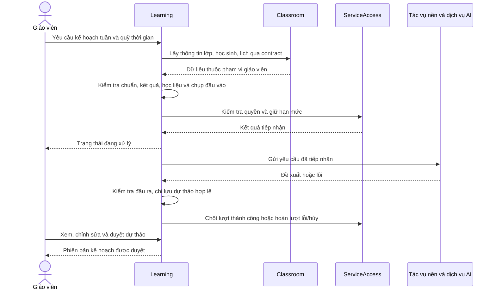

# BÁO CÁO KỊCH BẢN CHỨC NĂNG AI – EDUCATIONKEEPTRACK

**Chức năng:** Gợi ý ôn tập cá nhân và kế hoạch buổi học dựa trên kết quả học tập.\
**Đối tượng:** Gia sư, giáo viên dạy thêm; ưu tiên lớp có 1–2 học sinh.\
**Phạm vi thí điểm:** Toán lớp 2, từ đầu năm đến hết học kỳ 1; bộ sách cấu hình theo từng lớp.\
**Ngày lập:** 02/11/2026.\
**Trạng thái:** Báo cáo yêu cầu và kịch bản đã thống nhất về nghiệp vụ; chức năng đề xuất, chưa phải mô tả tính năng AI đã triển khai.

## 1. Mục tiêu và phạm vi

EducationKeeptrack hỗ trợ giáo viên quản lý lớp học, học sinh, lịch học, học phí và kết quả học tập. Chức năng AI được đề xuất nhằm giúp giáo viên sử dụng kết quả đánh giá để xác định nội dung cần củng cố, lựa chọn học liệu và lập kế hoạch ôn tập phù hợp với từng học sinh.

Bản đầu tập trung vào chu trình một tuần: ghi nhận kết quả theo kỹ năng → xác định nhu cầu ôn tập → AI tạo đề xuất → giáo viên sửa và duyệt → tổ chức buổi học → đánh giá lại. Mỗi học sinh được ưu tiên tối đa hai kỹ năng trong một đợt ôn, theo số buổi và số phút giáo viên có thể bố trí.

AI không tự đặt chuẩn đầu ra hoặc tự xác nhận kết quả học tập. Chuẩn, học liệu và đề xuất áp dụng đều thuộc quyền quyết định của giáo viên. Học sinh chưa cần sử dụng giao diện AI trong bản đầu.

### 1.1. Phạm vi thực hiện

- Cấu hình bộ sách và bộ chuẩn học kỳ theo lớp; đánh dấu nội dung đã dạy.
- Giáo viên nhập kết quả theo từng kỹ năng của bài đánh giá.
- Theo dõi mức đạt và bằng chứng của từng học sinh.
- Tạo kế hoạch ôn tập tuần và kế hoạch ngắn cho từng buổi.
- Lớp hai học sinh có thể có hoạt động chung và bài tập riêng; mục tiêu và kết quả vẫn quản lý riêng từng em.
- Lưu dự thảo, nội dung giáo viên chỉnh sửa, phiên bản được duyệt và kết quả đánh giá lại.

### 1.2. Hướng mở rộng sau bản đầu

- Lộ trình đầy đủ cho cả học kỳ và giáo án chi tiết toàn chương trình.
- Tự phân nhóm cho lớp đông, hỗ trợ nhiều môn và trình độ.
- AI tự đọc bài làm để nhận diện kỹ năng và lỗi sai.
- Giao diện học tập trực tiếp cho học sinh.

## 2. Cơ sở hiện có và khoảng trống

| Thành phần | Hiện có trong hệ thống | Cần bổ sung cho kịch bản AI |
|---|---|---|
| Classroom | Lớp, học sinh, ghi danh, lịch và buổi học, điểm danh | Bộ sách theo lớp; thông tin chương trình; nguồn lịch và quỹ thời gian cho lập kế hoạch |
| Learning | Bài đánh giá, bài nộp, lịch sử và xác nhận kết quả | Kỹ năng, chuẩn, học liệu, kết quả chi tiết, hồ sơ năng lực, kế hoạch ôn tập và phiên bản |
| Kết quả bài nộp | Mức hoàn thành và độ chính xác tổng thể; các mức đánh giá thông thường 25/50/75/100 | Số nhiệm vụ và số đúng theo kỹ năng để tính tỷ lệ chính xác; không suy diễn mức đạt 80% từ các mức tổng thể |
| ServiceAccess | Cơ chế quyền dịch vụ và quyền AI theo kiến trúc hiện có | Loại tác vụ, chính sách cấp quyền và hạn mức cho tạo kế hoạch |
| Reporting | Module báo cáo đã có trong mã nguồn | Có thể mở rộng nguồn báo cáo để thể hiện kế hoạch đã duyệt và tiến bộ; không mặc định đã hỗ trợ dữ liệu mới |
| Tích hợp AI | Learning hiện chỉ chấp nhận phương thức `manual`, từ chối phương thức khác với thông báo AI chưa khả dụng | Tác vụ nền, bộ cung cấp AI, kiểm tra đầu ra và quy trình duyệt |

Tài liệu báo cáo buổi 2 là nguồn mô tả kiến trúc tham chiếu. Báo cáo này đối chiếu thêm mã nguồn Learning và sự tồn tại của Reporting, không coi toàn bộ tính năng đề xuất dưới đây là chức năng đang vận hành.

## 3. Tác nhân và trách nhiệm

| Tác nhân | Trách nhiệm |
|---|---|
| Giáo viên/gia sư | Cấu hình lớp; duyệt chuẩn và học liệu; nhập, xác nhận kết quả; yêu cầu AI; chỉnh sửa và duyệt kế hoạch; tổ chức ôn tập và đánh giá lại |
| Hệ thống EducationKeeptrack | Kiểm tra quyền sở hữu, điều kiện dữ liệu và quyền AI; tính mức đạt theo quy tắc; lưu lịch sử; điều phối tác vụ và hiển thị kết quả |
| Dịch vụ AI | Giải thích nhu cầu ôn tập, lựa chọn/sắp xếp học liệu và đề xuất hoạt động trong giới hạn dữ liệu được cung cấp |
| Admin | Quản lý quyền dịch vụ và quyền AI; không mặc nhiên có quyền đọc dữ liệu học sinh |
| Học sinh | Tham gia học và làm bài; giáo viên ghi nhận kết quả trong bản đầu |

## 4. Khung nội dung thí điểm

Danh sách dưới đây là khung nội dung do người dùng cung cấp để xây dựng thí điểm, chưa phải bộ chuẩn học kỳ đã đối chiếu với từng bộ sách. Giáo viên phải chọn, điều chỉnh và duyệt theo lớp trước khi sử dụng. Tỷ trọng khoảng 60% và 40% là định hướng nội dung, không tự động trở thành trọng số tính điểm hoặc phân bổ thời gian.

| Mạch nội dung | Nhận biết, hiểu | Vận dụng dự kiến |
|---|---|---|
| Số và phép tính, khoảng 60% | Đọc, viết, nhận biết số trong phạm vi 100; làm quen đến 1000 tùy bộ sách và tiến độ; số liền trước/liền sau; số hạng, tổng, số bị trừ, số trừ, hiệu | Cộng/trừ qua 10 trong phạm vi 20; cộng/trừ có nhớ trong phạm vi 100; tìm thành phần chưa biết; toán có lời văn, nhiều hơn/ít hơn; bài một hoặc hai bước theo phạm vi được duyệt |
| Hình học và đo lường, khoảng 40% | Hình phẳng, hình khối quen thuộc; điểm, đoạn thẳng, tia số; các đơn vị cm, dm, m, kg theo chương trình áp dụng | Đo/vẽ đoạn thẳng; cộng/trừ cùng đơn vị đo; bài toán thực tế về độ dài và khối lượng |

Một mạch nội dung phải được tách thành kỹ năng có thể đánh giá, chẳng hạn “cộng qua 10 trong phạm vi 20”, “trừ có nhớ trong phạm vi 100”, “giải bài toán nhiều hơn”. Không dùng một nhãn rộng như “Số và phép tính” để kết luận chính xác điểm yếu.

Các khái niệm kỹ năng, chuẩn đầu ra, hồ sơ năng lực và kế hoạch ôn tập là phần mở rộng nghiệp vụ được đề xuất trong báo cáo; chưa được ghi nhận thành thuật ngữ chính thức trong `GLOSSARY.md` tại thời điểm lập báo cáo.

## 5. Quy tắc nghiệp vụ

| Mã | Quy tắc |
|---|---|
| BR-AI-01 | Bộ sách được cấu hình theo từng lớp. Bộ chuẩn có nguồn và phiên bản được giáo viên duyệt; AI không tự tạo chuẩn chính thức. |
| BR-AI-02 | Chỉ đánh giá mức đạt đối với nội dung đã được học. Nội dung chưa dạy không bị gắn nhãn yếu. |
| BR-AI-03 | Căn cứ phân tích là kết quả theo kỹ năng đã được giáo viên xác nhận; bản nháp chưa được dùng làm kết quả chính thức. |
| BR-AI-04 | Ngưỡng thí điểm: đạt ít nhất 80% trong từng lần của hai lần đánh giá khác nhau; mỗi lần có ít nhất năm câu/nhiệm vụ đúng kỹ năng. Giáo viên được điều chỉnh ngưỡng và hệ thống phải lưu phiên bản quy tắc áp dụng. |
| BR-AI-05 | Chưa đủ số lần hoặc số nhiệm vụ thì ghi “chưa đủ dữ liệu”, không kết luận yếu. Đề xuất khảo sát bổ sung khi cần. |
| BR-AI-06 | Kế hoạch theo tuần, tối đa hai kỹ năng ưu tiên mỗi học sinh, trong quỹ thời gian giáo viên nhập. |
| BR-AI-07 | Ưu tiên học liệu đã duyệt và phù hợp bộ sách. Bài tập mới do AI tạo phải được giáo viên duyệt trước khi giao. |
| BR-AI-08 | Lớp hai em giữ mục tiêu và kết quả riêng; chỉ ghép hoạt động khi phù hợp. Nếu không phù hợp, trình bày hai phần riêng. |
| BR-AI-09 | Đề xuất phải nêu kỹ năng, kết quả làm căn cứ, lý do chọn nội dung, học liệu, thời lượng và cách kiểm tra lại. |
| BR-AI-10 | AI hoàn tất chỉ tạo dự thảo; giáo viên sửa và duyệt trước khi áp dụng. Không tự ghi đè nội dung giáo viên. |
| BR-AI-11 | Lưu phiên bản kế hoạch, dữ liệu đầu vào và lịch sử duyệt. Kết quả mới không tự sửa kế hoạch cũ; giáo viên có thể yêu cầu bản mới để duyệt lại. |
| BR-AI-12 | Đánh giá lại dùng câu hỏi khác, cùng kỹ năng và độ khó tương đương; theo dõi kết quả và thời lượng thực tế, không mặc định mọi cải thiện đều do AI. |

Việc lựa chọn cặp kết quả khi có nhiều lần đánh giá cần được cụ thể hóa trong đặc tả triển khai. Không mặc nhiên cộng dồn các câu của nhiều lần để vượt điều kiện tối thiểu của từng lần.

## 6. Danh mục kịch bản

| Mã | Kịch bản | Kết quả |
|---|---|---|
| UC-AI-01 | Thiết lập chương trình cho lớp | Bộ sách, chuẩn đã duyệt và tiến độ nội dung được lưu |
| UC-AI-02 | Ghi nhận kết quả theo kỹ năng | Kết quả chi tiết được giáo viên xác nhận |
| UC-AI-03 | Xem hồ sơ năng lực | Hiển thị mức đạt và bằng chứng; nhận diện phần thiếu dữ liệu |
| UC-AI-04 | Tạo đề xuất ôn tập tuần | Dự thảo cá nhân và kế hoạch từng buổi |
| UC-AI-05 | Chỉnh sửa, duyệt kế hoạch | Phiên bản được duyệt để áp dụng |
| UC-AI-06 | Ghi nhận buổi ôn và đánh giá lại | Kết quả sau ôn, tiến bộ và dữ liệu cho đợt tiếp theo |

### 6.1. UC-AI-01 – Thiết lập chương trình cho lớp

**Tác nhân chính:** Giáo viên.\
**Điều kiện:** Đăng nhập, được phép ghi dữ liệu và sở hữu lớp.

1. Giáo viên mở cấu hình học tập của lớp, chọn Toán lớp 2, học kỳ 1 và bộ sách áp dụng.
2. Chọn hoặc chuẩn bị bộ kỹ năng và chuẩn đầu ra tương ứng, kiểm tra nguồn và phạm vi nội dung.
3. Duyệt bộ chuẩn, gắn học liệu đã duyệt và đánh dấu các kỹ năng đã được dạy.
4. Hệ thống lưu cấu hình và phiên bản áp dụng cho lớp.

**Ngoại lệ:** Nếu chưa có bộ chuẩn hoặc học liệu phù hợp, hiển thị thành phần thiếu; không tự điền bằng chuẩn AI tự suy đoán. Thay đổi chương trình phải giữ căn cứ lịch sử của kết quả và kế hoạch trước đó.

### 6.2. UC-AI-02 – Ghi nhận kết quả theo kỹ năng

**Tác nhân chính:** Giáo viên.\
**Điều kiện:** Có bài đánh giá, học sinh thuộc lớp và kỹ năng đã được xác định.

1. Giáo viên tạo bài đánh giá và gắn các phần/câu/nhiệm vụ với kỹ năng tương ứng.
2. Nhập số nhiệm vụ, số đúng và ghi chú lỗi quan sát được cho từng học sinh, từng kỹ năng.
3. Hệ thống kiểm tra dữ liệu, ví dụ số đúng không vượt tổng số nhiệm vụ.
4. Giáo viên xem lại và xác nhận kết quả.
5. Hệ thống lưu lịch sử và cập nhật dữ liệu dùng cho hồ sơ năng lực.

**Ngoại lệ:** Không làm bài, chưa giao hoặc chưa đánh giá phải được phân biệt rõ, không tự chuyển thành bằng chứng “không biết kỹ năng”. Các chỉ số tổng thể hiện có không được tự chuyển thành số câu đúng theo kỹ năng.

### 6.3. UC-AI-03 – Xem hồ sơ năng lực

1. Giáo viên chọn học sinh trong lớp.
2. Hệ thống hiển thị kỹ năng đã học, các lần đánh giá được xác nhận và quy tắc mức đạt đang áp dụng.
3. Với đủ bằng chứng, hiển thị đạt hoặc chưa đạt theo quy tắc; với thiếu bằng chứng, hiển thị “chưa đủ dữ liệu”.
4. Giáo viên mở từng kết luận để xem bài đánh giá, ngày, số nhiệm vụ và tỷ lệ đúng làm căn cứ.
5. Nếu thiếu dữ liệu, hệ thống đề xuất khảo sát đúng kỹ năng cần bổ sung.

Việc tính mức đạt do quy tắc hệ thống thực hiện. AI có thể giải thích kết quả nhưng không tự thay đổi ngưỡng hoặc biến nhận xét suy đoán thành điểm chính thức.

### 6.4. UC-AI-04 – Tạo đề xuất ôn tập tuần

**Tác nhân chính:** Giáo viên.\
**Điều kiện:** Đúng quyền sở hữu; được phép tạo yêu cầu AI; có cấu hình lớp, chuẩn và học liệu phù hợp; có kết quả đủ để đề xuất ôn tập, hoặc xác định rõ cần khảo sát bổ sung.

1. Giáo viên chọn lớp, tuần và học sinh cần lập kế hoạch.
2. Nhập/chọn các buổi học, quỹ phút dành cho ôn tập và lưu ý của giáo viên.
3. Hệ thống kiểm tra quyền dịch vụ, quyền AI, hạn mức và tính đầy đủ của dữ liệu.
4. Hệ thống chụp dữ liệu đầu vào: phiên bản cấu hình lớp, chuẩn, nội dung đã học, kết quả đã xác nhận, quy tắc mức đạt, học liệu và quỹ thời gian.
5. Yêu cầu được tiếp nhận và xử lý nền; giao diện hiển thị trạng thái.
6. AI đề xuất tối đa hai kỹ năng ưu tiên mỗi em, giải thích bằng chứng và chọn học liệu đã duyệt.
7. AI phân bổ hoạt động vào từng buổi. Với hai em, đề xuất phần chung khi phù hợp và phần riêng theo năng lực.
8. Hệ thống kiểm tra cấu trúc đầu ra, tham chiếu học liệu, phạm vi nội dung và tổng thời lượng trước khi lưu dự thảo.
9. Giáo viên nhận dự thảo để xem và duyệt ở UC-AI-05.

**Nhánh thay thế và ngoại lệ:**

- Thiếu bằng chứng: đề xuất khảo sát, không khẳng định học sinh yếu.
- Thiếu chuẩn/học liệu: chỉ rõ phần cần bổ sung, không tạo kế hoạch có vẻ đầy đủ nhưng không có căn cứ.
- Quỹ thời gian không đủ: giảm phạm vi hoặc yêu cầu giáo viên điều chỉnh; không vượt quỹ phút đã nhập.
- Không đủ quyền/hạn mức: giải thích lý do; nghiệp vụ thủ công vẫn tuân theo quyền dịch vụ của tài khoản.
- AI lỗi hoặc trả kết quả không hợp lệ: không tạo kế hoạch được duyệt; lưu trạng thái lỗi và cho phép thử lại theo chính sách hạn mức.
- Dữ liệu thay đổi trong lúc xử lý: giữ căn cứ đầu vào đã chụp, cảnh báo khác biệt khi giáo viên xem dự thảo để quyết định tạo lại.

### 6.5. UC-AI-05 – Chỉnh sửa và duyệt kế hoạch

1. Giáo viên xem kỹ năng ưu tiên và bằng chứng cho từng em.
2. Kiểm tra mục tiêu, bài tập, thời lượng và cách đánh giá lại; sửa nội dung khi cần.
3. Nếu có bài tập AI tạo mới, giáo viên kiểm tra và duyệt trước khi sử dụng.
4. Giáo viên xác nhận phiên bản kế hoạch được áp dụng.
5. Hệ thống lưu người duyệt, thời điểm và nội dung phiên bản; kế hoạch cũ vẫn truy xuất được.

**Ngoại lệ:** Nếu kết quả nguồn đã đổi hoặc giáo viên khác phiên làm việc đã cập nhật bản kế hoạch, hiển thị xung đột/thay đổi và yêu cầu xem lại; không ghi đè âm thầm. Thay đổi nội dung sau duyệt phải được lưu thành phiên bản để duyệt lại trước khi áp dụng.

### 6.6. UC-AI-06 – Ôn tập, đánh giá lại và điều chỉnh

1. Giáo viên tổ chức buổi học theo kế hoạch đã duyệt.
2. Ghi nhận hoạt động thực tế, thời lượng và phần chưa hoàn thành của từng em.
3. Tổ chức bài đánh giá khác câu, cùng kỹ năng và độ khó tương đương.
4. Nhập và xác nhận kết quả theo UC-AI-02.
5. Hệ thống so sánh trước/sau, hiển thị bằng chứng và cập nhật mức đạt theo quy tắc.
6. Giáo viên quyết định tiếp tục củng cố, chuyển kỹ năng hoặc yêu cầu AI đề xuất cho tuần tiếp theo.

Nếu học sinh vắng hoặc chưa hoàn thành đợt ôn, ghi rõ tình trạng thực tế; không diễn giải việc thiếu bài kiểm tra lại là thất bại học tập.

## 7. Ví dụ lớp hai học sinh

Các số liệu và tên học sinh dưới đây chỉ minh họa kịch bản, không phải dữ liệu thực của hệ thống.

**Lớp:** Toán lớp 2, học kỳ 1; dùng bộ sách do giáo viên cấu hình.\
**Quỹ ôn tập:** Hai buổi trong tuần, mỗi buổi 30 phút.\
**Tiến độ:** Hai kỹ năng trong bảng đều đã được dạy.

| Học sinh | Kỹ năng | Hai lần đánh giá đã xác nhận | Nhận định theo ngưỡng thí điểm |
|---|---|---|---|
| An | Cộng qua 10 trong phạm vi 20 | 2/5 và 3/5 | Chưa đạt; có đủ dữ liệu để ưu tiên ôn |
| Bình | Cộng qua 10 trong phạm vi 20 | 4/5 và 5/5 | Đạt |
| Bình | Cộng có nhớ trong phạm vi 100 | 2/5 và 3/5 | Chưa đạt; có đủ dữ liệu để ưu tiên ôn |

**Dự thảo hoạt động:**

| Buổi | Hoạt động chung | Hoạt động riêng | Kiểm tra và kết thúc |
|---|---|---|---|
| 1, 30 phút | 5 phút thao tác với que tính để tạo một chục | 20 phút: An luyện cộng qua 10; Bình luyện cộng có nhớ trong phạm vi 100, giáo viên luân phiên hướng dẫn | 5 phút kiểm tra ngắn và phản hồi từng em |
| 2, 30 phút | 5 phút nhắc lại cách tạo chục | 15 phút luyện tập bằng học liệu đã duyệt, điều chỉnh theo ghi nhận buổi 1 | 10 phút cho bài đánh giá lại và tổng kết |

AI phải kèm căn cứ chọn kỹ năng và mã/tên học liệu có thật trong kho. Các khoảng hoạt động trong bảng là thời gian của buổi học, không cộng hai phần riêng thành hai lần thời lượng buổi.

Giả sử An đạt 4/5 ở bài đánh giá lại: hệ thống ghi nhận tiến bộ nhưng chưa kết luận đạt chỉ từ một lần 80%, vì quy tắc yêu cầu hai lần phù hợp. Giáo viên dùng bằng chứng này để quyết định bước tiếp theo.

## 8. Dữ liệu cần bổ sung

Đây là các nhóm dữ liệu đề xuất, không khẳng định tên bảng hoặc class đã tồn tại.

| Nhóm | Thông tin chính |
|---|---|
| Cấu hình chương trình lớp | Lớp, môn, khối, học kỳ, bộ sách, phiên bản bộ chuẩn và thời điểm áp dụng |
| Kỹ năng và chuẩn | Mã kỹ năng, mô tả, tiêu chí đạt, nguồn, quan hệ tiên quyết, trạng thái duyệt |
| Tiến độ giảng dạy | Lớp, kỹ năng, trạng thái đã dạy, thời điểm và người ghi nhận |
| Học liệu | Nguồn/nội dung, kỹ năng, bộ sách/phạm vi tương thích, độ khó, thời lượng, trạng thái duyệt |
| Kết quả theo kỹ năng | Bài đánh giá, học sinh, kỹ năng, tổng nhiệm vụ, số đúng, ghi chú, phiên bản xác nhận |
| Hồ sơ năng lực | Mức đạt, quy tắc áp dụng, bằng chứng và thời điểm tính; có thể là dữ liệu tổng hợp từ kết quả nguồn |
| Kế hoạch ôn tập | Tuần, lớp, mục tiêu riêng từng em, quỹ thời gian, buổi học, học liệu, cách đánh giá lại |
| Phiên bản và duyệt | Dữ liệu đầu vào, nội dung AI, chỉnh sửa của giáo viên, người/thời điểm duyệt, phiên bản áp dụng |
| Tác vụ AI | Người yêu cầu, loại tác vụ, trạng thái, dữ liệu nguồn, thông tin bộ cung cấp/mô hình, lỗi và tham chiếu hạn mức |
| Thực hiện và đánh giá lại | Buổi thực tế, thời lượng, hoạt động hoàn thành và liên kết kết quả sau ôn |

Không thay thế lịch sử kết quả tổng thể hiện có bằng dữ liệu suy diễn. Phần kết quả theo kỹ năng cần được bổ sung và xác nhận riêng.

## 9. Tích hợp vào kiến trúc hệ thống

Hệ thống giữ kiến trúc Modular Monolith và nguyên tắc dữ liệu riêng từng module theo ADR-0001. Phân bổ dưới đây là đề xuất triển khai, chưa tạo module mới hoặc thay đổi ADR.

| Thành phần | Trách nhiệm đề xuất |
|---|---|
| Classroom | Giữ lớp, học sinh và lịch/buổi học; cung cấp thông tin qua hợp đồng công khai |
| Learning | Quản lý chương trình học áp dụng cho lớp, kỹ năng, chuẩn, học liệu, đánh giá chi tiết, kế hoạch và quy trình duyệt; điều phối nghiệp vụ AI |
| ServiceAccess | Kiểm tra quyền AI, quản lý hạn mức và lượt đang giữ theo loại tác vụ được thống nhất |
| Identity | Xác thực, trạng thái tài khoản và phiên |
| Reporting | Nhận dữ liệu qua hợp đồng nguồn nếu mở rộng báo cáo tiến bộ/kế hoạch |
| Host và hạ tầng AI | Khởi tạo worker, bộ cung cấp AI và cấu hình tích hợp; không thay giáo viên quyết định nghiệp vụ |
| Billing | Tiếp tục quản lý học phí; không quản lý phí dịch vụ AI |

Thông tin chương trình do Learning quản lý gắn với mã lớp; bộ sách vẫn được người dùng cấu hình theo từng lớp trên giao diện. Classroom không cần trực tiếp đọc hoặc ghi các bảng chương trình của Learning.

Hợp đồng `IClassroomLearningSource` hiện phục vụ danh sách học sinh cần được mở rộng hoặc bổ sung hợp đồng để cung cấp lịch, buổi và thông tin lớp cần thiết. Learning không truy vấn trực tiếp bảng Classroom.

Theo ADR-0003, tắt quyền AI hoặc hết hạn dịch vụ không tự hủy công việc đã tiếp nhận; kết quả nền chỉ là dự thảo. Khóa tài khoản phải hủy/vô hiệu kết quả về muộn. Hết hạn vẫn được xem/xuất dữ liệu cũ nhưng không tạo hoặc sửa kế hoạch mới; khóa tài khoản chặn truy cập.

Việc giữ, trừ và hoàn hạn mức phải tránh trừ hai lần khi retry. **Đơn vị tính lượt cho tạo kế hoạch chưa được chốt**; không tự dùng lượt chấm bài, lượt nhận xét hoặc mặc định miễn phí. Đây là quyết định cần hoàn thiện trước khi vận hành AI thật.

## 10. Yêu cầu kiểm soát và tiêu chí nghiệm thu

| Mã | Tiêu chí kiểm chứng |
|---|---|
| AC-AI-01 | Hai lớp chọn hai bộ sách khác nhau sử dụng đúng cấu hình và chuẩn của từng lớp. |
| AC-AI-02 | Giáo viên không thể đọc, tạo đề xuất hoặc duyệt kế hoạch trên lớp của tài khoản khác. |
| AC-AI-03 | Nội dung chưa dạy và kết quả chưa xác nhận không được dùng để kết luận kỹ năng yếu. |
| AC-AI-04 | Một lần đạt 80% hoặc lần đánh giá dưới năm nhiệm vụ chưa đủ để kết luận đạt theo ngưỡng thí điểm. |
| AC-AI-05 | Mỗi em có tối đa hai kỹ năng ưu tiên; tổng thời lượng hoạt động không vượt quỹ phút của từng buổi. |
| AC-AI-06 | Đề xuất có bằng chứng truy xuất được và tham chiếu học liệu đã duyệt; nội dung AI tạo mới phải qua duyệt trước sử dụng. |
| AC-AI-07 | Kế hoạch lớp hai em giữ kết quả và mục tiêu riêng; có thể hiển thị hoạt động chung và riêng. |
| AC-AI-08 | Kết quả AI chỉ là dự thảo; không tự xác nhận và không ghi đè sửa đổi của giáo viên. |
| AC-AI-09 | Kết quả nguồn thay đổi không sửa ngầm kế hoạch cũ; giữ phiên bản đầu vào và lịch sử duyệt. |
| AC-AI-10 | Lỗi/hủy tác vụ và retry không làm mất dữ liệu thủ công hoặc trừ hạn mức hai lần. |
| AC-AI-11 | Khóa tài khoản vô hiệu kết quả về muộn; hết hạn và tắt AI được xử lý đúng ADR-0003. |
| AC-AI-12 | Chạy được trọn luồng: cấu hình → đánh giá → đề xuất → duyệt → ôn tập → đánh giá lại và xem tiến bộ. |

Chỉ gửi dữ liệu cần thiết cho dịch vụ AI; dùng mã học sinh thay cho thông tin nhận dạng khi không cần tên. Không ghi bí mật tích hợp vào báo cáo hoặc log nội dung yêu cầu. Các kiểm soát quyền sở hữu phải thực thi tại backend.

Trước dùng thử cần có bộ chuẩn và học liệu được duyệt, kết quả mẫu đủ kiểm tra các nhánh đạt/chưa đạt/thiếu dữ liệu, và giáo viên kiểm tra được toàn bộ đề xuất. Chưa đặt tỷ lệ cải thiện học tập khi chưa có dữ liệu thực nghiệm; theo dõi mức phù hợp, chỉnh sửa của giáo viên, tiến bộ và thời lượng thực tế trong đợt thử.

## 11. Lộ trình thực hiện đề xuất

1. Chuẩn bị bộ kỹ năng, chuẩn học kỳ và học liệu theo bộ sách của lớp thí điểm; chốt thuật ngữ dùng chung.
2. Bổ sung đánh giá theo kỹ năng và hồ sơ năng lực có bằng chứng.
3. Xây dựng biểu mẫu kế hoạch, phiên bản và quy trình giáo viên duyệt.
4. Chốt loại tác vụ/hạn mức; tích hợp AI nền và xử lý lỗi, quyền, dữ liệu thay đổi.
5. Bổ sung ghi nhận thực hiện, đánh giá lại và màn hình tiến bộ.
6. Dùng thử trên lớp 1–2 học sinh, điều chỉnh trước khi mở rộng lớp đông hoặc lộ trình dài hạn.

Trước triển khai cần đặc tả tiếp đơn vị hạn mức, cách chọn bằng chứng khi có nhiều lần đánh giá và mô hình dữ liệu/API cụ thể. Các chi tiết này không làm thay đổi phạm vi chức năng đã chốt trong báo cáo.

## 12. Tài liệu và mã nguồn đối chiếu

- [Báo cáo buổi 2](Bao_cao_buoi_2_EducationKeeptrack.md).
- [Quy tắc tài liệu miền](agents/domain.md) và [thuật ngữ hiện có](../GLOSSARY.md).
- [ADR-0001: UI và dữ liệu theo module](adr/0001-ui-and-database.md).
- [ADR-0003: Quyền dịch vụ và AI](adr/0003-service-access-and-ai.md).
- [Assessment, Submission và lịch sử kết quả](../src/Modules/Learning/Domain/Assessment.cs).
- [LearningService và giới hạn AI hiện tại](../src/Modules/Learning/Application/LearningService.cs).
- [Module Reporting](../src/Modules/Reporting/ReportingModule.cs).
