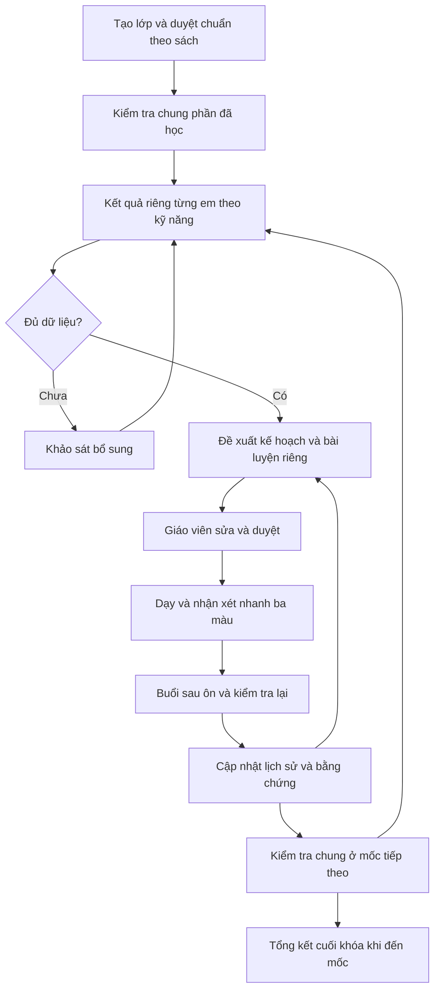

# BÁO CÁO TỔNG HỢP KỊCH BẢN CÁ NHÂN HÓA VÀ THEO DÕI HỌC TẬP

**Dự án:** EducationKeeptrack

**Đối tượng:** Gia sư, giáo viên dạy thêm; lớp 1–2 học sinh.

**Phạm vi:** Toán lớp 2 học kỳ 1; bộ sách cấu hình theo từng lớp.

**Ngày lập:** 05/11/2026.

**Trạng thái:** Báo cáo thiết kế nghiệp vụ và nội dung demo đề xuất, chưa phải tính năng đã triển khai. Không mô tả màu đánh giá là chuẩn xếp loại chính thức của ngành giáo dục.

## 1. Mục tiêu

Giúp giáo viên trả lời bốn câu hỏi mà không phải xem lại toàn bộ sổ theo dõi: mỗi em đang cần hỗ trợ gì, buổi tới nên làm gì, nội dung buổi trước đã được kiểm tra lại chưa và sau ôn tập em đã tiến bộ ra sao.

Chu trình chính là kiểm tra chung → xác định nhu cầu từng em → luyện riêng → kiểm tra riêng → kiểm tra chung ở mốc tiếp theo. Nhận xét nhanh Đỏ–Vàng–Xanh giúp theo dõi hằng buổi; kết quả bài kiểm tra cung cấp bằng chứng để kết luận mức đạt.

### 1.1. Điều đã thống nhất và giả định bổ sung

| Nhóm | Nội dung |
|---|---|
| Phạm vi đã chốt | Lớp nhỏ, Toán lớp 2 học kỳ 1, bộ sách theo lớp; giáo viên duyệt chuẩn, học liệu và đề xuất AI |
| Cá nhân hóa đã chốt | Kế hoạch tuần, tối đa hai kỹ năng ưu tiên mỗi em; có hoạt động chung và riêng, trong quỹ phút giáo viên nhập |
| Đánh giá đã chốt | Phân tích theo kỹ năng, dùng kết quả đã xác nhận; chưa đủ dữ liệu thì không kết luận yếu |
| Ngưỡng thí điểm đã chốt | Hai lần đánh giá khác nhau, mỗi lần tối thiểu năm nhiệm vụ đúng kỹ năng và đạt ít nhất 80%; giáo viên có thể điều chỉnh |
| Cách hiểu dùng trong báo cáo | Lời xác nhận gần nhất được hiểu là đồng ý kết hợp ba màu quan sát nhanh với đánh giá có bằng chứng, không thay ngưỡng 80% bằng màu |
| Đề xuất để demo | Số mục trên màn hình, lịch nhắc kiểm tra lại, câu hỏi mẫu, kế hoạch phút, lịch trình trình bày và bộ dữ liệu minh họa dưới đây |

Các khái niệm nhận xét nhanh, kỹ năng và kế hoạch ôn tập là phần mở rộng đang đề xuất; chưa sửa định nghĩa “kết quả cuối” trong GLOSSARY hiện có. Nhận xét màu phải được lưu riêng, không thay thế hai chỉ số đánh giá tổng thể của hệ thống hiện tại.

## 2. Đề xuất các vấn đề Toán nên đưa vào demo

Không cần trình diễn toàn bộ giáo án học kỳ. Nên chọn một câu chuyện chính về cộng qua 10 và cộng có nhớ, sau đó dùng một vài tình huống bổ sung để kiểm tra thiết kế.

| Tình huống | Biểu hiện có thể quan sát | Hoạt động hỗ trợ đề xuất | Điều phần mềm cần thể hiện |
|---|---|---|---|
| Nhầm chục và đơn vị | Đọc 42 thành 24; đặt lệch cột | Bảng chục–đơn vị, que tính, đọc và viết số | Phân biệt khó khăn về giá trị hàng với sai tính toán |
| Chưa biết tạo chục | Chưa tự giải được 8 + 5 | Tách 5 thành 2 và 3; ghép 8 + 2 rồi cộng 3 | Ghi nhận có cần gợi ý; đưa vào ôn buổi sau |
| Quên nhớ khi cộng | 28 + 15 được ghi thành 33 | Thao tác đổi 10 đơn vị thành 1 chục, rồi đặt tính | Gắn lỗi quan sát “quên cộng chục nhớ”, không tự chẩn đoán chỉ từ đáp án |
| Chưa hiểu đổi chục khi trừ | Sai ở 52 − 7 | Đổi một chục thành mười đơn vị bằng vật trực quan | Tách nhu cầu hỗ trợ trừ có nhớ khỏi cộng có nhớ |
| Nhầm quan hệ nhiều hơn/ít hơn | Chọn phép tính theo từ khóa, không hiểu ai nhiều hơn | Vẽ sơ đồ hoặc dùng nhóm đồ vật, yêu cầu diễn đạt lại đề | Phân biệt hiểu đề với thực hiện phép tính |
| Bỏ đơn vị hoặc đo sai | Ghi 22 thay vì 22 cm; đặt thước sai vạch | Đo đoạn thẳng, kiểm tra vạch 0, đọc kết quả kèm đơn vị | Ghi nhận riêng thao tác đo và trình bày đơn vị |
| Làm đúng khi được nhắc nhưng chưa tự làm | Đúng bài luyện có hướng dẫn, sai khi đổi câu | Cho câu tương đương không gợi ý | Không tự chọn Xanh chỉ vì đáp án cuối đúng |
| Hai em khác tốc độ | Một em chờ trong khi giáo viên hỗ trợ em còn lại | Phần chung ngắn, bài độc lập cho từng em | Thời gian giáo viên luân phiên hướng dẫn khả thi |

Các lỗi là giả thuyết cần quan sát, không phải kết luận về nguyên nhân tâm lý hay năng lực cố định của trẻ. Phạm vi học kỳ và thứ tự dạy phải được giáo viên đối chiếu với bộ sách của lớp. Demo không tự đưa nội dung chưa học vào danh sách yếu.

## 3. Chuẩn kỹ năng được tổ chức thế nào?

### 3.1. Ba tầng nội dung

1. **Mục tiêu khóa:** bộ chuẩn học kỳ của lớp do giáo viên duyệt.
2. **Kỹ năng có thể đánh giá:** ví dụ cộng qua 10 trong phạm vi 20.
3. **Mục tiêu buổi học:** biểu hiện cụ thể cần quan sát trong buổi, ví dụ tự dùng cách tạo chục để tính 8 + 5.

Không tạo chuẩn riêng cho từng câu hỏi. Nhiều câu hỏi có thể cùng kiểm tra một kỹ năng; một kỹ năng được quan sát qua nhiều buổi.

### 3.2. Bộ kỹ năng mẫu dùng trong demo

| Mã mẫu | Kỹ năng | Dấu hiệu quan sát |
|---|---|---|
| S01 | Nhận biết chục và đơn vị trong phạm vi 100 | Nêu đúng số chục, đơn vị và đọc/viết số |
| S02 | Cộng qua 10 trong phạm vi 20 | Thực hiện được phép cộng và thể hiện cách làm phù hợp |
| S03 | Cộng có nhớ trong phạm vi 100 | Đặt đúng hàng, cộng đơn vị, xử lý chục nhớ |
| S04 | Trừ có nhớ trong phạm vi 100 | Thực hiện được đổi chục và trừ |
| S05 | Giải toán nhiều hơn/ít hơn một bước | Xác định quan hệ, chọn phép tính, tính và ghi đơn vị |
| S06 | Đo độ dài và tính với cùng đơn vị cm | Đo đúng cách, tính đúng và giữ đơn vị |

Mã và mô tả này phục vụ demo, chưa phải mã chuẩn chính thức hay nội dung đã được ánh xạ đầy đủ theo sách. Giáo viên chọn một đến hai kỹ năng trọng tâm mỗi em mỗi đợt, không phải đánh giá cả sáu sau mọi buổi.

## 4. Hai lớp thông tin đánh giá

### 4.1. Nhận xét nhanh sau hoạt động hoặc buổi học

| Lựa chọn | Ý nghĩa | Hành động tiếp theo đề xuất |
|---|---|---|
| Đỏ — Cần hỗ trợ | Chưa tự thực hiện được hoặc còn lỗi quan trọng | Ưu tiên hỗ trợ và kiểm tra lại ở buổi tham dự kế tiếp |
| Vàng — Cần củng cố | Làm được nhưng còn cần gợi ý hoặc chưa ổn định | Gợi ý ôn ngắn; giáo viên chọn buổi kiểm tra lại |
| Xanh — Ổn trong buổi này | Tự làm được các nhiệm vụ đã quan sát | Giảm ưu tiên; theo dõi trong bài chung tiếp theo |

“Chưa đánh giá” là trạng thái thiếu quan sát, không phải nút màu thứ tư bắt giáo viên lựa chọn. Mặc định chưa có nhận xét; hệ thống cho phép bỏ qua, vắng hoặc hoãn bằng thao tác riêng. Màu luôn đi kèm chữ và biểu tượng.

Không tự chuyển màu vì đến hạn, vắng học hoặc thiếu bài. Nhận xét là về kỹ năng trong bối cảnh một lần quan sát, không gắn nhãn toàn bộ học sinh là “Đỏ”.

### 4.2. Đánh giá có bằng chứng

Giáo viên xác nhận số nhiệm vụ, số đúng, kỹ năng và ngày đánh giá. Hệ thống dùng quy tắc định lượng để tính mức đạt.

- Nhận xét Xanh không tự đổi thành 80%.
- Một bài ba câu đúng cả ba có thể hỗ trợ nhận xét nhanh, nhưng không đáp ứng tối thiểu năm nhiệm vụ của một lần đánh giá chính thức theo ngưỡng thí điểm.
- Hai bài chung và riêng có thể cung cấp bằng chứng cho cùng kỹ năng nếu mỗi lần đủ điều kiện; không bắt buộc mọi bằng chứng đều đến từ bài riêng.
- Không dùng kết quả có hướng dẫn như thể bài kiểm tra tự làm; lưu điều kiện hỗ trợ để giáo viên xác định bằng chứng có phù hợp hay không.
- Nếu mới đủ một lần đánh giá, hiển thị “chưa đủ dữ liệu để kết luận”, vẫn cho xem kết quả đã có.

**Quy tắc chọn bằng chứng đề xuất cho demo:** lấy hai lần hợp lệ gần nhất của đúng kỹ năng, đều nằm sau thời điểm bắt đầu học kỹ năng và thuộc phạm vi đánh giá phù hợp. Cả hai phải đạt 80%. Đây là đề xuất bổ sung chưa phải quyết định đã chốt; thời hạn hiệu lực của kết quả cần giáo viên góp ý trước triển khai.

### 4.3. Khi màu và bài kiểm tra khác nhau

Ví dụ bài kiểm tra đạt 5/5 nhưng giáo viên quan sát học sinh vẫn cần gợi ý: hiển thị cả “bài kiểm tra 5/5” và “Vàng — còn cần gợi ý”, không tự ghi đè một thông tin bằng thông tin kia. Giáo viên xem điều kiện thực hiện và quyết định khảo sát lại.

Nếu học sinh từng đạt nhưng lần kiểm tra hợp lệ mới cho thấy khó khăn, giữ lịch sử đạt cũ, cập nhật bằng chứng mới và đề xuất xem lại. Không giữ nhãn “ổn mãi mãi” hoặc tự xóa thành tích trước đó.

## 5. Quy trình từ đầu đến cuối khóa

| Giai đoạn | Giáo viên thực hiện | Hệ thống hỗ trợ | Đầu ra |
|---|---|---|---|
| Tạo lớp | Thêm học sinh, chọn bộ sách, lịch và chuẩn | Tái sử dụng bộ mẫu, kiểm tra cấu hình thiếu | Lớp và chương trình được duyệt |
| Đầu khóa | Tổ chức khảo sát chung phần đã học | Gắn nhiệm vụ với kỹ năng, lưu kết quả riêng | Hồ sơ ban đầu, phần cần khảo sát thêm |
| Chuẩn bị tuần | Nhập quỹ phút, duyệt ưu tiên | Gợi ý tối đa hai kỹ năng/em, hoạt động chung và riêng | Kế hoạch tuần được duyệt |
| Trong buổi | Dạy, quan sát, chọn màu nếu cần | Hiển thị mục tiêu và việc kiểm tra lại | Nhận xét theo buổi |
| Cuối buổi | Xác nhận nhận xét hoặc bài kiểm tra | Tạo danh sách cần theo dõi ở buổi sau | Việc tiếp nối có lịch |
| Buổi kế tiếp | Ôn ngắn, kiểm tra lại mục tiêu cũ | Giữ bằng chứng cũ và ghi nhận lần mới | Chuỗi tiến bộ qua các buổi |
| Mốc kiểm tra chung | Giao bài chung theo phần đã học | Tổng hợp theo từng em và kỹ năng | Điều chỉnh ưu tiên ôn riêng |
| Cuối khóa | Kiểm tra, duyệt tổng kết | Tổng hợp kỹ năng, tiến bộ và phần còn thiếu | Báo cáo cuối khóa đề xuất |

Phần tổng kết cuối khóa và kết nối Reporting là hướng mở rộng; bản đầu ưu tiên hoàn thiện chu trình tuần–buổi–đánh giá lại. Giáo viên vẫn quyết định việc hoàn thành khóa; hệ thống không tự xác nhận hoàn thành chỉ dựa vào màu.



## 6. Thiết kế trải nghiệm để giáo viên ít thao tác

### 6.1. Ba khu vực làm việc chính

| Khu vực | Nội dung mặc định | Thao tác chính |
|---|---|---|
| Buổi hôm nay | Học sinh, mục tiêu mới, mục cần kiểm tra lại | Mở bài, chọn màu, xác nhận kết quả |
| Chuẩn bị buổi sau | Mục Đỏ/Vàng còn mở và quỹ phút | Chấp nhận/sửa đề xuất, hoãn có chủ đích |
| Tiến bộ học sinh | Kỹ năng, nhận xét gần nhất, ngày, bằng chứng | Mở lịch sử hoặc xem bài liên quan |

Chuẩn toàn khóa, ngân hàng bài và thiết lập ngưỡng nằm ở khu vực cấu hình, không đổ hết lên màn hình buổi học. Kế hoạch đề xuất và nhắc kiểm tra lại được gộp vào một danh sách, tránh tạo nhiều thông báo cho cùng một kỹ năng.

### 6.2. Minh họa nội dung màn hình buổi học

```text
LỚP TOÁN 2 — BUỔI 4
Kế hoạch đã duyệt | 30 phút ôn tập

AN
Cần kiểm tra lại: Cộng qua 10
Lần trước: Đỏ, buổi 3 — còn cần hướng dẫn tách số
[Mở bài]  [Cần hỗ trợ] [Cần củng cố] [Ổn]

BÌNH
Cần kiểm tra lại: Cộng có nhớ
Lần trước: Vàng, buổi 3 — quên chục nhớ khi tự làm
[Mở bài]  [Cần hỗ trợ] [Cần củng cố] [Ổn]

[Lưu bản nháp] [Xác nhận nhận xét]
```

Đây là phác thảo nội dung, chưa phải giao diện đã xây. Mọi thao tác đổi màu cần cho sửa lại và có dấu hiệu đã lưu. Không chọn sẵn Xanh và không tự nhân nhận xét của em này sang em khác.

### 6.3. Giảm tải nhập liệu

- Giáo viên chọn kỹ năng từ bài đã chuẩn bị; không gõ lại tên kỹ năng.
- Bài mẫu có sẵn ánh xạ kỹ năng, đáp án và tổng nhiệm vụ; khi chấm chỉ nhập số đúng hoặc đánh dấu câu sai, không bắt làm cả hai.
- Không yêu cầu ghi chú dài. Có nhãn tùy chọn như “cần gợi ý”, “quên nhớ”, “đọc đề chưa rõ”, “khác”.
- Nhận xét nhanh chỉ tập trung kỹ năng trọng tâm của buổi; không có bài kiểm tra năm câu sau mọi hoạt động.
- Có thể xác nhận các nhận xét đã chọn một lần cuối buổi, nhưng phải nhìn thấy rõ từng em và từng kỹ năng trước xác nhận.
- Hiển thị “Vàng, quan sát ở buổi 3” thay vì chỉ ô màu không có ngày.

### 6.4. Lịch kiểm tra lại đề xuất

| Tình trạng | Gợi ý mặc định | Giáo viên được điều chỉnh |
|---|---|---|
| Đỏ | Buổi tham dự kế tiếp, trước nội dung phụ thuộc | Chọn hoạt động, chuyển buổi, bỏ đề xuất có lý do |
| Vàng | Trong hai buổi tham dự tiếp theo hoặc ghép bài chung phù hợp | Chọn mốc cụ thể để không bỏ quên |
| Xanh | Bài chung hoặc mốc ôn tích lũy tiếp theo | Tạo kiểm tra riêng nếu thấy cần |
| Vắng/hoãn | Giữ việc chưa hoàn tất sang buổi phù hợp | Chọn lại lịch; không đổi màu |

Đây là mặc định sản phẩm đề xuất, không phải lịch ôn có hiệu quả đã được thực nghiệm. Nếu việc tồn nhiều hơn quỹ phút, hệ thống đề xuất ưu tiên và hiển thị phần chưa xếp, không nhồi tất cả vào một buổi.

## 7. Kịch bản demo chính: hai em khác điểm yếu

### 7.1. Chuẩn bị dữ liệu

Lớp có An và Bình, hai buổi/tuần. Mỗi buổi dành 30 phút ôn. S02 và S03 đã được dạy; chuẩn và học liệu đã được giáo viên duyệt. Bản demo dùng dữ liệu giả, ghi rõ ngày các lần đánh giá.

| Học sinh | Kỹ năng | Lần hợp lệ trước | Bài chung hiện tại | Nhận định |
|---|---|---|---|---|
| An | S02: Cộng qua 10 | 2/5 | 3/5 | Cần hỗ trợ; có bằng chứng chưa đạt |
| An | S03: Cộng có nhớ | Chưa có | 2/5 | Chưa đủ hai lần; ưu tiên củng cố nền S02 và khảo sát khi phù hợp |
| Bình | S02 | 4/5 | 5/5 | Đạt theo ngưỡng thí điểm |
| Bình | S03 | 2/5 | 3/5 | Cần củng cố theo bằng chứng; giáo viên quan sát để chọn màu |

Màu không được tự suy ra từ tỷ lệ trong bảng. Ví dụ Bình làm bài khi cần nhiều gợi ý có thể được giáo viên nhận xét Đỏ; dữ liệu demo phải thể hiện rõ điều kiện quan sát.

### 7.2. Đề chung mẫu C01

Đề do báo cáo tự biên soạn để minh họa, không chép từ sách. Mỗi câu một nhiệm vụ, mỗi kỹ năng năm câu, một điểm mỗi câu. Giáo viên duyệt trước dùng thật và bố trí thời gian kiểm tra riêng ngoài phần ôn 30 phút nếu cần.

| Mã câu | Kỹ năng | Câu hỏi | Đáp án |
|---|---|---|---|
| C01-01 | S02 | 8 + 5 | 13 |
| C01-02 | S02 | 9 + 4 | 13 |
| C01-03 | S02 | 7 + 6 | 13 |
| C01-04 | S02 | 8 + 7 | 15 |
| C01-05 | S02 | 9 + 8 | 17 |
| C01-06 | S03 | 28 + 15 | 43 |
| C01-07 | S03 | 36 + 27 | 63 |
| C01-08 | S03 | 47 + 16 | 63 |
| C01-09 | S03 | 25 + 38 | 63 |
| C01-10 | S03 | 56 + 17 | 73 |

Đề này chỉ kiểm tra S02/S03, không đại diện toàn học kỳ. Khi demo, dùng bài làm giả có lỗi được chuẩn bị trước để kết quả và nhận xét khớp nhau.

### 7.3. Bài luyện riêng và phương án buổi thứ nhất

| Phút | Hoạt động | An | Bình |
|---|---|---|---|
| 0–5 | Chung: dùng que tính tạo một chục | Tham gia | Tham gia |
| 5–15 | Giáo viên hỗ trợ An, Bình làm độc lập | Tách số với 8 + 6, 7 + 5 | Đặt tính 27 + 16, 35 + 28 |
| 15–25 | Giáo viên hỗ trợ Bình, An làm độc lập | Luyện 9 + 5, 8 + 4 sau hướng dẫn | Đổi 10 đơn vị thành 1 chục, sửa lỗi quên nhớ |
| 25–30 | Kiểm tra ngắn và phản hồi luân phiên | Quan sát khả năng tự làm | Quan sát khả năng tự làm |

Đáp án bài luyện: 14, 12, 43, 63, 14, 12 theo thứ tự các phép tính xuất hiện. Bài luyện có hướng dẫn không được tự coi là bài kiểm tra độc lập đạt chuẩn. Cuối buổi có thể chọn An Vàng, Bình Vàng nếu quan sát phù hợp; đây là dữ liệu giả cho demo.

### 7.4. Đề kiểm tra riêng sau ôn

| Đề | Đối tượng/kỹ năng | Năm câu | Đáp án theo thứ tự |
|---|---|---|---|
| R01 | An, S02, lần sau ôn thứ nhất | 8 + 3; 9 + 5; 7 + 5; 8 + 6; 9 + 7 | 11; 14; 12; 14; 16 |
| R02 | An, S02, lần sau ôn thứ hai | 7 + 4; 8 + 4; 9 + 6; 7 + 8; 8 + 8 | 11; 12; 15; 15; 16 |
| R03 | Bình, S03, lần sau ôn thứ nhất | 27 + 14; 35 + 26; 46 + 17; 24 + 39; 55 + 18 | 41; 61; 63; 63; 73 |
| R04 | Bình, S03, lần sau ôn thứ hai | 26 + 15; 34 + 28; 45 + 18; 23 + 49; 54 + 19 | 41; 62; 63; 72; 73 |

Các đề khác câu và được thiết kế với cấu trúc tương tự, nhưng mức tương đương độ khó cần giáo viên thẩm định. Các lần làm phải thực sự khác nhau; không nhập hai lần cùng một bài để đủ ngưỡng.

### 7.5. Chuỗi tiến bộ qua ba buổi

| Mốc | An – S02 | Bình – S03 | Điều hệ thống hiển thị |
|---|---|---|---|
| Buổi 3 | Đỏ, bài chung 3/5 | Vàng theo quan sát, bài chung 3/5 | Ưu tiên ôn riêng; dữ liệu quan sát và điểm tách biệt |
| Buổi 4 | Vàng, R01 đạt 4/5 | Xanh, R03 đạt 4/5 | Mỗi em có một lần đạt sau ôn, chưa đủ kết luận đạt |
| Buổi 5 | Xanh, R02 đạt 5/5 | Xanh, R04 đạt 5/5 | Đủ hai lần gần nhất đạt theo quy tắc demo; giảm ưu tiên |
| Mốc chung tiếp theo | Làm phần S02 trong đề mới | Làm phần S03 trong đề mới | Kiểm tra khả năng duy trì; không mặc định Xanh vĩnh viễn |

Trong trình diễn có thể chuyển qua dữ liệu các buổi đã chuẩn bị sẵn; phải nói rõ đây là mô phỏng diễn biến, không tuyên bố AI đã cải thiện học sinh thật.

## 8. Tình huống bổ sung để giáo viên góp ý

### 8.1. Bài toán nhiều hơn và ít hơn

- Câu A: An có 12 viên bi. Bình có nhiều hơn An 5 viên. Bình có bao nhiêu viên bi? Đáp án: 17 viên bi.
- Câu B: An có 12 viên bi, nhiều hơn Bình 5 viên. Bình có bao nhiêu viên bi? Đáp án: 7 viên bi.

Hai câu đều xuất hiện “nhiều hơn” nhưng phép tính khác nhau. Giáo viên quan sát học sinh hiểu quan hệ hay chỉ chọn phép cộng theo từ khóa. Nếu chọn đúng phép tính nhưng tính sai, không quy toàn bộ lỗi thành “không hiểu đề”. Hai câu chỉ dùng quan sát nhanh, không đủ ngưỡng đánh giá năm nhiệm vụ.

### 8.2. Trừ có nhớ

Cho 52 − 7 = 45 và 43 − 8 = 35. Dùng que tính để quan sát đổi chục, sau đó cho câu khác khi không hỗ trợ. Giáo viên chọn nhận xét theo khả năng tự làm; AI không tự kết luận nguyên nhân từ một đáp án sai.

### 8.3. Độ dài và đơn vị

Cho 15 cm + 7 cm = 22 cm, 24 cm − 8 cm = 16 cm; thêm một nhiệm vụ đo đoạn thẳng trên bản in có kích thước được kiểm tra. Không đo độ dài thật từ hình hiển thị trên màn hình có thể phóng to/thu nhỏ. Chỉ demo nội dung lớp đã học.

### 8.4. Vắng học và hoãn kiểm tra

An vắng buổi 4: không ghi Đỏ mới và không nhập 0/5. Giữ nhận xét buổi 3 với ngày gốc, chuyển việc kiểm tra lại sang buổi An tham dự. Lịch sử phân biệt “chưa làm vì vắng” với “đã làm và chưa đúng”.

### 8.5. Nhiều việc cần ôn nhưng thiếu thời gian

Nếu An còn ba kỹ năng cần hỗ trợ, AI đề xuất tối đa hai ưu tiên và nêu phần chưa xếp. Giáo viên có thể chọn kỹ năng khác. Không tạo kế hoạch vượt thời lượng hoặc tự bỏ kỹ năng khỏi danh sách theo dõi.

## 9. Kịch bản trình bày cho buổi thông tin tới

Đề xuất dành 15–20 phút; chưa giả định ngày tổ chức cụ thể.

| Phần | Thời lượng đề xuất | Cách trình bày |
|---|---|---|
| Nêu vấn đề | 2 phút | Hai em cùng lớp nhưng khác điểm yếu; giáo viên khó nhớ việc phải kiểm tra lại |
| Xem lớp mẫu | 2 phút | Bộ sách theo lớp, kỹ năng đã dạy và bài chung C01 |
| Xem kết quả | 3 phút | Điểm riêng theo kỹ năng, nhận xét nhanh và căn cứ |
| Lập buổi ôn | 4 phút | AI đề xuất, giáo viên sửa/duyệt; chỉ ra hoạt động chung và riêng |
| Sang buổi tiếp theo | 3 phút | Tự xuất hiện việc cần kiểm tra lại, đổi nhận xét và lưu lịch sử |
| Xem tiến bộ | 2 phút | Một lần 4/5 chưa đủ, hai lần phù hợp mới kết luận đạt |
| Lấy phản hồi | 2–4 phút | Hỏi giáo viên về số thao tác, ngôn ngữ màu và quỹ thời gian |

Nếu chưa có giao diện, trình diễn bằng bảng trong báo cáo hoặc các bản phác thảo, ghi rõ phần mô phỏng. Không trình bày báo cáo như phần mềm đã chạy AI thật.

### 9.1. Những thứ cần chuẩn bị

- Một lớp giả có hai học sinh và bộ sách do giáo viên tham dự lựa chọn/duyệt.
- Sáu kỹ năng mẫu, nhưng câu chuyện chính chỉ dùng S02/S03.
- Bài chung, bài luyện, bài kiểm tra riêng và đáp án đã rà soát.
- Kết quả giả của các buổi 3–5; trường hợp vắng và chưa đủ dữ liệu.
- Một bản kế hoạch dự thảo và một bản đã được giáo viên sửa để thấy vai trò duyệt.
- Bảng lịch sử có ngày, nhận xét, bài nguồn và mục cần làm tiếp.

### 9.2. Câu hỏi lấy phản hồi

1. Ba nhãn có đủ rõ để hai giáo viên nhận xét gần giống nhau không?
2. Sau buổi học, giáo viên có thể ghi nhận mà không phải nhập lại nội dung bài không?
3. Việc nhắc Đỏ ở buổi kế tiếp và Vàng trong hai buổi có phù hợp lịch thực tế không?
4. Có cần ghi chú gì ngoài các nhãn lỗi gợi ý?
5. Các bài kiểm tra riêng có làm mất thời gian dạy quá nhiều không?
6. Tiêu chí hai lần, năm nhiệm vụ, 80% có phù hợp từng kỹ năng không?
7. Giáo viên cần xem gì khi trao đổi với phụ huynh cuối khóa?

## 10. Danh sách chức năng và ưu tiên

| Ưu tiên | Chức năng | Giá trị |
|---|---|---|
| Bản đầu | Chọn bộ sách, chuẩn và nội dung đã dạy | Không đánh giá sai phạm vi |
| Bản đầu | Bài chung, bài riêng có ánh xạ kỹ năng | Một kết quả phục vụ nhiều màn hình theo dõi |
| Bản đầu | Nhận xét ba màu và trạng thái chưa quan sát | Ghi nhận nhanh, tránh mặc định yếu |
| Bản đầu | Danh sách kiểm tra lại xuyên buổi | Không quên mục tiêu buổi trước |
| Bản đầu | Đề xuất kế hoạch tuần/buổi và giáo viên duyệt | Hỗ trợ cá nhân hóa khả thi |
| Bản đầu | Lịch sử, bằng chứng và mức đạt | Giải thích được tiến bộ |
| Sau khi luồng chính ổn | Báo cáo cuối khóa và bản chia sẻ phù hợp | Tổng kết để trao đổi với phụ huynh |
| Giai đoạn sau | Lớp đông, nhiều môn, lộ trình cả khóa | Mở rộng quy mô |
| Giai đoạn sau | Đọc ảnh bài làm, tự nhận diện lỗi | Giảm nhập liệu khi đủ độ tin cậy |

AI không bắt buộc cho thao tác chọn màu, lưu bài, tính ngưỡng hay tạo nhắc theo quy tắc. AI hữu ích ở việc đề xuất hoạt động, chọn học liệu và diễn giải dựa trên bằng chứng. Tài khoản không có AI vẫn dùng nghiệp vụ thủ công nếu quyền dịch vụ cho phép.

## 11. Dữ liệu và trách nhiệm module

| Thành phần | Trách nhiệm |
|---|---|
| Classroom | Lớp, học sinh, ghi danh, lịch, buổi và điểm danh |
| Learning, theo thiết kế mở rộng | Chương trình theo lớp, kỹ năng, bài và kết quả chi tiết, quan sát ba màu, việc kiểm tra lại, kế hoạch và phiên bản duyệt |
| ServiceAccess | Quyền AI và hạn mức tác vụ; loại lượt tạo kế hoạch cần chốt trước vận hành |
| Reporting | Tổng hợp từ hợp đồng dữ liệu nếu mở rộng báo cáo tiến bộ/cuối khóa |
| Host và hạ tầng AI | Điều phối tác vụ nền và bộ cung cấp AI |
| Billing | Học phí; không quản lý phí dịch vụ AI |

Mỗi lần quan sát cần lưu học sinh, lớp, kỹ năng, buổi/ngày, mức, người ghi và ghi chú nếu có. Mỗi việc kiểm tra lại cần biết nguồn phát sinh, buổi dự kiến, trạng thái mở/hoãn/hoàn tất và bằng chứng hoàn tất. Các tên trên mô tả dữ liệu đề xuất, không khẳng định bảng/class đã tồn tại.

Module giao tiếp qua contract hoặc sự kiện, không đọc/ghi trực tiếp bảng của nhau theo ADR-0001. Contract hiện cung cấp danh sách học sinh cần được bổ sung dữ liệu lịch/buổi để hỗ trợ kế hoạch. Không mặc định `ClassroomChange` hiện đã chứa hoặc xử lý sự kiện nhận xét kỹ năng; dữ liệu này thuộc nghiệp vụ Learning đề xuất.

Theo ADR-0003, AI nền chỉ lưu dự thảo, không tự duyệt hoặc ghi đè nội dung giáo viên. Giữ hạn mức trước, chốt khi thành công, hoàn khi lỗi/hủy và chống trừ trùng. Khóa tài khoản phải vô hiệu kết quả về muộn; hết hạn/tắt AI không tự hủy tác vụ đã tiếp nhận. Dữ liệu mới không sửa ngầm bản kế hoạch cũ.

## 12. Tiêu chí kiểm thử và nghiệm thu

| Ca | Tình huống | Kết quả mong đợi |
|---|---|---|
| T01 | Học sinh chưa được quan sát | Không tự có màu hoặc điểm 0 |
| T02 | Chọn Xanh sau hoạt động ba câu | Lưu nhận xét, không tự kết luận đạt chuẩn |
| T03 | Hai lần hợp lệ 4/5 và 5/5 | Đạt theo quy tắc thí điểm và lựa chọn bằng chứng phù hợp |
| T04 | Một lần 5/5 | Chưa đủ hai lần để kết luận |
| T05 | Hai lần 3/3 và 3/3 | Chưa đáp ứng năm nhiệm vụ mỗi lần |
| T06 | Mục Đỏ còn mở | Xuất hiện ở bước chuẩn bị buổi phù hợp kế tiếp |
| T07 | Học sinh vắng | Giữ lịch sử, không gán điểm/màu mới; cho xếp lại |
| T08 | Vàng được hoãn | Còn trong danh sách với mốc mới, không biến mất |
| T09 | Hai em khác điểm yếu | Có kế hoạch riêng, tổng thời lượng lớp khả thi |
| T10 | Kỹ năng chưa dạy | Không bị gắn là yếu hoặc tự giao bài vượt phạm vi |
| T11 | Đổi màu hoặc sửa kết quả | Có lịch sử và người thực hiện; không âm thầm xóa nhận xét trước |
| T12 | AI lỗi hoặc không có quyền AI | Không mất dữ liệu thủ công; không tự tạo kế hoạch đã duyệt |
| T13 | Tài khoản khác truy cập lớp | Bị từ chối theo quyền sở hữu |
| T14 | Bài chung có hai kỹ năng | Tổng hợp riêng từng kỹ năng, không chỉ một điểm toàn bài |
| T15 | Dữ liệu đổi khi AI đang chạy | Giữ snapshot đầu vào và chỉ rõ cần xem lại trước duyệt |
| T16 | Màu và bài kiểm tra khác nhau | Hiển thị cả hai, không tự ghi đè hoặc quy đổi |

Kiểm tra trải nghiệm bằng một buổi mô phỏng: quan sát giáo viên tìm việc cần làm, ghi nhận hai em và xem lại nguồn kết quả. Chưa ấn định số giây thao tác hay tỷ lệ cải thiện học tập khi chưa có dữ liệu đo.

## 13. Điểm cần giáo viên xác nhận sau demo

- Tính phù hợp của từng kỹ năng và đề mẫu với bộ sách, tiến độ lớp thực tế.
- Mô tả ba màu có đủ nhất quán và có cần điều chỉnh từ ngữ không.
- Lịch kiểm tra lại mặc định và quy tắc chọn hai lần bằng chứng.
- Quỹ thời gian dành cho kiểm tra riêng và tần suất bài kiểm tra chung.
- Phạm vi tổng kết cuối khóa cần thực hiện trong đợt triển khai nào.

Các đề xuất này phục vụ phản hồi, không tự mở rộng phạm vi phát triển đã chốt. Báo cáo không triển khai code, không tạo đề AI thật hoặc tự sửa thuật ngữ/ADR hiện có.

## 14. Tài liệu liên quan

- [Báo cáo kịch bản AI ban đầu](Bao_cao_kich_ban_AI_EducationKeeptrack.md).
- [Giải thích giao tiếp liên module](Giai_thich_giao_tiep_lien_module.md).
- [Thuật ngữ hệ thống](../GLOSSARY.md).
- [ADR-0001](adr/0001-ui-and-database.md) và [ADR-0003](adr/0003-service-access-and-ai.md).
- [Chương trình giáo dục phổ thông tổng thể — Bộ GDĐT](https://moet.gov.vn/content/vanban/Lists/VBPQ/Attachments/1483/vbhn-chuong-trinh-tong-the.pdf): nguồn tham khảo bối cảnh chung, không dùng tài liệu tổng thể để khẳng định phân phối học kỳ cụ thể của từng bộ sách. Bộ kỹ năng và đề mẫu trong báo cáo là nội dung tự biên soạn cần giáo viên duyệt.
