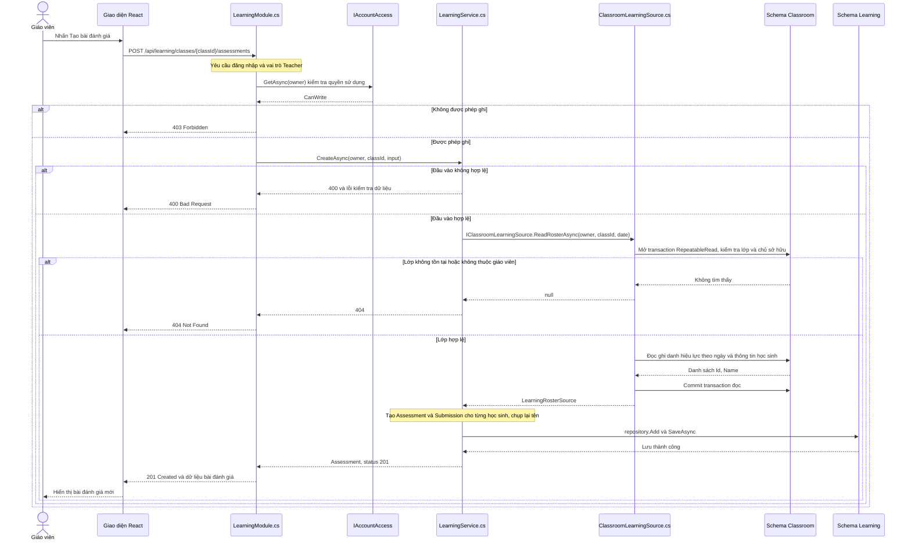
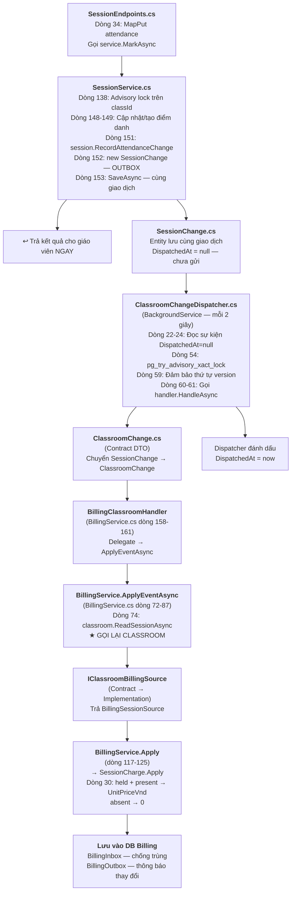

# Giải thích chi tiết luồng giao tiếp liên module — Trả lời giáo viên

**Mục đích:** Trình bày bằng lời nói khi được giáo viên hỏi về hai luồng chức năng: **Tạo bài đánh giá** và **Điểm danh dẫn đến học phí**. Giải thích từng bước, bắt đầu từ dòng lệnh nào, ở file nào, chức năng là gì, rồi chuyển sang file tiếp theo như thế nào.

> [!NOTE]
> Tất cả số dòng và mã nguồn trong tài liệu này được trích từ mã nguồn thực tế trong repository, không phải ví dụ minh họa đơn giản hóa.

---

## SƠ ĐỒ TUẦN TỰ LUỒNG CHẠY

Đọc từ trên xuống dưới. Mũi tên liền là lời gọi, mũi tên nét đứt là kết quả trả về. Các lời gọi qua contract chạy trong cùng backend; chỉ giao diện gọi backend qua HTTP. Dữ liệu các module nằm trong cùng PostgreSQL, nhưng mỗi module có schema và DbContext riêng.

### 1. Tạo bài đánh giá: Learning chờ Classroom trả danh sách học sinh



**Điểm cần nhớ:** `await ReadRosterAsync` phải hoàn tất trước khi Learning tạo bài nộp. DI nối `IClassroomLearningSource` với `ClassroomLearningSource`; đây là cấu hình khi khởi động, không phải một bước gọi qua mạng.

### 2. Điểm danh → học phí: lưu Outbox trước, Billing xử lý nền sau

```mermaid
sequenceDiagram
    actor GV as Giáo viên
    participant API as SessionEndpoints.cs
    participant Session as SessionService.cs
    participant CDB as Schema Classroom
    participant Worker as ClassroomChangeDispatcher.cs
    participant Handler as BillingClassroomHandler
    participant Billing as BillingService.cs
    participant Source as IClassroomBillingSource
    participant BDB as Schema Billing

    GV->>API: PUT /api/classes/{classId}/sessions/{id}/attendance/{studentId}
    Note over API: Kiểm tra đăng nhập, vai trò Teacher và CanWrite qua IAccountAccess
    API->>Session: MarkAsync(owner, classId, id, studentId, input)
    Session->>CDB: Khóa theo classId, đọc buổi học và học sinh
    Note over Session: Kiểm tra buổi held, dữ liệu đầu vào và phiên bản điểm danh
    alt Kiểm tra thất bại
        Session-->>API: NotFound / Invalid / Conflict
        API-->>GV: 404 / 400 / 409
    else Điểm danh hợp lệ
        Note over Session: Cập nhật Attendance, tăng phiên bản buổi học, tạo SessionChange
        Session->>CDB: SaveAsync: lưu điểm danh và Outbox trong cùng giao dịch
        CDB-->>Session: Commit thành công
        Session-->>API: AttendanceView
        API-->>GV: 200 OK, không chờ Billing tính phí
    end

    loop Tick nền mỗi 2 giây, xử lý sự kiện còn chờ
        Worker->>CDB: Đọc SessionChange có DispatchedAt = null
        Note over Worker,CDB: Khóa theo sessionId, bảo đảm thứ tự phiên bản trong cùng buổi
        opt Có sự kiện đủ điều kiện xử lý
            Worker->>Handler: IClassroomChangeHandler.HandleAsync(ClassroomChange)
            Handler->>Billing: ApplyEventAsync(change)
            Billing->>Source: ReadSessionAsync(owner, classId, sessionId)
            Source->>CDB: Đọc dữ liệu buổi học và điểm danh hiện tại
            CDB-->>Source: Dữ liệu nguồn
            Source-->>Billing: BillingSessionSource hoặc null
            alt Không còn dữ liệu nguồn
                Note over Billing: Kết thúc handler, không cập nhật học phí
            else Có dữ liệu nguồn
                Billing->>BDB: Khóa theo classId, kiểm tra BillingInbox.EventId
                alt EventId đã xử lý
                    Note over Billing: Bỏ qua sự kiện trùng
                else EventId chưa xử lý
                    Billing->>BDB: Đọc hoặc tạo TuitionLedger, đọc SessionCharge
                    Note over Billing: Apply → SessionCharge.Apply: kiểm tra SourceVersion và đơn giá
                    Note over Billing: held + present → UnitPriceVnd; trường hợp khác → 0
                    Note over Billing: Chưa có đơn giá thì phí có thể chưa xác định
                    Billing->>BDB: Lưu phí, Inbox, xử lý tiền giữ để đối chiếu và Outbox nếu projection đổi
                    BDB-->>Billing: Commit thành công
                end
            end
            Billing-->>Handler: Hoàn tất
            Handler-->>Worker: Hoàn tất
            Note over Worker: Chờ tất cả handler đã đăng ký hoàn tất
            Worker->>CDB: Acknowledge: đặt DispatchedAt, SaveChanges và commit
        end
    end

    Note over Worker,BDB: Nếu handler lỗi: không acknowledge, sự kiện còn chờ để thử lại; BillingInbox chống xử lý trùng
```

**Điểm cần nhớ:** Hai giao dịch lưu của Classroom và Billing tách biệt. Dispatcher chỉ đánh dấu đã gửi sau khi tất cả handler hoàn tất. Tick 2 giây là chu kỳ kiểm tra, không bảo đảm học phí luôn cập nhật trong đúng 2 giây; lỗi hoặc tồn đọng có thể làm chậm hơn.

---

## PHẦN 1: LUỒNG TẠO BÀI ĐÁNH GIÁ (Gọi qua Interface — Đồng bộ)

### Tổng quan bằng lời nói

> "Khi giáo viên nhấn nút 'Tạo bài đánh giá' trên giao diện, request HTTP được gửi đến backend. Module **Learning** tiếp nhận, nhưng nó không biết lớp có những học sinh nào. Nó phải **hỏi** module **Classroom** qua một interface (hợp đồng). Classroom trả danh sách học sinh, Learning dùng danh sách đó tạo bài nộp cho từng em rồi lưu vào database của mình."

---

### Bước 1 — Giao diện React gửi HTTP request

Giáo viên thao tác trên giao diện React (frontend). Khi nhấn "Tạo bài đánh giá", frontend gửi request:

```
POST /api/learning/classes/{classId}/assessments
Body: { "title": "Kiểm tra giữa kỳ", "date": "2026-11-04", "defaultMethod": "manual" }
```

Request này đi qua mạng (HTTP) đến backend ASP.NET Core.

---

### Bước 2 — Endpoint tiếp nhận request

> **File:** [`LearningModule.cs`](file:///d:/EducationKeeptrack/src/Modules/Learning/LearningModule.cs)

**Đăng ký route (dòng 26):**

```csharp
var group = endpoints.MapGroup("/api/learning/classes/{classId:guid}/assessments")
    .RequireAuthorization(p => p.RequireRole("Teacher"));
```

**Giải thích:** Dòng này tạo một nhóm endpoint tại đường dẫn `/api/learning/classes/{classId}/assessments`. `.RequireAuthorization(p => p.RequireRole("Teacher"))` bắt buộc người dùng phải đăng nhập và có vai trò "Teacher" — học sinh hoặc người lạ không gọi được.

**Kiểm tra quyền truy cập dịch vụ (dòng 27-33):**

```csharp
group.AddEndpointFilter(async (context, next) =>
{
    var http = context.HttpContext;
    var access = await http.RequestServices.GetRequiredService<IAccountAccess>()
        .GetAsync(Owner(http), http.RequestAborted);
    return (HttpMethods.IsGet(http.Request.Method) ? access.CanRead : access.CanWrite)
        ? await next(context)
        : Results.Json(new { message = "Tài khoản không có quyền...", status = access.Status }, statusCode: 403);
});
```

**Giải thích:** Trước khi xử lý bất kỳ request nào, filter này gọi module **ServiceAccess** (qua `IAccountAccess`) để kiểm tra: tài khoản giáo viên này có đang được phép sử dụng dịch vụ không? Nếu hết hạn hoặc chưa xác minh → trả 403 từ chối. Đây là **giao tiếp liên module đầu tiên** — Learning hỏi ServiceAccess qua contract.

**Xử lý request tạo bài đánh giá (dòng 34-38):**

```csharp
group.MapPost("/", async (Guid classId, AssessmentInput input, HttpContext http, LearningService service) =>
{
    var result = await service.CreateAsync(Owner(http), classId, input, http.RequestAborted);
    return result.Status == 201
        ? Results.Created($"/api/learning/classes/{classId}/assessments/{result.Value!.Id}", View(result.Value))
        : Respond(result, View);
});
```

**Giải thích bằng lời:**
> "Dòng 34 nói: khi nhận POST request, hãy gọi hàm bên trong. ASP.NET tự động phân giải `classId` từ URL, `input` từ body JSON, `http` từ request context, và `service` từ DI container."

> "Dòng 36 gọi `service.CreateAsync(Owner(http), classId, input, ct)` — đây là điểm chuyển tiếp từ tầng endpoint sang tầng nghiệp vụ. `Owner(http)` (dòng 58) lấy mã giáo viên từ claim `ClaimTypes.NameIdentifier` trong JWT token."

> [!IMPORTANT]
> Từ đây, control chuyển vào file [`LearningService.cs`](file:///d:/EducationKeeptrack/src/Modules/Learning/Application/LearningService.cs).

---

### Bước 3 — LearningService xử lý nghiệp vụ và GỌI SANG MODULE CLASSROOM

> **File:** [`LearningService.cs`](file:///d:/EducationKeeptrack/src/Modules/Learning/Application/LearningService.cs)

**Constructor — nhận các phụ thuộc qua DI (dòng 18):**

```csharp
public sealed class LearningService(
    ILearningRepository repository,         // Để lưu dữ liệu của Learning
    IClassroomLearningSource classroom,     // ← HỢP ĐỒNG VỚI CLASSROOM
    TimeProvider clock)                     // Đồng hồ hệ thống
```

**Giải thích:**
> "Constructor nhận 3 thứ qua DI: (1) `repository` để lưu dữ liệu; (2) `classroom` — đây chính là **đầu mối giao tiếp với module Classroom**, nhưng Learning chỉ biết interface `IClassroomLearningSource`, không biết Classroom làm gì bên trong; (3) `clock` để lấy thời gian."

**Phương thức `CreateAsync` (dòng 20-29):**

```csharp
public async Task<LearningResult<Assessment>> CreateAsync(
    string owner, Guid classId, AssessmentInput input, CancellationToken ct)
{
    // Dòng 22-23: VALIDATE đầu vào
    if (string.IsNullOrWhiteSpace(input.Title) || input.Title.Trim().Length > 160
        || input.Date == default || input.DefaultMethod != "manual")
        return new(null, 400, new() { ["assessment"] = ["Nhập tên (tối đa 160 ký tự)..."] });

    // ★ Dòng 24: GỌI SANG CLASSROOM — ĐIỂM GIAO TIẾP LIÊN MODULE
    var roster = await classroom.ReadRosterAsync(owner, classId, input.Date, ct);

    // Dòng 25: Nếu Classroom trả null → lớp không tồn tại hoặc không thuộc giáo viên
    if (roster is null) return new(null, 404);

    // Dòng 26: Tạo Assessment từ danh sách học sinh
    var assessment = new Assessment(owner, classId, input.Title, input.Date,
        roster.Students.Select(x => (x.Id, x.Name)));

    // Dòng 27-28: Lưu vào database riêng của Learning
    repository.Add(assessment);
    await repository.SaveAsync(ct);

    // Dòng 29: Trả về kết quả 201 Created
    return new(assessment, 201);
}
```

**Giải thích bằng lời (trọng tâm):**

> "**Dòng 22-23** kiểm tra đầu vào: tiêu đề không trống, tối đa 160 ký tự, ngày phải hợp lệ, và phương thức phải là 'manual' (AI chưa khả dụng). Nếu sai → trả lỗi 400 ngay, không gọi Classroom."

> "**Dòng 24 là dòng quan trọng nhất**: `classroom.ReadRosterAsync(owner, classId, input.Date, ct)` — Learning nói: _'Classroom ơi, cho tôi danh sách học sinh lớp `classId`, tại ngày `input.Date`, của giáo viên `owner`.'_ Learning **phải chờ** kết quả này — không có danh sách thì không tạo được bài nộp. Đây là **giao tiếp đồng bộ về nghiệp vụ**."

> "**Dòng 26** tạo entity `Assessment`. Constructor nhận danh sách tuple `(Id, Name)` từ roster — mỗi học sinh sẽ có một `Submission` (bài nộp). Tên học sinh được **chụp lại** (snapshot) — nếu sau này đổi tên bên Classroom thì tên trong bài đánh giá vẫn giữ nguyên."

> "**Dòng 27-28** lưu vào database **riêng** của Learning — không ghi vào database Classroom."

---

### Bước 4 — Contract Interface: hợp đồng giữa hai module

> **File:** [`ClassroomLearningSource.cs`](file:///d:/EducationKeeptrack/src/Contracts/ClassroomLearningSource.cs) (thư mục Contracts)

```csharp
// Dòng 3-4: DTO — dữ liệu trao đổi
public record LearningStudentSource(Guid Id, string Name);
public record LearningRosterSource(Guid ClassId, IReadOnlyList<LearningStudentSource> Students);

// Dòng 6-8: Interface — hợp đồng
public interface IClassroomLearningSource
{
    Task<LearningRosterSource?> ReadRosterAsync(
        string owner, Guid classId, DateOnly date, CancellationToken ct);
}
```

**Giải thích bằng lời:**
> "File này nằm trong thư mục `Contracts` — **dùng chung** cho cả hai module. Interface `IClassroomLearningSource` giống một **bản hợp đồng**: Learning biết mình có thể gọi `ReadRosterAsync` với các tham số trên và sẽ nhận lại `LearningRosterSource`."

> "`LearningStudentSource` chỉ chứa `Id` và `Name` — Classroom chỉ cung cấp **đúng thông tin Learning cần**, không trả toàn bộ hồ sơ học sinh. Learning không cần biết Classroom truy vấn bảng gì."

---

### Bước 5 — Dependency Injection nối interface với implementation

> **File:** [`ClassroomModule.cs`](file:///d:/EducationKeeptrack/src/Modules/Classroom/ClassroomModule.cs)

```csharp
// Dòng 25: Đăng ký DI
services.AddScoped<IClassroomLearningSource, ClassroomLearningSource>();
```

**Giải thích bằng lời:**
> "Dòng này nói với hệ thống DI: _'Khi ai đó cần `IClassroomLearningSource`, hãy tạo đối tượng `ClassroomLearningSource` và đưa cho họ.'_ Nhờ dòng này, khi `LearningService` được tạo, framework tự động truyền đúng implementation vào constructor tham số `classroom`."

---

### Bước 6 — Implementation thực sự truy vấn dữ liệu

> **File:** [`ClassroomLearningSource.cs`](file:///d:/EducationKeeptrack/src/Modules/Classroom/Infrastructure/ClassroomLearningSource.cs) (thư mục Infrastructure)

```csharp
public sealed class ClassroomLearningSource(ClassroomDatabase db) : IClassroomLearningSource
{
    public async Task<LearningRosterSource?> ReadRosterAsync(
        string owner, Guid classId, DateOnly date, CancellationToken ct)
    {
        // Dòng 10: Mở transaction RepeatableRead — đọc nhất quán
        await using var transaction = await db.Database
            .BeginTransactionAsync(IsolationLevel.RepeatableRead, ct);

        // Dòng 11: Kiểm tra lớp có tồn tại VÀ thuộc giáo viên này không
        if (!await db.Classes.AnyAsync(x => x.OwnerId == owner && x.Id == classId, ct))
            return null;

        // Dòng 12-14: Lấy ID học sinh đang ghi danh tại ngày đánh giá
        var ids = await db.Enrollments
            .Where(x => x.OwnerId == owner && x.ClassId == classId
                && x.StartDate <= date && (x.EndDate == null || x.EndDate >= date))
            .Select(x => x.StudentId).Distinct().ToArrayAsync(ct);

        // Dòng 15-16: Lấy thông tin học sinh, sắp xếp theo tên
        var students = await db.Students.AsNoTracking()
            .Where(x => x.OwnerId == owner && ids.Contains(x.Id))
            .OrderBy(x => x.Name).ThenBy(x => x.Id)
            .Select(x => new LearningStudentSource(x.Id, x.Name))
            .ToListAsync(ct);

        // Dòng 17-18: Commit transaction và trả kết quả
        await transaction.CommitAsync(ct);
        return new(classId, students);
    }
}
```

**Giải thích bằng lời:**
> "Đây là file **bên trong** module Classroom — chỉ Classroom mới thấy class này."

> "**Dòng 10**: mở transaction `RepeatableRead` — bảo đảm trong suốt quá trình đọc, dữ liệu không bị thay đổi bởi request khác. Đây là snapshot nhất quán."

> "**Dòng 11**: `x.OwnerId == owner` — **kiểm tra quyền sở hữu**: chỉ trả dữ liệu nếu lớp thuộc đúng giáo viên đang đăng nhập. Một giáo viên không thể lấy danh sách lớp của giáo viên khác."

> "**Dòng 12-14**: truy vấn bảng `Enrollments` (ghi danh), lọc theo giáo viên, lớp, và ngày — chỉ lấy học sinh có `StartDate` ≤ ngày đánh giá và `EndDate` chưa qua hoặc null (đang ghi danh)."

> "**Dòng 15-16**: từ danh sách ID học sinh, truy vấn bảng `Students` để lấy tên, rồi chuyển sang DTO `LearningStudentSource(Id, Name)`. `AsNoTracking()` cho biết không cần theo dõi thay đổi — chỉ đọc."

> "**Dòng 17-18**: commit transaction, trả `LearningRosterSource` về cho Learning. Từ đây, control **quay lại** `LearningService.CreateAsync` dòng 24."

---

### Sơ đồ tóm tắt luồng file

```mermaid
flowchart LR
    A["<b>LearningModule.cs</b><br/>Dòng 26: MapGroup route<br/>Dòng 27-33: Filter kiểm tra ServiceAccess<br/>Dòng 34: MapPost → gọi service.CreateAsync"]
    --> B["<b>LearningService.cs</b><br/>Dòng 22-23: Validate đầu vào<br/>Dòng 24: classroom.ReadRosterAsync<br/>★ GỌI SANG CLASSROOM"]
    --> C["<b>IClassroomLearningSource</b><br/>(Contracts/ClassroomLearningSource.cs)<br/>Dòng 6-8: Interface = hợp đồng"]
    --> D["<b>ClassroomModule.cs</b><br/>Dòng 25: AddScoped DI<br/>nối interface → implementation"]
    --> E["<b>ClassroomLearningSource.cs</b><br/>(Infrastructure)<br/>Dòng 10: RepeatableRead transaction<br/>Dòng 11: Kiểm tra owner<br/>Dòng 12-16: Truy vấn DB"]
    --> F["Trả LearningRosterSource<br/>về LearningService"]
    --> G["<b>LearningService.cs</b><br/>Dòng 26: Tạo Assessment + Submission<br/>Dòng 27-28: Lưu vào DB Learning"]
```



---

## PHẦN 2: LUỒNG ĐIỂM DANH DẪN ĐẾN HỌC PHÍ (Sự kiện — Bất đồng bộ)

### Tổng quan bằng lời nói

> "Khi giáo viên điểm danh, module **Classroom** lưu điểm danh và **đồng thời ghi một bản ghi sự kiện** vào database (Outbox pattern). Giáo viên nhận kết quả ngay. Sau đó, một **bộ xử lý nền** (dispatcher) chạy mỗi 2 giây, đọc sự kiện chưa xử lý và chuyển cho module **Billing**. Billing gọi lại Classroom qua contract riêng để lấy thông tin buổi học, rồi tính và lưu học phí cho từng học sinh."

> [!NOTE]
> Khác với Flow 1 (đồng bộ — phải chờ kết quả), Flow 2 dùng **sự kiện** (event): Classroom không gọi trực tiếp Billing, mà chỉ **thông báo** "điểm danh đã thay đổi". Billing phản ứng sau.

---

### Bước 1 — Giao diện gửi request điểm danh

Giáo viên tích "có mặt" / "vắng" cho từng học sinh. Frontend gửi:

```
PUT /api/classes/{classId}/sessions/{sessionId}/attendance/{studentId}
Body: { "status": "present", "reason": null, "excused": false, "version": 0 }
```

---

### Bước 2 — Endpoint tiếp nhận

> **File:** [`SessionEndpoints.cs`](file:///d:/EducationKeeptrack/src/Modules/Classroom/SessionEndpoints.cs)

**Đăng ký route (dòng 15, 34):**

```csharp
// Dòng 15: Nhóm endpoint cho lớp
var group = endpoints.MapGroup("/api/classes/{classId:guid}")
    .RequireAuthorization(policy => policy.RequireRole("Teacher"));

// Dòng 16-22: Filter kiểm tra quyền dịch vụ (giống Flow 1)

// Dòng 34: Route điểm danh
group.MapPut("/sessions/{id:guid}/attendance/{studentId:guid}",
    async (Guid classId, Guid id, Guid studentId, AttendanceInput input,
           HttpContext http, SessionService service) =>
        Respond(await service.MarkAsync(
            Owner(http), classId, id, studentId, input, http.RequestAborted)));
```

**Giải thích:**
> "Dòng 34 map PUT request cho điểm danh: nhận `classId`, `sessionId` (là `id`), `studentId` từ URL, và `AttendanceInput` từ body. Gọi `service.MarkAsync` rồi trả kết quả."

> [!IMPORTANT]
> Từ đây, control chuyển vào file [`SessionService.cs`](file:///d:/EducationKeeptrack/src/Modules/Classroom/Application/SessionService.cs).

---

### Bước 3 — SessionService: xử lý nghiệp vụ điểm danh (kèm tạo sự kiện Outbox)

> **File:** [`SessionService.cs`](file:///d:/EducationKeeptrack/src/Modules/Classroom/Application/SessionService.cs) — dòng 137-155

```csharp
public async Task<ClassroomResult<AttendanceView>> MarkAsync(
    string owner, Guid classId, Guid id, Guid studentId,
    AttendanceInput input, CancellationToken ct) =>
    await repository.WithClassLockAsync<AttendanceView>(classId, async () =>
    {
        // Dòng 140-141: Tìm buổi học
        var session = await repository.FindSessionAsync(owner, classId, id, ct);
        if (session is null) return new(null, ClassroomFailure.NotFound);

        // Dòng 142-144: Tìm bản ghi điểm danh đã có hoặc học sinh đủ điều kiện
        var saved = (await repository.AttendanceAsync(owner, id, ct))
            .SingleOrDefault(x => x.Student.Id == studentId);
        var student = saved?.Student
            ?? (await repository.EligibleStudentsAsync(owner, classId, session.Date, ct))
               .SingleOrDefault(x => x.Id == studentId);
        if (student is null) return new(null, ClassroomFailure.NotFound);

        // Dòng 145: Chỉ cho phép điểm danh buổi "held" (đã diễn ra)
        if (session.Status != "held")
            return new(null, ClassroomFailure.Conflict,
                "Chỉ điểm danh buổi đã diễn ra...");

        // Dòng 146-147: Validate input
        var errors = input.Validate();
        if (errors.Count > 0) return new(null, ClassroomFailure.Invalid, Errors: errors);

        // Dòng 148-149: Tạo mới hoặc cập nhật điểm danh (optimistic concurrency)
        var mark = saved?.Attendance ?? new Attendance(owner, id, studentId);
        if (!mark.TryMark(input)) return new(null, ClassroomFailure.Conflict,
            "Điểm danh đã thay đổi ở tab khác...");

        // Dòng 150: Nếu mới tạo thì thêm vào repository
        if (saved is null) repository.Add(mark);

        // ★ Dòng 151: TĂNG PHIÊN BẢN BUỔI HỌC
        session.RecordAttendanceChange();

        // ★ Dòng 152: TẠO BẢN GHI SỰ KIỆN (Outbox)
        repository.Add(new SessionChange(session, "attendance.changed", clock.GetUtcNow(), mark));

        // ★ Dòng 153: LƯU TẤT CẢ TRONG CÙNG MỘT GIAO DỊCH
        await repository.SaveAsync(ct);

        return new(View(session, student, mark));
    }, ct);
```

**Giải thích bằng lời (trọng tâm):**

> "**Dòng 138**: `WithClassLockAsync(classId, ...)` — khóa advisory trên PostgreSQL theo `classId`. Bảo đảm chỉ một request điểm danh cho cùng lớp được xử lý tại một thời điểm, tránh xung đột."

> "**Dòng 145**: chỉ buổi có trạng thái `held` (đã diễn ra) mới được điểm danh. Buổi `planned` hoặc `cancelled` bị từ chối."

> "**Dòng 148-149**: `TryMark(input)` dùng **optimistic concurrency** trên `Version` — nếu người khác đã sửa điểm danh (version không khớp), trả Conflict."

> "**Ba dòng quan trọng nhất:**"

> "**Dòng 151**: `session.RecordAttendanceChange()` — tăng `session.Version`. Phiên bản này giúp Billing biết thay đổi nào mới hơn."

> "**Dòng 152**: `new SessionChange(session, "attendance.changed", clock.GetUtcNow(), mark)` — tạo **bản ghi sự kiện**. Đây chính là **Outbox pattern**: sự kiện được lưu cùng giao dịch database với điểm danh."

> "**Dòng 153**: `SaveAsync` commit cả điểm danh lẫn sự kiện. Hoặc cả hai được lưu, hoặc không cái nào — **không bao giờ** xảy ra tình huống 'điểm danh lưu rồi nhưng sự kiện mất'."

> "Sau `SaveAsync`, giáo viên nhận kết quả **ngay** — không chờ Billing."

---

### Bước 4 — SessionChange: bản ghi sự kiện (Outbox record)

> **File:** [`SessionChange.cs`](file:///d:/EducationKeeptrack/src/Modules/Classroom/Domain/SessionChange.cs)

```csharp
public sealed class SessionChange
{
    public Guid Id { get; private set; } = Guid.NewGuid();     // Mã sự kiện duy nhất
    public string OwnerId { get; private set; }                 // Mã giáo viên
    public Guid ClassId { get; private set; }                   // Mã lớp
    public Guid SessionId { get; private set; }                 // Mã buổi học
    public int SessionVersion { get; private set; }             // Phiên bản buổi học
    public string Kind { get; private set; }                    // Loại thay đổi: "attendance.changed"
    public DateTimeOffset RecordedAt { get; private set; }      // Thời điểm xảy ra
    public string SessionStatus { get; private set; }           // "held", "planned", ...
    public Guid? StudentId { get; private set; }                // Học sinh liên quan
    public int? AttendanceVersion { get; private set; }         // Phiên bản điểm danh
    public string? AttendanceStatus { get; private set; }       // "present", "absent", ...
    public bool? Excused { get; private set; }                  // Có phép không
    public string? Reason { get; private set; }                 // Lý do
    public DateTimeOffset? DispatchedAt { get; private set; }   // ← null = CHƯA GỬI

    // Constructor (dòng 21-27): chụp toàn bộ thông tin từ session và attendance
    public SessionChange(ClassSession session, string kind, DateTimeOffset recordedAt,
                          Attendance? attendance = null) { ... }

    // Dòng 28: Dispatcher gọi khi đã chuyển thành công
    public void Acknowledge(DateTimeOffset now) => DispatchedAt = now;
}
```

**Giải thích:**
> "`SessionChange` chụp toàn bộ thông tin cần thiết. `DispatchedAt = null` nghĩa là sự kiện chưa được chuyển cho handler. Khi dispatcher xử lý xong, nó gọi `Acknowledge()` để đánh dấu thời điểm chuyển thành công."

> [!WARNING]
> Đây là điểm mà **eventual consistency** xảy ra: trong 2-3 giây sau khi điểm danh thành công, học phí có thể chưa được cập nhật. Billing sẽ xử lý khi dispatcher chuyển sự kiện.

---

### Bước 5 — ClassroomChangeDispatcher: bộ xử lý nền đọc và chuyển sự kiện

> **File:** [`ClassroomChangeDispatcher.cs`](file:///d:/EducationKeeptrack/src/Modules/Classroom/Infrastructure/ClassroomChangeDispatcher.cs)

**Vòng lặp chính (dòng 11-45):**

```csharp
// Dòng 9: BackgroundService — chạy nền liên tục khi ứng dụng khởi động
public sealed class ClassroomChangeDispatcher(...) : BackgroundService
{
    protected override async Task ExecuteAsync(CancellationToken stoppingToken)
    {
        // Dòng 13: Mỗi 2 giây kiểm tra một lần
        using var timer = new PeriodicTimer(TimeSpan.FromSeconds(2));
        while (await timer.WaitForNextTickAsync(stoppingToken))
        {
            // Dòng 22-24: Tìm sự kiện "đầu" (head) — sự kiện có version thấp nhất
            // chưa dispatch cho mỗi session, đảm bảo thứ tự
            var heads = db.SessionChanges.AsNoTracking()
                .Where(x => x.DispatchedAt == null
                    && !db.SessionChanges.Any(earlier =>
                        earlier.SessionId == x.SessionId
                        && earlier.SessionVersion < x.SessionVersion
                        && earlier.DispatchedAt == null))
                .OrderBy(x => x.RecordedAt).ThenBy(x => x.Id)
                .Select(x => x.Id);

            // Dòng 33-39: Với mỗi sự kiện, gọi DispatchAsync (chain xử lý tiếp)
            foreach (var id in pending)
            {
                Guid? next = id;
                for (var count = 0; next is { } current && count < 100; count++)
                    next = await DispatchAsync(current, stoppingToken);
            }
        }
    }
}
```

**Phương thức `DispatchAsync` (dòng 47-66) — xử lý từng sự kiện:**

```csharp
private async Task<Guid?> DispatchAsync(Guid id, CancellationToken ct)
{
    using var scope = scopes.CreateScope();
    var db = scope.ServiceProvider.GetRequiredService<ClassroomDatabase>();

    // Dòng 53-54: Mở transaction + khóa advisory (non-blocking)
    await using var transaction = await db.Database.BeginTransactionAsync(ct);
    var locked = await db.Database.SqlQuery<bool>(
        $"SELECT pg_try_advisory_xact_lock(...)").SingleAsync(ct);
    if (!locked) return null;  // Ai đó đang xử lý session này → bỏ qua

    // Dòng 56-57: Load sự kiện nếu vẫn chưa dispatch
    var change = await db.SessionChanges
        .SingleOrDefaultAsync(x => x.Id == id && x.DispatchedAt == null, ct);
    if (change is null) return null;

    // Dòng 59: Đảm bảo thứ tự — không xử lý version mới nếu version cũ chưa xong
    if (await db.SessionChanges.AnyAsync(x =>
        x.SessionId == change.SessionId
        && x.SessionVersion < change.SessionVersion
        && x.DispatchedAt == null, ct))
        return null;

    // ★ Dòng 60-61: GỌI TẤT CẢ HANDLER (Billing là một trong số đó)
    foreach (var handler in scope.ServiceProvider.GetServices<IClassroomChangeHandler>())
        await handler.HandleAsync(SessionService.ChangeView(change), ct);

    // Dòng 62-64: Đánh dấu đã xử lý, commit
    change.Acknowledge(clock.GetUtcNow());
    await db.SaveChangesAsync(ct);
    await transaction.CommitAsync(ct);

    // Dòng 65: Trả ID sự kiện tiếp theo cho cùng session (nếu có) → chain
    return await db.SessionChanges
        .Where(x => x.SessionId == change.SessionId && x.DispatchedAt == null)
        .OrderBy(x => x.SessionVersion)
        .Select(x => (Guid?)x.Id).FirstOrDefaultAsync(ct);
}
```

**Giải thích bằng lời:**
> "Dispatcher là một `BackgroundService` — khi ứng dụng khởi động, nó tự chạy nền và cứ 2 giây kiểm tra database xem có sự kiện `DispatchedAt == null` không."

> "**Dòng 22-24** tìm sự kiện 'đầu' cho mỗi session: nếu session A có version 1, 2, 3 chưa dispatch, chỉ xử lý version 1 trước — **bảo đảm thứ tự**. Billing nhận sự kiện theo đúng thứ tự xảy ra."

> "**Dòng 54** dùng `pg_try_advisory_xact_lock` — khóa **non-blocking**: nếu process khác đang xử lý cùng session, bỏ qua (không chờ). Tránh deadlock."

> "**Dòng 60-61**: `SessionService.ChangeView(change)` chuyển entity `SessionChange` thành DTO `ClassroomChange` (contract), rồi gọi `HandleAsync` trên **tất cả** handler đã đăng ký qua DI."

> "**Dòng 65**: sau khi xử lý xong, trả về ID sự kiện tiếp theo cho cùng session — tạo **chuỗi xử lý** (chain) để không phải chờ tick tiếp."

---

### Bước 6 — Contract sự kiện: ClassroomChange

> **File:** [`ClassroomChange.cs`](file:///d:/EducationKeeptrack/src/Contracts/ClassroomChange.cs)

```csharp
// Dòng 3-5: Sự kiện mang thông tin gì
public record ClassroomChange(
    Guid EventId,                    // Mã sự kiện duy nhất
    string OwnerId,                  // Mã giáo viên
    Guid ClassId,                    // Mã lớp
    Guid SessionId,                  // Mã buổi học
    int SessionVersion,              // Phiên bản buổi
    string Kind,                     // Loại: "attendance.changed"
    DateTimeOffset RecordedAt,       // Thời điểm xảy ra
    string SessionStatus,            // "held", "planned", ...
    Guid? StudentId,                 // Học sinh liên quan
    int? AttendanceVersion,          // Phiên bản điểm danh
    string? AttendanceStatus,        // "present", "absent", ...
    bool? Excused,                   // Có phép
    string? Reason);                 // Lý do

// Dòng 7: Comment ghi rõ: gửi ít nhất một lần, handler phải chống trùng
// Dòng 8-10: Interface handler
public interface IClassroomChangeHandler
{
    Task HandleAsync(ClassroomChange change, CancellationToken cancellationToken);
}
```

**Giải thích:**
> "Sự kiện `ClassroomChange` mang đủ metadata để handler quyết định có cần xử lý không: `EventId` để chống trùng, `SessionVersion` để biết phiên bản mới hay cũ. Comment dòng 7 ghi rõ: _'gửi ít nhất một lần, handler phải tự chống trùng'_ — đây là thiết kế **at-least-once delivery**."

---

### Bước 7 — BillingClassroomHandler: Billing nhận sự kiện

> **File:** [`BillingService.cs`](file:///d:/EducationKeeptrack/src/Modules/Billing/Application/BillingService.cs) — dòng 158-161

```csharp
// Dòng 158-161: Handler nhận sự kiện từ dispatcher
public sealed class BillingClassroomHandler(BillingService billing) : IClassroomChangeHandler
{
    public Task HandleAsync(ClassroomChange change, CancellationToken cancellationToken)
        => billing.ApplyEventAsync(change, cancellationToken);
}
```

**Giải thích:**
> "Handler rất đơn giản — nó chỉ chuyển tiếp (delegate) sang `BillingService.ApplyEventAsync`. Tách handler và service giúp tổ chức code gọn gàng."

**DI Registration trong [`BillingModule.cs`](file:///d:/EducationKeeptrack/src/Modules/Billing/BillingModule.cs) dòng 24:**

```csharp
services.AddScoped<IClassroomChangeHandler, BillingClassroomHandler>();
```

> "Dòng này đăng ký `BillingClassroomHandler` như implementation của `IClassroomChangeHandler`. Nhờ vậy, khi dispatcher gọi `GetServices<IClassroomChangeHandler>()`, nó tìm được handler này."

---

### Bước 8 — BillingService.ApplyEventAsync: xử lý sự kiện và tính phí

> **File:** [`BillingService.cs`](file:///d:/EducationKeeptrack/src/Modules/Billing/Application/BillingService.cs) — dòng 72-87

```csharp
public async Task ApplyEventAsync(ClassroomChange change, CancellationToken ct)
{
    // ★ Dòng 74: GỌI LẠI CLASSROOM — lấy dữ liệu buổi học
    var source = await classroom.ReadSessionAsync(
        change.OwnerId, change.ClassId, change.SessionId, ct);
    if (source is null) return;

    // Dòng 76: Khóa advisory theo classId trong Billing
    await repository.WithClassLockAsync<ProjectionComplete>(change.ClassId, async () =>
    {
        // ★ Dòng 78: KIỂM TRA IDEMPOTENCY — đã xử lý EventId này chưa?
        if (await repository.ProcessedAsync(change.EventId, ct))
            return new(new ProjectionComplete());  // Đã xử lý → bỏ qua

        // Dòng 79: Lấy hoặc tạo TuitionLedger (sổ cái học phí)
        var ledger = await GetOrCreateAsync(change.OwnerId, change.ClassId, ct);

        // Dòng 80: Lấy danh sách SessionCharge hiện có
        var charges = (await repository.ChargesAsync(change.OwnerId, change.ClassId, ct)).ToList();

        // ★ Dòng 81: ÁP DỤNG TÍNH PHÍ
        Apply(ledger, charges, source);

        // Dòng 82: Ghi EventId vào BillingInbox — chống xử lý trùng
        repository.Add(new BillingInbox(change.EventId, clock.GetUtcNow()));

        // Dòng 83: Kiểm tra phí thừa
        await HoldExcessAsync(ledger, charges, ct);

        // Dòng 84: Lưu tất cả vào DB Billing
        await repository.SaveAsync(ct);

        return new(new ProjectionComplete());
    }, ct);
}
```

**Giải thích bằng lời:**

> "**Dòng 74**: Billing gọi **lại** Classroom qua contract `IClassroomBillingSource.ReadSessionAsync` — đây là **giao tiếp liên module lần thứ hai**. Sự kiện chỉ nói 'có thay đổi', không chứa chi tiết. Billing cần gọi riêng để lấy: ngày buổi học, trạng thái, danh sách điểm danh."

> "**Dòng 78**: kiểm tra **idempotency** — nếu `EventId` đã nằm trong bảng `BillingInbox` nghĩa là đã xử lý rồi → bỏ qua. Điều này ngăn tình huống dispatcher gửi lại sự kiện (do restart) → Billing không tính phí trùng."

> "**Dòng 81**: gọi phương thức `Apply` nội bộ để tính phí — xem bước tiếp."

---

### Bước 9 — Apply: logic tính phí chi tiết

> **File:** [`BillingService.cs`](file:///d:/EducationKeeptrack/src/Modules/Billing/Application/BillingService.cs) — dòng 117-125

```csharp
private void Apply(TuitionLedger ledger, List<SessionCharge> charges, BillingSessionSource source)
{
    // Dòng 119-121: Tìm hoặc tạo SessionCharge cho buổi học này
    var charge = charges.SingleOrDefault(x => x.SessionId == source.Id);
    var isNew = charge is null;
    charge ??= new SessionCharge(ledger.OwnerId, ledger.ClassId, source.Id);

    // Dòng 122: Áp dụng dữ liệu buổi học + đơn giá
    if (!charge.Apply(source, ledger.RateOn(source.Date))) return;

    // Dòng 123: Nếu mới tạo thì thêm vào repository
    if (isNew) { repository.Add(charge); charges.Add(charge); }

    // Dòng 124: Ghi nhận phiên bản mới + tạo BillingOutbox event
    ledger.RecordProjection();
    repository.Add(new BillingOutbox(ledger, "tuition.changed", clock.GetUtcNow()));
}
```

**Và trong [`SessionCharge.cs`](file:///d:/EducationKeeptrack/src/Modules/Billing/Domain/SessionCharge.cs) — dòng 19-33:**

```csharp
public bool Apply(BillingSessionSource source, TuitionRate? rate)
{
    // Dòng 21: Bỏ qua nếu version cũ hơn đã xử lý
    if (source.Version < SourceVersion) return false;

    // Dòng 22-23: Chỉ gán đơn giá khi chưa có, buổi "held", và có rate
    var priceAdded = UnitPriceVnd is null && source.Status == "held" && rate is not null;
    if (source.Version == SourceVersion && !priceAdded) return false;

    // Dòng 24: Gán đơn giá nếu thỏa điều kiện
    if (priceAdded) { UnitPriceVnd = rate!.UnitPriceVnd; RateId = rate.Id; }

    // Dòng 25: Cập nhật thông tin buổi học
    Date = source.Date; StartTime = source.StartTime;
    Status = source.Status; Kind = source.Kind; SourceVersion = source.Version;

    // ★ Dòng 26-31: TÍNH PHÍ CHO TỪNG HỌC SINH
    foreach (var mark in source.Attendance)
    {
        var fee = Fees.SingleOrDefault(x => x.StudentId == mark.StudentId);
        if (fee is null) { fee = new StudentCharge(SessionId, mark.StudentId); Fees.Add(fee); }

        // Dòng 30: CÔNG THỨC TÍNH PHÍ
        fee.Apply(mark,
            Status == "held" && mark.Status == "present" ? UnitPriceVnd : 0m);
        // Nếu buổi "held" VÀ học sinh "present" → phí = UnitPriceVnd
        // Ngược lại → phí = 0
    }
    return true;
}
```

**Giải thích bằng lời:**
> "**Dòng 21**: kiểm tra phiên bản — nếu dữ liệu nguồn cũ hơn cái đã lưu, bỏ qua. Đây là idempotency ở tầng domain."

> "**Dòng 30 là công thức tính phí**: nếu buổi học trạng thái 'held' (đã diễn ra) VÀ học sinh 'present' (có mặt) → tính phí bằng đơn giá (`UnitPriceVnd`). Nếu vắng hoặc buổi chưa diễn ra → phí = 0."

> "Mỗi `StudentCharge` ghi lại: học sinh nào, trạng thái điểm danh gì, phí bao nhiêu. Tất cả nằm trong `SessionCharge` của buổi học."

---

### Bước 10 — Contract Billing lấy dữ liệu từ Classroom

> **File:** [`ClassroomBillingSource.cs`](file:///d:/EducationKeeptrack/src/Contracts/ClassroomBillingSource.cs) (Contract)

```csharp
public interface IClassroomBillingSource
{
    Task<BillingClassSource?> ReadClassAsync(string owner, Guid classId, CancellationToken ct);
    Task<BillingSessionSource?> ReadSessionAsync(string owner, Guid classId, Guid sessionId, CancellationToken ct);
}

// DTO cho một buổi học
public record BillingSessionSource(
    Guid Id, DateOnly Date, TimeOnly StartTime, string Status, string Kind,
    int Version, IReadOnlyList<BillingAttendanceSource> Attendance);
```

**Giải thích:**
> "Giống cơ chế contract ở Flow 1: Billing không tự truy vấn bảng Classroom. `ReadSessionAsync` trả đúng thông tin Billing cần: ngày, giờ, trạng thái, phiên bản, và danh sách điểm danh."

---

### Sơ đồ tóm tắt toàn bộ luồng file



---

## PHẦN 3: SO SÁNH HAI CÁCH GIAO TIẾP

| | Flow 1: Tạo bài đánh giá | Flow 2: Điểm danh → Học phí |
|---|---|---|
| **Cách giao tiếp** | Gọi interface trực tiếp (đồng bộ) | Sự kiện + xử lý nền (bất đồng bộ) |
| **Module gọi** | Learning gọi Classroom | Classroom phát sự kiện → Billing nhận |
| **Thời điểm xử lý** | Ngay — chờ kết quả rồi mới tiếp | Sau 2-3 giây — dispatcher chuyển sự kiện |
| **Giáo viên chờ?** | Có — chờ đến khi bài đánh giá tạo xong | Không — nhận kết quả điểm danh ngay |
| **Contract chính** | `IClassroomLearningSource` | `IClassroomChangeHandler` + `IClassroomBillingSource` |
| **Outbox pattern** | Không cần | Có — `SessionChange` lưu cùng giao dịch |
| **Idempotency** | Không cần (mỗi lần tạo là bài mới) | Cần — `BillingInbox.EventId` + `SourceVersion` |
| **Advisory lock** | Không | Có — `pg_advisory_xact_lock` cả hai bên |
| **Eventual consistency** | Không — nhất quán ngay | Có — học phí có thể chậm 2-3 giây |
| **File bắt đầu** | `LearningModule.cs` dòng 34 | `SessionEndpoints.cs` dòng 34 |
| **File kết thúc** | `LearningService.cs` dòng 28 | `SessionCharge.cs` dòng 30 |

---

## PHẦN 4: CÂU TRẢ LỜI MẪU KHI GIÁO VIÊN HỎI

### "Các module giao tiếp với nhau như thế nào?"

> "Các module giao tiếp bằng hai cách. **Cách thứ nhất** là gọi qua interface: khi tạo bài đánh giá, module Learning cần danh sách học sinh nên gọi `ReadRosterAsync` trên interface `IClassroomLearningSource` — Classroom trả kết quả ngay, Learning chờ xong rồi mới tạo bài nộp. **Cách thứ hai** là gửi sự kiện: khi điểm danh, Classroom lưu điểm danh kèm một bản ghi sự kiện `SessionChange` trong cùng giao dịch database, giáo viên nhận kết quả ngay. Sau đó, `ClassroomChangeDispatcher` chạy nền mỗi 2 giây, đọc sự kiện chưa xử lý và gọi `BillingClassroomHandler.HandleAsync` để Billing tính học phí."

### "Tại sao Learning không tự truy vấn bảng học sinh của Classroom?"

> "Vì kiến trúc Modular Monolith yêu cầu mỗi module sở hữu dữ liệu riêng. Dù cùng database PostgreSQL, mỗi module có schema và DbContext riêng. Learning gọi `IClassroomLearningSource` — một interface trong thư mục Contracts. Classroom cài đặt interface này trong class `ClassroomLearningSource` bên thư mục Infrastructure. DI nối hai bên qua dòng `AddScoped` trong `ClassroomModule.cs`. Nếu Classroom đổi cấu trúc bảng, Learning vẫn hoạt động bình thường vì chỉ phụ thuộc vào interface, không phụ thuộc bảng."

### "Outbox là gì? Tại sao cần?"

> "Outbox là kỹ thuật lưu sự kiện cùng giao dịch với thay đổi nghiệp vụ. Trong `SessionService.MarkAsync` dòng 152, `SessionChange` được tạo và lưu cùng lúc với điểm danh qua `SaveAsync` dòng 153. Nếu ứng dụng tắt đột ngột sau khi lưu, sự kiện vẫn nằm trong database với `DispatchedAt = null` để dispatcher xử lý khi khởi động lại. Nếu không có Outbox, sự kiện chỉ ở bộ nhớ và bị mất — điểm danh thay đổi nhưng học phí không bao giờ cập nhật."

### "Idempotency hoạt động thế nào trong Billing?"

> "Billing chống trùng bằng hai cơ chế. **Thứ nhất**, `BillingInbox` ghi lại `EventId` mỗi sự kiện đã xử lý — dòng 78 trong `ApplyEventAsync` kiểm tra: nếu `EventId` đã có trong inbox thì bỏ qua. **Thứ hai**, `SessionCharge.Apply` dòng 21 so sánh `source.Version` với `SourceVersion` đã lưu — nếu phiên bản nguồn cũ hơn hoặc bằng (và không có đơn giá mới), trả `false` không làm gì. Nhờ hai cơ chế này, dù dispatcher gửi cùng sự kiện nhiều lần, học phí chỉ tính một lần."

### "Tại sao Billing phải gọi lại Classroom sau khi nhận sự kiện?"

> "Vì sự kiện `ClassroomChange` chỉ mang metadata: 'buổi học nào thay đổi, phiên bản mấy'. Nó không chứa chi tiết danh sách điểm danh hay đơn giá. Billing gọi `classroom.ReadSessionAsync` ở dòng 74 để lấy trạng thái buổi học và danh sách điểm danh **mới nhất**. Thiết kế này giúp sự kiện nhẹ và Billing luôn đọc dữ liệu cập nhật nhất từ Classroom."
