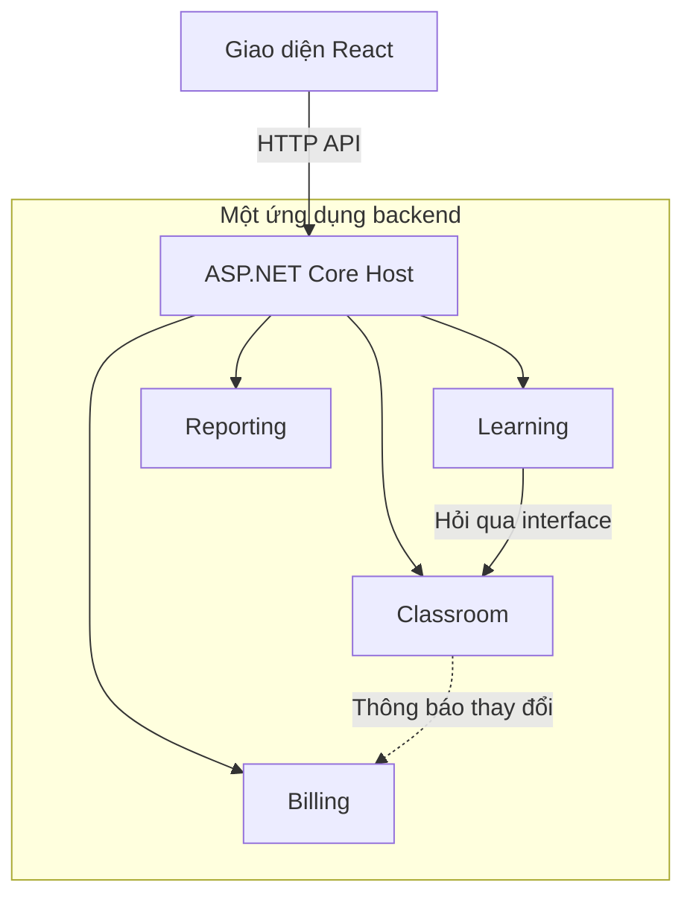
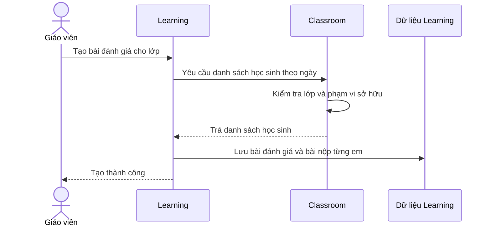
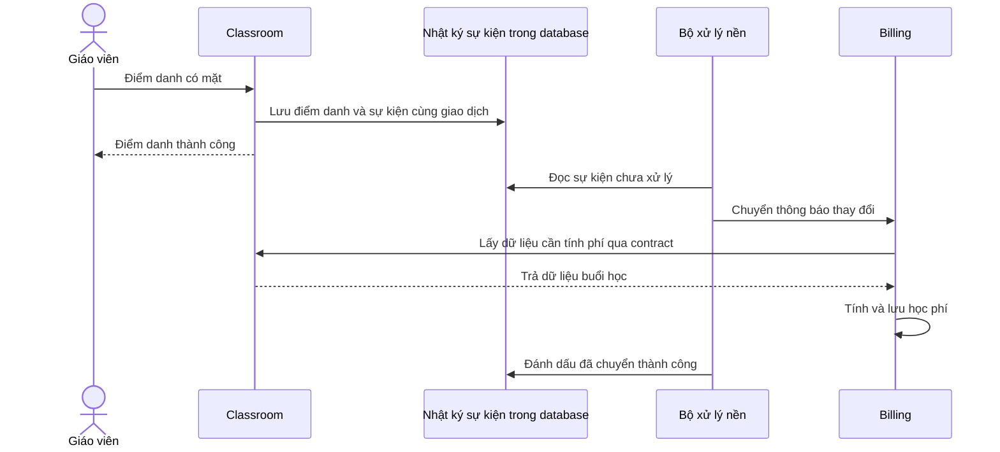
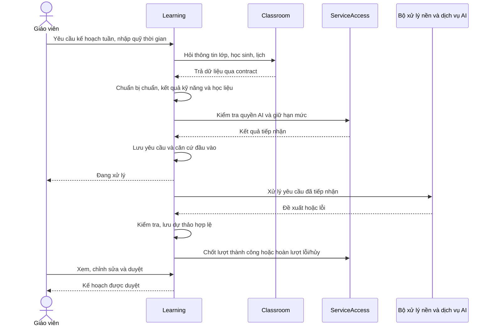

# Giải thích giao tiếp giữa các module trong EducationKeeptrack

**Mục đích:** Hiểu cách các module trao đổi dữ liệu, đọc được luồng xử lý trong mã nguồn và biết cách áp dụng vào chức năng AI đề xuất.\
**Ngày lập:** 02/11/2026.

## 1. Các module giao tiếp như thế nào?

EducationKeeptrack sử dụng kiến trúc **Modular Monolith**: một backend được chia thành các module có trách nhiệm riêng. Các module chủ yếu giao tiếp bằng hai cách:

1. **Gọi phương thức qua interface:** cần dữ liệu hoặc kết quả ngay để tiếp tục công việc.
2. **Gửi sự kiện:** thông báo một thay đổi đã xảy ra để module khác xử lý.

Các module cùng chạy trong một ứng dụng. Vì vậy, Learning gọi Classroom thường là gọi phương thức C# trong cùng tiến trình, không cần gửi HTTP giữa hai module.

Frontend vẫn gọi backend qua HTTP API. Đây là một ranh giới khác với giao tiếp nội bộ giữa các module.



Sơ đồ trên minh họa một số đường giao tiếp, không biểu diễn toàn bộ phụ thuộc của hệ thống.

## 2. Mỗi module giống một bộ phận có trách nhiệm riêng

| Module | Trách nhiệm | Ví dụ dữ liệu |
|---|---|---|
| Identity | Danh tính và đăng nhập | Tài khoản, phiên đăng nhập |
| ServiceAccess | Quyền sử dụng dịch vụ và AI | Thời hạn, quyền AI, hạn mức |
| Classroom | Tổ chức lớp học | Lớp, học sinh, ghi danh, lịch, điểm danh |
| Learning | Đánh giá học tập | Bài đánh giá, bài nộp, lịch sử kết quả |
| Billing | Học phí học sinh | Phí buổi học, khoản thu, phân bổ, công nợ |
| Reporting | Tổng hợp và xuất báo cáo | Bản nháp, bản xem trước, bản xuất |

Nguyên tắc là **module quản lý dữ liệu của mình và cung cấp phần dữ liệu cần thiết qua đầu mối công khai**.

Ví dụ Learning muốn biết lớp có học sinh nào thì hỏi Classroom. Learning không tự truy vấn bảng học sinh của Classroom.

Một PostgreSQL database vẫn có thể chứa nhiều schema, mỗi module có schema và DbContext riêng. Việc cùng dùng một database không có nghĩa module được tùy ý đọc, ghi dữ liệu nội bộ của nhau. Đây là quy định trong [ADR-0001](adr/0001-ui-and-database.md). Quyền sở hữu dữ liệu theo giáo viên vẫn phải kiểm tra riêng; schema không thay thế phân quyền.

Lợi ích là khi Classroom thay đổi cách lưu dữ liệu, Learning có thể tiếp tục sử dụng hợp đồng cũ nếu dữ liệu và hành vi công khai vẫn được giữ tương thích.

## 3. Cách thứ nhất: gọi qua interface

### 3.1. Tình huống: tạo bài đánh giá

Giáo viên yêu cầu tạo bài đánh giá cho lớp. Learning cần biết học sinh nào thuộc lớp tại ngày đánh giá để tạo bài nộp cho từng em.



Learning phải nhận được câu trả lời rồi mới làm tiếp. Đây là **giao tiếp đồng bộ về nghiệp vụ**: bước sau phụ thuộc vào kết quả bước trước.

### 3.2. Interface là hợp đồng

Mã nguồn có hợp đồng sau:

```csharp
public interface IClassroomLearningSource
{
    Task<LearningRosterSource?> ReadRosterAsync(
        string owner,
        Guid classId,
        DateOnly date,
        CancellationToken ct);
}
```

Đọc bằng ngôn ngữ thông thường:

> Hãy cung cấp danh sách học sinh của lớp `classId`, tại ngày `date`, trong phạm vi dữ liệu của giáo viên `owner`.

| Thành phần | Ý nghĩa |
|---|---|
| `IClassroomLearningSource` | Đầu mối công khai để Learning hỏi thông tin Classroom |
| `ReadRosterAsync` | Thao tác lấy danh sách học sinh |
| `owner` | Mã giáo viên sở hữu dữ liệu, được lấy từ danh tính đã xác thực |
| `classId` | Mã lớp cần đọc |
| `date` | Ngày dùng để xác định danh sách phù hợp |
| `CancellationToken` | Cho phép hủy thao tác khi yêu cầu bị hủy |
| `LearningRosterSource?` | Dữ liệu trả về; có thể không có kết quả |

Interface quy định cách gọi và kết quả trả về. Class thực thi interface mới chứa phần xử lý cụ thể, chẳng hạn truy vấn dữ liệu. Xem thêm [Interface trong C# — Microsoft Learn](https://learn.microsoft.com/en-us/dotnet/csharp/fundamentals/types/interfaces).

Xem mã nguồn: [ClassroomLearningSource contract](../src/Contracts/ClassroomLearningSource.cs).

### 3.3. Dependency Injection nối hợp đồng với phần thực thi

Classroom đăng ký:

```csharp
services.AddScoped<
    IClassroomLearningSource,
    ClassroomLearningSource>();
```

Dòng này cho cơ chế Dependency Injection (DI) biết:

> Khi một thành phần cần `IClassroomLearningSource`, hãy cung cấp đối tượng `ClassroomLearningSource`.

Learning nhận interface qua constructor:

```csharp
public sealed class LearningService(
    ILearningRepository repository,
    IClassroomLearningSource classroom,
    TimeProvider clock)
```

Sau đó gọi:

```csharp
var roster = await classroom.ReadRosterAsync(
    owner, classId, input.Date, ct);
```

Luồng thực thi là:

```text
LearningService
    → gọi qua IClassroomLearningSource
    → ClassroomLearningSource thực hiện
    → đọc dữ liệu Classroom
    → trả dữ liệu về Learning
```

DI phụ trách tạo và cung cấp đối tượng; interface quy định cách sử dụng đối tượng đó. `AddScoped` đăng ký đối tượng theo scope; trong xử lý HTTP thông thường, scope gắn với một request. Tìm hiểu thêm tại [Dependency Injection trong .NET](https://learn.microsoft.com/en-us/dotnet/core/extensions/dependency-injection/overview).

Xem mã nguồn: [LearningService](../src/Modules/Learning/Application/LearningService.cs) và [ClassroomModule](../src/Modules/Classroom/ClassroomModule.cs).

**Lưu ý về `async/await`:** phương thức dùng `Task` và `await` không có nghĩa đã chuyển sang giao tiếp bằng sự kiện. Trong ví dụ này, Learning vẫn chờ kết quả rồi mới tiếp tục, dù việc chờ I/O có thể không chiếm giữ thread xử lý.

## 4. DTO và snapshot: dữ liệu nào được trao đổi?

Classroom trả các cấu trúc dữ liệu:

```csharp
public record LearningStudentSource(Guid Id, string Name);

public record LearningRosterSource(
    Guid ClassId,
    IReadOnlyList<LearningStudentSource> Students);
```

Đây là dữ liệu phục vụ trao đổi, thường gọi là DTO. Learning nhận mã và tên học sinh cần thiết, không nhận DbContext của Classroom hoặc quyền thao tác trực tiếp bảng học sinh.

**Snapshot** có thể hiểu là bản chụp thông tin cần thiết tại lúc đọc, theo mốc nghiệp vụ được yêu cầu. Trong ví dụ này, danh sách được lấy theo ngày đánh giá; Learning dùng danh sách để tạo bài nộp và lưu thông tin phục vụ đánh giá.

DTO mô tả hình dạng dữ liệu trao đổi; snapshot nhấn mạnh ý nghĩa dữ liệu tại một thời điểm. Một DTO có thể được dùng để biểu diễn snapshot.

Nếu sau đó học sinh đổi tên hoặc thay đổi ghi danh, dữ liệu trả về trước đó không phải một liên kết tự cập nhật. Việc cập nhật dữ liệu lịch sử cần có quy tắc nghiệp vụ rõ ràng.

## 5. Cách thứ hai: gửi sự kiện

### 5.1. Tình huống: điểm danh dẫn đến cập nhật học phí

Giáo viên ghi nhận một học sinh có mặt. Classroom lưu điểm danh, còn Billing cần cập nhật học phí buổi học theo các điều kiện tính phí.

Classroom thông báo:

> Điểm danh của học sinh trong buổi học này đã thay đổi.

Thông báo này là **event — sự kiện**, mô tả một việc đã xảy ra. Billing có **handler — bộ xử lý** để nhận thông báo và thực hiện nghiệp vụ tương ứng.



Giáo viên có thể nhận kết quả điểm danh trước khi Billing hoàn tất tính phí. Vì vậy, trong một khoảng ngắn, học phí có thể đang chờ đồng bộ. Đây là biểu hiện của **eventual consistency — nhất quán sau khi quá trình đồng bộ hoàn tất**.

### 5.2. Contract sự kiện trong dự án

Hợp đồng xử lý thay đổi là:

```csharp
public interface IClassroomChangeHandler
{
    Task HandleAsync(
        ClassroomChange change,
        CancellationToken cancellationToken);
}
```

`ClassroomChange` chứa các thông tin như mã sự kiện, chủ sở hữu, lớp, buổi học, phiên bản và trạng thái thay đổi. Xem [contract ClassroomChange](../src/Contracts/ClassroomChange.cs).

Trong hệ thống hiện tại, [ClassroomChangeDispatcher](../src/Modules/Classroom/Infrastructure/ClassroomChangeDispatcher.cs) đọc nhật ký và gọi các handler trong cùng ứng dụng. Không bắt buộc phải có RabbitMQ, Kafka hoặc backend riêng mới xử lý được sự kiện.

Về thuật ngữ, sự kiện dùng bên trong miền thường được gọi là domain event; khi thông báo thay đổi qua ranh giới module hoặc dịch vụ, nó đóng vai trò sự kiện tích hợp. Tài liệu Microsoft phân tích sự khác biệt tại [Domain events: Design and implementation](https://learn.microsoft.com/en-us/dotnet/architecture/microservices/microservice-ddd-cqrs-patterns/domain-events-design-implementation).

## 6. Outbox, retry và idempotency

### 6.1. Vì sao cần lưu sự kiện?

Giả sử hệ thống làm lần lượt:

1. Lưu điểm danh thành công.
2. Chuẩn bị thông báo cho Billing.
3. Ứng dụng bị tắt trước khi thông báo được gửi.

Nếu thông báo chỉ tồn tại trong bộ nhớ, nó có thể bị mất. Điểm danh đã cập nhật nhưng học phí chưa thay đổi.

**Transactional Outbox** giải quyết bằng cách lưu thay đổi nghiệp vụ và thông báo cần gửi trong cùng một giao dịch database:

```text
Một giao dịch:
    Lưu điểm danh
    Lưu thông báo cần chuyển
    Commit cả hai

Sau đó:
    Bộ xử lý nền đọc thông báo và chuyển đến bên nhận
```

Nếu giao dịch thất bại, cả thay đổi và thông báo đều không được lưu. Nếu giao dịch thành công, thông báo được lưu bền vững để tiếp tục xử lý, kể cả sau khi ứng dụng khởi động lại. Việc chuyển thành công vẫn phụ thuộc bộ xử lý được vận hành và lỗi được khắc phục.

Trong Classroom, nhật ký thay đổi buổi học cùng dispatcher đảm nhiệm vai trò tương ứng; tên bảng không bắt buộc phải là `Outbox`. Tham khảo [Transactional Outbox — Chris Richardson](https://microservices.io/patterns/data/transactional-outbox.html).

### 6.2. Retry: lỗi thì thử lại

Nếu Billing tạm thời không ghi được database, thông báo chưa hoàn tất cần được xử lý lại. Đây là retry.

Retry giúp vượt qua lỗi tạm thời, nhưng không tự sửa được lỗi dữ liệu hoặc lỗi chương trình. Cần theo dõi lỗi kéo dài để tránh sự kiện tồn đọng mà không được phát hiện.

### 6.3. Idempotency: xử lý lại không làm sai kết quả

Một thông báo có thể được chuyển nhiều lần. Ví dụ Billing đã lưu thành công nhưng bên gửi chưa kịp đánh dấu đã chuyển thì ứng dụng dừng. Sau khi khởi động lại, thông báo được gửi tiếp.

Billing phải bảo đảm cùng một thay đổi không làm phát sinh phí hai lần. Đây là yêu cầu idempotency.

| Thông tin | Mục đích |
|---|---|
| `EventId` | Nhận diện cùng một sự kiện để tránh xử lý trùng |
| Phiên bản dữ liệu nguồn | Ngăn thay đổi cũ ghi đè trạng thái mới |
| Trạng thái đã chuyển | Giúp dispatcher biết sự kiện nào còn cần xử lý |

Contract hiện tại ghi rõ cơ chế gửi ít nhất một lần, bên nhận phải chống trùng và từ chối phiên bản nguồn cũ. Outbox không đồng nghĩa mỗi sự kiện chỉ được gửi đúng một lần. Tài liệu [Transactional Outbox](https://microservices.io/patterns/data/transactional-outbox.html) giải thích tình huống gửi lại này.

## 7. Chọn cách giao tiếp nào?

| Tình huống | Cách phù hợp | Lý do |
|---|---|---|
| Learning cần danh sách học sinh để tạo bài đánh giá | Gọi interface và chờ | Phải có danh sách mới làm tiếp được |
| Module kiểm tra quyền ghi dữ liệu | Gọi contract ServiceAccess | Phải biết được phép hay không trước khi ghi |
| Classroom đã đổi điểm danh, Billing cần phản ứng | Sự kiện và xử lý nền | Thông báo một thay đổi đã lưu |
| Reporting cần tổng hợp dữ liệu | Gọi các contract nguồn báo cáo | Mỗi module cung cấp phần dữ liệu thuộc trách nhiệm mình |

Một luồng có thể dùng cả hai cách. Billing nhận sự kiện, sau đó gọi contract Classroom để lấy dữ liệu cần tính phí.

Sự kiện diễn đạt việc đã xảy ra, ví dụ “điểm danh đã thay đổi”. Yêu cầu diễn đạt điều muốn thực hiện, ví dụ “hãy tạo kế hoạch ôn tập”. Đưa yêu cầu vào xử lý nền không tự biến nó thành sự kiện nghiệp vụ.

## 8. Áp dụng vào chức năng AI đề xuất

Phần này mô tả thiết kế đề xuất trong [báo cáo kịch bản AI](Bao_cao_kich_ban_AI_EducationKeeptrack.md), chưa phải luồng AI đã triển khai.



| Thành phần | Trách nhiệm trong luồng AI |
|---|---|
| Classroom | Cung cấp lớp, học sinh và lịch/buổi học |
| Learning | Quản lý chuẩn theo lớp, học liệu, kết quả, kế hoạch và duyệt theo thiết kế đề xuất |
| ServiceAccess | Quyền AI và hạn mức; đơn vị lượt cho tạo kế hoạch còn cần chốt |
| Bộ xử lý nền | Thực hiện công việc dài, cập nhật trạng thái và xử lý lỗi |
| Dịch vụ AI | Nhận đầu vào cần thiết, trả nội dung đề xuất |
| Giáo viên | Kiểm tra và quyết định kế hoạch áp dụng |

Contract Classroom–Learning hiện chỉ cung cấp danh sách học sinh. Muốn lấy lịch/buổi học cần mở rộng hoặc bổ sung contract, thay vì truy vấn trực tiếp bảng Classroom.

Gọi dịch vụ AI bên ngoài có thể cần HTTP qua mạng. Đây khác với lời gọi interface giữa các module trong cùng backend. Dữ liệu gửi AI được Learning chuẩn bị; dịch vụ AI không cần quyền truy cập trực tiếp database hệ thống.

Kết quả nền chỉ là dự thảo, không tự xác nhận hoặc ghi đè nội dung giáo viên, theo [ADR-0003](adr/0003-service-access-and-ai.md).

## 9. Các điểm dễ nhầm

| Cách hiểu dễ nhầm | Cách hiểu đúng trong hệ thống |
|---|---|
| Mỗi module là một server riêng | Các module cùng chạy trong một backend Modular Monolith |
| Module giao tiếp thì phải gọi REST API | Có thể gọi phương thức C# qua interface trong cùng ứng dụng |
| Interface tự truy vấn database | Class thực thi interface mới xử lý và truy vấn |
| DI là cơ chế gửi thông điệp | DI tạo và cung cấp đối tượng để thành phần khác sử dụng |
| Có `await` tức là đang dùng event | `await` có thể chỉ là chờ kết quả một lời gọi I/O |
| Cùng database thì đọc bảng của nhau được | Kiến trúc dự án yêu cầu đi qua contract/sự kiện |
| Snapshot sẽ tự cập nhật theo dữ liệu gốc | Đây là dữ liệu được chụp lúc đọc; cập nhật cần quy tắc riêng |
| Lưu điểm danh thành công tức Billing đã xong | Billing có thể cập nhật sau qua xử lý nền |
| Outbox bảo đảm không bao giờ gửi trùng | Có thể gửi lại; bên nhận phải chống trùng |
| Hoàn tất AI tức kế hoạch được áp dụng | Giáo viên còn phải kiểm tra và duyệt |

## 10. Tài liệu và thứ tự học

Các tài liệu dưới đây chủ yếu bằng tiếng Anh. Nên đọc khái niệm trước, sau đó đối chiếu một luồng cụ thể trong mã nguồn.

| Thứ tự | Bài học/tài liệu | Mục tiêu |
|---|---|---|
| 1 | [Interface trong C# — Microsoft Learn](https://learn.microsoft.com/en-us/dotnet/csharp/fundamentals/types/interfaces) | Phân biệt hợp đồng với class thực thi |
| 2 | [Dependency Injection trong .NET — Microsoft Learn](https://learn.microsoft.com/en-us/dotnet/core/extensions/dependency-injection/overview) | Hiểu đăng ký service và truyền phụ thuộc qua constructor |
| 3 | [Domain events: Design and implementation — Microsoft Learn](https://learn.microsoft.com/en-us/dotnet/architecture/microservices/microservice-ddd-cqrs-patterns/domain-events-design-implementation) | Hiểu event, handler và phản ứng sau thay đổi |
| 4 | [Integration-event-based communication — Microsoft Learn](https://learn.microsoft.com/dotnet/architecture/microservices/multi-container-microservice-net-applications/integration-event-based-microservice-communications) | Hiểu trao đổi thay đổi qua ranh giới nghiệp vụ |
| 5 | [Transactional Outbox — Chris Richardson](https://microservices.io/patterns/data/transactional-outbox.html) | Hiểu cách lưu thông báo bền vững và yêu cầu chống xử lý trùng |

Các bài về microservices minh họa nhiều dịch vụ riêng. Khi học cho EducationKeeptrack, tập trung vào hợp đồng, sự kiện, quyền sở hữu dữ liệu và xử lý tin cậy; không cần chuyển dự án thành microservices để áp dụng các nguyên tắc này.

### 10.1. Đọc một luồng đồng bộ trong repository

1. Đọc [contract Classroom–Learning](../src/Contracts/ClassroomLearningSource.cs): được gọi phương thức nào, đầu vào và đầu ra là gì?
2. Đọc [LearningService](../src/Modules/Learning/Application/LearningService.cs): `CreateAsync` gọi contract ở đâu, làm gì sau khi nhận dữ liệu?
3. Đọc [ClassroomModule](../src/Modules/Classroom/ClassroomModule.cs): interface được đăng ký với implementation nào?
4. Đọc [ClassroomLearningSource](../src/Modules/Classroom/Infrastructure/ClassroomLearningSource.cs): dữ liệu được lấy và kiểm tra như thế nào?

### 10.2. Đọc một luồng sự kiện trong repository

1. Đọc [ClassroomChange contract](../src/Contracts/ClassroomChange.cs): sự kiện mang thông tin gì, handler có phương thức nào?
2. Đọc [SessionRepository](../src/Modules/Classroom/Infrastructure/SessionRepository.cs): thay đổi buổi học và nhật ký được lưu ra sao?
3. Đọc [ClassroomChangeDispatcher](../src/Modules/Classroom/Infrastructure/ClassroomChangeDispatcher.cs): cách đọc sự kiện chưa chuyển, gọi handler và đánh dấu hoàn tất.
4. Tìm implementation của `IClassroomChangeHandler` trong Billing, theo dõi cách nhận thay đổi và cập nhật phí.

Có thể dùng tìm kiếm toàn repository với các từ khóa `IClassroomChangeHandler`, `HandleAsync`, `EventId` và `SessionVersion` để lần theo luồng.

### 10.3. Tài liệu dự án liên quan

- [Báo cáo buổi 2: phân tích yêu cầu và kiến trúc](Bao_cao_buoi_2_EducationKeeptrack.md).
- [Báo cáo kịch bản chức năng AI](Bao_cao_kich_ban_AI_EducationKeeptrack.md).
- [ADR-0001: UI và dữ liệu theo module](adr/0001-ui-and-database.md).
- [ADR-0003: Quyền dịch vụ và AI](adr/0003-service-access-and-ai.md).
- [Thuật ngữ dùng chung](../GLOSSARY.md).
