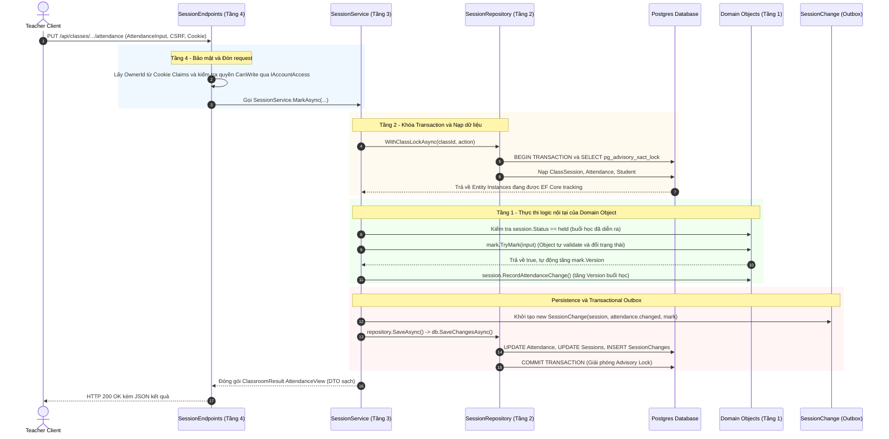
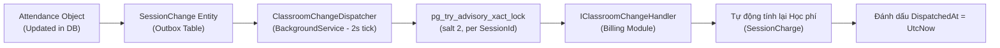

# Quy Trình Gọi Trong Module Classroom (Từ Domain Object Lên Application)
**Kiến trúc Domain-Driven Design (DDD) & Phân Tầng Xử Lý Nghiệp Vụ**

* **Mã nguồn Module:** [`src/Modules/Classroom/`](file:///d:/TruongQuocToan_0214168/Hoc_ky_7/DAPhattrienphiaServer/src/Modules/Classroom)
* **Schema Cơ sở dữ liệu:** `classroom` (PostgreSQL)
* **Mục tiêu tài liệu:** Phân tích chi tiết luồng dữ liệu và quy trình gọi thực thi theo chiều từ dưới lên (Bottom-Up): từ **Domain Object (Entity/Trạng thái cốt lõi)** $\rightarrow$ **Infrastructure/Repository (Khóa & Nạp)** $\rightarrow$ **Application Service (Điều phối Use Case)** $\rightarrow$ **API Endpoints (Giao diện Web)**.

---

## 1. Sơ Đồ Tổng Quan Luồng Gọi (Bottom-Up Architecture Flow)

Quy trình dưới đây mô tả luồng thực thi khi giáo viên thực hiện **Điểm danh một học sinh** (`PUT /api/classes/{classId}/sessions/{id}/attendance/{studentId}`):



---

## 2. Chi Tiết Từng Tầng: Đi Từ Domain Object Lên Application

---

### TẦNG 1: Domain Object (Thực thể & Quy tắc bất biến nội tại)

Tại tầng thấp nhất, các đối tượng Domain như [`Attendance`](file:///d:/TruongQuocToan_0214168/Hoc_ky_7/DAPhattrienphiaServer/src/Modules/Classroom/Domain/Attendance.cs) và [`ClassSession`](file:///d:/TruongQuocToan_0214168/Hoc_ky_7/DAPhattrienphiaServer/src/Modules/Classroom/Domain/ClassSession.cs) đại diện cho thực thể dữ liệu thực tế. Đây là các lớp C# thuần túy (POCO - Plain Old CLR Objects), **hoàn toàn độc lập với database, controller hay framework bên ngoài**.

#### 1. Tính Bao Đóng (Encapsulation) & Bảo Vệ Trạng Thái
Tất cả các trường dữ liệu quan trọng đều có setter là `private` để ngăn chặn việc chỉnh sửa trạng thái tùy tiện từ bên ngoài:
```csharp
public sealed class Attendance
{
    public Guid Id { get; private set; } = Guid.NewGuid();
    public string OwnerId { get; private set; } = "";
    public Guid SessionId { get; private set; }
    public Guid StudentId { get; private set; }
    public string Status { get; private set; } = "unmarked";
    public string? Reason { get; private set; }
    public bool Excused { get; private set; }
    public int Version { get; private set; } // Token chống xung đột đồng thời (OCC)

    private Attendance() { } // Dành riêng cho EF Core
    public Attendance(string owner, Guid sessionId, Guid studentId)
    {
        OwnerId = owner;
        SessionId = sessionId;
        StudentId = studentId;
    }
    ...
```

#### 2. Phương Thức Thay Đổi Trạng Thái Nội Tại (Domain Mutation Method)
Muốn thay đổi dữ liệu của `Attendance`, tầng trên bắt buộc phải gọi phương thức nghiệp vụ của chính nó (`TryMark`). Tại đây, Object tự bảo vệ các quy tắc nghiệp vụ bất biến:
```csharp
public bool TryMark(AttendanceInput input)
{
    // Kiểm tra phiên bản Optimistic Concurrency Control (OCC)
    if (input.Version != Version) return false;

    // Quy tắc nghiệp vụ cốt lõi: Chỉ vắng mặt mới được đánh dấu có phép (Excused)
    Status = input.Status;
    Excused = Status == "absent" && input.Excused;
    Reason = Status == "absent" && !string.IsNullOrWhiteSpace(input.Reason) 
        ? input.Reason.Trim() 
        : null;

    // Tự động tăng phiên bản dữ liệu
    Version++;
    return true;
}
```

#### 3. Quy Tắc Bất Biến Trên Thực Thể Buổi Học ([`ClassSession`](file:///d:/TruongQuocToan_0214168/Hoc_ky_7/DAPhattrienphiaServer/src/Modules/Classroom/Domain/ClassSession.cs))
Buổi học cũng tự bảo vệ quy tắc của chính nó:
```csharp
public void RecordAttendanceChange()
{
    if (Status != "held") 
        throw new InvalidOperationException("Chỉ điểm danh buổi đã diễn ra.");
    Version++;
}
```
*Ý nghĩa:* Nếu buổi học đang ở trạng thái dự kiến (`planned`) hoặc đã hủy (`cancelled`), hành vi điểm danh bị từ chối ngay từ tầng đối tượng.

---

### TẦNG 2: Persistence & Locking Strategy (Repository & DbContext)

Domain Object không tự lưu chính nó vào database. Nhiệm vụ quản lý vòng đời truy vấn, nạp Entity và khóa đồng thời được đảm nhiệm bởi [`SessionRepository`](file:///d:/TruongQuocToan_0214168/Hoc_ky_7/DAPhattrienphiaServer/src/Modules/Classroom/Infrastructure/SessionRepository.cs) và [`ClassroomDatabase`](file:///d:/TruongQuocToan_0214168/Hoc_ky_7/DAPhattrienphiaServer/src/Modules/Classroom/Infrastructure/ClassroomDatabase.cs).

#### 1. Khóa Cấp Cơ Sở Dữ Liệu: Transactional Advisory Lock
Để ngăn chặn hai tiến trình/giáo viên cùng sửa lịch hoặc điểm danh đồng thời gây Race Condition:
```csharp
public async Task<ClassroomResult<T>> WithClassLockAsync<T>(Guid classId, Func<Task<ClassroomResult<T>>> action, CancellationToken ct) where T : class
{
    await using var transaction = await db.Database.BeginTransactionAsync(ct);
    
    // Khóa độc quyền lớp học trong suốt phạm vi Transaction của PostgreSQL
    await db.Database.ExecuteSqlInterpolatedAsync(
        $"SELECT pg_advisory_xact_lock(hashtextextended({classId.ToString()}, 1))", ct);
    
    var result = await action();
    
    // Nếu nghiệp vụ hợp lệ -> Commit và tự động mở khóa
    if (result.Failure is null) await transaction.CommitAsync(ct);
    return result;
}
```

#### 2. Nạp Đối Tượng Lên Bộ Nhớ (Tracking)
Repository truy vấn đối tượng lên RAM:
```csharp
public Task<ClassSession?> FindSessionAsync(string owner, Guid classId, Guid id, CancellationToken ct) => 
    db.Sessions.SingleOrDefaultAsync(x => x.Id == id && x.ClassId == classId && x.OwnerId == owner, ct);
```
EF Core sẽ theo dõi (Tracking) trạng thái của đối tượng này. Khi phương thức `mark.TryMark()` làm thay đổi thuộc tính, EF Core tự động đánh dấu bản ghi là `Modified`.

---

### TẦNG 3: Application Service Layer (Điều Phối Nghiệp Vụ - Orchestrator)

Lớp [`SessionService`](file:///d:/TruongQuocToan_0214168/Hoc_ky_7/DAPhattrienphiaServer/src/Modules/Classroom/Application/SessionService.cs) là nơi trực tiếp hiện thực hóa Use Case. Service đóng vai trò là "nhạc trưởng" điều phối giữa nhiều Domain Object khác nhau (`ClassSession`, `Attendance`, `Student`, `SessionChange`).

#### Mã nguồn chi tiết của Use Case [`MarkAsync`](file:///d:/TruongQuocToan_0214168/Hoc_ky_7/DAPhattrienphiaServer/src/Modules/Classroom/Application/SessionService.cs#L137-L155):
```csharp
public async Task<ClassroomResult<AttendanceView>> MarkAsync(
    string owner, Guid classId, Guid id, Guid studentId, AttendanceInput input, CancellationToken ct) =>
    await repository.WithClassLockAsync<AttendanceView>(classId, async () =>
    {
        // BƯỚC 1: Nạp Domain Object Buổi học
        var session = await repository.FindSessionAsync(owner, classId, id, ct);
        if (session is null) return new(null, ClassroomFailure.NotFound);

        // BƯỚC 2: Nạp thông tin Học sinh và bản ghi Điểm danh cũ (nếu có)
        var saved = (await repository.AttendanceAsync(owner, id, ct)).SingleOrDefault(x => x.Student.Id == studentId);
        var student = saved?.Student ?? (await repository.EligibleStudentsAsync(owner, classId, session.Date, ct)).SingleOrDefault(x => x.Id == studentId);
        if (student is null) return new(null, ClassroomFailure.NotFound);

        // BƯỚC 3: Kiểm tra điều kiện nghiệp vụ liên đối tượng
        if (session.Status != "held") 
            return new(null, ClassroomFailure.Conflict, "Chỉ điểm danh buổi đã diễn ra. Buổi dự kiến hoặc đã hủy không được điểm danh.");

        // BƯỚC 4: Validate dữ liệu đầu vào DTO
        var errors = input.Validate();
        if (errors.Count > 0) return new(null, ClassroomFailure.Invalid, Errors: errors);

        // BƯỚC 5: Tạo mới hoặc tái sử dụng Domain Object Điểm danh
        var mark = saved?.Attendance ?? new Attendance(owner, id, studentId);

        // BƯỚC 6: GỌI PHƯƠNG THỨC NGHIỆP VỤ CỦA DOMAIN OBJECT (TryMark)
        // Trao quyền tự thay đổi và kiểm tra phiên bản cho chính đối tượng
        if (!mark.TryMark(input)) 
            return new(null, ClassroomFailure.Conflict, "Điểm danh đã thay đổi ở tab khác. Vui lòng tải lại; nội dung đang nhập được giữ.");

        if (saved is null) repository.Add(mark);

        // BƯỚC 7: Cập nhật phiên bản trên Domain Object Buổi học
        session.RecordAttendanceChange();

        // BƯỚC 8: Khởi tạo Entity Sự Kiện Outbox (SessionChange)
        // Lưu lại sự kiện để đồng bộ sang Module Billing trong cùng một Transaction
        repository.Add(new SessionChange(session, "attendance.changed", clock.GetUtcNow(), mark));

        // BƯỚC 9: Lưu toàn bộ thay đổi xuống Cơ sở dữ liệu
        await repository.SaveAsync(ct);

        // BƯỚC 10: Đóng gói Domain Object thành DTO View sạch sẽ
        return new(View(session, student, mark));
    }, ct);
```

#### Điểm Đặc Sắc Trong Thiết Kế Application Layer:
1. **Không can thiệp logic nội tại của Object:** Service không tự gán `mark.Status = input.Status`, mà bắt buộc phải qua `mark.TryMark(input)`.
2. **Transactional Outbox Pattern:** Bản ghi [`SessionChange`](file:///d:/TruongQuocToan_0214168/Hoc_ky_7/DAPhattrienphiaServer/src/Modules/Classroom/Domain/SessionChange.cs) được khởi tạo và lưu cùng đợt `SaveAsync()` với `Attendance`. Đảm bảo nếu lưu điểm danh thành công thì sự kiện gửi sang Module Billing chắc chắn được ghi nhận.
3. **Mô hình Kết quả Chuẩn (Result Pattern):** Trả về [`ClassroomResult<T>`](file:///d:/TruongQuocToan_0214168/Hoc_ky_7/DAPhattrienphiaServer/src/Modules/Classroom/Application/ClassroomResult.cs) chứa kết quả hoặc mã lỗi tường minh (`NotFound`, `Invalid`, `Conflict`), không dùng Exception để điều khiển luồng nghiệp vụ thông thường.

---

### TẦNG 4: Presentation / Endpoints Layer (Minimal APIs)

Tầng cao nhất nằm tại [`SessionEndpoints.cs`](file:///d:/TruongQuocToan_0214168/Hoc_ky_7/DAPhattrienphiaServer/src/Modules/Classroom/SessionEndpoints.cs).

#### 1. Bộ Lọc Bảo Mật & Đa Người Thuê (Endpoint Filter):
```csharp
group.AddEndpointFilter(async (context, next) =>
{
    var http = context.HttpContext;
    // Kiểm tra bản quyền sử dụng qua Module ServiceAccess
    var access = await http.RequestServices.GetRequiredService<IAccountAccess>().GetAsync(Owner(http), http.RequestAborted);
    
    // Quyền đọc cho GET, quyền ghi bắt buộc cho POST/PUT/DELETE
    return (HttpMethods.IsGet(http.Request.Method) ? access.CanRead : access.CanWrite) 
        ? await next(context) 
        : Results.Json(new { message = "Quyền sử dụng hiện tại không cho phép thao tác này.", status = access.Status }, statusCode: 403);
});
```

#### 2. Ánh Xạ Route & Chuyển Đổi Kết Quả HTTP:
```csharp
group.MapPut("/sessions/{id:guid}/attendance/{studentId:guid}", 
    async (Guid classId, Guid id, Guid studentId, AttendanceInput input, HttpContext http, SessionService service) => 
        Respond(await service.MarkAsync(Owner(http), classId, id, studentId, input, http.RequestAborted)));
```

Hàm `Respond()` chuyển đổi kết quả từ tầng Application thành HTTP Status Code tương ứng:
* `ClassroomFailure.NotFound` $\rightarrow$ Trả về `404 Not Found`.
* `ClassroomFailure.Invalid` $\rightarrow$ Trả về `400 ValidationProblem` kèm danh sách lỗi chi tiết.
* `ClassroomFailure.Conflict` $\rightarrow$ Trả về `409 Conflict` kèm thông điệp xung đột phiên bản.
* Thành công $\rightarrow$ Trả về `200 OK` kèm JSON của `AttendanceView`.

---

## 3. Lan Tỏa Sự Kiện Tiếp Theo: Từ Outbox Ra Ngoài Module

Sau khi Object `Attendance` được cập nhật và bản ghi `SessionChange` được lưu vào database thành công:



1. Background worker [`ClassroomChangeDispatcher`](file:///d:/TruongQuocToan_0214168/Hoc_ky_7/DAPhattrienphiaServer/src/Modules/Classroom/Infrastructure/ClassroomChangeDispatcher.cs) chạy nền chu kỳ 2 giây/lần.
2. Quét các bản ghi `SessionChanges` chưa gửi (`DispatchedAt IS NULL`), xin khóa không nghẽn `pg_try_advisory_xact_lock` theo từng `SessionId` để đảm bảo thứ tự tuần tự tuyệt đối.
3. Gọi sang trình xử lý sự kiện `IClassroomChangeHandler` của Module [`Billing`](file:///d:/TruongQuocToan_0214168/Hoc_ky_7/DAPhattrienphiaServer/src/Modules/Billing/BillingModule.cs) để tự động sinh hoặc hủy khoản học phí tương ứng với buổi học.

---

## 4. Bảng Tóm Tắt Vai Trò Trong Chuỗi Gọi "Từ Obj Lên Application"

| Thành phần | Đại diện trong Code | Trách nhiệm chính trong chuỗi gọi |
| :--- | :--- | :--- |
| **Domain Object (Obj)** | [`Attendance.cs`](file:///d:/TruongQuocToan_0214168/Hoc_ky_7/DAPhattrienphiaServer/src/Modules/Classroom/Domain/Attendance.cs)<br>[`ClassSession.cs`](file:///d:/TruongQuocToan_0214168/Hoc_ky_7/DAPhattrienphiaServer/src/Modules/Classroom/Domain/ClassSession.cs) | **Trung tâm sự thật (Source of Truth):** Lưu giữ trạng thái, bảo vệ các quy tắc nghiệp vụ bất biến (`Status`, `Excused`, `Reason`), tự tăng phiên bản `Version`. |
| **Infrastructure / Locking** | [`SessionRepository.cs`](file:///d:/TruongQuocToan_0214168/Hoc_ky_7/DAPhattrienphiaServer/src/Modules/Classroom/Infrastructure/SessionRepository.cs)<br>[`ClassroomDatabase.cs`](file:///d:/TruongQuocToan_0214168/Hoc_ky_7/DAPhattrienphiaServer/src/Modules/Classroom/Infrastructure/ClassroomDatabase.cs) | Quản lý kết nối PostgreSQL, thiết lập khóa `pg_advisory_xact_lock` chống race-condition, nạp Entity lên RAM và lưu trạng thái xuống DB. |
| **Application Layer** | [`SessionService.cs`](file:///d:/TruongQuocToan_0214168/Hoc_ky_7/DAPhattrienphiaServer/src/Modules/Classroom/Application/SessionService.cs) | **Nhạc trưởng điều phối (Use Case Orchestrator):** Tiếp nhận dữ liệu, gọi repository nạp Object, kiểm tra logic liên đối tượng, kích hoạt hàm của Object (`TryMark`), sinh sự kiện Outbox và đóng gói Result DTO. |
| **Presentation / Endpoints** | [`SessionEndpoints.cs`](file:///d:/TruongQuocToan_0214168/Hoc_ky_7/DAPhattrienphiaServer/src/Modules/Classroom/SessionEndpoints.cs) | **Cổng tiếp nhận HTTP:** Xác thực Cookie, trích xuất `OwnerId`, kiểm tra bản quyền `IAccountAccess` (`CanWrite`), và ánh xạ `ClassroomResult` thành HTTP Response JSON (200, 400, 404, 409). |
