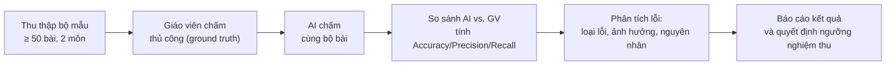
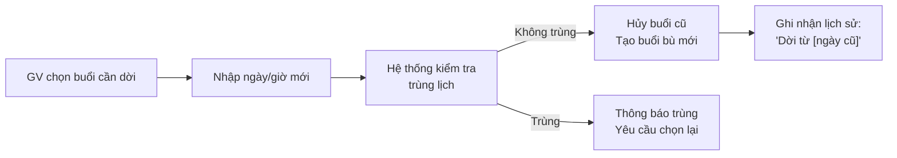
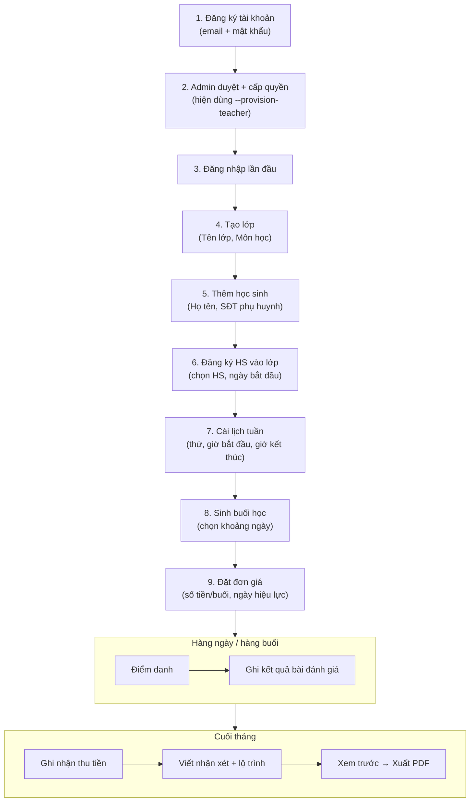

# Ghi nhận Góp ý Buổi Báo cáo 2 — Education Keeptrack

**Ngày:** 29/10/2026  
**Nguồn:** Phản hồi giảng viên tại buổi thông đồ án 2

---

## Tổng hợp 5 điểm góp ý và hướng xử lý

### 1. ✅ AI chấm bài: giới hạn phạm vi môn học & đo lường độ tin cậy

#### 1.1. Góp ý

> Tính năng AI chấm bài phải giới hạn phạm vi môn học rõ ràng. Phải có cách đo đạc được độ tin cậy của AI.

#### 1.2. Vấn đề hiện tại trong báo cáo buổi 1

- Mục 2.2 (bảng AI-01, AI-02) mô tả chức năng chấm bài khá tổng quát — "mô hình đa phương thức đọc ảnh và văn bản" — nhưng **chưa chốt cụ thể môn nào**, dạng bài nào AI có thể xử lý.
- Mục 2.5 có đề cập "Chưa đặt ngưỡng nghiệm thu, số lượng mẫu hoặc độ chính xác khi chưa có thống nhất và thực nghiệm" → quá mơ hồ, chưa đủ thuyết phục.
- Chưa định nghĩa **bộ chỉ số đo lường** cụ thể cho từng loại tác vụ AI.

#### 1.3. Hướng bổ sung cần làm

**A. Giới hạn phạm vi môn học:**

| Hạng mục | Nội dung cần chốt |
| --- | --- |
| Môn học mục tiêu | Chọn **1–2 môn cụ thể** để nghiệm thu (ví dụ: Toán lớp 6–9, Tiếng Anh trắc nghiệm). Lý do chọn: giáo viên dạy thêm phổ thông chiếm phần lớn đối tượng mục tiêu. |
| Dạng bài chấm được | Bài tự luận ngắn (phép tính, giải phương trình), trắc nghiệm ABCD trên giấy, điền khuyết. |
| Dạng bài chưa hỗ trợ | Bài luận dài, bài vẽ hình, bài thí nghiệm, bài tổng hợp nhiều kỹ năng chưa có tiêu chí. |
| Điều kiện ảnh đầu vào | Ảnh chụp thẳng, đủ sáng, chữ viết tay rõ nét, giấy A4/A5, không bị cắt xén phần bài làm. |

**B. Bộ chỉ số đo lường độ tin cậy AI:**

| Chỉ số | Định nghĩa | Cách đo | Ngưỡng dự kiến |
| --- | --- | --- | --- |
| **Accuracy (Độ chính xác tổng)** | Tỷ lệ bài AI đề xuất trùng mức đánh giá với giáo viên | Lấy bộ mẫu ≥ 50 bài có kết quả giáo viên xác nhận, so sánh AI vs. GV | ≥ 70% cho phiên bản đầu |
| **Precision (Độ chính xác dương)** | Trong các bài AI đánh giá "đúng", bao nhiêu % thực sự đúng theo GV | Confusion matrix cho mỗi mức Completion/Correctness | Báo cáo, chưa chốt ngưỡng |
| **Recall (Độ phủ)** | Trong các bài GV đánh giá "đúng", bao nhiêu % AI nhận ra | Confusion matrix | Báo cáo, chưa chốt ngưỡng |
| **OCR Accuracy** | Tỷ lệ ký tự/từ AI đọc đúng so với nội dung thực tế | So sánh văn bản OCR với bản gõ tay từ bài mẫu | ≥ 85% ký tự cho chữ viết tay rõ |
| **Confidence Score** | Mức tự tin AI trả về cho mỗi đề xuất (0–1) | Mô hình trả `confidence`, hệ thống lưu và so sánh | Nếu confidence < 0.6 → đánh dấu "cần giáo viên kiểm tra đặc biệt" |
| **Rejection Rate** | Tỷ lệ bài AI từ chối/trả "không đủ căn cứ" | Đếm trên bộ mẫu gồm cả ảnh xấu, thiếu trang | Ghi nhận, ảnh xấu phải reject chứ không đoán bừa |
| **Tỷ lệ GV sửa đề xuất** | Bao nhiêu % kết quả AI bị giáo viên chỉnh sửa lại | Thống kê từ log xác nhận/sửa kết quả cuối | < 30% cho phiên bản nghiệm thu |

**C. Quy trình đánh giá thực nghiệm:**

> [!IMPORTANT]
> Không công bố độ chính xác khi chưa có kết quả thực nghiệm. Báo cáo phải ghi rõ: số lượng mẫu, môn, dạng bài, phiên bản mô hình, ngày thực nghiệm.

---

### 2. ✅ Sửa lại yêu cầu phi chức năng — chi tiết từng yêu cầu

#### 2.1. Góp ý

> Yêu cầu phi chức năng hiện tại viết 1 dòng, quá chung chung. Cần cụ thể từng yêu cầu.

#### 2.2. Vấn đề hiện tại

Bảng NFR trong báo cáo buổi 1 (dòng 267–280) mỗi yêu cầu chỉ 1 câu mô tả → không đo lường được, không kiểm thử được.

#### 2.3. Bảng NFR chi tiết (thay thế bảng cũ)

| Mã | Nhóm yêu cầu | Yêu cầu cụ thể | Chỉ tiêu đo lường | Cách kiểm tra |
| --- | --- | --- | --- | --- |
| **NFR-01** | **Bảo mật — Xác thực** | Người dùng phải đăng nhập bằng email và mật khẩu. Cookie xác thực phải được đặt `HttpOnly`, `SameSite=Strict`, `Secure` khi chạy Production. | Cookie phải có 3 thuộc tính bảo mật khi HTTPS. | Kiểm tra header `Set-Cookie` từ response đăng nhập trên môi trường Production. |
| **NFR-02** | **Bảo mật — Phân quyền dữ liệu** | Giáo viên chỉ truy cập được dữ liệu lớp, học sinh, buổi học, học phí, báo cáo thuộc quyền sở hữu của mình (`OwnerId`). Truy cập dữ liệu giáo viên khác phải trả lỗi 403 hoặc 404. | 100% API kiểm tra `OwnerId` trước khi trả dữ liệu. | Test API gọi dữ liệu của giáo viên A bằng phiên giáo viên B → phải trả lỗi. |
| **NFR-03** | **Bảo mật — CSRF** | Mọi request ghi (`POST`, `PUT`, `PATCH`, `DELETE`) phải kèm CSRF token hợp lệ. Request thiếu hoặc sai token phải trả lỗi 400. | 100% endpoint ghi kiểm tra CSRF. | Gửi request POST không kèm header `X-CSRF-TOKEN` → phải trả 400. |
| **NFR-04** | **Bảo mật — Mật khẩu và cấu hình** | Mật khẩu hash bằng thuật toán của ASP.NET Core Identity (PBKDF2 mặc định). Chuỗi kết nối, API key R2, secret key không được lưu trong mã nguồn. | Không có credential nào trong source code. | Grep toàn bộ repo tìm chuỗi kết nối, password rõ → phải không tìm thấy. |
| **NFR-05** | **Hiệu năng — Thao tác CRUD** | Các thao tác xem danh sách, thêm, sửa dữ liệu (lớp, học sinh, điểm danh, khoản thu) phải phản hồi ≤ 2 giây trên môi trường development với database ≤ 10.000 bản ghi. | Response time ≤ 2.000ms (P95). | Đo thời gian response bằng Postman/curl cho các API chính với dữ liệu mẫu. |
| **NFR-06** | **Hiệu năng — Xuất PDF** | Xuất PDF báo cáo tháng phải hoàn tất ≤ 30 giây. Trong thời gian chờ, giao diện phải hiển thị trạng thái đang xử lý. | Thời gian từ gọi API xuất đến trạng thái `Ready` ≤ 30s. | Xuất PDF cho báo cáo có 1 học sinh, ≤ 5 trang → đo thời gian. |
| **NFR-07** | **Hiệu năng — Xử lý AI** | Khi gọi AI chấm bài, giao diện phải thông báo đang xử lý (pending/loading). Nếu AI không phản hồi trong 60 giây → thông báo lỗi timeout và cho phép thử lại. | Có trạng thái loading trên UI; timeout ≤ 60s. | Gọi API chấm bài, kiểm tra trạng thái trung gian và timeout. |
| **NFR-08** | **Độ chính xác — Tính tiền** | Học phí tính theo buổi đã diễn ra + có mặt + có đơn giá hiệu lực. Sai lệch so với tính tay ≤ 0 VND (phải chính xác tuyệt đối). | Sai lệch = 0 VND cho mọi trường hợp kiểm thử. | Tạo dữ liệu mẫu (5 buổi, 2 mức giá, 1 vắng) → so sánh API vs. tính tay. |
| **NFR-09** | **Độ chính xác — Idempotency** | Gửi lại cùng một yêu cầu thu tiền (cùng `IdempotencyKey`) không được tạo khoản thu trùng. | Gửi 2 lần cùng key → chỉ có 1 bản ghi trong DB. | Test gọi POST payment 2 lần cùng key → kiểm tra DB chỉ 1 receipt. |
| **NFR-10** | **Dễ sử dụng — Ngôn ngữ** | Toàn bộ giao diện và thông báo lỗi hiển thị tiếng Việt. Thông báo lỗi phải mô tả nguyên nhân, không hiển thị mã lỗi kỹ thuật cho người dùng cuối. | 100% label, button, thông báo bằng tiếng Việt. | Kiểm tra thủ công trên UI các luồng chính. |
| **NFR-11** | **Dễ sử dụng — Responsive** | Giao diện sử dụng được trên độ phân giải ≥ 375px (mobile) và ≥ 1280px (desktop). Không có thanh cuộn ngang, nội dung không bị tràn. | Không xuất hiện horizontal scroll trên 2 breakpoint. | Kiểm tra bằng DevTools responsive mode ở 375px và 1280px. |
| **NFR-12** | **Độ tin cậy — Persistence** | Dữ liệu đã lưu thành công phải được giữ nguyên sau khi khởi động lại container (`docker compose down && docker compose up`). | Dữ liệu trước/sau restart phải giống hệt. | Tạo dữ liệu → restart → query lại → so sánh. |
| **NFR-13** | **Độ tin cậy — Graceful degradation** | Khi dịch vụ R2 hoặc VietQR không khả dụng: hệ thống phải trả lỗi rõ ràng, không crash. Các chức năng không phụ thuộc R2/QR vẫn hoạt động bình thường. | API trả mã lỗi 502/503 có thông báo, không trả 500 không rõ. | Tắt R2 endpoint → gọi xuất PDF → kiểm tra lỗi; các API khác vẫn hoạt động. |
| **NFR-14** | **Chất lượng PDF** | PDF phải hiển thị đúng tiếng Việt (có dấu), đúng tên học sinh, đúng số liệu tài chính. Không bị mất nội dung khi báo cáo dài hơn 1 trang. | 100% ký tự tiếng Việt hiển thị đúng; số liệu khớp dữ liệu nguồn. | Xuất PDF có tên đặc biệt (dấu, chữ hoa) → mở và kiểm tra. |
| **NFR-15** | **Sao lưu** | Volume PostgreSQL phải được cấu hình named volume. Có tài liệu hướng dẫn sao lưu bằng `pg_dump` và khôi phục. | Volume named `postgres-data` tồn tại trong compose.yaml; có tài liệu backup. | Kiểm tra compose.yaml; chạy `pg_dump` theo hướng dẫn → khôi phục thành công. |
| **NFR-16** | **Bảo trì và mở rộng** | Mã nguồn chia ≥ 4 module độc lập, mỗi module có DbContext và schema riêng. Module không import trực tiếp class nội bộ của module khác. | 6 module (Identity, Classroom, Billing, Learning, Reporting, ServiceAccess), 6 schema riêng. | Kiểm tra cấu trúc source, project references và schema trong database. |

---

### 3. ✅ Gợi ý nghiệp vụ: GV thay đổi buổi học do bận

#### 3.1. Góp ý

> Giáo viên bận, cần thay đổi buổi học thì làm thế nào? UI/UX như nào để giáo viên cài đặt buổi học dễ dàng?

#### 3.2. Các tình huống và nghiệp vụ cần xử lý

| Tình huống | Hành động hiện tại (đã có) | Hành động cần bổ sung |
| --- | --- | --- |
| **GV hủy buổi trong tuần** | GV chuyển trạng thái buổi sang `Cancelled`. Buổi hủy không tính phí, không điểm danh. | ✅ Đã có — endpoint `PUT /sessions/{id}` với `status: Cancelled`. |
| **GV dời buổi sang ngày khác** | Chưa có chức năng "dời buổi" tự động. | 🔧 **Cần thêm:** GV hủy buổi cũ → tạo buổi mới (bù) ở ngày/giờ mới. Hệ thống kiểm tra trùng lịch. Hiện có thể làm bằng 2 thao tác thủ công (hủy + tạo bù), nhưng **nên có luồng "Dời buổi"** cho tiện. |
| **GV thay đổi lịch tuần cố định** | GV sửa `WeeklySchedule`. Buổi đã sinh không bị ảnh hưởng; chỉ áp dụng cho buổi sinh mới. | ✅ Đã có — endpoint `PUT /schedule`. |
| **GV tạm nghỉ 1–2 tuần** | Chưa có chức năng "tạm nghỉ hàng loạt". | 🔧 **Cần thêm:** Hủy hàng loạt các buổi trong khoảng ngày. UI cần cho phép chọn range ngày → hủy tất cả buổi `Scheduled` trong range đó. |
| **GV thêm buổi học bù** | GV tạo buổi mới với loại bổ sung, chọn ngày/giờ tùy ý. | ✅ Đã có — endpoint `POST /sessions` tạo buổi bù. |

**Luồng "Dời buổi" đề xuất bổ sung:**

#### 3.3. UI/UX cài đặt buổi học dễ dàng

| Yêu cầu UI/UX | Mô tả | Lý do |
| --- | --- | --- |
| **Lịch dạng Calendar** | Hiển thị buổi học trên giao diện lịch tuần/tháng (giống Google Calendar), thay vì chỉ danh sách. | GV nhìn tổng quan cả tuần, dễ thấy buổi bị trùng hoặc trống. |
| **Drag & Drop dời buổi** | Kéo thả buổi từ ngày này sang ngày khác trên calendar. | Thao tác trực quan, giảm số bước so với "Hủy → Tạo mới". |
| **Quick actions** | Menu chuột phải/long press trên buổi: Hủy, Dời, Tạo bù, Điểm danh. | Giảm số click để đến hành động thường dùng. |
| **Thiết lập lịch tuần nhanh** | Bước 1: Chọn các ngày trong tuần (checkbox thứ 2–CN). Bước 2: Chọn giờ bắt đầu–kết thúc. Bước 3: Nhấn lưu → tự sinh WeeklySchedule. | GV mới không cần hiểu khái niệm "slot", chỉ cần chọn ngày và giờ. |
| **Hiển thị số buổi/tháng** | Ở header calendar, hiện "Tháng 10: 12 buổi (2 hủy, 1 bù)". | GV đối chiếu nhanh với học phí. |
| **Nhắc buổi chưa điểm danh** | Badge đỏ trên các buổi đã qua nhưng chưa điểm danh. | Tránh bỏ sót điểm danh cuối tháng. |

---

### 4. ✅ Cách sử dụng: GV vào nhập liệu

#### 4.1. Góp ý

> Về cách sử dụng, giáo viên vào nhập liệu thế nào?

#### 4.2. Quy trình nhập liệu từ đầu cho GV mới

**Lưu ý quan trọng cho giảng viên:**

- **Hiện tại** hệ thống chưa có giao diện đăng ký công khai. Tài khoản giáo viên được tạo bằng lệnh CLI `--provision-teacher` trên môi trường Development.
- Khi có module Admin đầy đủ (FR-02): GV tự đăng ký → Admin duyệt → hệ thống cấp kỳ sử dụng.
- GV **không cần hiểu** cấu trúc module hay schema — giao diện che giấu hoàn toàn kiến trúc bên trong.

---

### 5. ✅ Phần AI có khả thi không?

#### 5.1. Góp ý

> Chú ý về phần AI có khả thi hay không.

#### 5.2. Phân tích tính khả thi từng chức năng AI

| Chức năng | Khả thi? | Phân tích | Rủi ro chính |
| --- | --- | --- | --- |
| **AI-01: Đọc ảnh bài nộp (OCR)** | ✅ Khả thi cao | Dùng API có sẵn (Google Vision, Azure AI Vision, hoặc GPT-4o). Chữ in → rất tốt. Chữ viết tay Việt → tùy chất lượng ảnh. | Chữ viết tay xấu, ảnh mờ, ảnh nghiêng → OCR sai nhiều. |
| **AI-02: Hỗ trợ chấm bài** | ⚠️ Khả thi có điều kiện | Với bài toán có đáp án rõ (phép tính, trắc nghiệm) → so sánh được. Bài tự luận, bài sáng tạo → rất khó đánh giá tự động. | Phụ thuộc vào chất lượng OCR và độ rõ ràng của rubric. **Phải giới hạn dạng bài.** |
| **AI-03: Sinh nhận xét tháng** | ✅ Khả thi cao | LLM (GPT-4, Gemini) sinh văn bản tiếng Việt tốt khi cho đủ dữ liệu đầu vào (điểm danh, kết quả). | Có thể sinh nội dung "hallucination" — cần GV kiểm tra. Chi phí API theo token. |
| **AI-04: Gợi ý lộ trình** | ⚠️ Khả thi có điều kiện | LLM có thể gợi ý dựa trên kết quả → nhưng chất lượng phụ thuộc vào dữ liệu kỹ năng có sẵn. | Thiếu khung kỹ năng → gợi ý quá chung chung. Cần có FR-18 (khóa học + chuẩn đầu ra) trước. |
| **AI-05: Cảnh báo HS cần hỗ trợ** | ✅ Khả thi (rule-based trước) | Bắt đầu bằng **luật đơn giản** (3 buổi liên tiếp dưới mức TB → cảnh báo). Mở rộng sang ML khi có đủ dữ liệu gán nhãn. | Dữ liệu ban đầu ít → ML chưa khả thi. Rule-based là bước đầu hợp lý. |
| **AI-06: Chatbot GV** | ✅ Khả thi cao | RAG + LLM là kiến trúc phổ biến, có nhiều thư viện hỗ trợ. Tài liệu hướng dẫn là dữ liệu nội bộ, kiểm soát được. | Chi phí embedding + LLM. Cần chuẩn bị tài liệu tốt trước khi chatbot hữu ích. |
| **AI-07: Cá nhân hóa theo chuẩn** | ❌ Rủi ro cao | Phụ thuộc vào FR-18, FR-19 (khung khóa học, kỹ năng) — chưa có mô hình dữ liệu. Thiết kế phức tạp, dữ liệu kiểm thử chưa có. | **Nên đặt là "nghiên cứu mở rộng"**, không cam kết triển khai trong đồ án. |

#### 5.3. Đề xuất phạm vi AI khả thi cho đồ án

> [!TIP]
> **Ưu tiên 3 chức năng khả thi nhất để triển khai và đánh giá:**
> 1. **AI-03 (Sinh nhận xét)** — dễ triển khai nhất, dữ liệu đầu vào đã có.
> 2. **AI-02 (Chấm bài)** — giới hạn Toán lớp 6–9, bài trắc nghiệm + phép tính.
> 3. **AI-05 (Cảnh báo)** — bắt đầu rule-based, mở rộng ML sau.
>
> Các chức năng còn lại: ghi nhận thiết kế, trình bày hướng triển khai, nhưng **không cam kết hoàn thành** trong phạm vi đồ án.

#### 5.4. Chi phí ước tính

| Nhà cung cấp | API | Giá (tham khảo) | Phù hợp cho |
| --- | --- | --- | --- |
| OpenAI | GPT-4o-mini | ~$0.15/1M input tokens | Sinh nhận xét, chatbot |
| OpenAI | GPT-4o | ~$2.5/1M input tokens | Chấm bài (ảnh + text) |
| Google | Gemini 2.0 Flash | Miễn phí tier thấp | Nghiên cứu, prototype |
| Google | Cloud Vision OCR | $1.5/1K ảnh | OCR nếu cần riêng |

> [!WARNING]
> Cần ước tính chi phí cho **bộ dữ liệu nghiệm thu** (≥ 50 bài × 2 môn) và cho **vận hành hàng tháng** (mỗi GV ~20–50 bài/tháng). Nếu dùng tier miễn phí để demo là hợp lý cho đồ án.

---

## Tóm tắt công việc cần làm

| # | Công việc | Liên quan đến góp ý | Ưu tiên |
| --- | --- | --- | --- |
| 1 | Chốt 1–2 môn học + dạng bài cho AI chấm | Góp ý 1 | Cao |
| 2 | Thiết kế bộ chỉ số đo lường AI (bảng ở mục 1.3) | Góp ý 1 | Cao |
| 3 | Viết lại bảng NFR chi tiết (bảng ở mục 2.3) | Góp ý 2 | Cao |
| 4 | Bổ sung nghiệp vụ dời/hủy hàng loạt buổi học | Góp ý 3 | Trung bình |
| 5 | Thiết kế mockup Calendar UI cho buổi học | Góp ý 3 | Trung bình |
| 6 | Viết tài liệu quy trình nhập liệu cho GV | Góp ý 4 | Trung bình |
| 7 | Phân tích khả thi AI → chốt phạm vi cam kết | Góp ý 5 | Cao |
| 8 | Prototype AI-03 (sinh nhận xét) với dữ liệu mẫu | Góp ý 5 | Cao |
