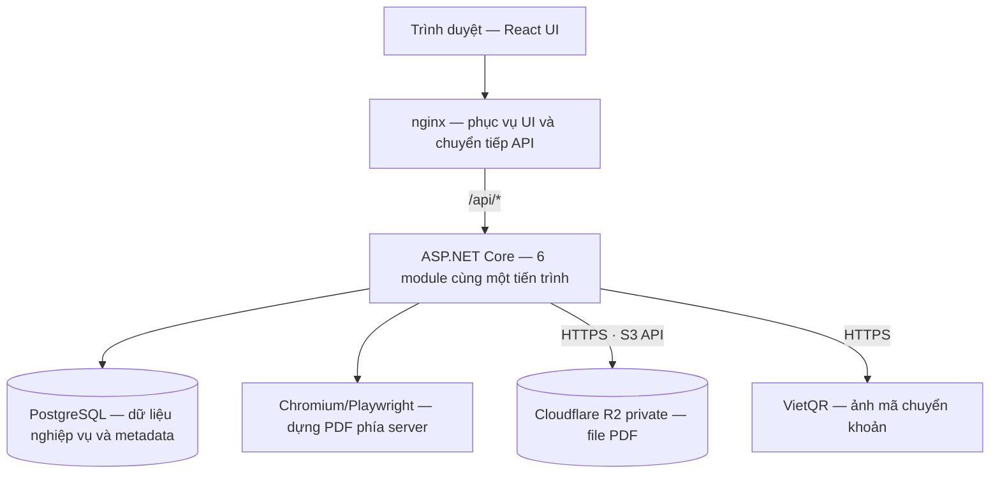
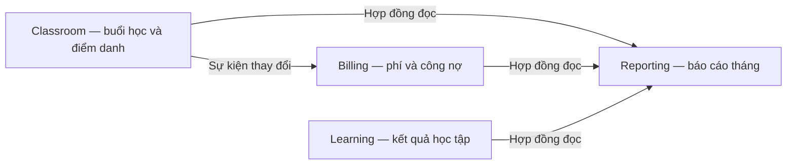
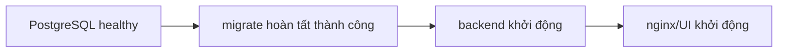

# Cơ chế hạ tầng, vai trò và quan hệ phụ thuộc

**Dự án:** Education Keeptrack  
**Ngày ghi nhận:** 22/10/2026  
**Mốc nội dung:** phần giải thích trong cuộc trao đổi sau triển khai ticket #28, commit `02ee9c5`.

Tài liệu này diễn giải kiến trúc và cấu hình tại mốc trên. Các hạng mục chưa triển khai được nêu riêng; tài liệu không thay thế đặc tả nghiệp vụ hoặc các ADR.

## 1. Tổng thể hệ thống

Dự án có một backend xử lý nghiệp vụ, PostgreSQL lưu dữ liệu và Cloudflare R2 lưu file. Docker tổ chức môi trường chạy; Jenkins phục vụ build và kiểm thử.

## 2. Vai trò của từng thành phần

| Thành phần | Vai trò |
| --- | --- |
| React UI | Hiển thị lớp, học sinh, điểm danh, học phí, báo cáo; gửi yêu cầu đến backend. |
| nginx | Phục vụ UI đã build và chuyển `/api/*` đến backend, giúp UI/API dùng chung địa chỉ khi triển khai. |
| ASP.NET Core | Xác thực, kiểm tra quyền, xử lý nghiệp vụ, điều phối dữ liệu và gọi dịch vụ ngoài. |
| PostgreSQL | Lưu tài khoản, phiên, lớp, học sinh, điểm danh, học phí, đánh giá, bản nháp và metadata PDF. |
| Chromium/Playwright | Chuyển HTML báo cáo thành PDF trên server. Người dùng không cần trình duyệt Chromium riêng để xuất PDF. |
| Cloudflare R2 | Lưu nội dung file PDF. Thiết kế cũng dành R2 cho ảnh bài nộp; phần ảnh thuộc T12. |
| VietQR | Cung cấp ảnh QR chuyển khoản. Billing vẫn chịu trách nhiệm ghi nhận tiền; tạo QR không tự xác nhận đã thanh toán. |
| Docker Compose | Khởi chạy các container và cấu hình mạng, biến môi trường, volume, thứ tự khởi động. |
| Jenkins | Tự động build và kiểm thử trong quá trình phát triển; không xử lý yêu cầu của giáo viên. |

### PostgreSQL và R2 bổ sung cho nhau

PostgreSQL lưu thông tin về một bản xuất: giáo viên sở hữu, phạm vi báo cáo, trạng thái, object key, content type, kích thước và SHA-256. R2 giữ bytes của PDF.

Reporting dùng một bucket cấu hình chung cho deployment, không lưu bucket theo từng bản xuất. Đổi bucket sẽ chuyển hướng toàn bộ lần tải sau đó, nên cần sao chép và đối chiếu đầy đủ object, giữ nguyên key trước khi đổi cấu hình.

## 3. Cấu trúc backend và trách nhiệm module

Backend dùng Modular Monolith: sáu module có trách nhiệm riêng nhưng cùng chạy trong một tiến trình và cùng triển khai một lần.

| Module | Trách nhiệm |
| --- | --- |
| Identity | Tài khoản, đăng nhập, phiên và thu hồi phiên. |
| ServiceAccess | Quyền đọc/ghi, thời hạn sử dụng; thiết kế quyền và hạn mức AI. Quy trình vận hành đầy đủ thuộc các ticket tiếp theo. |
| Classroom | Lớp, học sinh, đăng ký học, lịch tuần, buổi học và điểm danh. |
| Billing | Đơn giá hiệu lực, phí từng buổi, giao dịch nhận tiền, phân bổ thanh toán và công nợ. |
| Learning | Bài đánh giá, kết quả học tập và lịch sử xác nhận. |
| Reporting | Bản nháp báo cáo, tổng hợp nguồn, xuất và tải PDF. |

Mỗi module có schema và DbContext riêng trong cùng một PostgreSQL database. Các schema tương ứng là `identity`, `service_access`, `classroom`, `billing`, `learning`, `reporting`.

Module trao đổi dữ liệu qua hợp đồng công khai hoặc sự kiện, không đọc/ghi trực tiếp bảng của module khác. Schema phân chia trách nhiệm; kiểm tra sở hữu theo giáo viên vẫn bắt buộc.

Các worker xử lý sự kiện chạy trong backend. Những luồng đã triển khai dùng bản ghi bền vững trong PostgreSQL để hỗ trợ xử lý lại sau khi khởi động. Tại mốc tài liệu, cấu hình không có Redis, RabbitMQ hoặc máy chủ hàng đợi riêng.

## 4. Cơ chế xuất và tải PDF

1. Giáo viên đăng nhập; backend xác định tài khoản và quyền truy cập.
2. Reporting lấy dữ liệu lớp, học tập và học phí qua hợp đồng của các module.
3. Backend tạo HTML; Chromium dựng thành PDF.
4. Backend upload PDF vào bucket R2 private.
5. Sau khi upload thành công và metadata được lưu, bản xuất được đánh dấu `ready` trong PostgreSQL.
6. Khi tải, trình duyệt gọi API ứng dụng. Backend kiểm tra phiên, owner, quyền đọc và token tải, lấy file từ R2 rồi trả về.

Các điểm kiểm soát:

- Credentials R2 chỉ ở server; trình duyệt không giữ Access Key/Secret Key.
- Luồng mặc định không cấp URL R2 công khai hoặc presigned URL R2 trực tiếp.
- Token tải mặc định hạn 5 phút vẫn cần phiên đăng nhập hợp lệ và quyền đọc tại lần tải.
- Khi tài khoản bị khóa hoặc phiên bị thu hồi, backend có thể từ chối lần tải tiếp theo.
- Phản hồi tải có `Cache-Control: no-store`; token không được đưa vào log truy cập.
- Upload thất bại không được công bố bản xuất `ready`. Mỗi attempt có key riêng để tránh ghi đè bytes của bản đã công bố.

## 5. Thứ tự khởi động và phụ thuộc hạ tầng

`migrate` dùng cùng mã backend nhưng chỉ chạy một lần để cập nhật cấu trúc database, sau đó kết thúc. Backend chỉ khởi động sau khi tác vụ này thành công.

Compose chờ backend được khởi động trước khi chạy UI; điều này không đồng nghĩa backend đã vượt qua một kiểm tra sẵn sàng phục vụ nghiệp vụ.

R2 nằm ngoài Compose và không tham gia `depends_on`. Backend gọi R2 qua Internet khi thao tác file.

### Phạm vi ảnh hưởng khi có sự cố

| Thành phần gặp sự cố | Ảnh hưởng |
| --- | --- |
| PostgreSQL | Phần lớn nghiệp vụ không hoạt động, gồm xác thực phiên và đọc/ghi dữ liệu. |
| Backend | UI có thể vẫn tải được nhưng không sử dụng được nghiệp vụ. |
| nginx/UI | Người dùng không truy cập được giao diện qua địa chỉ Compose. |
| R2 hoặc đường mạng đến R2 | Xuất/tải PDF lỗi; lớp, điểm danh và học phí vẫn có thể hoạt động. |
| Chromium | Không dựng được PDF mới; tải PDF đã lưu không cần dựng lại. |
| VietQR | Không lấy được QR động; luồng đã thiết kế hỗ trợ QR tĩnh hoặc hướng dẫn chuyển khoản. |
| Jenkins | Build/kiểm thử tự động gián đoạn; ứng dụng đã triển khai hoạt động độc lập. |

Backend kiểm tra cấu hình kho PDF khi sử dụng adapter. Tuy nhiên, Compose yêu cầu các biến R2 ngay khi đọc cấu hình; thiếu biến môi trường có thể chặn lệnh Compose dù một số module nghiệp vụ không trực tiếp dùng R2.

## 6. Lưu trữ bền vững và backup

| Nơi lưu | Nội dung |
| --- | --- |
| Volume `postgres-data` | Dữ liệu PostgreSQL. |
| Volume `session-keys` | Khóa Data Protection dùng bảo vệ cookie và token. |
| Bucket R2 | Nội dung file PDF; độc lập với volume Docker. |

`session-keys` chứa khóa mật mã, không phải bảng phiên đăng nhập. Mất khóa có thể khiến cookie/token cũ không còn sử dụng được.

Khôi phục đầy đủ cần metadata PostgreSQL và các object R2 tương ứng. Volume và dịch vụ lưu trữ cần quy trình backup riêng; việc giữ dữ liệu qua lần khởi động container không thay thế backup.

SeaweedFS đã được bỏ khỏi cấu hình chạy đích trong #28. Dữ liệu cũ chưa được di chuyển hoặc xóa; công việc đó thuộc #30.

## 7. Phân biệt các môi trường chạy

| Môi trường | Cách hoạt động |
| --- | --- |
| Local phát triển | Vite phục vụ UI, thường ở cổng `5173`, proxy API sang backend `5080`. PostgreSQL có thể chạy trực tiếp trên máy. |
| Compose | nginx phục vụ UI đã build, mặc định mở `127.0.0.1:8088`. Backend và PostgreSQL giao tiếp trong mạng Docker. |
| Kiểm thử API | Tạo database PostgreSQL ngẫu nhiên; sử dụng bucket R2 test cấp trước và prefix riêng theo fixture. |
| Jenkins | Dựng PostgreSQL kiểm thử, build và chạy test. Cấp cấu hình R2 cho pipeline còn thuộc #29 tại mốc tài liệu. |

### Các nhóm cấu hình

| Phạm vi | Cấu hình |
| --- | --- |
| API tests | `TEST_DATABASE_CONNECTION`, `TEST_S3_ENDPOINT`, `TEST_S3_ACCESS_KEY`, `TEST_S3_SECRET_KEY`, `TEST_S3_BUCKET`. |
| Backend chạy trực tiếp | `ConnectionStrings__Database` và nhóm `Reporting__Endpoint`, `Reporting__Region`, `Reporting__Bucket`, `Reporting__AccessKey`, `Reporting__SecretKey`. |
| Compose | `.env` cung cấp `POSTGRES_PASSWORD`, `R2_ENDPOINT`, `R2_BUCKET`, `S3_ACCESS_KEY`, `S3_SECRET_KEY` để Compose truyền vào container. |

`.local/r2-test.env` chỉ cung cấp biến kiểm thử khi được nạp vào môi trường tiến trình. File này không tự cấu hình backend hoặc Compose.

R2 dùng endpoint S3 API HTTPS dạng `https://<ACCOUNT_ID>.r2.cloudflarestorage.com`, region `auto`; tên bucket được cấu hình riêng, không gắn vào endpoint. Secrets được giữ ngoài Git và tách theo môi trường.

### HTTPS khi triển khai

nginx trong repo hiện lắng nghe HTTP. Môi trường Production cần một điểm kết thúc HTTPS được cấu hình phù hợp. Kết nối backend → R2 qua HTTPS không đồng nghĩa kết nối trình duyệt → ứng dụng đã có HTTPS.

UI/API cùng origin giúp dùng cookie HttpOnly và kiểm soát CSRF tại backend. Cookie bảo vệ thông tin đăng nhập; mọi thao tác vẫn phải kiểm tra quyền và sở hữu dữ liệu phía server.

## 8. Trạng thái và các bước tiếp theo

Tại mốc sau #28, luồng PDF qua R2 đã được kiểm thử với kho thật. Các phần sau là công việc riêng:

| Hạng mục | Vai trò |
| --- | --- |
| [#29 — Jenkins và R2](https://github.com/truongtoanr0602/EducationKeeptrack/issues/29) | Tự động nghiệm thu PDF qua R2 trong CI, quản lý secrets và dữ liệu kiểm thử. |
| [#30 — Chuyển dữ liệu cũ](https://github.com/truongtoanr0602/EducationKeeptrack/issues/30) | Kiểm kê, chuyển PDF từ SeaweedFS, đối chiếu, backup, khôi phục thử và rollback. |
| [T12 — Ảnh bài nộp](https://github.com/truongtoanr0602/EducationKeeptrack/issues/13) | Upload và quản lý ảnh riêng tư phục vụ bài nộp. |
| AI/email | Chưa được kết nối thành dịch vụ chạy thật trong mã nguồn tại mốc tài liệu. |

## 9. Tài liệu và cấu hình liên quan

- [Docker Compose](../compose.yaml)
- [Jenkins pipeline](../Jenkinsfile)
- [Backend host](../src/Host/Program.cs)
- [nginx](../ui/nginx.conf)
- [Thiết kế R2](../doc/cloudflare-r2.md)
- [Thiết kế hệ thống](../doc/thiet-ke-he-thong.md)
- [Đặc tả kỹ thuật](Technical_Spec_EducationKeeptrack.md)
- [Thuật ngữ nghiệp vụ](../GLOSSARY.md)
- [Các quyết định kiến trúc](adr/)
