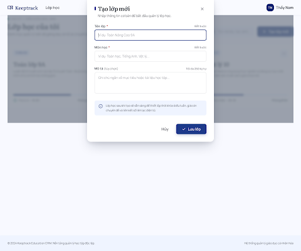
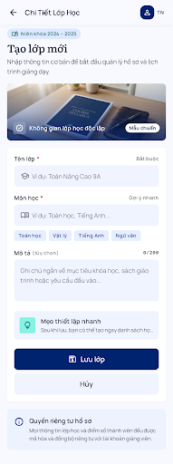

# Rà soát form tạo lớp mới — Ticket #2

**Kết quả hiện hành:** [Rà soát sau chỉnh sửa](Ticket_02_Latest_Review.md). Đã đủ 5 trạng thái tạo lớp desktop/mobile; các khác biệt còn lại được chuyển thành checklist triển khai. Kết luận thiếu mobile lỗi/thành công ở các báo cáo cũ đã được thay thế.

Project: `7871005430122021919`. Ngày: 16/10/2026 theo múi giờ Việt Nam. Đối chiếu: [ticket #2](https://github.com/truongtoanr0602/EducationKeeptrack/issues/2). Báo cáo này cập nhật kết luận “chưa có tạo lớp” trong [lượt trước](Ticket_02_User_Review.md).

## Kết luận hiện tại

Đã có tám màn hình tạo lớp mới, đọc HTML và xem screenshot của tất cả. Desktop đủ năm biến thể mặc định/thiếu thông tin/đang lưu/lưu lỗi/thành công. Mobile có ba biến thể mặc định/thiếu thông tin/đang lưu; chưa tìm thấy bản lưu lỗi/thành công dành cho mobile trong inventory hiện tại.

Style giữ navy, Literata/Manrope và nền sáng. Form có tên lớp, môn học, mô tả, lưu/hủy; validation hiện ngay dưới trường, trạng thái lưu có disabled trong HTML, lỗi desktop giữ dữ liệu và cho thử lại, thành công desktop trở về danh sách có lớp mới.

Bộ này đủ để xem xét bố cục chính của form, **chưa đủ để đánh dấu toàn bộ thiết kế ticket #2 đã chốt**. Không có xác nhận lưu dữ liệu thật, cô lập giáo viên hoặc chuyển trang end-to-end.

## Inventory mới

| Màn hình | Metadata | HTML | Ảnh | Resource |
| --- | --- | --- | --- | --- |
| Tạo lớp — Desktop (Lưu lỗi) | DESKTOP | [Xem](stitch/user-review-create-class/c4a5952b25e648fe8543f1535eb2cdad.html) | [PNG](stitch/user-review-create-class/c4a5952b25e648fe8543f1535eb2cdad.png) | `projects/7871005430122021919/screens/c4a5952b25e648fe8543f1535eb2cdad` |
| Tạo lớp — Mobile (Thiếu thông tin) | MOBILE | [Xem](stitch/user-review-create-class/8f174cc2909146a1bdc0f20f33289124.html) | [PNG](stitch/user-review-create-class/8f174cc2909146a1bdc0f20f33289124.png) | `projects/7871005430122021919/screens/8f174cc2909146a1bdc0f20f33289124` |
| Tạo lớp — Desktop (Lưu thành công) | DESKTOP | [Xem](stitch/user-review-create-class/ba6e4734d49044478e75771c5578de53.html) | [PNG](stitch/user-review-create-class/ba6e4734d49044478e75771c5578de53.png) | `projects/7871005430122021919/screens/ba6e4734d49044478e75771c5578de53` |
| Tạo lớp — Mobile (Mặc định) | MOBILE | [Xem](stitch/user-review-create-class/086ee4bacc43495287fad20522ce1ccd.html) | [PNG](stitch/user-review-create-class/086ee4bacc43495287fad20522ce1ccd.png) | `projects/7871005430122021919/screens/086ee4bacc43495287fad20522ce1ccd` |
| Tạo lớp — Mobile (Đang lưu) | MOBILE | [Xem](stitch/user-review-create-class/63bbcd7634b9465a8725e7686898bb46.html) | [PNG](stitch/user-review-create-class/63bbcd7634b9465a8725e7686898bb46.png) | `projects/7871005430122021919/screens/63bbcd7634b9465a8725e7686898bb46` |
| Tạo lớp — Desktop (Đang lưu) | DESKTOP | [Xem](stitch/user-review-create-class/91e3cc7b462046b3afda5c3b37cc2592.html) | [PNG](stitch/user-review-create-class/91e3cc7b462046b3afda5c3b37cc2592.png) | `projects/7871005430122021919/screens/91e3cc7b462046b3afda5c3b37cc2592` |
| Tạo lớp — Desktop (Thiếu thông tin) | DESKTOP | [Xem](stitch/user-review-create-class/0086033406bf4aa78d9619901784cfc7.html) | [PNG](stitch/user-review-create-class/0086033406bf4aa78d9619901784cfc7.png) | `projects/7871005430122021919/screens/0086033406bf4aa78d9619901784cfc7` |
| Tạo lớp — Desktop (Mặc định) | DESKTOP | [Xem](stitch/user-review-create-class/07433cf1473b443791e787be23feeade.html) | [PNG](stitch/user-review-create-class/07433cf1473b443791e787be23feeade.png) | `projects/7871005430122021919/screens/07433cf1473b443791e787be23feeade` |

## Điểm cần sửa

| Mức | Quan sát trực tiếp | Yêu cầu khi hoàn thiện |
| --- | --- | --- |
| Cần sửa | Mẫu desktop và mobile thêm niên khóa, khối lớp, sĩ số, lịch tuần, trạng thái giảng dạy, giáo án hoặc “đồng bộ điểm số/điểm danh” | Giữ đúng ticket #2: tên, môn, mô tả; thẻ mới chỉ ba thông tin này. Không đưa chi tiết tự sinh thành yêu cầu được duyệt |
| Cần sửa | Ba HTML mobile có user-scalable=no và maximum-scale=1.0 | Cho phép zoom; kiểm tra viewport thật và vùng chạm, không chỉ dựa metadata MOBILE |
| Cần thống nhất | Mô tả desktop mặc định maxlength=250, mobile mặc định maxlength=200; các bản khác có nhãn giới hạn khác/không có maxlength | Chọn một giới hạn cho API và UI khi triển khai. Spec chưa duyệt số cụ thể; có thể bỏ giới hạn hiển thị khỏi mockup đến khi chốt |
| Cần thống nhất | Header mobile ghi “Chi Tiết Lớp Học”, các trạng thái đổi nhãn thành “Hồ sơ lớp học”/“Bộ môn”/“Mục tiêu” | Dùng “Tạo lớp mới”, “Tên lớp”, “Môn học”, “Mô tả (tùy chọn)” nhất quán ở cả hai thiết bị |
| Cần bổ sung/kiểm tra | Chưa thấy mobile lưu lỗi/thành công | Bổ sung hai biến thể hoặc xác minh bố cục dùng chung đáp ứng ở điện thoại |
| Cần sửa | Mobile đang lưu hiển thị 75% và thông báo tạo giáo án/danh sách/điểm danh | Dùng tiến độ không xác định “Đang lưu...” nếu chưa có dữ liệu tiến độ thật; không hứa tính năng ngoài phạm vi |
| Còn mở | Màn hình đăng nhập vẫn resource 15a5fb831ea64c77917157b55c0a65e7 | Hoàn thiện đăng nhập cùng style, bỏ/xác nhận OAuth, dùng thử, hotline và AES-256 theo lượt rà trước; cần trạng thái sai thông tin/hết phiên/loading |

## Phạm vi đã kiểm tra và chưa kiểm tra

- Đã đọc inventory gồm 14 UI HTML và một ảnh minh họa: tám bản tạo lớp, năm bản danh sách và một đăng nhập cũ.
- Đã tải HTML/PNG của tám bản mới; xem ảnh và kiểm tra tĩnh nhãn, viewport, giới hạn nhập, disabled và trạng thái.
- Chưa chạy UI trong trình duyệt để chứng minh focus, contrast, chuyển trang, responsive, giữ dữ liệu sau tải lại hoặc quyền truy cập. Những kiểm thử này thực hiện khi dựng ứng dụng.
- Không sửa Stitch, không thay nghiệp vụ hoặc trạng thái GitHub trong lần rà này. Các màn hình mới là thiết kế cần xem xét, không tự coi đã được duyệt chỉ vì người dùng đã tạo xong.
- Các quyết định công nghệ/xác thực, giới hạn input và nghiệp vụ bổ sung vẫn cần ghi nhận khi bắt đầu triển khai; không cần sinh lại mọi màn hình chỉ để chứng minh có API.

## Preview form mặc định

