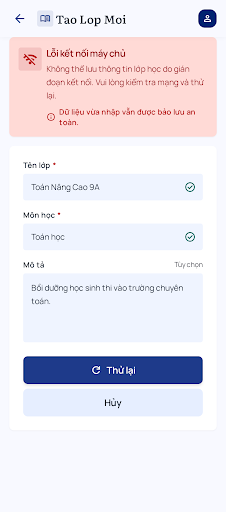
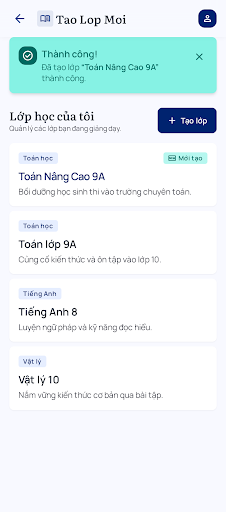

# Ticket #2 — Kết quả kiểm tra sau chỉnh sửa

Ngày: 16/10/2026 (Việt Nam). Project: `7871005430122021919`. Nguồn: [ticket #2](https://github.com/truongtoanr0602/EducationKeeptrack/issues/2).

## Kết luận

Đã có đủ năm trạng thái tạo lớp cho cả desktop và mobile: mặc định, thiếu thông tin, đang lưu, lưu lỗi, thành công. Hai bản mobile lưu lỗi/thành công mới đã được tải và xem screenshot; bản thành công hiện danh sách có lớp mới, bản lỗi giữ dữ liệu và nút thử lại. Đã đọc lại HTML cả mười bản tạo lớp và hai bản đăng nhập tinh gọn xuất hiện trong inventory hiện tại.

**Có thể chuyển sang chốt công nghệ và chuẩn bị triển khai ticket #2 dựa trên bộ mẫu này.** Những khác biệt dưới đây là checklist cần xử lý khi xây UI; không cần một vòng sinh lại toàn bộ thiết kế. Kết luận này không tự đánh dấu thiết kế đã được người dùng duyệt hoặc tính năng đã hoàn thành.

## Các bản đã đọc lại

| Màn hình | Metadata | HTML | Resource |
| --- | --- | --- | --- |
| Tạo lớp — Desktop (Lưu lỗi) | DESKTOP | [Xem](stitch/create-class-recheck/c4a5952b25e648fe8543f1535eb2cdad.html) | `projects/7871005430122021919/screens/c4a5952b25e648fe8543f1535eb2cdad` |
| Tạo lớp — Desktop (Đang lưu) | DESKTOP | [Xem](stitch/create-class-recheck/91e3cc7b462046b3afda5c3b37cc2592.html) | `projects/7871005430122021919/screens/91e3cc7b462046b3afda5c3b37cc2592` |
| Đăng nhập — Bản tinh gọn | DESKTOP | [Xem](stitch/create-class-recheck/c7f4efa4627b497c9ab9173a5ef95118.html) | `projects/7871005430122021919/screens/c7f4efa4627b497c9ab9173a5ef95118` |
| Tạo lớp — Mobile (Thành công) | MOBILE | [Xem](stitch/create-class-recheck/0b4741a108a04797ade9006ea4bd3394.html) | `projects/7871005430122021919/screens/0b4741a108a04797ade9006ea4bd3394` |
| Tạo lớp — Mobile (Đang lưu) | MOBILE | [Xem](stitch/create-class-recheck/63bbcd7634b9465a8725e7686898bb46.html) | `projects/7871005430122021919/screens/63bbcd7634b9465a8725e7686898bb46` |
| Tạo lớp — Desktop (Mặc định) | DESKTOP | [Xem](stitch/create-class-recheck/07433cf1473b443791e787be23feeade.html) | `projects/7871005430122021919/screens/07433cf1473b443791e787be23feeade` |
| Tạo lớp — Mobile (Thiếu thông tin) | MOBILE | [Xem](stitch/create-class-recheck/8f174cc2909146a1bdc0f20f33289124.html) | `projects/7871005430122021919/screens/8f174cc2909146a1bdc0f20f33289124` |
| Tạo lớp — Mobile (Lưu lỗi) | MOBILE | [Xem](stitch/create-class-recheck/7dc46fc360ea4f12aacfb67d7327246d.html) | `projects/7871005430122021919/screens/7dc46fc360ea4f12aacfb67d7327246d` |
| Tạo lớp — Desktop (Thiếu thông tin) | DESKTOP | [Xem](stitch/create-class-recheck/0086033406bf4aa78d9619901784cfc7.html) | `projects/7871005430122021919/screens/0086033406bf4aa78d9619901784cfc7` |
| Tạo lớp — Desktop (Lưu thành công) | DESKTOP | [Xem](stitch/create-class-recheck/ba6e4734d49044478e75771c5578de53.html) | `projects/7871005430122021919/screens/ba6e4734d49044478e75771c5578de53` |
| Tạo lớp — Mobile (Mặc định) | MOBILE | [Xem](stitch/create-class-recheck/086ee4bacc43495287fad20522ce1ccd.html) | `projects/7871005430122021919/screens/086ee4bacc43495287fad20522ce1ccd` |
| Đăng nhập — Mobile Ticket #2 | DESKTOP | [Xem](stitch/create-class-recheck/3521c44b24d447a9ae360f70daf9f202.html) | `projects/7871005430122021919/screens/3521c44b24d447a9ae360f70daf9f202` |
| Tạo lớp — Mobile Ticket #2 | DESKTOP | [Xem](stitch/create-class-recheck/6df79c7ac54540d2a14554a70b6d39ed.html) | `projects/7871005430122021919/screens/6df79c7ac54540d2a14554a70b6d39ed` |

## Thay đổi so với lần trước

- Đã bổ sung mobile lưu lỗi `7dc46fc360ea4f12aacfb67d7327246d` và thành công `0b4741a108a04797ade9006ea4bd3394`.
- Mobile mặc định và validation đã cho phép zoom; mobile đang lưu `63bbcd7634b9465a8725e7686898bb46` vẫn tắt zoom trong HTML.
- Form chính đã bỏ nhiều lời hứa đồng bộ và các trường tự thêm; desktop thành công không còn lịch trên thẻ lớp.
- Inventory hiện trả cả các bản agent tạo trước đây, trong đó có đăng nhập tinh gọn desktop/mobile. Không dùng kết quả inventory cũ để kết luận không có đăng nhập tinh gọn nữa.
- Hai bản đăng nhập tinh gọn vẫn có bảng QA; chúng chỉ là tài liệu đối chiếu form/trạng thái, không phải màn hình sản phẩm nguyên trạng.

## Checklist khi xây UI thật

- [ ] Màn hình đăng nhập chỉ form Tài khoản/Mật khẩu và hành động đã chọn; bỏ bảng QA, mã ticket, version giả và nội dung ngoài spec. Không tự triển khai OAuth/dùng thử từ bản đăng nhập cũ.
- [ ] Tạo lớp dùng tên trường nhất quán: Tên lớp, Môn học, Mô tả (tùy chọn); đổi “Chi Tiết Lớp Học”, “Bộ môn”, “Mục tiêu” và “Tao Lop Moi” thành nội dung đúng ngữ cảnh có dấu.
- [ ] Chốt một giới hạn mô tả và dùng chung API/UI; hiện HTML mặc định vẫn có maxlength desktop 250, mobile 200 dù nhãn giới hạn đã bỏ.
- [ ] Bật zoom cho mọi trạng thái, gồm mobile đang lưu; kiểm tra vùng chạm, focus, contrast và layout ở 390px.
- [ ] Nền phía sau modal desktop chỉ dùng danh sách lớp chuẩn, không lấy niên khóa, thống kê sĩ số, lịch, mã tự tạo hoặc số liệu mẫu tự thêm vào ứng dụng.
- [ ] Đang lưu dùng spinner, không tiến độ giả; disable hành động có thể gửi trùng, xử lý hủy theo trạng thái yêu cầu thật.
- [ ] Lỗi giữ dữ liệu hiện tại trên form; không hứa dữ liệu đã được lưu bền vững nếu chưa có cơ chế tương ứng.
- [ ] Thành công chỉ xuất hiện sau API lưu thành công; về danh sách và tải lại vẫn có lớp; lỗi/phiên hết hạn thể hiện đúng.
- [ ] Xác thực và quyền sở hữu kiểm tra từ server; hai giáo viên không đọc/sửa dữ liệu của nhau bằng ID trực tiếp.

## Giới hạn kiểm tra

Kiểm tra lần này gồm đọc inventory/HTML và xem screenshot của các trạng thái mới, đang lưu mobile và thành công desktop. Chưa chạy ứng dụng, không xác nhận responsive thực, API, database hoặc bảo mật. Giữ các bản cũ làm lịch sử; các ID trên là nguồn đối chiếu, không phải quyết định chọn mọi bản để triển khai. Không sửa Stitch hoặc GitHub trong lần rà này.

## Preview hai trạng thái mới

