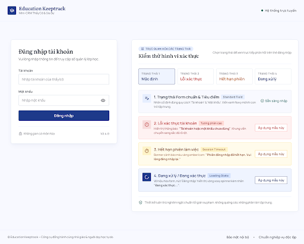
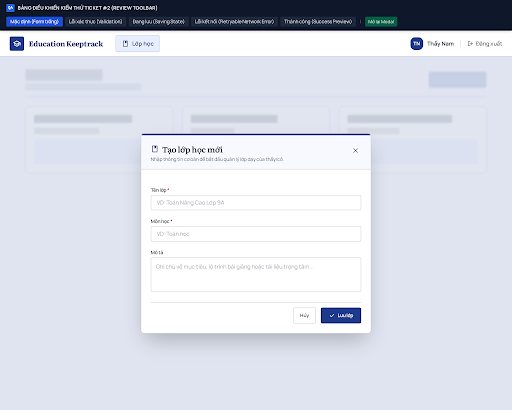
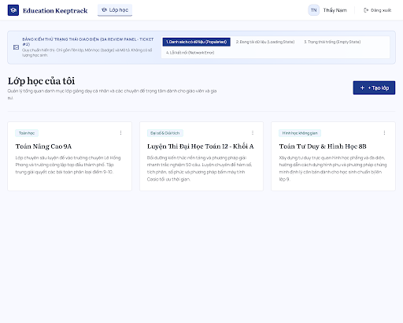
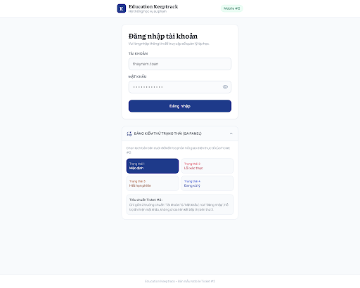
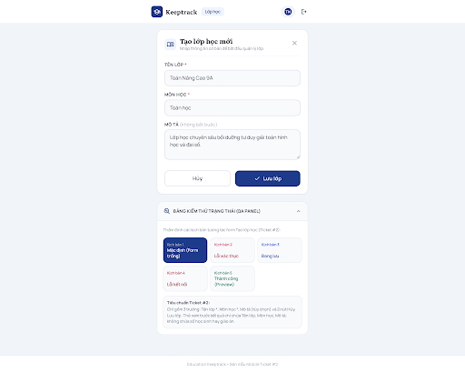
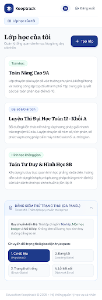

# Ticket #2 — Bộ bản nháp giao diện để duyệt

**Rà soát mới nhất sau người dùng cập nhật:** [Ticket_02_User_Review.md](Ticket_02_User_Review.md). Có năm bản danh sách mới; đăng nhập cũ còn nội dung ngoài spec và chưa tìm thấy form tạo lớp mới trong inventory. Các bộ preview trước được giữ làm lịch sử, không tự coi đã được duyệt.

Project Stitch: `7871005430122021919`. Ngày: 16/10/2026. Phạm vi: đăng nhập → danh sách lớp → tạo lớp; các file HTML là prototype độc lập, chưa nối API hoặc lưu dữ liệu thật.

## Danh sách bản hiện hành

| Màn hình | Bố cục dự kiến | Metadata Stitch | Xem HTML | Ảnh | Resource màn hình |
| --- | --- | --- | --- | --- | --- |
| Đăng nhập — Bản tinh gọn | DESKTOP | DESKTOP | [HTML](stitch/ticket-02/c7f4efa4627b497c9ab9173a5ef95118.html) | [PNG](stitch/ticket-02/c7f4efa4627b497c9ab9173a5ef95118.png) | `projects/7871005430122021919/screens/c7f4efa4627b497c9ab9173a5ef95118` |
| Tạo lớp học mới — Ticket #2 | DESKTOP | DESKTOP | [HTML](stitch/ticket-02/55c9e18305074f929063120c7f62b07d.html) | [PNG](stitch/ticket-02/55c9e18305074f929063120c7f62b07d.png) | `projects/7871005430122021919/screens/55c9e18305074f929063120c7f62b07d` |
| Lớp học của tôi — Ticket #2 (Chuẩn hóa) | DESKTOP | DESKTOP | [HTML](stitch/ticket-02/4cd5615371394dfe966ebb79fb4953ff.html) | [PNG](stitch/ticket-02/4cd5615371394dfe966ebb79fb4953ff.png) | `projects/7871005430122021919/screens/4cd5615371394dfe966ebb79fb4953ff` |
| Đăng nhập — Mobile Ticket #2 | MOBILE | DESKTOP | [HTML](stitch/ticket-02/3521c44b24d447a9ae360f70daf9f202.html) | [PNG](stitch/ticket-02/3521c44b24d447a9ae360f70daf9f202.png) | `projects/7871005430122021919/screens/3521c44b24d447a9ae360f70daf9f202` |
| Tạo lớp — Mobile Ticket #2 | MOBILE | DESKTOP | [HTML](stitch/ticket-02/6df79c7ac54540d2a14554a70b6d39ed.html) | [PNG](stitch/ticket-02/6df79c7ac54540d2a14554a70b6d39ed.png) | `projects/7871005430122021919/screens/6df79c7ac54540d2a14554a70b6d39ed` |
| Lớp học của tôi — Mobile Ticket #2 (Chuẩn hóa) | MOBILE | MOBILE | [HTML](stitch/ticket-02/187fb6e36da14b63bfbbde4d3ffdfa95.html) | [PNG](stitch/ticket-02/187fb6e36da14b63bfbbde4d3ffdfa95.png) | `projects/7871005430122021919/screens/187fb6e36da14b63bfbbde4d3ffdfa95` |

## Những gì đã kiểm tra

- Đã tải HTML và xem screenshot của cả sáu bản; có nhãn tiếng Việt, viewport cho zoom và các mẫu trạng thái trong HTML.
- Đăng nhập có form trung tính Tài khoản/Mật khẩu, hiện/ẩn và mẫu sai thông tin/hết phiên/đang xác thực. Không còn OAuth, dùng thử, hotline hoặc tuyên bố AES-256 trong bản tinh gọn.
- Danh sách có mẫu có dữ liệu/đang tải/rỗng/lỗi và xác nhận đăng xuất; thẻ lớp chỉ tên/môn/mô tả, đã bỏ giáo án và niên khóa tự thêm.
- Tạo lớp có tên/môn/mô tả, lưu/hủy và mẫu thiếu trường/đang lưu/lỗi/thành công. Thanh chọn trạng thái chỉ phục vụ duyệt prototype, không phải thành phần sản phẩm.

## Giới hạn phải giữ rõ

- Các bản đều ở trạng thái **bản nháp cần người dùng duyệt**, không phải thiết kế đã phê duyệt hoặc ticket đã hoàn thành.
- Hai bản có tên Mobile (đăng nhập/tạo lớp) trả metadata DESKTOP và ảnh canvas rộng; HTML có container hẹp, nhưng chưa chạy kiểm thử responsive tại 390px. Không dùng tên màn hình làm bằng chứng đã kiểm tra mobile.
- Chưa kiểm thử tương tác trong trình duyệt, focus bằng bàn phím, toàn bộ kích thước vùng chạm hoặc độ tương phản. Chưa chứng minh liên kết chuyển trang xuyên sáu prototype; trạng thái là mô phỏng độc lập.
- HTML còn tải font/icon/Tailwind từ bên ngoài, nên cần mạng để xem đúng. Khi triển khai phải thay mô phỏng bằng API, xác thực thật và kiểm tra quyền hai giáo viên.
- `get_screen` đọc được các ID desktop mới nhưng `list_screens`/canvas project chưa liệt kê chúng tại lần kiểm tra sau tạo; bản local bảo toàn nội dung để duyệt. Không khẳng định tất cả bản đã xuất hiện trên canvas.
- Lượt sinh mobile đầu trả lỗi 503; sau kiểm tra không thấy kết quả, đã chuyển sang thích ứng từ các màn hình desktop bằng `edit_screens`, không gửi lại cùng lượt sinh thất bại.
- Các bản desktop trung gian còn trong thư mục để đối chiếu; bảng trên xác định sáu bản hiện hành, không dùng bản cũ thay bản chuẩn hóa.

## Xem nhanh

### Đăng nhập — Bản tinh gọn

### Tạo lớp học mới — Ticket #2

### Lớp học của tôi — Ticket #2 (Chuẩn hóa)

### Đăng nhập — Mobile Ticket #2

### Tạo lớp — Mobile Ticket #2

### Lớp học của tôi — Mobile Ticket #2 (Chuẩn hóa)

