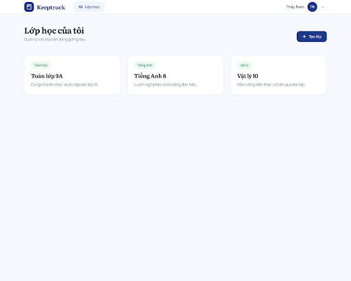
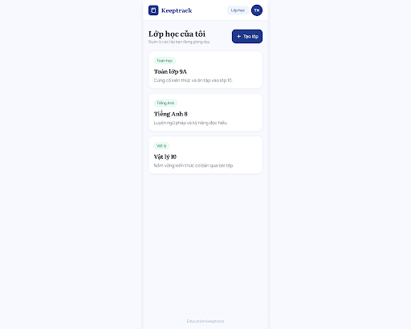

# Rà soát thiết kế người dùng cập nhật — Ticket #2

**Kết quả hiện hành:** [Rà soát sau chỉnh sửa](Ticket_02_Latest_Review.md). Đã đủ 5 trạng thái tạo lớp desktop/mobile; các khác biệt còn lại được chuyển thành checklist triển khai. Kết luận thiếu mobile lỗi/thành công ở các báo cáo cũ đã được thay thế.

**Cập nhật mới nhất:** [Rà soát form tạo lớp](Ticket_02_Create_Class_Review.md): đã có tám bản tạo lớp. Kết luận chưa có form trong báo cáo trước đã được thay thế; còn cần sửa nội dung ngoài phạm vi, zoom/giới hạn mô tả và hoàn thiện đăng nhập.

Ngày kiểm tra: 16/10/2026, múi giờ Việt Nam. Project: `7871005430122021919`. Nguồn đối chiếu: [ticket #2](https://github.com/truongtoanr0602/EducationKeeptrack/issues/2), [spec](../Technical_Spec_EducationKeeptrack.md).

## Kết luận

Danh sách lớp mới phù hợp phạm vi và phong cách của project: navy, nền sáng, accent xanh ngọc, Literata cho tiêu đề và Manrope cho nội dung. Có năm bản mới cho danh sách, gồm desktop/mobile/các trạng thái, và không đưa bảng QA vào sản phẩm.

**Chưa đủ bộ thiết kế ticket #2:** danh sách hiện tại chưa có form tạo lớp mới hoặc đăng nhập tinh gọn. Bản đăng nhập vẫn là mẫu cũ với nội dung ngoài spec. Đây là đánh giá thiết kế, không xác nhận người dùng đã duyệt tất cả mẫu hoặc tính năng đã triển khai.

## Inventory hiện có trên project

Đã đọc project, danh sách màn hình, tải và đọc HTML, xem screenshot của sáu màn hình UI. Ngoài ra còn một ảnh minh họa không có HTML. Các ID mới đều có instance trên project; không cần dựa vào các bản prototype do agent tạo trước đó để nhận biết thiết kế người dùng vừa cập nhật.

| Màn hình | Resource name | Metadata | HTML | Screenshot |
| --- | --- | --- | --- | --- |
| Lớp học của tôi — Mobile (Thực tế) | `projects/7871005430122021919/screens/ff2404a1e79e42938b30c864dd5779c7` | DESKTOP | [Xem](stitch/user-review-ticket-02/ff2404a1e79e42938b30c864dd5779c7.html) | [Ảnh](stitch/user-review-ticket-02/ff2404a1e79e42938b30c864dd5779c7.png) |
| Lớp học của tôi — Đang tải (Loading Skeleton) | `projects/7871005430122021919/screens/ffff15e01e0940c8aa2448386af39732` | DESKTOP | [Xem](stitch/user-review-ticket-02/ffff15e01e0940c8aa2448386af39732.html) | [Ảnh](stitch/user-review-ticket-02/ffff15e01e0940c8aa2448386af39732.png) |
| Đăng nhập - Education Keeptrack | `projects/7871005430122021919/screens/15a5fb831ea64c77917157b55c0a65e7` | MOBILE | [Xem](stitch/user-review-ticket-02/15a5fb831ea64c77917157b55c0a65e7.html) | [Ảnh](stitch/user-review-ticket-02/15a5fb831ea64c77917157b55c0a65e7.png) |
| Lớp học của tôi — Tải lỗi (Error State) | `projects/7871005430122021919/screens/bb1dc84896db4ea1b02ba97764072e58` | DESKTOP | [Xem](stitch/user-review-ticket-02/bb1dc84896db4ea1b02ba97764072e58.html) | [Ảnh](stitch/user-review-ticket-02/bb1dc84896db4ea1b02ba97764072e58.png) |
| Lớp học của tôi — Chưa có lớp (Empty State) | `projects/7871005430122021919/screens/8c8984f6742d429e933e86aaf6c70281` | DESKTOP | [Xem](stitch/user-review-ticket-02/8c8984f6742d429e933e86aaf6c70281.html) | [Ảnh](stitch/user-review-ticket-02/8c8984f6742d429e933e86aaf6c70281.png) |
| Lớp học của tôi — Desktop (Thực tế) | `projects/7871005430122021919/screens/879d049abdf14b0abb7c940d008314a0` | DESKTOP | [Xem](stitch/user-review-ticket-02/879d049abdf14b0abb7c940d008314a0.html) | [Ảnh](stitch/user-review-ticket-02/879d049abdf14b0abb7c940d008314a0.png) |

## Đối chiếu tiêu chí thiết kế

| Nội dung | Kết quả | Bằng chứng/giới hạn |
| --- | --- | --- |
| Danh sách lớp desktop | Có | Ba thẻ mẫu, tên/môn/mô tả; nút tạo lớp và menu giáo viên |
| Danh sách lớp mobile | Có bản bố cục hẹp | HTML giới hạn thân trang 390px; metadata vẫn DESKTOP và screenshot canvas rộng; chưa kiểm thử viewport thực |
| Danh sách rỗng | Có bản riêng | Lời nhắc và nút tạo lớp đầu tiên |
| Đang tải | Có bản riêng | Skeleton cùng cấu trúc thẻ lớp |
| Tải lỗi | Có bản riêng | Thông báo và nút thử lại |
| Style nhất quán | Phù hợp phần danh sách | Literata/Manrope, navy #1E3A8A, nền sáng, badge xanh; bo góc mềm hơn mẫu cũ |
| Không có bảng QA/nội dung kỹ thuật | Đạt ở năm bản danh sách mới | Trạng thái tách thành các màn hình riêng |
| Nội dung thẻ đúng phạm vi | Đạt | Không sĩ số, phí, niên khóa, giáo án hoặc tiến độ tự thêm |
| Đăng xuất | Có mẫu menu và modal | HTML xác nhận chỉ hiện alert, không chuyển trang hoặc kết thúc phiên thật; chưa là hành vi ứng dụng |
| Đăng nhập tinh gọn desktop/mobile | Chưa có trong inventory hiện tại | Project vẫn liệt kê màn hình cũ 15a5...; các bản agent trước đây chỉ giữ làm lịch sử, không tự chọn thay thiết kế mới |
| Form tạo lớp desktop/mobile | Chưa tìm thấy trong inventory hiện tại | Nút tạo lớp mới chưa có xử lý tạo/form liên kết trong HTML đã kiểm tra |
| Tên/môn/mô tả và trạng thái tạo lớp | Chưa kiểm tra được | Cần form mới, trạng thái thiếu trường, đang lưu, lưu lỗi và thành công |
| Lưu/tải lại và cô lập dữ liệu giáo viên | Ngoài khả năng chứng minh bằng mẫu | Chưa có tích hợp API/backend; phải nghiệm thu khi triển khai |

## Các điểm cần hoàn thiện

1. **Tạo lớp:** thiết kế form tên lớp, môn học, mô tả; lưu/hủy; lỗi trường bắt buộc, đang lưu, lưu lỗi/thử lại và thành công. Giữ header, typography và màu giống bộ danh sách mới. Có bản desktop/mobile.
2. **Đăng nhập:** thiết kế lại theo style danh sách, có bình thường/đang xử lý/sai tài khoản/phiên hết hạn. Cách xác thực chưa chốt nên dùng nhãn Tài khoản trung tính khi chưa chọn phương thức cụ thể.
3. **Nội dung ngoài spec trên mẫu đăng nhập cũ:** Google login, email/số điện thoại, ghi nhớ/quên mật khẩu chưa được quyết định; dùng thử 30 ngày, hotline 1900 6828 và tuyên bố AES-256 chưa có căn cứ phê duyệt. Không đưa những nội dung này vào hợp đồng triển khai chỉ vì chúng có trong mẫu.
4. **Trợ năng:** mẫu đăng nhập cũ dùng lang=en và tắt zoom. Các bản danh sách mới dùng lang=vi và cho zoom; menu avatar mobile có w-9/h-9 (36px), cần tăng vùng chạm tối thiểu 44px. Kiểm tra focus, contrast và responsive trước duyệt cuối.
5. **Phạm vi mobile:** mới có bản có dữ liệu dành cho mobile. Rỗng/loading/error đang là bản desktop; cần xác minh cùng layout hoạt động ở 390px hoặc bổ sung biến thể mobile nếu chưa đáp ứng.

## Cách sử dụng kết quả

- Dùng năm màn hình danh sách mới làm ứng viên tham chiếu cho phần danh sách của ticket #2; cần người dùng duyệt trước khi coi là thiết kế đã chốt.
- Bản cũ ở [Ticket_02_Preview.md](Ticket_02_Preview.md) được giữ làm lịch sử, không tự ghép các bản agent đã bị người dùng đánh giá chưa ổn vào bộ mới.
- Chưa tạo/sửa màn hình Stitch trong lượt rà soát, chưa sửa GitHub issue hoặc đánh dấu ticket hoàn thành.
- Không có yêu cầu triển khai mới phát sinh từ các chi tiết mẫu. Sau khi có tạo lớp và đăng nhập phù hợp, rà lại bộ thiết kế trước chốt công nghệ/triển khai.

## Preview danh sách desktop mới

## Preview bố cục danh sách mobile mới

