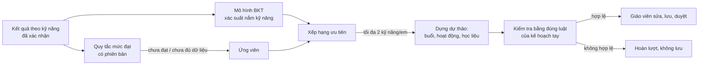

# Cá nhân hoá lớp học bằng AI: cơ chế và đánh giá

Tài liệu này mô tả phần AI của tính năng **gợi ý kế hoạch ôn tập tuần** (UC-AI-04 trong [Kich_ban_AI_thong_nhat.md](../Kich_ban_AI_thong_nhat.md)). AI chấm bài từ ảnh đang tạm dừng và không thuộc phạm vi này. Số liệu đánh giá nằm ở [danh-gia-mo-hinh.md](danh-gia-mo-hinh.md), do `tools/MlEval` sinh ra.

## 1. Vấn đề và cách chia việc

Giáo viên có kết quả theo kỹ năng của từng học sinh và cần chọn tối đa hai kỹ năng ưu tiên mỗi em, rồi xếp học liệu vào các buổi ôn trong quỹ phút có hạn. Việc này tốn thời gian và dễ thiên lệch về những em nổi bật.

Nguyên tắc chia việc (BR trong tài liệu kịch bản): **mọi quyết định tính được bằng quy tắc thì hệ thống tự tính; mô hình chỉ xếp thứ tự và đề xuất; giáo viên duyệt.**



- **Quy tắc vẫn là thẩm quyền** về "đạt": mô hình không đổi kết luận của quy tắc, chỉ xếp hạng trong các kỹ năng quy tắc chưa cho là đạt.
- **Mô hình chỉ đọc dữ liệu đã được giáo viên xác nhận.** Kết quả chưa xác nhận không vào mô hình.

## 2. Mô hình học máy: Bayesian Knowledge Tracing (BKT)

Mỗi cặp (học sinh, kỹ năng) có một trạng thái ẩn: **biết** hoặc **chưa biết**. Mỗi lần đánh giá gồm *n* nhiệm vụ, đúng *k*. Tham số của kỹ năng:

| Tham số | Ý nghĩa | Mặc định |
|---|---|---|
| PInit | xác suất đã biết trước lần đầu | 0,30 |
| PLearn | xác suất chuyển từ chưa biết sang biết giữa hai lần | 0,20 |
| PGuess | xác suất đúng một nhiệm vụ khi chưa biết | 0,20 |
| PSlip | xác suất sai một nhiệm vụ khi đã biết | 0,10 |

Số câu đúng là quan sát nhị thức: tỉ lệ đúng là `1 − PSlip` nếu biết và `PGuess` nếu chưa biết. Với xác suất biết trước lần đánh giá là `p`:

```text
L_biết   = Binomial(k; n, 1 − PSlip)
L_chưabiết = Binomial(k; n, PGuess)
p_sau    = p · L_biết / ( p · L_biết + (1 − p) · L_chưabiết )     # cập nhật Bayes
p_kế     = p_sau + (1 − p_sau) · PLearn                            # chuyển trạng thái học
```

Xác suất đúng kỳ vọng ở lần sau là `p_kế · (1 − PSlip) + (1 − p_kế) · PGuess`. Mã nguồn: [KnowledgeTracing.cs](../../src/Modules/Learning/Domain/Mastery/KnowledgeTracing.cs).

**Học tham số.** `KnowledgeTracing.Fit` cực đại hoá log-likelihood bằng đệ quy tiến (forward) và tìm kiếm toạ độ trên lưới; đoán và nhầm bị chặn ở 0,40 để trạng thái "biết" còn nghĩa là tốt hơn đoán mò. Dự án chỉ học tham số riêng khi lớp có ít nhất 100 lịch sử kỹ năng có từ hai lần đánh giá (`ReviewPlanService.MinSequencesToFit`), vì đánh giá ngoại tuyến không thấy lợi ích của việc học (mục 5). Ngược lại thì dùng tham số mặc định.

## 3. Xếp hạng ưu tiên và dựng kế hoạch

[SkillPriority.cs](../../src/Modules/Learning/Domain/Mastery/SkillPriority.cs): với kỹ năng **chưa đạt hoặc chưa đủ dữ liệu** theo quy tắc,

```text
điểm = 0,60 · (1 − p)  +  0,25 · 4p(1 − p)  +  0,15 · min(1, số ngày từ lần đánh giá cuối / 28)
        khoảng cách        độ bất định          độ cũ
```

Khoảng cách ưu tiên kỹ năng còn xa mức đạt; độ bất định cao nhất khi `p ≈ 0,5` (một kết quả mới cho nhiều thông tin nhất); độ cũ nhắc kỹ năng lâu không kiểm tra. Kỹ năng chưa có kết quả được tính độ cũ tối đa. Hai điểm bằng nhau xếp theo mã kỹ năng để kết quả ổn định.

[PlanDrafter.cs](../../src/Modules/Learning/Domain/Mastery/PlanDrafter.cs) dựng dự thảo:

1. Lấy tối đa hai kỹ năng điểm cao nhất mỗi học sinh làm mục tiêu.
2. Mỗi buổi ôn, mỗi học sinh làm đúng một mục tiêu (xoay vòng), nên tổng phút của em trong buổi không vượt quỹ phút.
3. Học sinh cùng mục tiêu trong một buổi dùng chung một hoạt động.
4. Học liệu chỉ lấy từ kho **đã duyệt** và đúng kỹ năng; độ khó theo mức nắm: dưới 0,40 chọn cơ bản, dưới 0,75 chọn vừa, còn lại chọn nâng cao. Không có học liệu vừa quỹ phút thì để trống và ghi rõ để giáo viên chọn.

Sau khi dựng, [ReviewPlanService.DraftAsync](../../src/Modules/Learning/Application/ReviewPlanService.cs) cho dự thảo qua **đúng `PlanRules.Normalize` mức duyệt** như kế hoạch lập tay (tối đa hai kỹ năng, chỉ kỹ năng đã dạy, học liệu đã duyệt đúng kỹ năng, có lý do và cách kiểm tra lại). Không hợp lệ thì loại, không lưu.

## 4. Chỗ cắm mô hình ngôn ngữ và quyền riêng tư

`IPlanExplainer` là điểm duy nhất để một mô hình ngôn ngữ viết lý do và cách kiểm tra lại của mục tiêu. Hiện dùng `TemplatePlanExplainer` (câu mẫu từ các con số của mô hình), nên chưa cần nhà cung cấp ngoài. Một explainer dùng LLM chỉ được gửi dữ liệu trong `GoalFacts` (mã kỹ năng, tên kỹ năng, xác suất, số lần, trạng thái, ngưỡng), **không gửi tên hay liên hệ học sinh** (BR-AI-13). Nó không chọn kỹ năng, học liệu hay số phút, nên đổi explainer không đổi hình dạng kế hoạch (BR-AI-15).

## 5. Hạn mức, API và giao diện

- `POST /api/learning/classes/{classId}/review-plans/draft` với `weekStart` (thứ Hai) và tuỳ chọn `sessions`, `requestKey`. Trả về `content` (để sửa), `model` (tên, explainer, nguồn tham số, tham số) và `trace` (xác suất và điểm của từng ứng viên, kỹ năng nào được chọn). Dự thảo **không tự lưu**.
- Mỗi lần gọi thành công tốn **1 lượt kế hoạch** của kỳ. Thứ tự: kiểm tra đầu vào và dựng dự thảo, giữ lượt, kiểm tra luật, chốt lượt. Lỗi hoặc dự thảo không hợp lệ thì hoàn lượt; không có gì để ôn thì từ chối mà không giữ lượt.
- Giao diện: màn kế hoạch ôn tập có nút **Gợi ý bằng AI** và phần "Vì sao AI chọn các kỹ năng này" liệt kê xác suất và điểm ưu tiên.

## 6. Kết quả đánh giá ngoại tuyến

Dữ liệu thật quá ít để huấn luyện hay kiểm thử (lớp thí điểm có một, hai học sinh), nên mô hình được đánh giá trên **học sinh mô phỏng** có sự thật ẩn đã biết, với hai bộ sinh: một đúng giả định BKT và một sai giả định (năng lực liên tục, có quên). Chi tiết, độ lệch chuẩn trên 30 hạt giống và hạn chế: [danh-gia-mo-hinh.md](danh-gia-mo-hinh.md). Chạy lại bằng:

```powershell
dotnet run --project tools/MlEval -c Release -- docs/ml/danh-gia-mo-hinh.md 30
```

Những gì kết quả **hỗ trợ**:

- Dự đoán kết quả lần sau, BKT cho xác suất **được hiệu chỉnh tốt hơn** các cách đơn giản: log loss 0,49 so với 0,68 (lần gần nhất) và 0,90 (trung bình) ở bộ đúng giả định; hơn nữa quy tắc mức đạt hiện tại chỉ có AUC 0,72 vì chỉ cho ba nhóm rời rạc.
- Chọn hai kỹ năng yếu trong tám: quy tắc kết hợp xếp hạng BKT đạt precision@2 khoảng 0,72 so với 0,31 khi chọn ngẫu nhiên và 0,51 khi chỉ lọc bằng quy tắc, ở bộ đúng giả định.

Những gì kết quả **không hỗ trợ** (nêu thẳng để không nói quá):

- **Về thứ hạng (AUC), BKT chỉ ngang** "lần gần nhất" (0,862 so với 0,858), trong phạm vi độ lệch chuẩn. Ưu thế đo được là về hiệu chỉnh xác suất, không phải thứ hạng.
- **Học tham số không giúp** ở mọi cỡ mẫu thử (5 đến 200 lịch sử) và khi dữ liệu sai giả định còn làm nhiệm vụ chọn kỹ năng kém đi (0,897 so với 0,980). Vì vậy mặc định không học tham số.
- Ở bộ sai giả định, nhiều phương pháp đơn giản đạt gần như ngang BKT ở nhiệm vụ chọn kỹ năng (0,98). Chưa chạy kiểm định thống kê ghép cặp.
- Chưa đo tác động của kế hoạch lên kết quả học sinh thật.

## 7. Hạn chế đã biết và hướng phát triển

- **Mô hình hai trạng thái quá cứng.** Học sinh nắm một phần (ví dụ đúng khoảng 65%) có thể bị BKT cho là "gần chắc đã biết" vì tỉ lệ đó gần mức `1 − PSlip` hơn mức `PGuess`. Phần giải thích đã được sửa để không in ra mâu thuẫn với quy tắc, nhưng xếp hạng vẫn bị ảnh hưởng. Hướng: mô hình liên tục (Beta-Binomial theo kỹ năng, hoặc IRT có tham số độ khó), so với BKT bằng chính `tools/MlEval`.
- **Dữ liệu phản hồi chưa được dùng.** Kế hoạch lưu việc thực hiện (hoàn thành, một phần, chưa làm, vắng) và bằng chứng trước và sau của từng mục tiêu. Đó là tín hiệu thưởng tự nhiên để học xem loại học liệu hay mức độ nào hiệu quả (bài toán bandit ngữ cảnh), khi lớp có đủ dữ liệu.
- **Trọng số xếp hạng (0,60/0,25/0,15) chọn thủ công**, chưa được tinh chỉnh bằng dữ liệu hay phân tích độ nhạy.
- **Chưa có nhà cung cấp LLM.** Explainer mẫu là chỗ cắm; khi có, cần đo chất lượng văn bản, chống bịa dữ kiện (BR-AI-18) và ghi nhận nhà cung cấp và model cho từng lượt (BR-AI-13).
